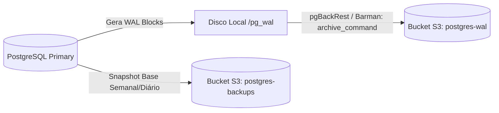

# 📊 Estudo de Arquitetura: Escalabilidade, Alta Disponibilidade e Recuperação do PostgreSQL

> **Plataforma:** SCIA — Scientific Collaboration and Intelligent Assistance (`sci-latex-vscode`)  
> **Tema:** Especificação técnica de persistência, modelo de fencing de posse, mitigação de concorrência, integridade cruzada e Disaster Recovery (DR)  
> **Data de Atualização:** 28 de Outubro de 2026 (Revisão Técnica Consolidada)  
> **Status:** Especificação Arquitetural de Referência & Critérios de Aceite  

---

## 📑 Sumário

1. [Fundamentos & Modelo Conceitual](#1-fundamentos--modelo-conceitual)
   - 1.1. [Por que PostgreSQL e MinIO no SCIA?](#11-por-que-postgresql-e-minio-no-scia)
   - 1.2. [Contratos de Comportamento sob Falhas (Matriz PACELC Prática)](#12-contratos-de-comportamento-sob-falhas-matriz-pacelc-prática)
   - 1.3. [O Motor Colaborativo: Coordenação via @codemirror/collab (OT)](#13-o-motor-colaborativo-coordenação-via-codemirrorcollab-ot)
2. [Fencing de Posse, Concorrência e RPO Real no Editor](#2-fencing-de-posse-concorrência-e-rpo-real-no-editor)
   - 2.1. [O Cenário de Falha do Pod Zumbi](#21-o-cenário-de-falha-do-pod-zumbi)
   - 2.2. [Protocolo de Fencing Atômico em Duas Etapas](#22-protocolo-de-fencing-atômico-em-duas-etapas)
   - 2.3. [Ciclo de Recuperação e Reconciliação pelo Cliente CodeMirror](#23-ciclo-de-recuperação-e-reconciliação-pelo-cliente-codemirror)
   - 2.4. [Delimitação Técnica dos Objetivos de RPO](#24-delimitação-técnica-dos-objetivos-de-rpo)
3. [Dimensionamento e Gerenciamento de Conexões (PgBouncer & Prisma)](#3-dimensionamento-e-gerenciamento-de-conexões-pgbouncer--prisma)
   - 3.1. [Topologia de Porta Dupla: Runtime vs. Migrações](#31-topologia-de-porta-dupla-runtime-vs-migrações)
   - 3.2. [Parâmetros Reais da Stack (Prisma v7 + @prisma/adapter-pg)](#32-parâmetros-reais-da-stack-prisma-v7--prismaadapter-pg)
   - 3.3. [Metodologia Empírica de Dimensionamento do Pool](#33-metodologia-empírica-de-dimensionamento-do-pool)
4. [Durabilidade Cruzada e Recuperação de Desastres (Postgres + MinIO)](#4-durabilidade-cruzada-e-recuperação-de-desastres-postgres--minio)
   - 4.1. [Saga de 3 Estados para Uploads de Objetos Binários](#41-saga-de-3-estados-para-uploads-de-objetos-binários)
   - 4.2. [Rotina de Reconciliação Bidirecional (Postgres ⟷ MinIO)](#42-rotina-de-reconciliação-bidirecional-postgres--minio)
   - 4.3. [Point-in-Time Recovery (PITR) com Arquivamento Contínuo de WALs](#43-point-in-time-recovery-pitr-com-arquivamento-contínuo-de-wals)
   - 4.4. [Isolamento de Domínio de Falha (Backups Off-site)](#44-isolamento-de-domínio-de-falha-backups-off-site)
5. [Alta Disponibilidade (HA), Failover e Idempotência](#5-alta-disponibilidade-ha-failover-e-idempotência)
   - 5.1. [Topologia CloudNativePG e Isolamento Físico](#51-topologia-cloudnativepg-e-isolamento-físico)
   - 5.2. [Mecanismos de Eleição vs. Quórum de Replicação](#52-mecanismos-de-eleição-vs-quórum-de-replicação)
   - 5.3. [Tratamento de In-Doubt Commits e Idempotência na Aplicação](#53-tratamento-de-in-doubt-commits-e-idempotência-na-aplicação)
6. [Diretrizes de Integridade Relacional e Otimizações Tardias](#6-diretrizes-de-integridade-relacional-e-otimizações-tardias)
   - 6.1. [Políticas Estritas de Deleção: Imutabilidade de AuditLog](#61-políticas-estritas-de-deleção-imutabilidade-de-auditlog)
   - 6.2. [Critérios Reais para Introdução de Réplicas de Leitura](#62-critérios-reais-para-introdução-de-réplicas-de-leitura)
   - 6.3. [Critérios Reais para Particionamento Declarativo](#63-critérios-reais-para-particionamento-declarativo)
7. [Matriz Consolidada de Decisões Arquiteturais](#7-matriz-consolidada-de-decisões-arquiteturais)
8. [Matriz de Testes de Aceite Automatizados (T01 a T10)](#8-matriz-de-testes-de-aceite-automatizados-t01-a-t10)

---

## 1. Fundamentos & Modelo Conceitual

### 1.1. Por que PostgreSQL e MinIO no SCIA?

O SCIA **não é apenas um editor web de texto**, mas um sistema integrado de governança acadêmica e publicação científica:
* **Escopo Relacional (`schema.prisma`):** Ciclos de submissão (`AcademicPeriod`), etapas Gantt com marcos *gatekeeper* (`ProjectStage`), fluxo de bate-e-volta de tarefas (`Task`), deliberações de patentes e propriedade intelectual (`NitProcess`), rodadas de avaliação por pares (`ReleaseCandidate`) e trilha institucional de auditoria (`AuditLog`).
* **Integridade ACID Nativa:** Constraints exclusivas compostas (`@@unique([projectId, path])`, `@@unique([userId, projectId])`) e tipos enumerados estritos garantem consistência estrutural no banco, sem depender de validações na aplicação.
* **Modelo Híbrido com `JSONB`:** O PostgreSQL fornece suporte maduro a documentos semiestruturados com índices GIN, atendendo a metadados variáveis de compilação sem perder o rigor relacional das entidades canônicas.
* **Desacoplamento Estrito de Binários:** O PostgreSQL armazena apenas metadados e conteúdo textual (.tex e .bib). Binários pesados (PDFs gerados, imagens 300 DPI, arquivos ZIP de templates) são delegados ao **MinIO** (S3-compatible), preservando o I/O e a memória compartilhada de buffer (`shared_buffers`) do SGBD.

### 1.2. Contratos de Comportamento sob Falhas (Matriz PACELC Prática)

Em vez de tratar as siglas do Teorema de PACELC como propriedades místicas pré-adquiridas, o SCIA define **contratos explícitos de comportamento sob falhas**:

```
┌──────────────────────────────────────────────────────────────────────────────────────────────────┐
│                                 CONTRATOS DE COMPORTAMENTO OPERACIONAL                           │
├────────────────────────┬──────────────────────────────────────────┬──────────────────────────────┤
│ Cenário de Operação    │ Módulo de Governança e NIT               │ Editor Colaborativo          │
├────────────────────────┼──────────────────────────────────────────┼──────────────────────────────┤
│ **Operação Normal**    │ Transações ACID imediatas no PostgreSQL  │ Digitação otimista local no  │
│ *(Else)*               │ com latência aceitável de 20–80 ms.      │ CodeMirror 6 (< 16 ms) e     │
│                        │                                          │ sequenciamento em memória.   │
├────────────────────────┼──────────────────────────────────────────┼──────────────────────────────┤
│ **Partição de Rede /** │ Rejeita operações que não possam obter   │ O cliente bloqueia edição    │
│ **Desconexão**         │ confirmação imediata do Primary;         │ canônica, retém deltas em    │
│ *(Partition)*          │ previne bifurcações de aprovações.       │ buffer local e exibe status. │
├────────────────────────┼──────────────────────────────────────────┼──────────────────────────────┤
│ **Recuperação de**     │ Valida chaves de idempotência para       │ Rebase automático de deltas  │
│ **Conexão**            │ evitar duplicações por retentativas.     │ pendentes sobre a nova versão│
│                        │                                          │ canônica do documento.       │
└────────────────────────┴──────────────────────────────────────────┴──────────────────────────────┘
```

### 1.3. O Motor Colaborativo: Coordenação via @codemirror/collab (OT)

O editor colaborativo do SCIA implementa **estritamente `@codemirror/collab`**, baseado no modelo de autoridade centralizada e Transformação Operacional (OT) com sequenciamento de versões inteiras no Node.js (ADR-007).

* **Atenção sobre Validade Sintática LaTeX:** Nenhum algoritmo de colaboração (seja OT ou CRDT) garante que estados intermediários de digitação concorrente formem um documento LaTeX sintaticamente válido.
* **Desacoplamento da Compilação:** A compilação é tratada como um processo assíncrono executado sob demanda sobre um snapshot durável e estável registrado no banco, nunca sobre cada caractere em trânsito.

---

## 2. Fencing de Posse, Concorrência e RPO Real no Editor

### 2.1. O Cenário de Falha do Pod Zumbi

O editor distribui a posse de documentos ativos entre Pods no Kubernetes utilizando leases no Redis com **TTL de 15 segundos** (`editor:document:<projectId>:owner`), renovado a cada **2 segundos** via heartbeat do Pod dono, com trava de autodefesa em **8 segundos** (conforme calibrado na **ADR-007.1**).

**A anatomia do problema:**
1. O **Pod A** possui a posse do documento sob a geração `104`.
2. O Pod A entra em uma pausa de Garbage Collection (GC) ou sofre partição de rede temporária por 16 segundos.
3. O lease expira no Redis. O **Pod B** adquire o lease com a nova geração incrementada `105`.
4. O Pod A "acorda". Se o Pod A tentar persistir alterações antes ou sem que o banco saiba que a geração `104` foi revogada, ele sobrescreveria o documento com um estado obsoleto.

### 2.2. Protocolo de Fencing Atômico em Duas Etapas

No schema do SCIA (`backend/prisma/schema.prisma`), os campos de controle de concorrência e posse (`currentVersion` e `ownerGeneration`) residem na entidade canônica **`Project`** (o artigo como um todo), enquanto o texto reside em **`ProjectFile`** (`main.tex` e secundários).

Para neutralizar o risco de zumbis, a autoridade de fencing **deve ser estabelecida duravelmente na tabela `Project` antes que o novo proprietário processe gravações**:

```mermaid
sequenceDiagram
    autonumber
    participant Redis as Redis Lease
    participant PodB as Novo Dono (Pod B)
    participant PG as PostgreSQL (Project & ProjectFile)
    participant PodA as Pod Zumbi (Pod A)

    PodB->>Redis: Adquire Lease (INCR generation -> 105)
    Note over PodB,PG: Etapa 1: Handshake de Posse no Banco
    PodB->>PG: UPDATE "Project" SET ownerGeneration = 105 WHERE id = :projectId AND ownerGeneration < 105
    PG-->>PodB: Rows affected: 1 (Posse confirmada)
    
    Note over PodA,PG: Tentativa tardia do Pod Zumbi
    PodA->>PG: BEGIN; UPDATE "Project" SET currentVersion=42, ownerGeneration=104 WHERE id=:projectId AND ownerGeneration=104 AND currentVersion=41;
    PG-->>PodA: Rows affected: 0 (REJEITADO! Banco já está em gen 105)
    Note over PodA: Pod A detecta geração revogada, faz rollback e encerra a sala.
```

#### Queries de Persistência Protegida:

1. **Etapa 1: Handshake de Posse (Acionado pelo Pod B ao adquirir o lease no Redis):**
   ```sql
   UPDATE "Project"
   SET "ownerGeneration" = :newGeneration,
       "updatedAt" = NOW()
   WHERE id = :projectId
     AND "ownerGeneration" < :newGeneration;
   ```
   *Se `rows_affected == 0`, o Pod B sabe que outro nó já registrou uma geração superior e aborta imediatamente.*

2. **Etapa 2: Checkpoint Regular do Documento (`prisma.$transaction` atômica):**
   Dentro de uma única transação ACID:
   ```sql
   -- A. Valida posse e versão atômica no Projeto:
   UPDATE "Project"
   SET "currentVersion" = :newVersion,
       "ownerGeneration" = :myGeneration,
       "updatedAt" = NOW()
   WHERE id = :projectId
     AND "ownerGeneration" = :myGeneration
     AND "currentVersion" = :expectedVersion;
   -- Se rows_affected == 0: LANÇA ERRO (Conflito de Fencing / Versão), aborta transaction!

   -- B. Persiste o conteúdo no arquivo correspondente:
   INSERT INTO "ProjectFile" ("id", "projectId", "path", "content", "fileType", "mimeType", "sizeBytes", "updatedAt")
   VALUES (:fileId, :projectId, 'main.tex', :content, 'text', 'text/x-tex', :sizeBytes, NOW())
   ON CONFLICT ("projectId", "path") DO UPDATE
   SET "content" = :content, "sizeBytes" = :sizeBytes, "updatedAt" = NOW();

   -- C. Registra o ponto de restauração histórico:
   INSERT INTO "DocumentSnapshot" ("id", "projectId", "version", "content", "savedBy", "createdAt")
   VALUES (:snapshotId, :projectId, :newVersion, :content, :podAuthor, NOW());
   ```
   *A igualdade estrita (`=`) em `ownerGeneration` bloqueia o Pod antigo; a validação de `currentVersion` impede reordenação de gravações concorrentes.*
### 2.3. Ciclo de Recuperação e Reconciliação pelo Cliente CodeMirror

Rejeitar a gravação do Pod zumbi evita corromper o banco, mas não recupera por si só os deltas que estavam na memória do Pod A. O ciclo de recuperação de ponta a ponta opera conforme abaixo:

```
[1. Banco Rejeita Pod A] ──► [2. Pod A Encerra WS (Code 4409)] ──► [3. Cliente Retém sendableUpdates]
                                                                                │
[5. Cliente Rebaseia & Envia] ◄── [4. Cliente Reconecta ao Pod B e Puxa Versão Canônica]
```

1. **Detecção:** Ao receber `rows_affected == 0`, o Pod A encerra o socket de todos os clientes conectados com o código de aplicação `4409 Fencing Conflict`.
2. **Buffer Local:** O cliente CodeMirror 6 não descarta o texto digitado; as transações não confirmadas permanecem isoladas no array `sendableUpdates(view.state)`.
3. **Reconexão e Rebase:** O navegador reconecta ao Gateway, que o roteia para o Pod B. O Pod B entrega a revisão canônica atual do banco. O cliente executa o `rebaseUpdates` localmente sobre o estado canônico e despacha os deltas pendentes para o Pod B.

### 2.4. Delimitação Técnica dos Objetivos de RPO

É fundamental distinguir o **RPO do estado em voo (memória)** do **RPO de transações confirmadas (PostgreSQL)**:

```
┌─────────────────────────────────┬──────────────────────────────────┬─────────────────────────────┐
│ Camada do Sistema               │ Mecanismo de Durabilidade        │ RPO Alvo sob Falha          │
├─────────────────────────────────┼──────────────────────────────────┼─────────────────────────────┤
│ **Estado em Voo (Memória Pod)** │ Debounce Multi-Critério:         │ Máximo 15s ou 50 operações  │
│                                 │ Idle 3s / MaxWait 15s / 50 ops   │ (apenas em kill -9 do nó).  │
├─────────────────────────────────┼──────────────────────────────────┼─────────────────────────────┤
│ **Encerramento Normal (Pod)**   │ Graceful Shutdown (`SIGTERM`)    │ 0 segundos, condicionado ao │
│                                 │ com flush de salas ativas        │ terminationGracePeriod (30s)│
├─────────────────────────────────┼──────────────────────────────────┼─────────────────────────────┤
│ **Banco de Dados (Postgres)**   │ WAL Archiving contínuo           │ Menor que 5 minutos         │
│                                 │ (pgBackRest / CloudNativePG)     │ (baseado no archive_timeout)│
└─────────────────────────────────┴──────────────────────────────────┴─────────────────────────────┘
```

* **Tratamento de Falha no Checkpoint:** Se o PostgreSQL estiver temporariamente inacessível quando o temporizador de 15 segundos disparar, o Pod **não descarta os deltas**. Ele entra em modo de retenção com backpressure, aplica retentativas com backoff exponencial e emite um alerta operacional antes de atingir o esgotamento de memória.

---

## 3. Dimensionamento e Gerenciamento de Conexões (PgBouncer & Prisma)

### 3.1. Topologia de Porta Dupla: Runtime vs. Migrações

Para viabilizar escalabilidade horizontal com dezenas de pods de aplicação sem exaurir a memória do PostgreSQL por conexões ociosas, adota-se **PgBouncer** com separação explícita de portas:

```
                          ┌──► Porta 6543 (PgBouncer: Transaction Mode) ──► Fastify App (CRUD / Checkpoints)
[ PostgreSQL Cluster ] ───┤
                          └──► Porta 5432 (Conexão Direta ao PostgreSQL)  ──► Prisma Migrate / DDL Scripts
```

1. **Porta 6543 (Runtime / Aplicação):**
   * Modo: *Transaction Pooling*.
   * Uma conexão física com o banco é alugada exclusivamente durante o tempo em que uma transação SQL está executando, retornando ao pool imediatamente após `COMMIT` ou `ROLLBACK`.
2. **Porta 5432 (Migrações / DDL):**
   * Rota direta para operações estruturais (`prisma migrate deploy`, seeds).
   * Migrações de schema utilizam locks de sessão e comandos que não são suportados de forma previsível por pools transacionais.

### 3.2. Parâmetros Reais da Stack (Prisma v7 + @prisma/adapter-pg)

Para a stack exata do projeto (`prisma ^7.10.0`, `@prisma/adapter-pg`, driver `pg` v8 e `PgBouncer 1.21+`):

* **Configuração no `schema.prisma`:**
  ```prisma
  datasource db {
    provider  = "postgresql"
    url       = env("DATABASE_URL") // Porta 6543 (PgBouncer com ?pgbouncer=true)
    directUrl = env("DIRECT_URL")   // Porta 5432 (Conexão direta)
  }
  ```
* **Compatibilidade com Prepared Statements:** No `PgBouncer 1.21+`, quando o parâmetro `max_prepared_statements` está ativado no pooler, o suporte a prepared statements de protocolo é funcional. Caso contrário, o adapter `@prisma/adapter-pg` deve ser inicializado configurando o driver `pg` com prepared statements anônimos para evitar colisões entre transações compartilhadas.

### 3.3. Metodologia Empírica de Dimensionamento do Pool

Não se adota fórmulas estáticas do passado baseadas em discos mecânicos como regra universal de dimensionamento. O dimensionamento do pool obedece ao seguinte processo empírico:

1. **Levantamento do Orçamento Global:**
   $$\text{Conexões Físicas no Postgres} = \text{Pool PgBouncer} + \text{Reservadas Superusuário} + \text{Conexões Diretas Migrações/Monitoramento}$$
2. **Configuração Inicial Conservadora no PgBouncer:**
   * `default_pool_size = 25` conexões físicas para atender os pods de API Fastify.
   * `max_client_conn = 500` conexões virtuais de clientes (absorvendo picos de WebSockets e requisições HTTP).
3. **Métricas de Ajuste Fino (Gatilhos de Reavaliação):**
   * Monitorar a métrica `avg_wait_time` no PgBouncer: se o tempo de espera no pool ultrapassar 5 ms em p95, elevar gradativamente o pool físico;
   * Monitorar o percentual de CPU e saturação de I/O no nó do PostgreSQL durante testes de carga.

---

## 4. Durabilidade Cruzada e Recuperação de Desastres (Postgres + MinIO)

### 4.1. Saga de 3 Estados para Uploads de Objetos Binários (Arquitetura Alvo / Backlog)

O PostgreSQL e o MinIO não compartilham transações distribuídas (2PC). No schema atual, arquivos referenciam strings de `storageKey` ou URLs. Para mitigar o risco de referências fantasmas ou órfãos no S3 em produção de larga escala, a arquitetura alvo especifica uma máquina de estados explícita:

```
                  ┌──────────────────────┐
                  │ 1. PENDING_UPLOAD    │ (Metadados registrados no Postgres com hash SHA-256 e UUID)
                  └──────────┬───────────┘
                             │ (Upload concluído no MinIO com ETag/Checksum verificado)
                             ▼
                  ┌──────────────────────┐
                  │ 2. UPLOADED          │ (Objeto integro no storage; transação de negócio em curso)
                  └──────────┬───────────┘
                             │ (Amarração atômica no banco: ex. ReleaseCandidate publicada)
                             ▼
                  ┌──────────────────────┐
                  │ 3. CONFIRMED         │ (Referência canônica ativa; visível para a aplicação)
                  └──────────────────────┘
```

* **Tratamento de Compensação:** Se o upload no MinIO falhar ou for abortado pelo usuário, a aplicação cancela o registro no banco transicionando-o para `CANCELLED`.
* *Nota de Implementação:* Este modelo será integrado ao Prisma em migração futura dedicada ao storage service.
### 4.2. Rotina de Reconciliação Bidirecional (Postgres ⟷ MinIO)

A integridade do armazenamento cruzado é auditada periodicamente por um job de conciliação assíncrono:

1. **Sentido Postgres $\to$ MinIO (Detecção de Links Quebrados):**
   * Consulta registros com status `CONFIRMED` e verifica a existência do objeto correspondente no MinIO via chamada `HeadObject`.
   * Se o objeto não existir, emite alerta crítico de corrupção de storage para intervenção da equipe.
2. **Sentido MinIO $\to$ Postgres (Limpeza de Órfãos com Carência Segura):**
   * Varre os objetos armazenados no MinIO que não possuam vínculo ativo no banco de dados (cenário pós-PITR ou falha no handshake).
   * **Janela de Carência de 7 Dias:** Objetos órfãos só são excluídos do MinIO se o metadado `LastModified` for superior a 7 dias, garantindo que janelas de recuperação temporal do banco não apaguem arquivos legítimos de auditoria forense.

### 4.3. Point-in-Time Recovery (PITR) com Arquivamento Contínuo de WALs

O plano de recuperação para qualquer segundo dentro da janela de retenção fundamenta-se no arquivamento contínuo de segmentos WAL:



* **Condições Explícitas de Recuperação:** O SCIA suporta recuperação para um instante específico dentro de uma janela de 30 dias **desde que exista um backup base válido anterior ao ponto desejado e a cadeia de segmentos WAL intermediários esteja 100% contínua e íntegra**.
* **Configuração de Tempo de Arquivamento:** O parâmetro `archive_timeout = 300` (5 minutos) força a troca de segmento mesmo em períodos de baixa atividade, delimitando o atraso de arquivamento.

### 4.4. Isolamento de Domínio de Falha (Backups Off-site)

Para que a estratégia de recuperação seja resiliente a desastres de infraestrutura:
* O bucket de armazenamento primário do MinIO e o bucket de arquivamento de WALs **não devem residir no mesmo pool de armazenamento físico ou zona de disponibilidade do cluster PostgreSQL**.
* Os backups e WALs devem possuir replicação assíncrona para uma infraestrutura independente (*off-site*, outra nuvem ou datacenter secundário), com credenciais estritamente separadas e proteção contra exclusão acidental (Object Lock / Immutability).

---

## 5. Alta Disponibilidade (HA), Failover e Idempotência

### 5.1. Topologia CloudNativePG e Isolamento Físico

A infraestrutura oficial de produção adota o operador **CloudNativePG**:
* **Topologia:** Cluster de 3 instâncias (1 Primary + 2 Standby Replicas).
* **Isolamento de Falha Obrigatório:** A configuração do operador deve incluir `podAntiAffinity` com topologia `kubernetes.io/hostname` configurada como `requiredDuringSchedulingIgnoredDuringExecution`. Três pods rodando no mesmo nó físico não oferecem tolerância a falhas de hardware.

### 5.2. Mecanismos de Eleição vs. Quórum de Replicação

É essencial separar a governança de líderes da durabilidade dos dados:
1. **Eleição e Fencing do Primário:** Realizado via primitivas de lease na API do Kubernetes para impedir a coexistência de dois primários (*Split-Brain*).
2. **Durabilidade das Transações:** 
   * Por padrão, a replicação por streaming físico é **assíncrona**. Durante um failover não planejado, existe a possibilidade de commits muito recentes (na casa de milissegundos) não terem sido transmitidos à réplica promovida.
   * O SCIA aceita a replicação assíncrona para priorizar a disponibilidade de escrita, tratando o RPO de failover local como $< 1\text{ segundo}$ em condições normais de rede.

### 5.3. Tratamento de In-Doubt Commits e Idempotência na Aplicação

Durante a janela de failover (~10 a 15 segundos), conexões TCP são encerradas. Se a rede cair no instante exato do commit, a aplicação não sabe se a transação passou.
Para evitar duplicação em retentativas:
1. **Comandos de Governança (Tarefas, Etapas, NIT):** Toda mutação crítica carrega uma chave de idempotência exclusiva (`Idempotency-Key` / `operationId`). Como especificação de arquitetura alvo para o serviço de governança, o banco gravará essa chave em uma tabela de controle transacional (`IdempotencyKey`, pendente de migração no schema):
   ```sql
   INSERT INTO "IdempotencyKey" (id, "actionType", "responsePayload", "createdAt")
   VALUES (:operationId, :action, :payload, NOW())
   ON CONFLICT (id) DO NOTHING;
   ```
   *Se a operação já tiver sido aplicada antes da queda de conexão, o backend reconhece o conflito e retorna o resultado original sem reexecutar a ação de negócio.*
2. **Persistência do Editor:** A cláusula `AND "currentVersion" = :expectedVersion` na tabela `Project` já atua hoje como barreira natural de idempotência: se a gravação anterior passou, a versão subiu de `41` para `42`; a repetição da query é ignorada sem gerar regressão ou erro colateral.
---

## 6. Diretrizes de Integridade Relacional e Otimizações Tardias

### 6.1. Políticas Estritas de Deleção: Imutabilidade de AuditLog

* No schema real do SCIA (`schema.prisma`), a tabela `AuditLog` utiliza uma relação polimórfica desvinculada para entidades (`entityType String`, `entityId String`), e a relação com o usuário opera com `onDelete: SetNull`.
* **Proteção contra Deleção em Cascata:** Como o `AuditLog` não possui Foreign Key direta com `Project` ou `Task`, a exclusão de um projeto ou tarefa **nunca apaga em cascata** o registro de auditoria.
* Caso um usuário seja removido, a chave `userId` é anulada (`SET NULL`), mas o identificador original e o payload completo de auditoria permanecem congelados e imutáveis dentro da coluna `details Json?`, garantindo conformidade regulatória sem violação de LGPD.

### 6.2. Critérios Reais para Introdução de Réplicas de Leitura

Adiar a introdução de *Read Replicas* até que medições objetivas justifiquem a complexidade:
* **Risco Real:** O atraso de sincronização (*Replication Lag*) em réplicas assíncronas gera inconsistência de *Read-Your-Writes* (o usuário conclui uma tarefa e, ao recarregar a tela, a consulta atinge a réplica defasada exibindo a tarefa como pendente).
* **Gatilho de Adoção:** Read Replicas só serão introduzidas quando as métricas de CPU do Primary ultrapassarem **75% de utilização contínua**, com evidência via `pg_stat_statements` de que o gargalo decorre de consultas puramente analíticas (dashboards do Manager e SciAI).

### 6.3. Critérios Reais para Particionamento Declarativo

Adiar o particionamento declarativo de tabelas (`AuditLog`, `DocumentSnapshot`):
* **Restrição Técnica:** No PostgreSQL, tabelas particionadas exigem que a chave de partição faça parte da `PRIMARY KEY` e de todas as constraints `UNIQUE`. Além disso, o Postgres não provê índices globais que unam todas as partições: consultas sem filtro compatível com a chave de partição sofrem sobrecarga ao ter que varrer múltiplas partições.
* **Gatilho de Adoção:** O particionamento só será avaliado quando o tamanho em disco de uma tabela isolada ultrapassar dezenas de gigabytes com impacto mensurável na duração dos comandos de `VACUUM` ou no tempo de planejamento de consultas.

---

## 7. Matriz Consolidada de Decisões Arquiteturais

```
┌──────────────────────────────────────┬────────────────────────┬──────────────────────────────────────────────┐
│ Domínio Técnico                      │ Decisão Arquitetural   │ Mecanismo de Garantia Comprovável            │
├──────────────────────────────────────┼────────────────────────┼──────────────────────────────────────────────┤
│ Motor de Banco Primário              │ PostgreSQL 16          │ Driver @prisma/adapter-pg com pg v8          │
│ Motor Colaborativo do Editor         │ @codemirror/collab(OT) │ Sequenciamento centralizado no Node.js       │
│ Fencing contra Pods Zumbis           │ Handshake + Geração    │ ownerGeneration com igualdade estrita e DB-1º│
│ Concorrência de Arquivos             │ Versionamento Otimista │ WHERE currentVersion = expectedVersion       │
│ Reconciliação do Cliente             │ Rebase Local CodeMirror│ Buffer sendableUpdates mantido em reconexão  │
│ Gestão de Conexões em Escala         │ PgBouncer              │ Transaction Pooling (Porta 6543 App/5432 DDL)│
│ Proteção contra In-Doubt Commits     │ Idempotency Keys       │ Constraints únicas por operação transacional │
│ Integridade de Storage Binário       │ Saga de 3 Estados      │ PENDING -> UPLOADED -> CONFIRMED com Hash    │
│ Trilha de Auditoria Institucional    │ Imutabilidade Legal    │ ON DELETE RESTRICT (Sem Cascades em AuditLog)│
│ Disaster Recovery (PITR)             │ Arquivamento WALs      │ Cadeia contínua de WALs com réplica off-site │
│ Alta Disponibilidade no K8s          │ CloudNativePG          │ 3 nós físicos com podAntiAffinity estrita    │
│ Réplicas de Leitura e Particionamento│ Adiar                  │ Manter simplicidade até evidência em métricas│
└──────────────────────────────────────┴────────────────────────┴──────────────────────────────────────────────┘
```

---

## 8. Matriz de Testes de Aceite Automatizados (T01 a T10)

Para validar na prática as garantias especificadas neste documento, o sistema deve ser homologado contra os seguintes 10 testes de integração e caos:

| ID | Cenário de Falha / Teste | Critério de Aceite Inviolável |
| :--- | :--- | :--- |
| **T01** | Pod antigo retoma após expiração do lease no Redis | Nenhuma gravação da geração antiga é aceita pelo banco (`rows_affected == 0`). |
| **T02** | Duas atualizações concorrentes do mesmo arquivo | O controle de versão otimista barra a segunda; não ocorre regressão de conteúdo. |
| **T03** | PostgreSQL indisponível durante checkpoints | O Pod retém alterações em memória com backpressure; emite alerta sem descartar deltas. |
| **T04** | Queda abrupta de Pod (`kill -9`) durante persistência | A recuperação pelo novo Pod não duplica operações nem corrompe o histórico. |
| **T05** | Primary do PostgreSQL cai após receber transação | A aplicação identifica se a transação comitou via chave de idempotência pós-failover. |
| **T06** | Upload conclui no MinIO, mas gravação no banco falha | O objeto entra no estado pendente e não é apagado prematuramente da carência de 7 dias. |
| **T07** | PITR restaurado para ponto anterior a uploads | A rotina de reconciliação identifica objetos órfãos no MinIO sem quebrar o banco. |
| **T08** | Restauração completa a partir de backup externo off-site | Banco e objetos são recuperados em ambiente isolado cumprindo RTO $< 30\text{ min}$. |
| **T09** | Pool do PgBouncer atinge capacidade máxima | O pooler enfileira requisições com backpressure controlado, sem derrubar o PostgreSQL. |
| **T10** | Failover do PostgreSQL durante atividade colaborativa | Os clientes reconectam ao novo primário; deltas em voo são reconciliados sem perda. |

---
*Documento aprovado como especificação técnica oficial de persistência, resiliência e integridade do SCIA.*
