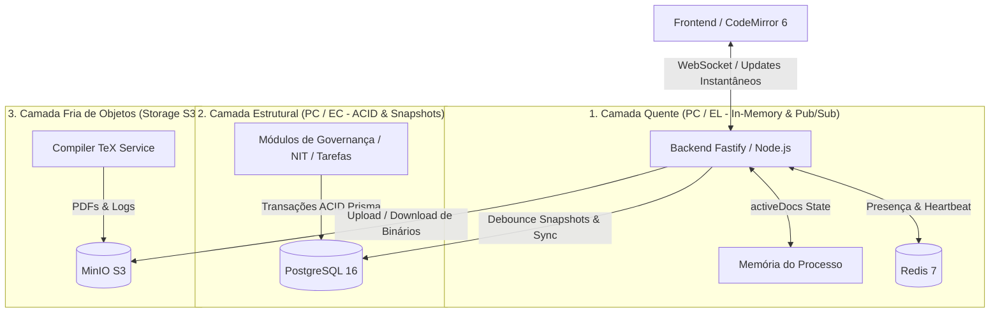
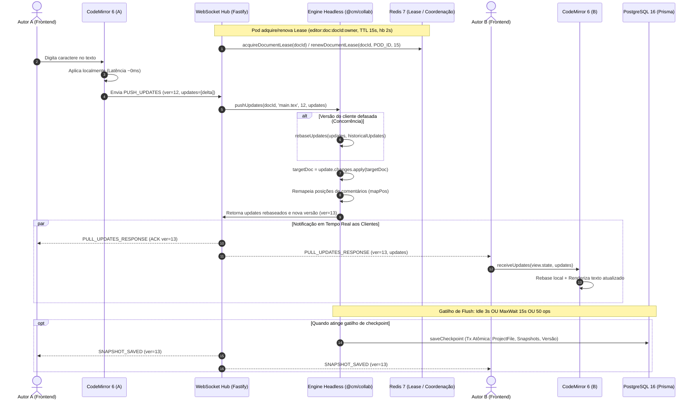

# 📊 Análise Arquitetural: Overleaf (MongoDB) vs. SCIA (PostgreSQL) e Avaliação no Teorema de PACELC

> **Plataforma:** SCIA — Scientific Collaboration and Intelligent Assistance (`sci-latex-vscode`)  
> **Tema:** Estudo comparativo de persistência, avaliação de PACELC e detalhamento técnico do editor colaborativo (Frontend, Backend, Redis e PostgreSQL)  
> **Data:** 24 de Outubro de 2026  
> **Status:** Aprovado / Documento de Referência Arquitetural  

---

## 📑 Sumário

1. [Visão Geral & Contexto da Comparação](#1-visão-geral--contexto-da-comparação)
2. [Por que o Overleaf usa MongoDB? (Contexto Histórico & Arquitetural)](#2-por-que-o-overleaf-usa-mongodb-contexto-histórico--arquitetural)
3. [Por que o SCIA usa PostgreSQL + Redis + MinIO?](#3-por-que-o-scia-usa-postgresql--redis--minio)
4. [Matriz Comparativa Direta](#4-matriz-comparativa-direta)
5. [Avaliação no Teorema de PACELC](#5-avaliação-no-teorema-de-pacelc)
   - 5.1. [O Teorema de PACELC](#51-o-teorema-de-pacelc)
   - 5.2. [Avaliação do Módulo do Editor Colaborativo](#52-avaliação-do-módulo-do-editor-colaborativo)
   - 5.3. [Avaliação dos Módulos de Governança & Publicação](#53-avaliação-dos-módulos-de-governança--publicação)
   - 5.4. [O Diletantismo de CRDTs vs. OT em Código LaTeX](#54-o-diletantismo-de-crdts-vs-ot-em-código-latex)
6. [Arquitetura de Persistência em Três Camadas (A Solução Adotada)](#6-arquitetura-de-persistência-em-três-camadas-a-solução-adotada)
7. [Detalhamento Técnico da Feature do Editor (A Implementação Atual)](#7-detalhamento-técnico-da-feature-do-editor-a-implementação-atual)
   - 7.1. [Frontend: CodeMirror 6, Extensões Modulares e `@codemirror/collab`](#71-frontend-codemirror-6-extensões-modulares-e-codemirrorcollab)
   - 7.2. [Backend: Engine Headless do CodeMirror, WebSockets e Rebase Server-Side](#72-backend-engine-headless-do-codemirror-websockets-e-rebase-server-side)
   - 7.3. [Redis: Buffer de Operações de Alta Frequência, Presença e Pub/Sub](#73-redis-buffer-de-operações-de-alta-frequência-presença-e-pubsub)
   - 7.4. [PostgreSQL: Persistência de Duas Camadas (Two-Tier) com Debounced Checkpoints](#74-postgresql-persistência-de-duas-camadas-two-tier-com-debounced-checkpoints)
   - 7.5. [Diagrama de Sequência: Ciclo de Vida de um Keystroke](#75-diagrama-de-sequência-ciclo-de-vida-de-um-keystroke)
8. [Conclusões & Recomendações](#8-conclusões--recomendações)

---

## 1. Visão Geral & Contexto da Comparação

Ao analisar plataformas colaborativas para escrita científica em LaTeX, uma dúvida recorrente diz respeito à escolha do banco de dados principal:
* **Overleaf (ShareLaTeX):** Utiliza **MongoDB** como repositório primário de metadados e documentos, suportado por Redis.
* **SCIA (`sci-latex-vscode`):** Utiliza **PostgreSQL** como SGBD relacional e transacional, complementado por Redis (tempo real/presença) e MinIO (armazenamento de objetos S3).

Esta análise detalha as razões de engenharia por trás dessas escolhas, as diferenças no escopo de negócio de cada plataforma, a avaliação formal sob a ótica do **Teorema de PACELC** e uma radiografia completa de como nossa arquitetura implementa o **CodeMirror Collab** de ponta a ponta.

---

## 2. Por que o Overleaf usa MongoDB? (Contexto Histórico & Arquitetural)

O Overleaf (especificamente o ShareLaTeX, cuja base de código open-source originou o Overleaf v2) foi desenvolvido entre 2011 e 2013. A adoção do MongoDB deveu-se a fatores de contexto da época e do problema específico que buscavam resolver:

1. **Auge da Stack MEAN & ShareJS:**
   * O ecossistema Node.js na época tinha o MongoDB como parceiro padrão.
   * O motor de Transformação Operacional (OT) adotado originalmente era o **ShareJS** (criado por Joseph Gentle), cujo conector oficial e maduro era o `share-mongo`.
2. **Representação Hierárquica em Documento Único (BSON Tree):**
   * No ShareLaTeX, um projeto inteiro era modelado como um documento JSON/BSON aninhado contendo pastas, arquivos e referências:
     ```json
     {
       "_id": "project_123",
       "name": "Artigo_IEEE",
       "rootFolder": [
         {
           "name": "src",
           "folders": [],
           "docs": [{ "name": "main.tex", "lines": [...] }],
           "fileRefs": [{ "name": "figure.png", "fileStoreId": "..." }]
         }
       ]
     }
     ```
3. **Limitações e Dívidas Técnicas Enfrentadas pelo Overleaf:**
   * **Limite de 16 MB do BSON:** Projetos acadêmicos extensos com muitas figuras, pacotes e histórico esbarravam no limite rígido de tamanho de documento do MongoDB, forçando a fragmentação da arquitetura em microserviços específicos (`docstore`, `filestore`, `document-updater`).
   * **Ausência de Integridade Referencial Nativa:** Na época, o MongoDB não possuía chaves estrangeiras nem transações ACID multi-documento (introduzidas apenas no Mongo 4.0 em 2018). Isso exigiu a implementação manual de travas distribuídas via Redis e rotinas constantes de limpeza para evitar dados e arquivos órfãos.

---

## 3. Por que o SCIA usa PostgreSQL + Redis + MinIO?

O SCIA **não é apenas um editor de texto web**. Ele é uma **plataforma integrada de governança acadêmica e fluxo de publicação científica**.

### Escopo Abrangente do Modelo de Dados (`schema.prisma`):
* **Governança & Ciclos:** Períodos acadêmicos (`AcademicPeriod`), metas institucionais e relatórios.
* **Planejamento:** Cronogramas Gantt de etapas (`ProjectStage`) com marcos *gatekeeper* e tarefas (`Task`).
* **Propriedade Intelectual & Compliance:** Fluxo do Núcleo de Inovação Tecnológica (`NitProcess`) com protocolos e deliberações de patente.
* **Fluxo Editorial & Revisão:** Submissão a conferências alvo/backup (`SubmissionStatus`), rodadas formais de avaliação por pares com candidatos a release (`ReleaseCandidate`).
* **Auditoria Estrita:** Tabela de trilha de auditoria (`AuditLog`) para conformidade institucional.

### Vantagens do PostgreSQL no SCIA:
1. **Integridade Referencial Forte (ACID):** Chaves estrangeiras, `ON DELETE CASCADE` e constraints únicas compostas (`@@unique([projectId, path])`, `@@unique([userId, projectId])`) eliminam o risco de inconsistências relacionais ou arquivos duplicados na mesma rota.
2. **Flexibilidade Híbrida com `JSONB`:** Metadados variáveis de compilação ou payloads de auditoria são armazenados no tipo `Json` nativo do Postgres com suporte a índices GIN, provendo as vantagens do modelo de documentos sem perder o rigor relacional.
3. **Desacoplamento de Blobs Pesados:** O banco armazena apenas metadados e conteúdos de texto. Binários pesados (PDFs compilados, imagens 300 DPI, arquivos ZIP de templates) são delegados ao **MinIO**, evitando a degradação de I/O do banco.

---

## 4. Matriz Comparativa Direta

| Dimensão | Overleaf (MongoDB + Redis) | SCIA (PostgreSQL + Redis + MinIO) | Impacto Arquitetural |
| :--- | :--- | :--- | :--- |
| **Escopo do Sistema** | Editor web de LaTeX com compilação. | Gestão de publicação acadêmica + Editor integrado. | O SCIA necessita de modelagem relacional rigorosa para etapas e NIT. |
| **Integridade de Dados** | Consistência eventual tratada na aplicação. | ACID nativo com Foreign Keys e Constraints estritas. | Zero registros órfãos de tarefas, membros ou arquivos no SCIA. |
| **Estrutura de Arquivos** | Árvore aninhada BSON (limite de 16 MB). | Tabela relacional indexada `ProjectFile` (`projectId, path`). | Previne corrupção por tamanho excessivo de projeto. |
| **Arquivos Binários** | Filestore interno / GridFS / S3. | MinIO dedicado (S3-compatible). | Desonera o SGBD de I/O de blobs pesados em ambos os casos. |
| **Edição em Tempo Real** | ShareJS/OT via Redis + MongoDB. | CodeMirror 6 Collab + Memória ativa (`activeDocs`) + Redis Pub/Sub. | Digitação em alta frequência não onera o banco de dados. |
| **Evolução de Schema** | Schema-less (migrações manuais por scripts). | Prisma Migrations fortemente tipadas e versionadas. | Rastreabilidade total de alterações de banco em CI/CD. |

---

## 5. Avaliação no Teorema de PACELC

### 5.1. O Teorema de PACELC

O Teorema de PACELC estende o clássico Teorema CAP (Eric Brewer) para cenários onde o sistema opera normalmente sem falhas de partição de rede:

$$\text{Se } \mathbf{P} \text{ (Partição de Rede): Escolha entre } \mathbf{A} \text{ (Disponibilidade) ou } \mathbf{C} \text{ (Consistência)}$$
$$\mathbf{E} \text{ (Else / Operação Normal): Escolha entre } \mathbf{L} \text{ (Baixa Latência) ou } \mathbf{C} \text{ (Consistência Estrita)}$$

---

### 5.2. Avaliação do Módulo do Editor Colaborativo

Ao isolar o módulo do **Editor Colaborativo de Texto** (`backend/src/modules/documents/`), a análise técnica do PACELC revela:

```
                               ┌── [P]artição de Rede ───> [C]onsistency (Autoridade Canônica)
                               │
[Editor Colaborativo LaTeX] ───┤
                               │
                               └── [E]lse (Normal) ──────> [L]atency (Digitação Otimista Local)
```

#### 1. Em Operação Normal (**Else**): Escolhemos **Latency (L)**
* **Justificativa:** Na experiência de digitação, qualquer atraso superior a 50 ms degrada a percepção do usuário. Aguardar uma transação de banco com *write-ahead log* e `fsync` a cada tecla inviabilizaria o editor.
* **Implementação:** O editor adota aplicação otimista local imediata no CodeMirror 6 no cliente, enquanto os deltas operacionais são processados em memória (`activeDocs` no Node.js) e propagados via WebSocket. A persistência em disco é assíncrona e debounced.

#### 2. Em Partição de Rede (**Partition**): Escolhemos **Consistency (C)**
* **Justificativa:** Em documentos científicos em LaTeX, a consistência da versão canônica é estritamente prioritária sobre a escrita offline desenfreada.
* **Implementação:** O servidor mantém a autoridade do sequenciamento de versão (`version`, `rebaseUpdates`). Se um cliente se desconectar, a interface exibe status de reconexão e retém as alterações em buffer, impedindo bifurcações descontroladas do histórico.

> **Classificação PACELC do Editor:** **PC / EL**  
> *(Na partição de rede, preserva a Consistência da versão canônica; em operação normal, prioriza a Latência da digitação via otimismo local e memória).*

---

### 5.3. Avaliação dos Módulos de Governança & Publicação

Em contraste direto com o editor, os módulos organizacionais (`AcademicPeriod`, `NitProcess`, `ReleaseCandidate`, `Task`) possuem requisitos de negócios diametralmente opostos:

* **Em Operação Normal (Else):** **Consistency (C)**. A confirmação de aprovação de um artigo no NIT ou submissão à conferência IEEE deve ser imediatamente consistente e durável via transação ACID. Latências de 20 a 100 ms são plenamente aceitáveis.
* **Em Partição de Rede (Partition):** **Consistency (C)**. Jamais pode ocorrer divisão de split-brain que permita aprovação concorrente contraditória de uma patente ou duplicação de versão de submissão.

> **Classificação PACELC da Governança:** **PC / EC**  
> *(O padrão canônico de bancos relacionais tradicionais como PostgreSQL).*

---

### 5.4. O Diletantismo de CRDTs vs. OT em Código LaTeX

Poder-se-ia argumentar pela adoção de arquiteturas puramente orientadas à **Disponibilidade na Partição (PA)** através de CRDTs (*Conflict-free Replicated Data Types*, como Yjs ou Automerge), permitindo escrita offline irrestrita.

No entanto, no domínio de documentos **LaTeX**, essa abordagem introduz graves riscos semânticos:
1. **Fragilidade Sintática do TeX:** O compilador LaTeX não tolera inconsistências estruturais (ex: `\begin{equation}` intercalado sem fechamento correspondente).
2. **Convergência Matemática vs. Validade de Compilação:** CRDTs garantem que os caracteres converjam identicamente em todos os nós, mas **não garantem que o texto resultante seja sintaticamente compilável**.
3. **Conclusão:** O modelo baseado em Transformação Operacional (OT) com autoridade centralizada (**PC / EL**) é mais previsível e seguro para LaTeX, reduzindo significativamente o risco de quebras sintáticas invisíveis durante a colaboração.

---

## 6. Arquitetura de Persistência em Três Camadas (A Solução Adotada)

Para acomodar simultaneamente os requisitos de **PC/EL** (Editor) e **PC/EC** (Governança) sem gargalos, o SCIA implementa uma arquitetura em camadas bem definidas:



---

## 7. Detalhamento Técnico da Feature do Editor (A Implementação Atual)

Com as recentes melhorias de engenharia introduzidas no repositório, o editor colaborativo foi estruturado sobre quatro pilares altamente coordenados: **Frontend**, **Backend**, **Redis** e **PostgreSQL**.

```
┌──────────────────────────────────────────────────────────────────────────────────┐
│                         ARQUITETURA COMPLETA DO EDITOR                           │
├────────────────────────┬────────────────────────┬───────────────┬────────────────┤
│  Frontend (Browser)    │  Backend (Node/Fastify)│  Redis 7      │  PostgreSQL 16 │
├────────────────────────┼────────────────────────┼───────────────┼────────────────┤
│ - CodeMirror 6         │ - Engine @cm/collab    │ - Buffer Ops  │ - ProjectFile  │
│ - collabPushPlugin     │ - activeDocs (Memory)  │ - Pub/Sub     │ - Document     │
│ - collabSyncFacet      │ - rebaseUpdates()      │ - Presença    │   Snapshot     │
│ - remoteCursorsField   │ - WebSocket Hub        │ - Locks       │ - Project      │
│ - commentsExtension    │ - Multi-file Collab    │   Efêmeros    │ - AuditLog     │
│ - Tab State Cache      │ - Debounce Checkpoint  │               │                │
└────────────────────────┴────────────────────────┴───────────────┴────────────────┘
```

---

### 7.1. Frontend: CodeMirror 6, Extensões Modulares e `@codemirror/collab`

A experiência do editor no cliente (`frontend/src/features/editor/`) foi construída sobre a moderna arquitetura orientada a extensões do **CodeMirror 6**:

#### A. Arquitetura Modular com Compartments
No componente `CodeMirrorEditor.tsx`, extensões dinâmicas são isoladas em instâncias de `Compartment`:
* `themeCompart`: Alternância atômica entre temas Claro e Escuro sem desmontar a árvore DOM do editor.
* `spellcheckCompart` & `grammarLinterCompart`: Integração assíncrona com corretores gramaticais e de ortografia com debounce de 800 ms.
* `linterCompart`: Parser de erros de compilação TeX (`parseLatexCompilerError`) com exibição de diagnósticos na calha (*gutter*).
* `editorConfigCompart`: Ajustes em tempo real de tamanho de fonte, altura de linha e cursor sem piscar (*non-blinking cursor*).

#### B. Implementação do `@codemirror/collab` no Cliente
O fluxo de colaboração em tempo real opera de maneira desacoplada através de duas primitivas customizadas:
1. **`collabSyncFacet` (`collabExtension.ts`):** Faceta do CodeMirror que expõe ao editor callbacks para obter a versão sincronizada atual, ID do cliente, arquivo ativo e despachar deltas.
2. **`collabPushPlugin` (`collabExtension.ts`):** `ViewPlugin` que monitora as transações do editor (`update.docChanged`). Quando detecta que a alteração foi gerada localmente pelo usuário (`!isRemoteChange()`):
   * Invoca `sendableUpdates(view.state)` para extrair transações pendentes de confirmação.
   * Obtém a versão canônica conhecida via `getSyncedVersion(view.state)`.
   * Serializa as alterações para JSON estruturado via `u.changes.toJSON()`.
   * Envia o pacote via WebSocket sob o tipo `PUSH_UPDATES`:
     ```typescript
     socket.send(JSON.stringify({
       type: 'PUSH_UPDATES',
       file: activeFile,
       version: syncedVersion,
       updates: jsonUpdates
     }));
     ```
3. **Recepção de Atualizações Remotas (`receiveUpdates`):**
   * Ao receber a mensagem `PULL_UPDATES_RESPONSE` do servidor, o frontend desserializa as alterações usando `ChangeSet.fromJSON(u.changes)`.
   * Aplica as alterações no editor local com `view.dispatch(receiveUpdates(view.state, parsedUpdates))`.
   * O motor interno do CodeMirror faz o **rebase local imediato** de qualquer caractere que o usuário tenha digitado enquanto a resposta da rede trafegava, garantindo zero travamento ou sobrescrita do cursor.

#### C. Cursores Remotos e Comentários Dinâmicos
* **Cursores Remotos (`remoteCursorsExtension.ts`):** Os cursores de outros autores são renderizados como decorações flutuantes (`CursorWidget`), exibindo bandeiras com o nome e a cor atribuída pelo servidor. Quando outro autor digita, suas posições de seleção e cursor são recalculadas automaticamente.
* **Comentários de Revisão Ancorados (`commentsExtension.ts`):** Os trechos destacados com comentários (`ReviewComment`) utilizam a API `changes.mapPos(comment.from, 1)`. Quando novos parágrafos são inseridos ou removidos acima do comentário, as marcações descem ou sobem no texto sem perder a ancoragem exata da sentença revisada.
* **Cache de Estado entre Abas (`editorStateCache.ts`):** Ao alternar entre `main.tex`, `references.bib` ou arquivos `.sty`, o estado do CodeMirror é preservado integralmente em cache, mantendo histórico de *undo/redo*, cursores e dobras de código intactos.

---

### 7.2. Backend: Engine Headless do CodeMirror, WebSockets e Rebase Server-Side

Diferente de abordagens tradicionais que usam bibliotecas heterogêneas no servidor, o backend do SCIA (`backend/src/modules/documents/`) roda **a própria engine oficial do `@codemirror/collab` e `@codemirror/state` dentro do Node.js**.

#### A. Gerenciador WebSocket (`documents.websocket.ts`)
* Rota dedicada: `/ws/documents/:documentId`.
* **Salas em Memória (`documentRooms`):** Agrupa os sockets conectados por ID de documento.
* **Paleta de Cores Dinâmica:** Atribui cores de alto contraste (`USER_COLORS`) aos autores garantindo que dois colaboradores simultâneos não recebam a mesma cor.
* **Roteamento de Eventos:** Trata eventos de `PUSH_UPDATES`, `PULL_UPDATES`, `CURSOR_MOVE`, adição e resolução de comentários.

#### B. Engine Headless e Rebase Server-Side (`documents.service.ts`)
O serviço mantém em memória o estado quente de todos os documentos ativos através de uma estrutura `activeDocs`:
```typescript
export interface ActiveDocState {
  content: string;
  doc: Text;                                // Representação em árvore do CodeMirror 6
  version: number;                          // Versão sequencial canônica
  updates: Update[];                        // Histórico de atualizações do arquivo principal
  filesCollab: Map<string, ActiveFileCollab>; // Suporte a múltiplos arquivos concorrentes
  opSeq: number;
  pendingOps: number;
  debounceTimer?: NodeJS.Timeout;
  lastAuthor: string;
  onSnapshotSaved?: (snapshot: DocumentSnapshot) => void;
}
```

#### C. O Algoritmo de Resolução de Conflitos (`rebaseUpdates`)
Quando um cliente submete um lote de atualizações via `pushUpdates`:
1. O backend verifica a versão em que o cliente se baseou (`clientVersion`).
2. Se `clientVersion < targetUpdates.length`, significa que outro autor gravou alterações antes da chegada deste pacote.
3. O servidor extrai o histórico concorrente e executa a transformação operacional através do algoritmo nativo do CodeMirror:
   ```typescript
   if (clientVersion < targetUpdates.length) {
     const historicalUpdates = targetUpdates.slice(clientVersion);
     received = [...rebaseUpdates(received, historicalUpdates)];
   }
   ```
4. As operações rebaseadas são aplicadas diretamente na árvore canônica de texto do servidor:
   ```typescript
   targetDoc = update.changes.apply(targetDoc);
   ```
5. As posições de todos os comentários ativos do arquivo são atualizadas em tempo real via `update.changes.mapPos`.
6. O lote final rebaseado é transmitido a **todos os clientes da sala** através do evento `PULL_UPDATES_RESPONSE`.

---

### 7.3. Redis: Coordenação Distribuída, Document Ownership Lease e Presença

O Redis 7 atua estritamente na coordenação distribuída e integridade de instâncias, **sem armazenar deltas de digitação**:

1. **Document Ownership Lease (Posse do Documento / Single-Writer):**
   * Ao abrir uma sessão colaborativa, o Pod Fastify adquire posse exclusiva no Redis:
     ```typescript
     await redisService.acquireDocumentLease(documentId, POD_ID, 15);
     ```
   * Enquanto houver usuários conectados na sala WebSocket, um heartbeat a cada 2 segundos renova a chave com TTL de 15s (com autodefesa aos 8s, conforme ADR-007.1).
   * Se o pod morrer, o lease expira em 15s e outro pod assume o documento a partir do PostgreSQL.
2. **Zero Keystrokes no Redis:**
   * A digitação opera em memória RAM do processo Node.js dono (`doc: Text` e `updates: Update[]`). O Redis não sofre com `rpush` a cada tecla, eliminando I/O inútil e vazamentos de memória.
3. **Descarte de Memória Inativa (*Eviction*):**
   * Documentos inativos sem conexões há mais de 10 minutos sofrem flush final e são removidos da heap (`activeDocs.delete(docId)`).
---

### 7.4. PostgreSQL: Persistência Confiável com Debounce Híbrido e Transação Atômica

Para mitigar perda de dados sem sobrecarregar o PostgreSQL, o SCIA adota um **Debounce Híbrido Multi-Critério**:

```
[Keystrokes: 10 a 50 por segundo]
         │
         ▼
┌──────────────────┐
│  Memória Node.js │ ◄── Processamento em RAM via Text e rebaseUpdates (< 2ms)
└────────┬─────────┘
         │
         │  Gatilhos: 3s Inativo OU 15s MaxWait OU 50 Operações OU SIGTERM
         ▼
┌──────────────────┐
│  PostgreSQL 16   │ ◄── saveCheckpoint: Transação Atômica Única
│  (Prisma Tx)     │     (ProjectFile + Snapshots + Versão Otimista)
└──────────────────┘
```

#### Funcionamento do `flushCheckpoint`:
1. **Debounce Híbrido (3s Idle / 15s MaxWait / 50 ops):**
   * *Inatividade:* 3 segundos sem digitação.
   * *Teto Máximo:* Se a digitação for ininterrupta, um `maxWaitTimer` força o checkpoint a cada 15 segundos.
   * *Volume:* Se `pendingOps >= 50`, o flush ocorre imediatamente.
2. **Flush Manual e Graceful Shutdown:**
   * Ao clicar em "Salvar" ou ao receber sinal `SIGTERM`/`SIGINT` no Kubernetes, todos os documentos com deltas pendentes são salvos no PostgreSQL antes do encerramento do processo.
3. **Transação Atômica Única (`saveCheckpoint`):**
   * Valida a versão esperada do documento (`expectedOldVersion`) para barrar gravações de pods zumbis.
   * Atualiza `currentVersion` do projeto.
   * Atualiza `ProjectFile` (`main.tex`) e todos os arquivos secundários (`filesCollab`) na mesma transação.
   * Cria registro imutável em `DocumentSnapshot`.
   * Emite evento `SNAPSHOT_SAVED` via WebSocket para sincronizar a timeline do histórico em tempo real.
---

### 7.5. Diagrama de Sequência: Ciclo de Vida de um Keystroke

O fluxo a seguir ilustra o trajeto exato desde a digitação de um caractere pelo Autor A até a convergência na tela do Autor B e a persistência final no PostgreSQL:



---

## 8. Conclusões & Recomendações

1. **Permanência no PostgreSQL:** A decisão de utilizar o PostgreSQL no SCIA é plenamente justificada e recomendada. O sistema tem forte ênfase institucional, dependendo de integridade referencial, conformidade de prazos, auditoria e fluxos de aprovação que seriam frágeis e custosos de gerenciar no MongoDB.
2. **Adequação ao PACELC:** O sistema atende perfeitamente ao teorema ao segregar as responsabilidades: o editor alcança a baixa latência requerida (**EL**) operando na camada quente de memória e Redis, enquanto a governança obtém consistência estrita (**EC**) no PostgreSQL.
3. **Simetria Arquitetural com CodeMirror:** Ao utilizar a **mesma engine oficial (`@codemirror/collab` e `@codemirror/state`) tanto no frontend quanto no backend**, eliminamos disparidades de comportamento, permitindo que o algoritmo de `rebaseUpdates` resolva concorrências com precisão cirúrgica.
4. **Boas Práticas Consolidadas:**
   * A persistência de dados de alta frequência é mediada pelo buffer em memória com checkpoints consolidados no PostgreSQL via *debounce híbrido* (inatividade, teto temporal e limite de volume).
   * Nenhum *keystroke* individual gera escrita síncrona no PostgreSQL, eliminando contenção de I/O.
   * Todos os arquivos binários pesados permanecem isolados no MinIO (S3), preservando a agilidade do banco relacional.
