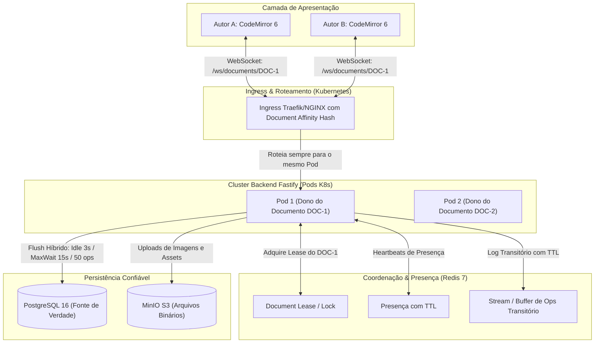

# 🔬 Análise Técnica e Arquitetural Profunda: Módulo de Editor Colaborativo do SCIA

> **Plataforma:** SCIA — Scientific Collaboration and Intelligent Assistance (`sci-latex-vscode`)  
> **Tema:** Auditoria técnica de consistência, concorrência, persistência e resiliência do editor colaborativo  
> **Data:** 24 de Outubro de 2026  
> **Status:** Relatório Crítico de Engenharia / Auditoria Arquitetural  

---

## 📑 Sumário Executivo

1. [Modelo de Colaboração (`@codemirror/collab`)](#1-modelo-de-colaboração-codemirrorcollab)
   - 1.1. [Mecânica de Funcionamento no SCIA](#11-mecânica-de-funcionamento-no-scia)
   - 1.2. [Análise das Primitivas de Colaboração](#12-análise-das-primitivas-de-colaboração)
   - 1.3. [Concorrência, Reconexão e Clientes Defasados](#13-concorrência-reconexão-e-clientes-defasados)
   - 1.4. [Classificação Formal da Propriedade de Consistência](#14-classificação-formal-da-propriedade-de-consistência)
2. [Arquitetura Frontend (CodeMirror 6 + React)](#2-arquitetura-frontend-codemirror-6--react)
   - 2.1. [Ciclo de Execução e Extensões](#21-ciclo-de-execução-e-extensões)
   - 2.2. [Diagnóstico de Riscos e Falhas no Cliente](#22-diagnóstico-de-riscos-e-falhas-no-cliente)
3. [Arquitetura Backend (Fastify, WebSockets e Estado em Memória)](#3-arquitetura-backend-fastify-websockets-e-estado-em-memória)
   - 3.1. [Estrutura do Servidor e Memória Ativa (`activeDocs`)](#31-estrutura-do-servidor-e-memória-ativa-activedocs)
   - 3.2. [Respostas Técnicas aos Cenários Críticos de Falha](#32-respostas-técnicas-aos-cenários-críticos-de-falha)
4. [Uso Crítico do Redis 7](#4-uso-crítico-do-redis-7)
   - 4.1. [Realidade do Código vs. Funções Documentadas](#41-realidade-do-código-vs-funções-documentadas)
   - 4.2. [Avaliação de Durabilidade, TTL e Papel Real do Redis](#42-avaliação-de-durabilidade-ttl-e-papel-real-do-redis)
5. [PostgreSQL como Fonte de Verdade Persistente](#5-postgresql-como-fonte-de-verdade-persistente)
   - 5.1. [Mecanismos de Persistência no Banco](#51-mecanismos-de-persistência-no-banco)
   - 5.2. [Mapeamento da Janela Real de Perda de Dados](#52-mapeamento-da-janela-real-de-perda-de-dados)
6. [Análise Crítica do Mecanismo de Debounce](#6-análise-crítica-do-mecanismo-de-debounce)
   - 6.1. [A Falha Estrutural do "Debounce Infinito" (Idle Debounce)](#61-a-falha-estrutural-do-debounce-infinito-idle-debounce)
   - 6.2. [Modelo de Flush Multi-Critério Obrigatório](#62-modelo-de-flush-multi-critério-obrigatório)
7. [Escalabilidade Multi-Pod e Orquestração em Kubernetes](#7-escalabilidade-multi-pod-e-orquestração-em-kubernetes)
   - 7.1. [Incompatibilidade do `activeDocs` em Múltiplas Réplicas](#71-incompatibilidade-do-activedocs-em-múltiplas-réplicas)
   - 7.2. [Por que Redis Pub/Sub Isolado Não Resolve](#72-por-que-redis-pubsub-isolado-não-resolve)
   - 7.3. [Solução Obrigatória: Document Affinity / Single-Writer](#73-solução-obrigatória-document-affinity--single-writer)
8. [Avaliação Rigorosa no Teorema de PACELC](#8-avaliação-rigorosa-no-teorema-de-pacelc)
   - 8.1. [Por que uma Classificação Única é Inadequada](#81-por-que-uma-classificação-única-é-inadequada)
   - 8.2. [As Três Fronteiras do Editor no PACELC](#82-as-três-fronteiras-do-editor-no-pacelc)
9. [`@codemirror/collab` vs. Yjs / CRDT no Contexto do SCIA](#9-codemirrorcollab-vs-yjs--crdt-no-contexto-do-scia)
   - 9.1. [Convergência de Caracteres vs. Validade Sintática LaTeX](#91-convergência-de-caracteres-vs-validade-sintática-latex)
   - 9.2. [Tabela Comparativa Aprofundada](#92-tabela-comparativa-aprofundada)
10. [Matriz de Recuperação por Cenário de Falha](#10-matriz-de-recuperação-por-cenário-de-falha)
11. [Definição Estrita das Fontes de Verdade](#11-definição-estrita-das-fontes-de-verdade)
12. [Arquitetura Final Recomendada (Target State)](#12-arquitetura-final-recomendada-target-state)
13. [Matriz de Problemas e Vulnerabilidades Encontradas](#13-matriz-de-problemas-e-vulnerabilidades-encontradas)
14. [Conclusão e Parecer de Engenharia](#14-conclusão-e-parecer-de-engenharia)

---

## 1. Modelo de Colaboração (`@codemirror/collab`)

### 1.1 Mecânica de Funcionamento no SCIA
O CodeMirror 6 implementa um sistema de **Transformação Operacional Centralizada com Rebase (Single-Leader OT / State Machine Replication)**. Ele **não é um CRDT**, pois não utiliza identificadores matematicamente imutáveis para cada caractere nem estruturas livres de coordenação. Ele manipula instâncias de `ChangeSet`, que são representações baseadas em deslocamentos numéricos (`from`, `to`, `insert`) indexados à versão de um documento em um dado instante temporal.

```
Cliente A (v10) ──[PUSH ver=10, updates=[ΔA]]──► Backend Fastify (v11)
                                                    │
                                         rebaseUpdates([ΔA], [ΔB_hist])
                                                    │
                                            Aplica em targetDoc
                                                    ▼
Cliente A ◄──[PULL_UPDATES_RESPONSE ver=12]── Nova Versão Canônica v12
```

### 1.2 Análise das Primitivas de Colaboração
* **`sendableUpdates(state)`:** Inspeciona o estado do editor no cliente e extrai as transações locais geradas pelo usuário que ainda não foram reconhecidas (*acknowledged*) pelo servidor central. Se a conexão de rede estiver indisponível, essas transações continuam acumuladas na fila interna do CodeMirror.
* **`receiveUpdates(state, updates)`:** Despachado no cliente quando chegam alterações remotas confirmadas pelo servidor. O CodeMirror aplica as alterações remotas e, caso existam atualizações locais ainda não confirmadas (`sendableUpdates`), ele **transforma (rebaseia)** essas operações locais sobre as novas operações remotas recebidas.
* **`rebaseUpdates(received, historicalUpdates)`:** Função pura de Transformação Operacional executada no servidor (`backend/src/modules/documents/documents.service.ts`). Recebe as operações de um cliente baseadas na versão $V_{\text{cliente}}$ e as transforma contra todas as operações canônicas ocorridas no servidor no intervalo $[V_{\text{cliente}}, V_{\text{atual}}]$.
* **Versionamento:** É um número inteiro sequencial estrito ($0, 1, 2, \dots$) gerado exclusivamente pelo servidor. O servidor é a autoridade central que dita a ordem total das operações no documento.
* **`clientID`:** Identificador único do cliente usado para descartar o eco de suas próprias alterações quando o servidor faz o broadcast de volta para a sala.

### 1.3 Concorrência, Reconexão e Clientes Defasados
* **Concorrência entre Autores:** Se Autor A e Autor B estão na versão $10$ e enviam atualizações concorrentes:
  1. A atualização de A chega primeiro: o servidor aceita, incrementa a versão canônica para $11$ e notifica a sala.
  2. A atualização de B chega baseada na versão $10$: o servidor detecta que $V_{\text{cliente}} < V_{\text{servidor}}$ ($10 < 11$), executa `rebaseUpdates([B], [A])`, transforma os offsets de B, aplica em seu estado interno e incrementa para $12$. B recebe de volta a sua operação rebaseada.
* **Cliente Atrasado:** Se um cliente ficou sem rede por alguns segundos e gerou alterações locais sobre uma versão antiga, ao reconectar ele envia seu lote acumulado. O servidor faz o rebase contra todo o histórico acumulado desde aquela versão, preservando as intenções de ambos.
* **Cliente Desconectado:** Continua digitando no buffer local. As mudanças ficam pendentes em `sendableUpdates`.
* **Perda de Conexão durante Edição:** Se a conexão cair no meio de um envio:
  * Se o servidor recebeu e processou, mas o socket caiu antes da resposta, o cliente reenviará o pacote. O servidor receberá uma versão defasada e tentará rebasear novamente. Como a implementação atual não possui deduplicação idempotente por `transactionID` ou hash de operação, isso acarreta duplicação do texto inserido.

### 1.4 Classificação Formal da Propriedade de Consistência
A propriedade de consistência que o sistema possui é **Consistência Eventual Forte com Ordenação Total (Strong Eventual Consistency sob Sequenciador Central Único)**:
* Todos os clientes que receberem o mesmo prefixo de operações rebaseadas e aplicarem `receiveUpdates` convergirão para o mesmo texto idêntico.
* **Pré-requisito inviolável:** Existe exatamente **uma única autoridade central (Single Leader)** ordenando e aplicando o `rebaseUpdates`. Se houver mais de uma autoridade atribuindo versões canônicas simultaneamente (ex: múltiplos pods sem afinidade), a garantia colapsa.

---

## 2. Arquitetura Frontend (CodeMirror 6 + React)

### 2.1 Ciclo de Execução e Extensões
* **Aplicação Local:** Imediata e síncrona na camada de visualização (`EditorView`). O usuário digita com latência zero (60 fps), sem bloqueio de rede.
* **Envio de Updates:** O `collabPushPlugin` intercepta `update.docChanged`. Se a alteração não foi remota (`!isRemoteChange()`), serializa o `ChangeSet` para JSON e chama `onPush`.
* **Recebimento e Rebase Local:** Ao receber `PULL_UPDATES_RESPONSE`, o hook converte o JSON em `ChangeSet` e despacha `receiveUpdates(view.state, updates)`. O CodeMirror local cuida do deslocamento de cursores e rebase de edições pendentes.
* **Cursores Remotos:** Mapeados através de decorações (`CursorWidget`). As coordenadas são números absolutos (`position`, `selectionStart`, `selectionEnd`).
* **Comentários Ancorados:** Utilizam `changes.mapPos(comment.from, 1)` para acompanhar o texto conforme caracteres são inseridos ou removidos antes da âncora.

### 2.2 Diagnóstico de Riscos e Falhas no Cliente

```
           [Usuário Digita Localmente]
                      │
           DocChanged no CodeMirror
                      │
              WS Conectado?
             /             \
          [SIM]           [NÃO]
           /                 \
  Envia PUSH_UPDATES     Descarta Silenciosamente! (Bug useCollabWebSocket:206)
                          Mudanças ficam presas em sendableUpdates sem retry.
```

1. **Perda Silenciosa de Edições durante Desconexão:**
   * Em `frontend/src/features/editor/hooks/useCollabWebSocket.ts` (linhas 220–228), o método `sendCollabUpdates` verifica:
     ```typescript
     if (socketRef.current && socketRef.current.readyState === WebSocket.OPEN) {
       socketRef.current.send(...);
     }
     ```
   * Se o WebSocket estiver em estado de reconexão ou desconectado (`readyState !== WebSocket.OPEN`), a mensagem é **descartada silenciosamente**. Não há fila de reenvio (*retry queue*) no cliente. As mudanças ficam represadas no CodeMirror e só serão enviadas se o usuário digitar uma nova tecla após o socket voltar a ficar aberto.
2. **Desconexão Forçada ao Alternar Abas (Bug de Ciclo de Vida):**
   * No hook `useCollabWebSocket.ts`, o `useEffect` possui `activeFile` no array de dependências (linha 194):
     ```typescript
     useEffect(() => { ... }, [documentId, userId, userName, activeFile, ...]);
     ```
   * **Consequência:** Toda vez que o usuário clica em outro arquivo (`main.tex` $\to$ `references.bib`), **o WebSocket é destruído (`ws.close()`) e reconectado do zero**. Isso gera sobrecarga de rede, recriação desnecessária de conexões, reenvio de `SYNC_INIT` e risco de perder deltas em trânsito durante a transição de arquivos.
3. **Desalinhamento de Versão em Multi-arquivos:**
   * O CodeMirror é inicializado em `CodeMirrorEditor.tsx` com `collab({ startVersion: collabVersion || 0 })`.
   * Esse `collabVersion` no frontend reflete unicamente a versão de `main.tex`. Quando o usuário abre um arquivo secundário que no backend está na versão $0$, o frontend tenta submeter atualizações com a versão do `main.tex` (ex: versão $35$), causando descompasso nos índices do backend.
4. **Perda de Âncora de Comentários:**
   * O `mapPos(from, 1)` lida com deslocamentos. Porém, se o trecho do texto onde o comentário foi inserido for completamente excluído por outro autor, `comment.from` colapsa e torna-se idêntico a `comment.to`. O comentário vira um ponto de largura zero ou permanece flutuando em texto não relacionado.

---

## 3. Arquitetura Backend (Fastify, WebSockets e Estado em Memória)

### 3.1 Estrutura do Servidor e Memória Ativa (`activeDocs`)
* **`documentRooms`:** Um `Map<string, Set<ClientMeta>>` local na memória da instância do Node.js. Não possui visibilidade de conexões em outros processos.
* **`activeDocs`:** Mantém o estado quente (`doc: Text`, `updates: Update[]`, `filesCollab`). O documento inteiro reside na heap do V8.
* **`pendingOps`:** Contador em memória que determina se o checkpoint no PostgreSQL deve ocorrer.
* **Lifecycle do Documento:** **Inexistente.** Não há rotina de descarte (*eviction*) de documentos inativos. Uma vez aberto, o documento e todo o seu histórico de updates permanecem no Map `activeDocs` até o processo Node.js reiniciar.

### 3.2 Respostas Técnicas aos Cenários Críticos de Falha

#### A. O que acontece se o processo Node.js morrer exatamente antes de um checkpoint PostgreSQL?
**Perda total de todas as alterações feitas desde o último checkpoint.**  
O backend carrega o documento via `getDocument` a partir do PostgreSQL (`ProjectFile.content`). As operações recebidas em memória que estavam aguardando o debounce de 3 segundos desaparecem com o encerramento da heap do processo.

#### B. O que acontece se o processo morrer depois de colocar uma operação no Redis mas antes do PostgreSQL?
**A perda de dados continua ocorrendo da mesma forma.**  
O backend executa `await redisPubClient.rpush(...)`, mas **nenhuma linha do código do backend lê ou faz replay dessa lista do Redis ao reiniciar**. O método `getDocument` consulta exclusivamente o banco relacional PostgreSQL (`this.repository.findById(id)`). O Redis atua como um "sumidouro cego" de operações.

#### C. O que acontece se houver dois pods do backend atendendo o mesmo documento?
**Split-brain imediato e corrupção silenciosa do documento.**  
* O Pod 1 tem seu próprio `activeDocs` e suas versões (v1, v2, v3).
* O Pod 2 tem seu próprio `activeDocs` e suas versões concorrentes (v1, v2, v3).
* O `broadcastToRoom` do Pod 1 apenas envia mensagens para os WebSockets locais do Pod 1. Autores conectados no Pod 2 não veem as edições dos autores do Pod 1.
* Quando o Pod 1 executa `flushCheckpoint`, ele grava o texto $T_1$ no PostgreSQL. Segundos depois, o Pod 2 executa `flushCheckpoint` e **sobrescreve cegamente** o banco com o texto $T_2$, destruindo as edições do Pod 1.

#### D. O que acontece se uma mensagem WebSocket chegar fora de ordem?
O WebSocket trafega sobre TCP, que garante a ordenação dos pacotes por conexão. Porém, se o cliente sofrer uma desconexão temporária e enviar mensagens acumuladas, ou se duas chamadas assíncronas concorrentes suspenderem no `await` de `pushUpdates` no Node.js:
* O Node.js não possui lock por documento. Se a requisição 1 pausa em `await redisPubClient.rpush`, a requisição 2 pode entrar e alterar `targetUpdates` antes da requisição 1 terminar, gerando desordem na sequência de versões aplicadas ao `targetDoc`.

#### E. O que acontece se o cliente reenviar uma operação?
**A operação é duplicada no texto.**  
O backend não valida se o `clientID` já enviou aquele delta nem possui tabela de deduplicação de transações. O `pushUpdates` simplesmente aceita a operação, gera uma nova versão canônica e insere o texto repetidamente.

---

## 4. Uso Crítico do Redis 7

### 4.1 Realidade do Código vs. Funções Documentadas

| Responsabilidade | Estado na Documentação Anterior | Realidade no Código Fonte | Diagnóstico |
| :--- | :--- | :--- | :--- |
| **Buffer / Event Log** | Declarado como write-buffer de alta durabilidade. | `rpush` em `collab:doc:${id}:ops`, deletado no flush. **Nunca lido.** | **Inútil na recuperação.** Apenas consome I/O e RAM do Redis. |
| **Presença em Tempo Real** | Declarado como distribuído via Redis com TTL. | Controlado exclusivamente em memória local via `documentRooms`. | **Inexistente no Redis.** Multi-pod quebra a presença. |
| **Pub/Sub de Edições** | Declarado como sincronizador de salas entre pods. | **Nenhum** canal Pub/Sub de edição é assinado no WebSocket. | **Inexistente.** Não há coordenação multi-pod no editor. |
| **Coordenação / Locks** | Declarado como coordenador de concorrência. | Nenhum lock distribuído (Redlock ou similar) no editor. | **Ausente.** Concorrência multi-pod desprotegida. |

### 4.2 Avaliação de Durabilidade, TTL e Papel Real do Redis
1. **Redis como Garantia de Durabilidade:**  
   Não pode ser considerado parte da durabilidade no desenho atual. Primeiro, porque o código não implementa rotina de recuperação a partir dele. Segundo, mesmo que implementasse, o Redis por padrão opera com persistência assíncrona (RDB periódico ou AOF com `fsync` a cada segundo). Tratar o Redis como repositório primário de durabilidade entre checkpoints violaria os requisitos de integridade do SCIA.
2. **TTL nas Operações do Redis:**  
   As chaves `collab:doc:${documentId}:ops` são inseridas com `rpush` **sem TTL**. Se o servidor cair antes do `flushCheckpoint` (onde ocorre o `del`), essas chaves acumularão na memória do Redis indefinidamente (*memory leak*).
3. **Estratégia Recomendada para o Redis:**
   * **Não utilizar como banco de recuperação de texto.**
   * Utilizar **Redis Streams (`XADD`)** apenas se houver consumidores em segundo plano processando auditoria.
   * Utilizar **Redis Keys com TTL** para controle real de presença e batimento cardíaco dos usuários.
   * Utilizar **Redis Distributed Lock / Lease** para atribuição de dono único do documento (Single-Writer).

---

## 5. PostgreSQL como Fonte de Verdade Persistente

### 5.1 Mecanismos de Persistência no Banco
A gravação ocorre no método `flushCheckpoint(documentId)`:
1. `updateContent`: Executa transação Prisma atualizando `Project.currentVersion` e `ProjectFile.content` (onde `path = 'main.tex'`).
2. `updateProjectFileContent`: Atualiza arquivos secundários em loop assíncrono separado.
3. `createSnapshot`: Cria registro imutável em `DocumentSnapshot`.

### 5.2 Mapeamento da Janela Real de Perda de Dados
O modelo **CodeMirror $\to$ Memória Node.js $\to$ Redis $\to$ PostgreSQL** possui uma **janela crítica de perda de dados**:

$$\text{Risco de Perda} = \text{Período desde o último Checkpoint persistido no PostgreSQL}$$

* **Garantia Real:** A durabilidade é **limitada exclusivamente ao último checkpoint salvo no PostgreSQL**.
* Como o Redis não possui mecanismo de replay, qualquer alegação de que o Redis protege contra perda de dados antes do PostgreSQL é **falsa no código atual**.
* **Falta de Atomicidade no Flush Multi-arquivo:**  
  O salvamento de arquivos secundários (`filesCollab`) ocorre fora da transação do arquivo principal (`main.tex`). Se o processo sofrer interrupção no meio do loop, o `main.tex` estará na versão $N$, mas um arquivo `.bib` associado continuará na versão $N-1$, quebrando a compilação do LaTeX.

---

## 6. Análise Crítica do Mecanismo de Debounce

### 6.1 A Falha Estrutural do "Debounce Infinito" (Idle Debounce)
O código em `documents.service.ts` (linhas 355–358) implementa:
```typescript
clearTimeout(active.debounceTimer);
active.debounceTimer = setTimeout(async () => {
  await this.flushCheckpoint(documentId);
}, 3000);
```

```
Keystrokes:  |--|--|--|--|--|--|--|--|--|--|--|--|--|--|--|--| (Digitação Contínua)
Timers:      X  X  X  X  X  X  X  X  X  X  X  X  X  X  X  X
Postgres:    [---------------- ZERO CHECKPOINTS ----------------]
```

* **Comportamento sob Digitação Contínua:**  
  A cada caractere recebido, o timer de 3 segundos é cancelado e postergado. Se um pesquisador digitar um parágrafo longo continuamente durante 5 minutos, **nenhum checkpoint será gravado no PostgreSQL ao longo de todo esse período**.
* **Impacto em Caso de Crash:**  
  Se a máquina reiniciar no quarto minuto de escrita contínua, os 4 minutos inteiros de trabalho de todos os autores ativos na sala serão perdidos simultaneamente.

### 6.2 Modelo de Flush Multi-Critério Obrigatório
O flush para o PostgreSQL não pode depender exclusivamente de um temporizador de inatividade. Deve adotar um modelo híbrido:
1. **Tempo de Inatividade (*Idle Timer*):** 3 segundos sem digitação.
2. **Teto Máximo Temporal (*MaxWait Ceiling*):** Forçar o checkpoint a cada 15 segundos de digitação contínua, mesmo que haja fluxo ininterrupto de teclas.
3. **Volume de Operações (*Op Threshold*):** Forçar o checkpoint a cada 50 operações atômicas pendentes (`pendingOps >= 50`).
4. **Volume de Bytes Alterados:** Forçar o checkpoint se o volume de deltas acumulados ultrapassar 10 KB.
5. **Eventos Críticos de Negócio:**
   * Desconexão do último usuário da sala.
   * Fechamento explícito da aba ou saída do workspace.
   * Acionamento do botão "Salvar" ou compilação LaTeX (`useLatexCompiler`).
   * Transição de estágio no fluxo institucional (ex: submissão ao NIT ou criação de Release Candidate).

---

## 7. Escalabilidade Multi-Pod e Orquestração em Kubernetes

### 7.1 Incompatibilidade do `activeDocs` em Múltiplas Réplicas
A arquitetura atual com `activeDocs` mantido em memória do processo é **totalmente incompatível com múltiplas réplicas sem coordenação de tráfego**.

Se o cluster Kubernetes escalar o pod do backend para 2 ou mais réplicas:

```
[Cliente A] ──WS──► [Pod 1: activeDocs A] ──► Grava Versão 10 no PostgreSQL
                                                        ▲
                                              Conflito de Escrita
                                                        ▼
[Cliente B] ──WS──► [Pod 2: activeDocs B] ──► Grava Versão 10 no PostgreSQL
```

1. **Pub/Sub Não Resolve a Ordem Total:**  
   Mesmo que o Pod 1 transmitisse suas alterações via Redis Pub/Sub para o Pod 2, ambos os pods estariam executando `rebaseUpdates` e atribuindo versões numéricas independentes em paralelo. Não há garantia de que Pod 1 e Pod 2 decidam a mesma ordem para eventos simultâneos sem uma liderança unificada.
2. **Estratégias de Resolução para Kubernetes:**

| Estratégia | Descrição | Viabilidade no SCIA |
| :--- | :--- | :--- |
| **Sticky Sessions por Ingress (Document Affinity)** | O Ingress (ex: Traefik, NGINX) direciona conexões com base no path `/ws/documents/:documentId` para o mesmo pod. | **Alta / Recomendada.** Garante que todas as sessões do mesmo documento convijam no mesmo pod. |
| **Distributed Lease via Redis (Single-Writer)** | Um pod adquire uma trava (*lease*) com TTL no Redis para gerenciar o documento. Se o Pod 2 receber um socket para esse documento, ele atua como proxy reverso para o Pod 1 ou instrui o cliente a se reconectar no pod correto. | **Alta / Robusta.** Previne split-brain mesmo se o Ingress falhar no roteamento. |
| **Shared Memory / External Sequencer** | Retirar a engine de rebase do Node.js e colocá-la em um serviço de estado isolado. | **Inviável a curto prazo.** Alta complexidade operacional desnecessária. |

---

## 8. Avaliação Rigorosa no Teorema de PACELC

Classificar o editor genericamente sob uma única sigla (como PC/EL) ignora as diferentes fronteiras do sistema. O editor atua em três camadas distintas, cada uma com seus próprios limites de PACELC:

```
[Camada 1: Interface do Usuário (Local)] ──► PA / EL
[Camada 2: Sequenciador Central (Node/WS)] ──► PC / EC
[Camada 3: Persistência Durável (Postgres)] ──► PC / EL
```

### 8.1 Por que uma Classificação Única é Inadequada
Uma classificação única esconde os trade-offs de cada subsistema. O editor possui um loop de interface do usuário, um loop de consenso de sincronização em rede e um loop de armazenamento durável.

### 8.2 As Três Fronteiras do Editor no PACELC

#### Fronteira 1: Editor Local (Interface do Usuário)
* **Em Operação Normal (Else):** Escolhe **Latency (L)**. O caractere digitado é aplicado imediatamente na tela (latência $< 16\text{ ms}$). Não espera a rede nem o banco.
* **Em Partição de Rede (Partition):** Escolhe **Availability (A)** temporária. O usuário não tem o teclado travado instantaneamente ao primeiro soluço de rede; o buffer local aceita a digitação.
* **Classificação:** **PA / EL**.

#### Fronteira 2: Sequenciador de Concorrência Canônico (Backend Node.js)
* **Em Operação Normal (Else):** Escolhe **Consistency (C)**. O sequenciador central precisa linearizar cada operação recebida para atribuir versões estritas ($1, 2, 3$). Se flexibilizar a consistência aqui, a Transformação Operacional falha matematicamente.
* **Em Partição de Rede (Partition):** Escolhe **Consistency (C)**. Se o sequenciador perder a conexão com seus pares ou com o lease de liderança, ele deve **rejeitar ou pausar o recebimento de atualizações**. Permitir que dois nós aceitem atualizações concorrentes quebra a ordem total.
* **Classificação:** **PC / EC**.

#### Fronteira 3: Armazenamento em Disco (PostgreSQL)
* **Em Operação Normal (Else):** Escolhe **Latency (L)**. O sistema desacopla a digitação do disco através do debounce, evitando `fsync` a cada tecla.
* **Em Partição de Rede (Partition):** Escolhe **Consistency (C)**. O PostgreSQL impede transações parciais ou corrompidas.
* **Classificação:** **PC / EL**.

---

## 9. `@codemirror/collab` vs. Yjs / CRDT no Contexto do SCIA

### 9.1 Convergência de Caracteres vs. Validade Sintática LaTeX
Não se deve desqualificar CRDTs sob a alegação simplista de que "quebram a compilação do LaTeX". A comparação técnica deve separar com precisão a **convergência colaborativa** da **validade semântica**:

```
Convergência Colaborativa:
  Garante que todos os nós tenham exatamente os mesmos caracteres em tela.
  (Atendida tanto por OT quanto por CRDT).

Validade Sintática e Semântica do LaTeX:
  Garante que \begin{item} tenha correspondente \end{item} e o compilador gere PDF.
  (NENHUM motor colaborativo garante isso por si só).
```

### 9.2 Tabela Comparativa Aprofundada

| Critério | `@codemirror/collab` (Nossa Stack) | Yjs / CRDT | Impacto no SCIA |
| :--- | :--- | :--- | :--- |
| **Topologia** | Centralizada (Requer Sequenciador Líder). | Descentralizada / P2P / Multi-Master. | CodeMirror exige pod único ou afinidade; Yjs funcionaria em multi-pod sem afinidade. |
| **Consumo de Memória** | Mínimo. Texto puro + array enxuto de deltas. | Alto. Metadados e IDs por caractere/bloco + tombstones de deleção. | CodeMirror escala melhor o consumo de RAM no backend Node.js. |
| **Persistência em Banco** | String de texto plano simples no PostgreSQL. | Estado binário compactado do Yjs (`Uint8Array`) ou texto extraído. | CodeMirror encaixa-se naturalmente no modelo relacional com Prisma (`@db.Text`). |
| **Edição Offline Longa** | Fraca. Rebases de horas de divergência acumulam histórico pesado e falham em conflitos complexos. | Excelente. Projetado nativamente para mesclar históricos divergentes de dias/semanas. | Como o SCIA prioriza trabalho conectado com auditoria institucional, offline longo não é o foco principal. |
| **Feedback de Erros LaTeX** | Imediato. Como o atraso de sincronização é de milissegundos, o autor percebe a quebra sintática na hora. | Tardio em caso de edições offline: o merge assíncrono de horas pode gerar erros de compilação confusos. | A autoridade centralizada do CodeMirror favorece a detecção rápida de inconsistências em TeX. |
| **Complexidade Operacional** | Baixa no código da aplicação, mas exige afinidade no Kubernetes. | Alta no gerenciamento de persistência de updates do Yjs no PostgreSQL. | CodeMirror mantém a base de código do backend compreensível e diretamente depurável. |

---

## 10. Matriz de Recuperação por Cenário de Falha

### A. Backend Reiniciado (Crash / Reboot do Processo Node.js)
* **Estado Perdido:** Todo o conteúdo de `activeDocs` (documentos em memória), array de `updates`, conexões WebSocket e deltas ainda não persistidos pelo debounce.
* **Estado Recuperável:** O último checkpoint consolidado salvo no PostgreSQL (`ProjectFile.content` e `DocumentSnapshot`). As operações acumuladas no Redis são perdidas porque o sistema não as lê no boot.
* **Origem da Recuperação:** PostgreSQL via `repository.findById`.
* **Garantia Arquitetural Desejada:** Replay obrigatório de operações pendentes no Redis antes de abrir o documento para novas conexões.

### B. Redis Reiniciado
* **Estado Perdido:** Buffer de operações efêmeras em `collab:doc:${id}:ops`.
* **Estado Recuperável:** O documento continua íntegro na memória do Node.js (`activeDocs`) e no PostgreSQL.
* **Origem da Recuperação:** Memória ativa do backend em execução.
* **Garantia Arquitetural Desejada:** O reinício do Redis não deve derrubar a sessão ativa; o backend deve continuar atendendo e forçar um flush imediato no PostgreSQL para segurança.

### C. PostgreSQL Reiniciado
* **Estado Perdido:** Nenhum dado persistido é perdido (graças ao WAL do PostgreSQL).
* **Estado Recuperável:** Todo o histórico de versões e arquivos gravados até o momento da queda.
* **Impacto em Andamento:** O `flushCheckpoint` falhará temporariamente. O backend deve reter as operações na memória e no Redis até que o pool do banco restabeleça conexão, sem descartar deltas.

### D. Cliente Desconectado
* **Estado Perdido:** Conexão WebSocket. O cliente não recebe atualizações remotas de terceiros.
* **Estado Recuperável:** O texto digitado localmente permanece no buffer `sendableUpdates` do CodeMirror local.
* **Origem da Recuperação:** Memória local do browser do usuário.

### E. Cliente Reconectado
* **Fluxo de Recuperação:**
  1. O cliente reabre o WebSocket e recebe `SYNC_INIT` com a versão atual do servidor.
  2. O cliente envia suas alterações locais pendentes através de `PUSH_UPDATES` informando a sua versão defasada.
  3. O servidor executa `rebaseUpdates` e devolve as operações integradas.

### F. Dois Autores Editando Simultaneamente
* **Fluxo:** O servidor lineariza as requisições que chegam ao socket. A primeira operação define a versão canônica $N$; a segunda é rebaseada e define a versão $N+1$. Ambos os clientes convergem para o mesmo estado final. Zero perda de dados.

### G. Pod Eliminado pelo Kubernetes (Despejo / Scale Down)
* **Estado Perdido:** Todas as edições que estavam aguardando o debounce de 3 segundos no pod eliminado.
* **Risco Real:** Se o Pod receber `SIGTERM`, os timers do `setTimeout` são interrompidos sem executar o flush.
* **Garantia Arquitetural Desejada:** Interceptar o sinal `SIGTERM`/`SIGINT` no processo Node.js e executar o `flushCheckpoint()` de todos os documentos ativos antes de encerrar o container (*Graceful Shutdown*).

---

## 11. Definição Estrita das Fontes de Verdade

Para eliminar ambiguidades e sobreposição de responsabilidades entre Redis e PostgreSQL:

```
┌──────────────────────────────────────┬───────────────────────────────────────────┐
│ DOMÍNIO / ENTIDADE                   │ FONTE DE VERDADE ABSOLUTA (SOURCE OF TRUTH)│
├──────────────────────────────────────┼───────────────────────────────────────────┤
│ Conteúdo Persistente dos Arquivos    │ PostgreSQL (`ProjectFile.content`)        │
├──────────────────────────────────────┼───────────────────────────────────────────┤
│ Snapshots Históricos & Versões       │ PostgreSQL (`DocumentSnapshot`)           │
├──────────────────────────────────────┼───────────────────────────────────────────┤
│ Colaboração em Andamento (Hot State) │ Memória do Pod Dono + Log de Replay Redis │
├──────────────────────────────────────┼───────────────────────────────────────────┤
│ Presença e Usuários Ativos           │ Redis (Chaves com TTL de Heartbeat)       │
├──────────────────────────────────────┼───────────────────────────────────────────┤
│ Arquivos Binários (PDFs, Imagens)    │ MinIO Object Storage                      │
└──────────────────────────────────────┴───────────────────────────────────────────┘
```

* **Regra de Ouro:** O Redis **nunca** decide o conteúdo canônico de um documento em repouso. O PostgreSQL é a autoridade máxima e final. O Redis atua exclusivamente como buffer operacional transitório e coordenador de presença/bloqueio.

---

## 12. Arquitetura Final Recomendada (Target State)

Para resolver os gargalos de multi-pod, debounce infinito e perda de dados em crash, a arquitetura recomendada é estruturada com **Roteamento com Afinidade**, **Single-Writer por Documento**, **Flush Híbrido** e **Graceful Shutdown**:



### Componentes Chave da Solução:
1. **Document Affinity no Ingress:** O balanceador roteia todas as conexões WebSocket para o mesmo `documentId` ao mesmo Pod do Kubernetes, preservando a coerência da memória de `activeDocs`.
2. **Receptor de Encerramento Gracioso (*Graceful Shutdown*):** Ao receber `SIGTERM`, o Pod bloqueia novas edições, executa o `flushCheckpoint` de todos os documentos ativos no PostgreSQL e só então devolve o sinal de término.
3. **Mecanismo de Flush Multi-Critério:** Checkpoint disparado por inatividade (3s), teto máximo de tempo (15s) ou quantidade de operações (50 deltas).

---

## 13. Matriz de Problemas e Vulnerabilidades Encontradas

| Problema | Severidade | Causa Raiz no Código | Consequência | Solução de Engenharia |
| :--- | :--- | :--- | :--- | :--- |
| **Debounce Infinito sem MaxWait** | **Crítico** | `active.debounceTimer` é postergado a cada tecla digitada sem teto de corte. | Digitação contínua por longos períodos não grava no banco; crash apaga todo o texto. | Implementar `maxWait` de 15s e limite de 50 operações para forçar o checkpoint. |
| **Incompatibilidade Multi-Pod no Kubernetes** | **Crítico** | `activeDocs` e `documentRooms` residem exclusivamente na memória de cada processo. | Se 2 pods atenderem o mesmo documento: split-brain, edições cegas e sobrescrita destrutiva no banco. | Configurar afinidade de documentos no Ingress ou eleição de Pod dono via Redis Lease. |
| **Redis Ops sem Replay (Write-Only)** | **Crítico** | O método `pushUpdates` grava operações no Redis, mas `getDocument` só lê do PostgreSQL. | Falsa sensação de segurança: operações no Redis são descartadas em caso de crash do Node.js. | Implementar rotina de recuperação no boot que consome operações pendentes do Redis antes de abrir o doc. |
| **Queda do WebSocket na Troca de Abas** | **Alto** | `activeFile` está nas dependências do `useEffect` em `useCollabWebSocket.ts`. | O socket fecha e reabre do zero a cada clique de aba (`main.tex` $\to$ `.bib`). | Remover `activeFile` da conexão base; trafegar eventos de troca de arquivo sobre o mesmo socket. |
| **Descarte Silencioso de Updates Desconectado** | **Alto** | `sendCollabUpdates` verifica `readyState === OPEN` e não faz nada se estiver fechado. | Edições feitas durante instabilidade de rede podem se perder sem aviso ao autor. | Criar fila de pendências (*offline queue*) com reenvio automático ao restabelecer o socket. |
| **Vazamento de Memória (*Memory Leak*) em `activeDocs`** | **Alto** | Não existe instrução de remoção de documentos inativos no Map `activeDocs`. | Todo documento aberto permanece em RAM indefinidamente; consumo de memória escala até OOM. | Implementar rotina de descarregamento (*eviction*) após 10 minutos sem clientes conectados na sala. |
| **Falta de Idempotência no Reenvio** | **Médio** | O backend não armazena hashes ou IDs das últimas transações aplicadas por cliente. | Se o cliente reenviar um pacote após timeout de rede, o texto é inserido em duplicidade. | Implementar cache LRU das últimas transações de cada `clientID` para ignorar duplicatas. |
| **Falta de Atomicidade no Flush de Arquivos** | **Médio** | Arquivos secundários (`filesCollab`) são atualizados fora da transação do arquivo principal. | Queda durante o flush deixa `main.tex` atualizado e arquivos `.bib`/`.cls` defasados. | Englobar a atualização de todos os arquivos modificados em uma única `prisma.$transaction`. |

---

## 14. Conclusão e Parecer de Engenharia

### A arquitetura atual do editor está correta?
**Não em sua totalidade.**  
O núcleo de sincronização local com CodeMirror 6 no cliente e a biblioteca `@codemirror/collab` com `rebaseUpdates` no backend são **conceitualmente excelentes e corretos**. No entanto, a camada de infraestrutura de persistência, ciclo de vida e orquestração de rede possui falhas estruturais graves que impedem o uso seguro em produção.

### O que está correto?
* A escolha de `@codemirror/collab` para resolução determinística de concorrência com rebase no servidor.
* A experiência de edição local imediata (latência zero) desacoplada do round-trip de rede.
* O mapeamento dinâmico de posições para comentários com `changes.mapPos`.
* O uso de PostgreSQL com Prisma para modelagem estrita e transacional dos arquivos consolidados.

### O que está incorreto?
* O **Redis operando como sumidouro cego**: operações são inseridas em lista com `rpush` e apagadas no flush, mas **nunca lidas em nenhuma rotina de recuperação**.
* A **ausência de afinidade de pod**: o sistema assume uma única réplica do Node.js; se colocado em Kubernetes com auto-scaling, sofrerá split-brain destrutivo.
* A **reconexão forçada de WebSocket ao trocar de aba** no frontend.
* A **falta de teto máximo no debounce**, permitindo que digitação contínua adie o checkpoint no PostgreSQL indefinidamente.

### O que é apenas uma escolha arquitetural?
* Optar por Transformação Operacional com CodeMirror Collab em vez de Yjs/CRDT. Trata-se de uma escolha perfeitamente válida e mais econômica em consumo de memória para o escopo do SCIA, desde que respeitada a exigência de um sequenciador único por documento.

### O que representa risco real de perda de dados?
1. Queda do processo Node.js durante digitação contínua (debounce sem `maxWait`).
2. Múltiplos pods atendendo o mesmo documento no Kubernetes (sobrescrita mútua no banco).
3. Queda temporária de rede no browser descartando deltas acumulados sem fila de retry.

### O que precisa ser alterado antes de colocar o editor em produção?
1. **Adicionar `maxWait` (15s) e limite de operações (50 ops) no debounce de persistência.**
2. **Implementar Document Affinity no Ingress do Kubernetes (ou travas distribuídas via Redis).**
3. **Corrigir o hook do WebSocket no frontend**, removendo `activeFile` das dependências da conexão para manter o socket estável entre abas.
4. **Implementar Graceful Shutdown no Node.js**, forçando a gravação de todos os documentos ativos no PostgreSQL ao receber sinal `SIGTERM`.
5. **Implementar rotina de recuperação a partir do Redis** ou remover a escrita de operações desnecessárias no Redis, evitando consumo inútil de recursos.
