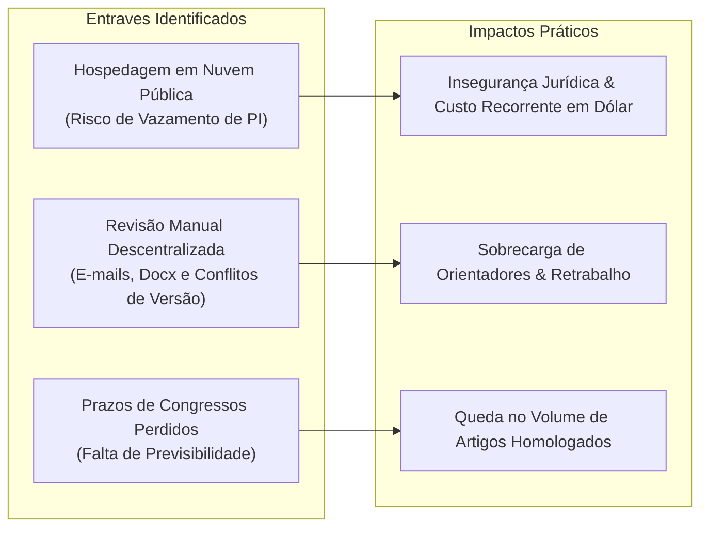
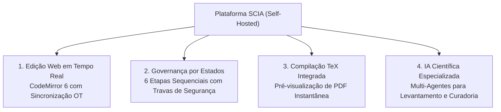
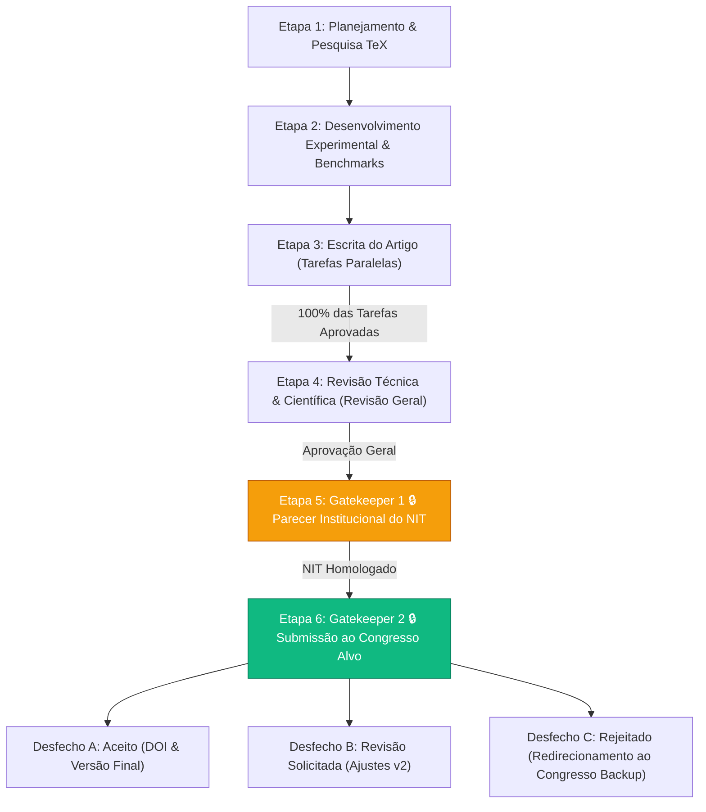
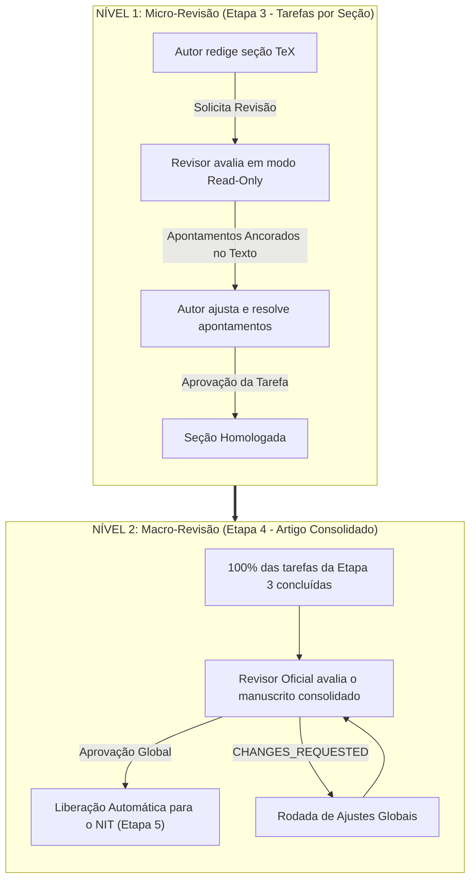
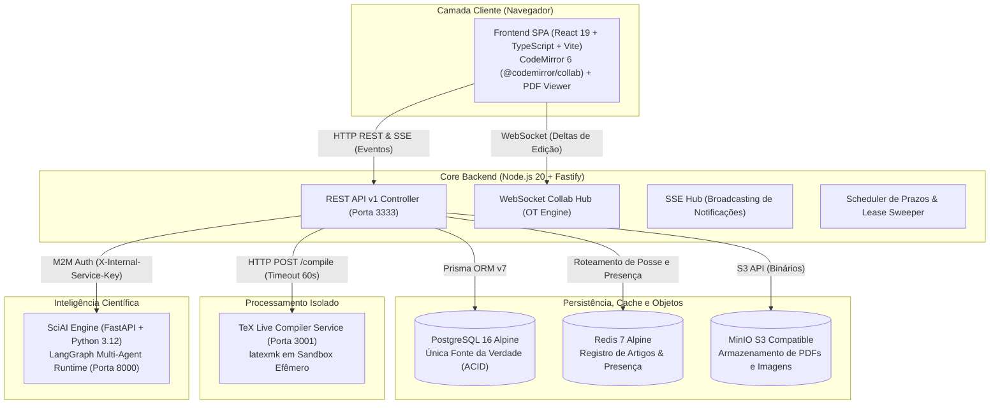
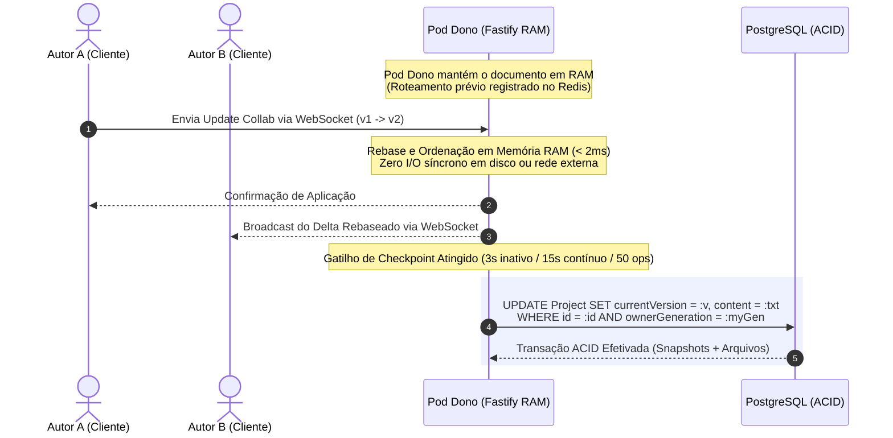
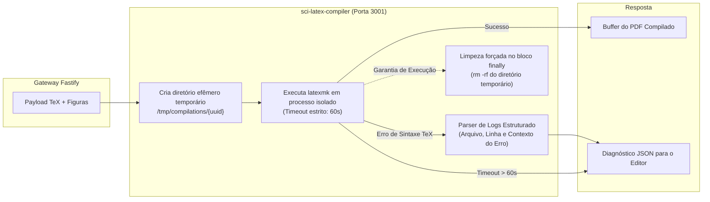
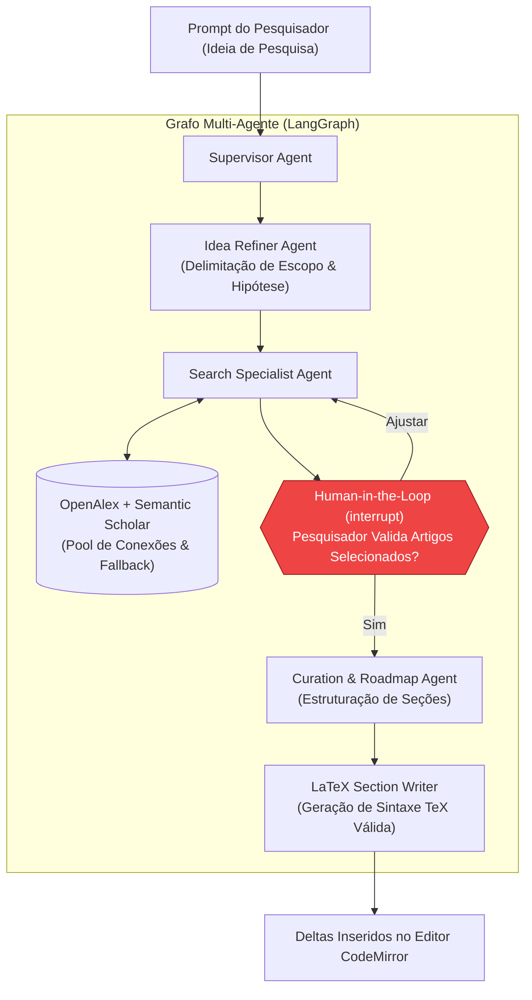
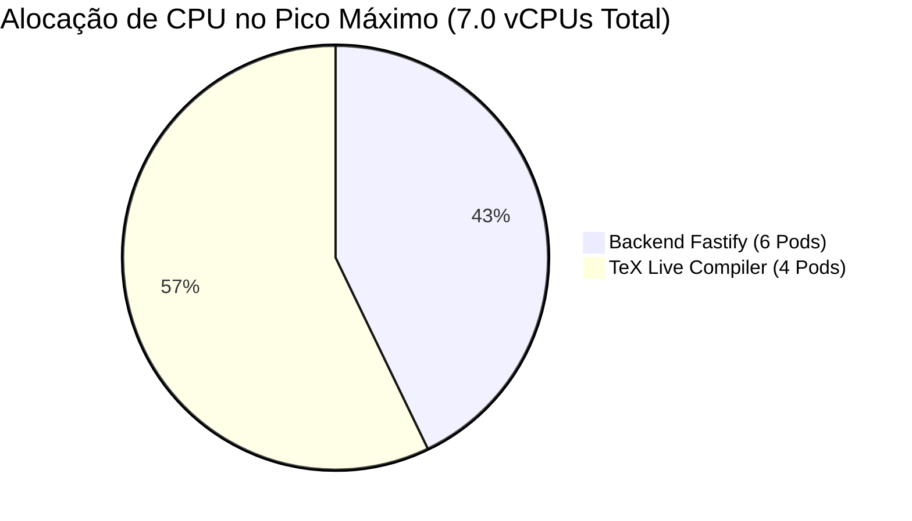

# Plataforma SCIA: Colaboração Científica e Arquitetura de Software
## Da Proposta de Valor à Engenharia de Alta Concorrência

---

## 📑 Índice da Apresentação

- [PARTE 1: A SOLUÇÃO](#parte-1-a-solução)
  - [Slide 01: O Cenário Atual e os Gargalos da Produção Científica](#slide-01-o-cenário-atual-e-os-gargalos-da-produção-científica)
  - [Slide 02: A Plataforma SCIA — Soberania, Produtividade e Colaboração](#slide-02-a-plataforma-scia--soberania-produtividade-e-colaboração)
  - [Slide 03: Governança por Estados: O Ciclo em 6 Etapas Imutáveis](#slide-03-governança-por-estados-o-ciclo-em-6-etapas-imutáveis)
  - [Slide 04: Modelo de Revisão em Dois Níveis: Micro e Macro](#slide-04-modelo-de-revisão-em-dois-níveis-micro-e-macro)
  - [Slide 05: Papéis do Sistema e Matriz de Permissões (RBAC)](#slide-05-papéis-do-sistema-e-matriz-de-permissões-rbac)
- [PARTE 2: A ARQUITETURA](#parte-2-a-arquitetura)
  - [Slide 06: Topologia Geral de Serviços e Comunicação](#slide-06-topologia-geral-de-serviços-e-comunicação)
  - [Slide 07: O Motor Colaborativo: Single-Writer OT e Fencing Monotônico](#slide-07-o-motor-colaborativo-single-writer-ot-e-fencing-monotônico)
  - [Slide 08: Persistência Relacional ACID: Por que PostgreSQL e não MongoDB?](#slide-08-persistência-relacional-acid-por-que-postgresql-e-não-mongodb)
  - [Slide 09: Isolamento do Compilador TeX Live (Sandbox Anti-Noisy-Neighbor)](#slide-09-isolamento-do-compilador-tex-live-sandbox-anti-noisy-neighbor)
  - [Slide 10: Camada de IA Científica: LangGraph Multi-Agente com Human-in-the-Loop](#slide-10-camada-de-ia-científica-langgraph-multi-agente-com-human-in-the-loop)
  - [Slide 11: Capacidade Comprovada e Dimensionamento Físico On-Premises](#slide-11-capacidade-comprovada-e-dimensionamento-físico-on-premises)
- [PONTOS CRÍTICOS & PERGUNTAS FREQUENTES (FAQ)](#pontos-críticos--perguntas-frequentes-faq)
- [ROTEIRO DA DEMONSTRAÇÃO PRÁTICA (LIVE DEMO)](#roteiro-da-demonstração-prática-live-demo)

---

# PARTE 1: A SOLUÇÃO

## Slide 01: O Cenário Atual e os Gargalos da Produção Científica

A produção científica institucional enfrenta hoje três entraves estruturais que afetam a qualidade das publicações, a segurança da informação e o cumprimento de prazos:

* **Vulnerabilidade de Propriedade Intelectual (PI):** A redação de pesquisas e patentes em serviços SaaS externos armazena minutas confidenciais em servidores de terceiros no exterior antes do depósito legal.
* **Complexidade Operacional de TeX Live Local:** Cada pesquisador mantém configurações manuais e versões discrepantes de pacotes, gerando falhas recorrentes de compilação.
* **Fluxo Editorial Desestruturado:** Revisões baseadas em anexos de e-mail causam perda de rastreabilidade, retrabalho e envio de artigos sem validação institucional formal.

---

## Slide 02: A Plataforma SCIA — Soberania, Produtividade e Colaboração

O **SCIA (*Scientific Collaboration and Intelligent Assistance*)** é uma plataforma web unificada, **100% On-Premises**, projetada para centralizar todo o ciclo de vida da produção científica institucional:

### Nossos Pilares de Entrega:
1. **Soberania Completa dos Dados:** Todo código-fonte, imagem de experimento e apontamento institucional reside dentro da nossa infraestrutura.
2. **Ambiente Zero Configuração:** O pesquisador precisa apenas de um navegador moderno para escrever, colaborar e compilar documentos em LaTeX.
3. **Controle Integrado de Congressos:** Gestão simultânea de Conferência Alvo e Conferência Backup, garantindo reaproveitamento estruturado em caso de necessidade de reenvio.

---

## Slide 03: Governança por Estados: O Ciclo em 6 Etapas Imutáveis

O ciclo de vida de qualquer manuscrito na plataforma segue uma máquina de estados estrita de 6 etapas, protegida por duas travas de segurança institucionais (*Gatekeepers*):

### Regras de Negócio e Segurança:
* **Etapa 4 (Revisão Geral):** Avaliação holística do manuscrito pelo Revisor Oficial. Se houver inconformidades de conteúdo, novas rodadas de ajuste (`CHANGES_REQUESTED`) são feitas sem desmanchar o histórico de tarefas já concluídas.
* **Etapa 5 (Gatekeeper 1 - NIT 🔒):** Trava sistêmica que bloqueia qualquer submissão externa até que o Núcleo de Inovação Tecnológica homologue formalmente o parecer de Propriedade Intelectual.
* **Etapa 6 (Gatekeeper 2 - Submissão Final 🔒):** Registro formal da submissão com controle de comprovante e plano de contingência para congresso backup.

---

## Slide 04: Modelo de Revisão em Dois Níveis: Micro e Macro

A plataforma desacopla a revisão técnica contínua da homologação institucional global, eliminando retrabalhos e gargalos de entrega:

* **Apontamentos Inline Ancorados (`ReviewComment`):** O revisor atua em modo protegido contra edição acidental (`readOnly: true`), comentando trechos específicos do código TeX com threads de discussão persistidas no banco.
* **Isolamento de Progresso:** Um ajuste solicitado na conclusão (Etapa 4) não anula nem bloqueia as tarefas prévias da metodologia (Etapa 3).

---

## Slide 05: Papéis do Sistema e Matriz de Permissões (RBAC)

O controle de acesso é baseado em responsabilidades operacionais claras para cada participante do projeto:

| Papel no Sistema | Responsabilidade Operacional | Ferramentas Dedicadas no SCIA |
| :--- | :--- | :--- |
| **Autor / Pesquisador** | Redação do manuscrito, condução experimental e resolução de apontamentos | Editor CodeMirror 6 com compilação instantânea, árvore de arquivos e chat de apontamentos |
| **Revisor Oficial / Orientador** | Validação metodológica, consistência científica e emissão de parecer | Editor protegido em modo Read-Only, comentários inline ancorados e controle de parecer |
| **Coordenador de Pesquisa** | Acompanhamento de metas, gestão de cronograma e resolução de gargalos | Visão Gantt por etapas/tarefas, reatribuição de revisores e alertas automáticos de prazo |
| **Gestor / Gerente de Área** | Governança estratégica e indicadores institucionais | Dashboard executivo por Período Acadêmico (`AcademicPeriod`), métricas de ciclo e auditoria do NIT |

---

# PARTE 2: A ARQUITETURA

## Slide 06: Topologia Geral de Serviços e Comunicação

A solução é desenhada como uma arquitetura de microsserviços desacoplada, garantindo que processamento intensivo de compilação não impacte a edição em tempo real:

* **Separação de Canais de Comunicação:**
  * **WebSockets:** Tráfego bidirecional de deltas de edição diretamente entre clientes e o Pod dono responsável pelo artigo.
  * **SSE (Server-Sent Events):** Canal unidirecional para notificações, avisos e atualização de status de tarefas em tempo real.
  * **REST API:** Operações administrativas, autenticação e gestão de projetos.
  * **Papel Estrito do Redis:** Atua exclusivamente no registro de posse dos artigos (`editor:document:<projectId>:owner`) e presença de usuários online para roteamento entre pods. O Redis não transporta deltas de digitação nem armazena keystrokes.

---

## Slide 07: O Motor Colaborativo: Single-Writer OT e Fencing Monotônico

Para garantir digitação sem travamentos e consistência absoluta de versão, implementamos uma arquitetura de **Single-Writer com Transformação Operacional (OT)** em memória e fencing no banco:

### Decisões Cruciais de Engenharia:
* **Zero I/O no Hot Path de Digitação:** O Redis não centraliza nem transporta operações de digitação. Sua função na edição colaborativa limita-se ao registro inicial de qual Pod detém a posse do documento para roteamento de conexões. O ciclo de digitação transita estritamente entre o WebSocket do cliente e a memória RAM do Pod responsável pelo artigo (< 2ms).
* **Debounce Híbrido Multi-Critério:** A persistência no PostgreSQL ocorre de forma assíncrona por inatividade (3s), teto contínuo (15s) ou acúmulo de operações (50 ops).
* **Proteção Contra Pods Zumbis (Fencing Monotônico):** O token `ownerGeneration` no banco invalida qualquer escrita de um Pod antigo que tenha sofrido perda de conectividade. O documento nunca é sobrescrito com dados defasados.

---

## Slide 08: Persistência Relacional ACID: Por que PostgreSQL e não MongoDB?

A decisão pelo **PostgreSQL 16 com transações ACID** em vez de uma base orientada a documentos (como na modelagem histórica do ShareLaTeX/Overleaf) decorre da complexidade das regras de governança e integridade do SCIA:

### Comparativo Arquitetural Direto

| Dimensão de Engenharia | Abordagem por Documento Único (BSON) | Modelo Relacional SCIA (PostgreSQL + MinIO) | Vantagem de Engenharia no SCIA |
| :--- | :--- | :--- | :--- |
| **Modelagem do Projeto** | Árvore BSON aninhada (pastas, dezenas de arquivos TeX, histórico e metadados no mesmo documento) | Esquema Relacional Normalizado (`Project`, `ProjectFile`, `TaskItem`, `ReviewComment`) | Leitura e mutação granular de seções sem carregar ou reescrever documentos inteiros de 10-50MB |
| **Integridade Referencial** | Depende exclusivamente da consistência lógica da aplicação | Chaves estrangeiras (`Foreign Keys`) com restrições e cascata no próprio banco | Proteção rígida contra comentários órfãos ou inconsistências entre tarefas e etapas |
| **Atomicidade de Checkpoints** | Requer coordenação entre documentos distintos | Transação ACID única via Prisma 7 (`prisma.$transaction`) | Versão de colaboração, arquivos modificados e snapshot gravados atomicamente |
| **Auditoria e Histórico** | Coleções esparsas sem vínculo relacional estrito | Tabela `DocumentSnapshot` indexada com auditoria imutável por versão | Rastreabilidade formal exigida por comitês acadêmicos e auditoria do NIT |
| **Armazenamento de Binários** | Binários (PDFs/Imagens) armazenados na mesma base | Segregação estrita: Binários no MinIO (S3), dados estruturados no PostgreSQL | Banco de dados transacional leve, veloz em I/O e com rotinas de backup instantâneas |
---

## Slide 09: Isolamento do Compilador TeX Live (Sandbox Anti-Noisy-Neighbor)

Para impedir que compilações maliciosas ou loops infinitos em macros LaTeX derrubem o servidor, isolamos o motor de compilação em um microsserviço dedicado (`sci-latex-compiler`):

* **Sandbox Efêmero:** Cada compilação é executada em `/tmp/compilations/<uuid>` e totalmente destruída no `finally`, prevenindo vazamento de inodes ou disco.
* **Timeout Rígido de 60s:** Processos travados são terminados sumariamente pelo Node.js e pelo Kubernetes.
* **Parser de Erros:** Erros de sintaxe TeX são convertidos em diagnósticos estruturados com número de linha, apontados diretamente na interface do editor.

---

## Slide 10: Camada de IA Científica: LangGraph Multi-Agente com Human-in-the-Loop

A camada de inteligência científica (`ai-service`) é construída sobre Python 3.12 e LangGraph, com salvaguardas estritas contra alucinações bibliográficas:

* **Human-in-the-Loop Obrigatório:** O agente de busca pausa a execução (`interrupt()`) e exige confirmação humana das referências antes de estruturar qualquer seção.
* **Resiliência de Fontes Externas:** Conexões com Semantic Scholar e OpenAlex implementadas com semáforos de concorrência, retries com exponential backoff e fallback automático.
* **Segurança M2M:** Comunicação autenticada internamente via header `X-Internal-Service-Key`.

---

## Slide 11: Capacidade Comprovada e Dimensionamento Físico On-Premises

Submetemos o cluster a testes empíricos de estresse para mensurar o comportamento dos componentes sob carga real de produção:

### Resultados dos Benchmarks no Cluster Kubernetes

| Métrica Avaliada | Baseline (2 Pods Backend, 1 Compiler) | Carga Máxima Testada (6 Pods Backend, 4 Compilers) |
| :--- | :--- | :--- |
| **Conexões WebSocket Simultâneas** | 150 conexões (30 projetos ativos com 5 autores) | **1.250 conexões simultâneas** (250 projetos ativos) |
| **Latência de Aplicação de Edição** | **< 2ms** (Processamento em memória) | **< 3ms** (Sob pico de tráfego) |
| **Latência RTT Total do Editor** | **543ms** (P95 com handshake completo) | **610ms** (P95 no teto de concorrência) |
| **Vazão de Compilação TeX** | 2 compilações concorrentes | **50 compilações de artigos em 17.3 segundos** |
| **Throughput de Operações** | ~180 operações / segundo | **1.445 operações / segundo** |
| **Recursos Físicos Consumidos no Pico** | **CPU:** 0.5 vCPU \| **RAM:** 300 MiB | **CPU:** ~7.0 vCPUs \| **RAM:** ~7.2 GB |

### Metodologia dos Benchmarks (Reprodutibilidade dos Dados)
* **Ambiente de Teste:** Cluster Kubernetes local (KinD) em nó isolado, simulando pods de backend (`sci-latex-backend`) e compiladores TeX (`sci-latex-compiler`) sob limites rígidos de recursos (`resources.limits`).
* **Perfil de Carga Concorrente:** Scripts de estresse automatizados (`benchmark-kind-500-users.ts` e `test-empirical-limits.ts`) instanciando 1.250 clientes WebSocket simultâneos, distribuídos em 250 projetos concorrentes (5 autores por projeto).
* **Simulação de Digitação Contínua:** Injeção paralela de ChangeSets do CodeMirror (`@codemirror/state`) em rajadas controladas com intervalos que simulam digitação humana acelerada, mensurando a latência de rebase em memória RAM e o RTT de ponta a ponta.
* **Rajadas de Compilação TeX:** 50 compilações concorrentes de artigos científicos completos (com pacotes matemáticos, tabelas e bibliografia) via `latexmk -pdf` no serviço isolado.
* **Coleta de Métricas:** Métricas coletadas em tempo real via Prometheus e `kubectl top`, avaliando a resposta do Horizontal Pod Autoscaler (HPA) na expansão horizontal de réplicas.
* **Conclusão de Infraestrutura:**  
  Para sustentar **1.250 pesquisadores simultâneos** e compilações concorrentes massivas, a plataforma inteira consome apenas **7.0 vCPUs e 7.2 GB de RAM**, operando com ampla margem em uma única máquina virtual corporativa padrão de **8 vCPUs e 16 GB de RAM**.

---

# PONTOS CRÍTICOS & PERGUNTAS FREQUENTES (FAQ)

### 1. Por que manter uma plataforma interna em vez de contratar uma assinatura corporativa de SaaS público na nuvem?
* **Soberania e Sigilo de Invenções:** Pesquisas estratégicas e potenciais patentes não podem residir em servidores externos antes da proteção legal formal, sob pena de risco de quebra de novidade.
* **Governança Inflexível:** Soluções comerciais não impõem a máquina de estados de 6 etapas e não bloqueiam envios sem a homologação do NIT.
* **Controle de Custo:** Não há custo por usuário/mês em moeda estrangeira; a plataforma aproveita a infraestrutura já existente com custo marginal zero de expansão.

### 2. Como o sistema evita manuscritos incompletos entregues na véspera do prazo?
* A escrita é fracionada em tarefas específicas dentro da Etapa 3. Cada seção tem prazo registrado no cronograma e ciclo próprio de micro-revisão.
* O sistema bloqueia a entrada na Etapa 4 enquanto 100% das tarefas da Etapa 3 não estiverem formalmente aprovadas pelo revisor.

### 3. Por que adotar Transformação Operacional (OT) com Single-Writer em vez de CRDTs (como Yjs ou Automerge)?
* O código LaTeX depende de uma árvore sintática rígida (delimitadores e macros emparelhadas). CRDTs puros aplicam resolução de conflitos por timestamp que podem quebrar a compilação do documento de forma silenciosa.
* O histórico em memória de CRDTs cresce sem limite de tempo. Com o Single-Writer OT, temos ordenação determinística centralizada no Pod dono, latência em RAM menor que 2ms e histórico enxuto persistido no PostgreSQL.

### 4. Como a infraestrutura se protege contra travamentos provocados por códigos TeX com loops infinitos?
* A compilação é fisicamente isolada no microsserviço `sci-latex-compiler`.
* O processo roda em container dedicado com timeout estrito de 60 segundos e cotas de CPU/memória no Kubernetes. Caso haja estouro de tempo ou recursos, o processo é encerrado de forma limpa sem qualquer impacto no backend ou nos outros usuários.

### 5. O que ocorre se um Pod do backend falhar durante a digitação de vários autores?
* O cliente CodeMirror retém localmente um buffer de operações pendentes (`sendableUpdates`).
* O Pod possui tratamento de terminação graciosa (`SIGTERM`) para descarregar o estado ativo no PostgreSQL.
* Caso ocorra queda abrupta, o próximo Pod assume o lease no Redis com novo token monotônico (`ownerGeneration`). Os clientes reconectam, sincronizam a versão e rebaseiam suas edições de forma transparente.

---

# ROTEIRO DA DEMONSTRAÇÃO PRÁTICA (LIVE DEMO)

Roteiro planejado para 5 a 7 minutos de demonstração ao vivo da plataforma:

1. **A Visão do Autor (2 minutos):**
   * Abertura de um artigo em andamento na Etapa 3.
   * Exibição da tela dividida: editor CodeMirror 6 à esquerda e visualizador de PDF compilado à direita.
   * Edição de um parágrafo e execução da compilação instantânea com atualização direta do PDF.
2. **A Visão do Revisor (2 minutos):**
   * Alternância para o perfil de Revisor Oficial.
   * Demonstração do editor em modo protegido (`Read-Only`), impedindo alterações acidentais de texto.
   * Seleção de um trecho de texto e inserção de um comentário de revisão inline ancorado.
3. **Travas Institucionais e Gatekeepers (2 minutos):**
   * Navegação até o painel de Etapas do Artigo.
   * Tentativa de transição para a Etapa 6 (Submissão ao Congresso) sem o parecer do NIT aprovado.
   * Exibição do bloqueio automático pelo sistema exigindo a homologação da Etapa 5.
4. **Visão de Gestão e Prazos (1 minuto):**
   * Acesso à tela de Acompanhamento / Cronograma Gantt, demonstrando o controle de datas planejadas versus executadas e o monitoramento da conferência alvo e de backup.
