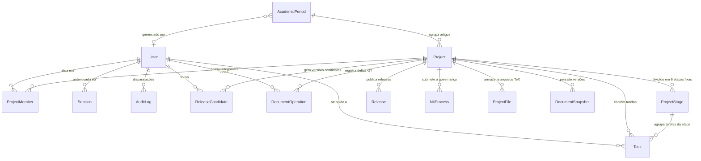

# 🗄️ Documentação Técnica do Banco de Dados (Database Specification)

> **Plataforma:** SCIA — Scientific Collaboration and Intelligent Assistance (`sci-latex-vscode`)  
> **SGBD Principal:** PostgreSQL 16 (Relacional ACID)  
> **Camada de Acesso a Dados:** Prisma ORM v7.10 com Adapter Nativo `@prisma/adapter-pg`  
> **Camada Auxiliar In-Memory:** Redis 7 (Controle de Presença & Cache Atômico)  
> **Status:** Produção / Especificação Ativa  
> **Última Atualização:** Outubro de 2026  

---

## 📑 Sumário

1. [Visão Geral & Stack de Armazenamento](#1-visão-geral--stack-de-armazenamento)
2. [Diagrama Entidade-Relacionamento (ERD)](#2-diagrama-entidade-relacionamento-erd)
3. [Tipos Enumerados (Enums)](#3-tipos-enumerados-enums)
4. [Dicionário de Dados Completo](#4-dicionário-de-dados-completo)
   - 4.1. [Domínio de Usuários, Sessões & Auditoria](#41-domínio-de-usuários-sessões--auditoria)
   - 4.2. [Domínio Organizacional (Períodos, Equipes & Metas)](#42-domínio-organizacional-períodos-equipes--metas)
   - 4.3. [Domínio Editorial (Projetos/Artigos, Membros & Etapas)](#43-domínio-editorial-projetosartigos-membros--etapas)
   - 4.4. [Domínio de Tarefas & Workspaces da IDE](#44-domínio-de-tarefas--workspaces-da-ide)
   - 4.5. [Domínio de Revisão por Pares & Diffs TeX](#45-domínio-de-revisão-por-pares--diffs-tex)
   - 4.6. [Domínio de Publicação & Release Candidates](#46-domínio-de-publicação--release-candidates)
   - 4.7. [Domínio de Governança NIT & Integração GitHub](#47-domínio-de-governança-nit--integração-github)
5. [Regras de Integridade, Índices & Cascading](#5-regras-de-integridade-índices--cascading)
6. [Estratégia de Presença e Cache em Memória (Redis)](#6-estratégia-de-presença-e-cache-em-memória-redis)
7. [Rotinas Operacionais (Migrações, Seeds & Consultas)](#7-rotinas-operacionais-migrações-seeds--consultas)

---

## 1. Visão Geral & Stack de Armazenamento

O sistema de persistência do SCIA adota um modelo híbrido com foco em integridade transacional ACID estrita para dados acadêmicos e baixa latência para sincronização de presenças atômicas de escrita.

```
┌────────────────────────────────────────────────────────────────────────┐
│                        DATA PERSISTENCE ARCHITECTURE                   │
├───────────────────────────────────┬────────────────────────────────────┤
│  PostgreSQL 16 (sci_latex_postgres)│  Redis 7 (sci_latex_redis)         │
│  - 17 Tabelas Relacionais         │  - Chaves de Presença com TTL      │
│  - Chaves Estrangeiras & Cascades │  - Heartbeat de Pods K8s (180s)    │
│  - JSONB para Logs de Auditoria   │  - Zero Lock no SGBD Principal     │
│  - Prisma ORM 7 + Driver Adapter  │  - Pub/Sub e Stream SSE Real-Time  │
└───────────────────────────────────┴────────────────────────────────────┘
```

### Tecnologias e Configurações

* **Engine:** PostgreSQL 16 Alpine (`container: sci_latex_postgres`, porta padrão `5432`).
* **Database Name:** `sci_latex_db` (`schema: public`).
* **Prisma Client:** Versão `^7.10.0` com adapter nativo `@prisma/adapter-pg` sobre o driver `pg` v8.
* **Pool de Conexões:** Gerenciado nativamente pelo Fastify no boot do processo Node.js através de instância única singleton (`src/db/prisma.ts`).
* **Convenção de Nomes:** 
  - Modelos/Tabelas: PascalCase com aspas duplas no PostgreSQL (`"User"`, `"Project"`, `"ProjectFile"`, `"DocumentSnapshot"`).
  - Colunas/Propriedades: camelCase com aspas duplas (`"passwordHash"`, `"academicPeriodId"`).
  - Tipos Enumerados: PascalCase (`"Role"`, `"TaskStatus"`, `"SubmissionStatus"`).

---

## 2. Diagrama Entidade-Relacionamento (ERD)



---

## 3. Tipos Enumerados (Enums)

### 3.1. `Role` (Controle de Acesso Baseado em Papéis — RBAC)
Define os privilégios operacionais do usuário na plataforma e dentro de projetos específicos.

```sql
CREATE TYPE "Role" AS ENUM ('AUTHOR', 'REVIEWER', 'COORDINATOR', 'MANAGER', 'ADMIN');
```

* `AUTHOR`: Escritor e pesquisador com permissão para gerenciar tarefas, editar no CodeMirror e solicitar revisões.
* `REVIEWER`: Avaliador acadêmico. Permissão estrita de leitura (`readOnly`) e inclusão de anotações e comentários inline ancorados (`ReviewSidebar`).
* `COORDINATOR`: Líder técnico de equipe. Monitora cronogramas, matriz de prazos e compilações oficiais.
* `MANAGER`: Gestor executivo institucional. Supervisiona cotas de publicação, gargalos e períodos acadêmicos.
* `ADMIN`: Administrador do sistema com acesso irrestrito a configurações e gestão de infraestrutura.

---

### 3.2. `TaskStatus` (Ciclo de Vida da Tarefa & Bate e Volta de Revisão — ADR-008)
Controla a transição granular das tarefas de escrita e os ciclos iterativos de revisão entre coautores e orientadores.

```sql
CREATE TYPE "TaskStatus" AS ENUM (
  'NOT_STARTED',
  'IN_PROGRESS',
  'REVIEW_REQUESTED',
  'IN_REVIEW',
  'CHANGES_REQUESTED',
  'COMPLETED'
);
```

* `NOT_STARTED`: Tarefa cadastrada e ainda não iniciada pelo pesquisador.
* `IN_PROGRESS`: Tarefa em processo ativo de escrita no editor CodeMirror 6.
* `REVIEW_REQUESTED`: Autor concluiu a seção e solicitou a avaliação do Revisor Oficial.
* `IN_REVIEW`: Revisor acessou a tarefa para inspeção e anotação em modo leitura.
* `CHANGES_REQUESTED`: Revisor devolveu a tarefa apontando melhorias necessárias.
* `COMPLETED`: Seção aprovada pelo Revisor Oficial e finalizada.
---

### 3.3. `NITStatus` (Governança do Núcleo de Inovação Tecnológica)
Trava formal de conformidade antes da submissão externa do manuscrito.

```sql
CREATE TYPE "NITStatus" AS ENUM ('NOT_REQUIRED', 'WAITING_NIT', 'APPROVED_NIT', 'REJECTED_NIT');
```

* `NOT_REQUIRED`: Artigo sem patente ou restrição de inovação associada.
* `WAITING_NIT`: Submetido à auditoria do NIT e retido na esteira de aprovação.
* `APPROVED_NIT`: Parecer favorável emitido. Libera a trava de envio para o congresso alvo.
* `REJECTED_NIT`: Restrição apontada pelo NIT. Exige reestruturação do conteúdo protegido.

---

### 3.4. `SubmissionStatus` (Status Macro do Artigo Científico)
Rastreia a jornada do paper desde o rascunho até a publicação final com DOI.

```sql
CREATE TYPE "SubmissionStatus" AS ENUM (
  'IN_PROGRESS',
  'WAITING_NIT',
  'SUBMITTED_TARGET',
  'SUBMITTED_BACKUP',
  'ACCEPTED_REVISION_REQUESTED',
  'ACCEPTED_CAMERA_READY',
  'REJECTED_WAITING_DECISION',
  'REJECTED_REOPENED_V2',
  'COMPLETED_PUBLISHED'
);
```

---

### 3.5. `StageStatus` (Estado das Etapas de Escrita)

```sql
CREATE TYPE "StageStatus" AS ENUM ('NOT_STARTED', 'IN_PROGRESS', 'COMPLETED', 'LOCKED');
```

* `NOT_STARTED`: Etapa planejada sem nenhuma atividade registrada.
* `IN_PROGRESS`: Ao menos uma sub-tarefa está sob escrita ativa.
* `COMPLETED`: Todas as sub-tarefas vinculadas alcançaram status `MERGED`.
* `LOCKED`: Etapa retida por dependência de gatekeeper ou trava sequencial.

---

### 3.6. `TaskStatus` (Estado das Sub-tarefas e Issues)

```sql
CREATE TYPE "TaskStatus" AS ENUM ('NOT_STARTED', 'IN_PROGRESS', 'UNDER_REVIEW', 'CHANGES_REQUESTED', 'APPROVED', 'MERGED');
```

---

### 3.7. `WorkspaceStatus` (Ciclo de Vida do Pod VS Code K8s)

```sql
CREATE TYPE "WorkspaceStatus" AS ENUM (
  'PROVISIONING',
  'READY',
  'DIRTY',
  'SYNCING',
  'BEHIND',
  'CONFLICTED',
  'ERROR',
  'TERMINATED'
);
```

---

### 3.8. Outros Enums de Apoio

* **`DeadlineStatus`**: `'ON_TIME'`, `'WARNING_SOON'`, `'OVERDUE'` (Cálculo de semáforo de prazos).
* **`PeriodStatus`**: `'ACTIVE'`, `'ARCHIVED'`, `'COMPLETED'` (Ciclos de pesquisa).
* **`RCStatus`**: `'SUBMITTED'`, `'UNDER_REVIEW'`, `'CHANGES_REQUESTED'`, `'APPROVED'` (Release Candidates).

---

## 4. Dicionário de Dados Completo

### 4.1. Domínio de Usuários, Sessões & Auditoria

#### Tabela `"User"`
Entidade central de autenticação e identificação de atores.

| Coluna | Tipo | Nulo | Restrições / Default | Descrição |
| :--- | :--- | :---: | :--- | :--- |
| `id` | `TEXT` | Não | `PK`, `default(uuid())` | Identificador único universal (UUIDv4) |
| `email` | `TEXT` | Não | `UNIQUE` | E-mail corporativo ou institucional |
| `name` | `TEXT` | Não | — | Nome completo do usuário |
| `passwordHash` | `TEXT` | Não | — | Hash seguro da senha |
| `role` | `"Role"` | Não | `DEFAULT 'AUTHOR'` | Papel global padrão no sistema |
| `createdAt` | `TIMESTAMP(3)` | Não | `DEFAULT now()` | Data e hora de criação do registro |
| `updatedAt` | `TIMESTAMP(3)` | Não | `@updatedAt` | Data e hora da última modificação |
| `deletedAt` | `TIMESTAMP(3)` | Sim | `NULL` | Data para Soft Delete |

#### Tabela `"Session"`
Armazena sessões ativas com rotação de refresh tokens HTTP-Only.

| Coluna | Tipo | Nulo | Restrições / Default | Descrição |
| :--- | :--- | :---: | :--- | :--- |
| `id` | `TEXT` | Não | `PK`, `default(uuid())` | Identificador único da sessão |
| `userId` | `TEXT` | Não | `FK -> User.id ON DELETE CASCADE` | Usuário proprietário da sessão |
| `refreshToken`| `TEXT` | Não | `UNIQUE` | Token de atualização persistido |
| `expiresAt` | `TIMESTAMP(3)` | Não | — | Data/hora de expiração do token |
| `createdAt` | `TIMESTAMP(3)` | Não | `DEFAULT now()` | Data de abertura da sessão |

#### Tabela `"AuditLog"`
Trilha imutável de auditoria com suporte a metadados livres via JSONB.

| Coluna | Tipo | Nulo | Restrições / Default | Descrição |
| :--- | :--- | :---: | :--- | :--- |
| `id` | `TEXT` | Não | `PK`, `default(uuid())` | Identificador único do log |
| `userId` | `TEXT` | Sim | `FK -> User.id ON DELETE SET NULL` | Autor da operação (nulo se sistema) |
| `action` | `TEXT` | Não | — | Ação executada (ex: `COMMIT_PROGRESS`, `PR_MERGE`) |
| `entityType` | `TEXT` | Não | — | Tipo da entidade afetada (`Project`, `Task`, etc.) |
| `entityId` | `TEXT` | Não | — | ID do registro afetado |
| `details` | `JSONB` | Sim | — | Payload com diff, justificativas ou parâmetros |
| `createdAt` | `TIMESTAMP(3)` | Não | `DEFAULT now()` | Timestamp imutável da ocorrência |

---

### 4.2. Domínio Organizacional (Períodos, Equipes & Metas)

#### Tabela `"AcademicPeriod"`
Representa ciclos acadêmicos e períodos de avaliação de metas de publicação (ex: *Ciclo 2026/2027*).

| Coluna | Tipo | Nulo | Restrições / Default | Descrição |
| :--- | :--- | :---: | :--- | :--- |
| `id` | `TEXT` | Não | `PK`, `default(uuid())` | UUID do ciclo acadêmico |
| `name` | `TEXT` | Não | — | Nome do período (ex: *"Ciclo Anual 2026/2027"*) |
| `startDate` | `TIMESTAMP(3)` | Não | — | Início do ciclo |
| `endDate` | `TIMESTAMP(3)` | Não | — | Término do ciclo |
| `targetArticlesCount`| `INTEGER` | Não | `DEFAULT 0` | Meta global de artigos para o ciclo |
| `status` | `"PeriodStatus"`| Não | `DEFAULT 'ACTIVE'` | Status (`ACTIVE`, `ARCHIVED`, `COMPLETED`) |
| `managerId` | `TEXT` | Sim | `FK -> User.id` | Gestor institucional responsável |
| `createdAt` | `TIMESTAMP(3)` | Não | `DEFAULT now()` | Data de criação |
| `updatedAt` | `TIMESTAMP(3)` | Não | `@updatedAt` | Data de atualização |
| `deletedAt` | `TIMESTAMP(3)` | Sim | `NULL` | Soft delete do ciclo |

#### Tabela `"Team"`
Equipe de pesquisa associada a um Coordenador técnico e um Gerente.

| Coluna | Tipo | Nulo | Restrições / Default | Descrição |
| :--- | :--- | :---: | :--- | :--- |
| `id` | `TEXT` | Não | `PK`, `default(uuid())` | UUID da equipe |
| `name` | `TEXT` | Não | — | Nome da equipe de pesquisa |
| `description` | `TEXT` | Sim | — | Escopo e objetivos da equipe |
| `managerId` | `TEXT` | Sim | `FK -> User.id` | Gerente supervisor |
| `coordinatorId`| `TEXT` | Não | `FK -> User.id` | **Coordenador técnico exclusivo** |
| `createdAt` | `TIMESTAMP(3)` | Não | `DEFAULT now()` | Data de criação |
| `updatedAt` | `TIMESTAMP(3)` | Não | `@updatedAt` | Data de atualização |
| `deletedAt` | `TIMESTAMP(3)` | Sim | `NULL` | Soft delete |

#### Tabela `"TeamMember"`
Tabela associativa entre Usuários e Equipes com papéis atribuídos.

| Coluna | Tipo | Nulo | Restrições / Default | Descrição |
| :--- | :--- | :---: | :--- | :--- |
| `id` | `TEXT` | Não | `PK`, `default(uuid())` | UUID do registro associativo |
| `teamId` | `TEXT` | Não | `FK -> Team.id ON DELETE CASCADE` | ID da equipe |
| `userId` | `TEXT` | Não | `FK -> User.id ON DELETE CASCADE` | ID do membro |
| `role` | `"Role"` | Não | `DEFAULT 'AUTHOR'` | Papel do membro na equipe |

* **Restrição Única Composta:** `@@unique([teamId, userId])` (Impede duplicidade de vínculo).

#### Tabela `"TeamAcademicGoal"`
Metas individuais de publicação atribuídas a uma equipe em um ciclo específico.

| Coluna | Tipo | Nulo | Restrições / Default | Descrição |
| :--- | :--- | :---: | :--- | :--- |
| `id` | `TEXT` | Não | `PK`, `default(uuid())` | UUID da meta |
| `academicPeriodId`| `TEXT`| Não | `FK -> AcademicPeriod.id ON DELETE CASCADE` | Ciclo acadêmico vinculado |
| `teamId` | `TEXT` | Não | `FK -> Team.id ON DELETE CASCADE` | Equipe vinculada |
| `targetArticles` | `INTEGER`| Não | `DEFAULT 0` | Quantidade de artigos contratada |
| `createdAt` | `TIMESTAMP(3)` | Não | `DEFAULT now()` | Data de definição da meta |
| `updatedAt` | `TIMESTAMP(3)` | Não | `@updatedAt` | Data de atualização |

* **Restrição Única Composta:** `@@unique([academicPeriodId, teamId])`.

---

### 4.3. Domínio Editorial (Projetos/Artigos, Membros & Etapas)

#### Tabela `"Project"`
Entidade mestra que encapsula o Artigo Científico, repositório Git e conferências associadas.

| Coluna | Tipo | Nulo | Restrições / Default | Descrição |
| :--- | :--- | :---: | :--- | :--- |
| `id` | `TEXT` | Não | `PK`, `default(uuid())` | UUID do artigo/projeto |
| `name` | `TEXT` | Não | — | Título do artigo científico |
| `description` | `TEXT` | Sim | — | Resumo executivo / Abstract do paper |
| `gitRepoPath` | `TEXT` | Não | — | Subcaminho no storage ou slug do GitHub |
| `teamId` | `TEXT` | Não | `FK -> Team.id ON DELETE CASCADE` | Equipe dona do artigo |
| `academicPeriodId`| `TEXT`| Sim | `FK -> AcademicPeriod.id` | Ciclo acadêmico vinculado |
| `submissionStatus`| `"SubmissionStatus"` | Não | `DEFAULT 'IN_PROGRESS'` | Estado atual na esteira de publicação |
| `currentVersion` | `INTEGER` | Não | `DEFAULT 1` | Versão editorial atual (v1, v2 pós-rejeição) |
| `targetConferenceName`| `TEXT`| Sim | — | Nome do congresso/periódico prioritário |
| `targetConferenceDate`| `TIMESTAMP(3)`| Sim | — | Data final de submissão no alvo |
| `backupConferenceName`| `TEXT`| Sim | — | Nome do congresso backup em caso de rejeição |
| `backupConferenceDate`| `TIMESTAMP(3)`| Sim | — | Prazo do congresso backup |
| `doi` | `TEXT` | Sim | — | Digital Object Identifier pós-publicação |
| `publicationUrl` | `TEXT` | Sim | — | URL oficial no portal da editora |
| `datasetUrl` | `TEXT` | Sim | — | URL do dataset científico vinculado |
| `publishedAt` | `TIMESTAMP(3)` | Sim | — | Data formal de publicação aceita |
| `reviewerFeedback`| `TEXT` | Sim | — | Parecer consolidado dos revisores externos |
| `createdAt` | `TIMESTAMP(3)` | Não | `DEFAULT now()` | Data de cadastro |
| `updatedAt` | `TIMESTAMP(3)` | Não | `@updatedAt` | Data de alteração |
| `deletedAt` | `TIMESTAMP(3)` | Sim | `NULL` | Soft delete |

#### Tabela `"ProjectMember"`
Associação de co-autores e do revisor técnico ao artigo.

| Coluna | Tipo | Nulo | Restrições / Default | Descrição |
| :--- | :--- | :---: | :--- | :--- |
| `id` | `TEXT` | Não | `PK`, `default(uuid())` | UUID da membresia |
| `userId` | `TEXT` | Não | `FK -> User.id ON DELETE CASCADE` | Usuário participante |
| `projectId` | `TEXT` | Não | `FK -> Project.id ON DELETE CASCADE`| Artigo associado |
| `role` | `"Role"` | Não | — | Papel no artigo (`AUTHOR` ou `REVIEWER`) |

* **Restrição Única Composta:** `@@unique([userId, projectId])`.
* **Regra de Domínio:** A camada de serviços valida no nível de aplicação que um projeto aceita **estritamente 1 único membro com `role = REVIEWER`**.

#### Tabela `"ProjectStage"`
Etapas sequenciais da linha do tempo do artigo (Gantt) e travas de Gatekeeper. Conforme estabelecido na **ADR-008**, todo projeto nasce com **6 etapas fixas e imutáveis** (ordem estrita 1 a 6):
1. Planejamento e Pesquisa TeX (`order: 1`, `isGatekeeper: false`)
2. Desenvolvimento Experimental & Benchmarks (`order: 2`, `isGatekeeper: false`)
3. Escrita do Artigo — Tarefas Paralelas (`order: 3`, `isGatekeeper: false`)
4. Revisão Técnica e Científica — Revisão Geral (`order: 4`, `isGatekeeper: false`)
5. Parecer do NIT — Gatekeeper 1 (`order: 5`, `isGatekeeper: true`, `gatekeeperType: 'NIT'`)
6. Submissão Final ao Congresso Alvo — Gatekeeper 2 (`order: 6`, `isGatekeeper: true`, `gatekeeperType: 'TARGET_CONFERENCE'`)

| Coluna | Tipo | Nulo | Restrições / Default | Descrição |
| :--- | :--- | :---: | :--- | :--- |
| `id` | `TEXT` | Não | `PK`, `default(uuid())` | UUID da etapa |
| `projectId` | `TEXT` | Não | `FK -> Project.id ON DELETE CASCADE`| Artigo vinculado |
| `title` | `TEXT` | Não | — | Nome da etapa fixa |
| `description` | `TEXT` | Sim | — | Orientações de escrita da seção |
| `order` | `INTEGER` | Não | — | Posição sequencial obrigatória (1 a 6) |
| `plannedStartAt` | `TIMESTAMP(3)` | Sim | — | Início planejado |
| `plannedEndAt` | `TIMESTAMP(3)` | Sim | — | Término planejado |
| `plannedCompletionDate` | `TIMESTAMP(3)` | Sim | — | Data alvo contratada |
| `startedAt` | `TIMESTAMP(3)` | Sim | — | Início real de trabalho |
| `completedAt` | `TIMESTAMP(3)` | Sim | — | Conclusão real da etapa |
| `status` | `"StageStatus"`| Não | `DEFAULT 'NOT_STARTED'` | Estado da etapa (`NOT_STARTED`, `IN_PROGRESS`, `COMPLETED`, `LOCKED`) |
| `isGatekeeper` | `BOOLEAN` | Não | `DEFAULT false` | Indica trava de governança obrigatória |
| `gatekeeperType` | `TEXT` | Sim | — | `"NIT"`, `"TARGET_CONFERENCE"` ou `"BACKUP_CONFERENCE"` |
| `createdAt` | `TIMESTAMP(3)` | Não | `DEFAULT now()` | Data de criação |
| `updatedAt` | `TIMESTAMP(3)` | Não | `@updatedAt` | Data de atualização |

* **Restrição Única Composta:** `@@unique([projectId, order])` (Garante unicidade estrita de ordenação).
* **Regra de Imutabilidade (ADR-008):** Deleção de etapas é bloqueada na API (`DELETE /stages/:id -> 400 BAD_REQUEST`); a ordem 1 a 6 não pode ser alterada.

---

### 4.4. Domínio de Tarefas de Escrita & Bate e Volta

#### Tabela `"Task"`
Sub-tarefas atômicas de escrita científica vinculadas às etapas do artigo, com ciclo iterativo de revisão entre autor e orientador.

| Coluna | Tipo | Nulo | Restrições / Default | Descrição |
| :--- | :--- | :---: | :--- | :--- |
| `id` | `TEXT` | Não | `PK`, `default(uuid())` | UUID da tarefa |
| `projectId` | `TEXT` | Não | `FK -> Project.id ON DELETE CASCADE`| Artigo vinculado |
| `stageId` | `TEXT` | Sim | `FK -> ProjectStage.id ON DELETE SET NULL`| Etapa pai vinculada |
| `assignedToId` | `TEXT` | Sim | `FK -> User.id` | Autor responsável atribuído |
| `title` | `TEXT` | Não | — | Título da tarefa de escrita (ex: *"Seção de Metodologia"*) |
| `status` | `"TaskStatus"` | Não | `DEFAULT 'NOT_STARTED'` | Estado operacional (`NOT_STARTED`, `IN_PROGRESS`, `REVIEW_REQUESTED`, `IN_REVIEW`, `CHANGES_REQUESTED`, `COMPLETED`) |
| `startDate` | `TIMESTAMP(3)` | Sim | — | Data programada de início |
| `startedAt` | `TIMESTAMP(3)` | Sim | — | Data real de inicialização |
| `dueDate` | `TIMESTAMP(3)` | Sim | — | Data limite de entrega da sub-tarefa |
| `createdAt` | `TIMESTAMP(3)` | Não | `DEFAULT now()` | Data de criação |
| `updatedAt` | `TIMESTAMP(3)` | Não | `@updatedAt` | Data de atualização |

---

### 4.5. Domínio de Edição Colaborativa TeX & Versionamento (ADR-007)

#### Tabela `"ProjectFile"`
Armazena a árvore de arquivos de código LaTeX, bibliografia BibTeX, figuras e folhas de estilo do projeto.

| Coluna | Tipo | Nulo | Restrições / Default | Descrição |
| :--- | :--- | :---: | :--- | :--- |
| `id` | `TEXT` | Não | `PK`, `default(uuid())` | UUID do arquivo |
| `projectId` | `TEXT` | Não | `FK -> Project.id ON DELETE CASCADE`| Artigo vinculado |
| `path` | `TEXT` | Não | — | Caminho relativo do arquivo (ex: `"main.tex"`, `"sections/01_intro.tex"`) |
| `content` | `TEXT` | Não | `DEFAULT ''` | Conteúdo textual durável em disco/banco |
| `createdAt` | `TIMESTAMP(3)` | Não | `DEFAULT now()` | Data de criação |
| `updatedAt` | `TIMESTAMP(3)` | Não | `@updatedAt` | Momento do último flush de persistência |

* **Restrição Única Composta:** `@@unique([projectId, path])`.

#### Tabela `"DocumentOperation"`
Histórico de deltas de Transformação Operacional (OT) sequenciados pelo pod dono do documento.

| Coluna | Tipo | Nulo | Restrições / Default | Descrição |
| :--- | :--- | :---: | :--- | :--- |
| `id` | `TEXT` | Não | `PK`, `default(uuid())` | UUID da operação |
| `projectId` | `TEXT` | Não | `FK -> Project.id ON DELETE CASCADE`| Artigo vinculado |
| `userId` | `TEXT` | Não | `FK -> User.id` | Autor originário da digitação |
| `file` | `TEXT` | Não | — | Arquivo alvo do delta |
| `operation`| `JSONB` | Não | — | Payload serializado da operação OT (insert/delete) |
| `version` | `INTEGER` | Não | — | Versão sequencial do documento após aplicação |
| `createdAt` | `TIMESTAMP(3)` | Não | `DEFAULT now()` | Timestamp de recepção |

#### Tabela `"DocumentSnapshot"`
Pontos de restauração e versões completas do documento geradas automaticamente ou sob demanda.

| Coluna | Tipo | Nulo | Restrições / Default | Descrição |
| :--- | :--- | :---: | :--- | :--- |
| `id` | `TEXT` | Não | `PK`, `default(uuid())` | UUID do snapshot |
| `projectId` | `TEXT` | Não | `FK -> Project.id ON DELETE CASCADE`| Artigo vinculado |
| `version` | `INTEGER` | Não | — | Versão sequencial consolidada |
| `content` | `TEXT` | Não | — | Conteúdo integral de todos os arquivos do snapshot |
| `createdAt` | `TIMESTAMP(3)` | Não | `DEFAULT now()` | Timestamp do snapshot |

---

### 4.6. Domínio de Publicação & Release Candidates

#### Tabela `"ReleaseCandidate"`
Versões congeladas do documento submetidas à validação integral da equipe antes do envio formal.

| Coluna | Tipo | Nulo | Restrições / Default | Descrição |
| :--- | :--- | :---: | :--- | :--- |
| `id` | `TEXT` | Não | `PK`, `default(uuid())` | UUID da Release Candidate |
| `projectId` | `TEXT` | Não | `FK -> Project.id ON DELETE CASCADE`| Artigo ao qual pertence |
| `versionTag` | `TEXT` | Não | — | Tag semântica (ex: `"v1.0-rc1"`) |
| `snapshotId` | `TEXT` | Sim | — | Identificador do snapshot correspondente |
| `status` | `"RCStatus"` | Não | `DEFAULT 'SUBMITTED'` | Estado da RC (`SUBMITTED`, `UNDER_REVIEW`, `CHANGES_REQUESTED`, `APPROVED`) |
| `feedback` | `TEXT` | Sim | — | Avaliação geral da versão |
| `reviewerId` | `TEXT` | Sim | `FK -> User.id` | Revisor avaliador |
| `pdfUrl` | `TEXT` | Sim | — | Caminho do PDF compilado correspondente |
| `createdAt` | `TIMESTAMP(3)` | Não | `DEFAULT now()` | Data de congelamento |
| `updatedAt` | `TIMESTAMP(3)` | Não | `@updatedAt` | Data da avaliação |

#### Tabela `"Release"`
Histórico imutável de versões finais aprovadas e publicadas em conferências.

| Coluna | Tipo | Nulo | Restrições / Default | Descrição |
| :--- | :--- | :---: | :--- | :--- |
| `id` | `TEXT` | Não | `PK`, `default(uuid())` | UUID da release oficial |
| `projectId` | `TEXT` | Não | `FK -> Project.id ON DELETE CASCADE`| Artigo publicado |
| `versionTag` | `TEXT` | Não | — | Tag de versão (ex: `"v1.0"`) |
| `version` | `INTEGER` | Não | `DEFAULT 1` | Versão numérica |
| `title` | `TEXT` | Não | — | Título no momento da submissão |
| `conference` | `TEXT` | Sim | — | Nome da conferência onde foi submetido |
| `pdfUrl` | `TEXT` | Sim | — | Link do PDF Camera-Ready arquivado |
| `createdAt` | `TIMESTAMP(3)` | Não | `DEFAULT now()` | Timestamp do registro da entrega |

---

### 4.7. Domínio de Governança NIT

#### Tabela `"NitProcess"`
Rastreia a conformidade institucional de Propriedade Intelectual junto ao NIT (Gatekeeper 1).

| Coluna | Tipo | Nulo | Restrições / Default | Descrição |
| :--- | :--- | :---: | :--- | :--- |
| `id` | `TEXT` | Não | `PK`, `default(uuid())` | UUID do processo NIT |
| `articleId` | `TEXT` | Não | `FK -> Project.id ON DELETE CASCADE`| Artigo auditado |
| `status` | `"NITStatus"` | Não | `DEFAULT 'WAITING_NIT'` | Parecer atual do comitê |
| `sentAt` | `TIMESTAMP(3)` | Não | — | Data do envio ao NIT |
| `sentNotes` | `TEXT` | Sim | — | Observações submetidas ao comitê |
| `approvedAt` | `TIMESTAMP(3)` | Sim | — | Data de aprovação formal |
| `responseNotes` | `TEXT` | Sim | — | Resposta e parecer emitido |
| `protocolNumber`| `TEXT` | Sim | — | Número oficial de protocolo do processo |
| `createdAt` | `TIMESTAMP(3)` | Não | `DEFAULT now()` | Data de abertura do processo |

---

## 5. Regras de Integridade, Índices & Cascading

### 5.1. Políticas de Cascading (`ON DELETE`)

```
Project (Deleção em Cascata)
  ├── ProjectMember (CASCADE)
  ├── ProjectStage (CASCADE)
  │     └── Task (CASCADE)
  ├── ProjectFile (CASCADE)
  ├── DocumentOperation (CASCADE)
  ├── DocumentSnapshot (CASCADE)
  ├── ReleaseCandidate (CASCADE)
  ├── Release (CASCADE)
  └── NitProcess (CASCADE)

User (Preservação de Histórico)
  ├── AuditLog (SET NULL)  <-- Logs permanecem intactos sem dados pessoais
  ├── Task.assignedToId (RESTRICT/SET NULL)
  └── ReleaseCandidate.reviewerId (SET NULL)
```

### 5.2. Chaves Únicas e Índices de Performance

| Tabela | Campos Envolvidos | Propósito Técnico |
| :--- | :--- | :--- |
| `"User"` | `(email)` | Unicidade estrita de e-mails de login |
| `"Session"` | `(refreshToken)` | Rotação segura e invalidação atômica de sessões |
| `"TeamMember"` | `(teamId, userId)` | Impede duplicidade de membro na mesma equipe |
| `"TeamAcademicGoal"` | `(academicPeriodId, teamId)` | Uma meta por equipe em cada período acadêmico |
| `"ProjectMember"` | `(userId, projectId)` | Impede vincular o mesmo usuário mais de uma vez ao paper |
| `"ProjectStage"` | `(projectId, order)` | Unicidade sequencial de etapas na linha do tempo |
| `"Workspace"` | `(projectId, userId, stageId, taskId)` | Evita provisionamento de múltiplos Pods concorrentes |
| `"GithubWebhookEvent"`| `(deliveryId)` | **Idempotência estrita**: Rejeita re-entregas duplicadas do GitHub |

---

## 6. Estrutura de Presença e Cache em Memória (Redis)

O banco de dados PostgreSQL é blindado contra requisições contínuas de alta frequência (polling de digitação e batimento cardíaco da IDE). Essa responsabilidade é delegada ao **Redis 7** (`sci_latex_redis`):

### 6.1. Estrutura de Chave de Presença do Workspace

```
workspace:active:<projectId>:<userId>:<taskId>
```

* **Tipo:** String / Hash de presença.
* **Valor:** JSON com timestamp do último batimento e identificador do Pod.
* **TTL (Time to Live):** `180 segundos` (Renovado a cada 20 segundos pelo Web Worker do frontend via `POST /api/v1/events/heartbeat`).
* **Regra de Sweeper / Garbage Collector:**
  - Se o usuário fecha a aba ou o navegador, o TTL expira.
  - O daemon do backend Fastify (`k8s-pod-manager.service.ts` / `reconcileOrphanPods`) roda a cada 60s, detecta a ausência da chave no Redis e solicita à API do Kubernetes a destruição física do Pod correspondente, economizando memória RAM e CPU do nó.

### 6.2. Coordenação de Posse do Editor Colaborativo (Document Ownership Lease)

```
editor:document:<documentId>:owner
```

* **Tipo:** String atômica (`SET key podId EX 10 NX`).
* **Valor:** Identificador do Pod Fastify responsável pela sessão (`POD_ID`).
* **TTL (Time to Live):** `10 segundos` (Renovado a cada 3 segundos via heartbeat enquanto houver autores conectados na sala WebSocket).
* **Propósito Técnico:**
  - Garante a autoridade única (*Single-Writer*) do motor `@codemirror/collab` para cada documento ativo.
  - Impede *split-brain* e corrupção concorrente quando o backend é orquestrado em múltiplos Pods no Kubernetes.
  - Se o Pod morrer subitamente, o TTL de 10s expira automaticamente e outro Pod pode assumir a autoridade do documento a partir do checkpoint persistido no PostgreSQL.
  - **Regra de ouro:** O Redis **não** armazena deltas de digitação; os deltas são operados na RAM do Pod dono e gravados diretamente no PostgreSQL via debounce híbrido.
---

## 7. Rotinas Operacionais (Migrações, Seeds & Consultas)

### 7.1. Comandos de Gerenciamento do Banco via CLI

```bash
# Executar migrações pendentes em ambiente de desenvolvimento
npm run db:migrate

# Gerar o cliente Prisma após alterações no schema.prisma
npm run db:generate

# Popular o banco com os dados iniciais (Seed: Usuário Admin padrão)
npm run db:seed

# Abrir o visualizador gráfico web do banco de dados (Prisma Studio)
npm run db:studio
```

---

### 7.2. Exemplos de Consultas SQL Frequentes (PostgreSQL)

> **Nota:** Como o Prisma utiliza identificadores em PascalCase e camelCase, as consultas em SQL nativo no PostgreSQL **devem** utilizar aspas duplas nas tabelas e colunas:

#### 1. Listar Artigos com seus Respectivos Coordenadores e Equipes
```sql
SELECT 
    p.id AS project_id,
    p.name AS article_title,
    p."submissionStatus",
    t.name AS team_name,
    u.name AS coordinator_name,
    u.email AS coordinator_email
FROM "Project" p
JOIN "Team" t ON p."teamId" = t.id
JOIN "User" u ON t."coordinatorId" = u.id
WHERE p."deletedAt" IS NULL;
```

#### 2. Relatório de Desempenho de Metas por Equipe no Período Ativo
```sql
SELECT 
    ap.name AS academic_cycle,
    t.name AS team_name,
    tag."targetArticles" AS target_quota,
    COUNT(p.id) AS produced_articles,
    CASE 
        WHEN COUNT(p.id) >= tag."targetArticles" THEN 'MET_OR_EXCEEDED'
        ELSE 'IN_PROGRESS'
    END AS status
FROM "TeamAcademicGoal" tag
JOIN "AcademicPeriod" ap ON tag."academicPeriodId" = ap.id
JOIN "Team" t ON tag."teamId" = t.id
LEFT JOIN "Project" p ON p."teamId" = t.id AND p."academicPeriodId" = ap.id
WHERE ap.status = 'ACTIVE'
GROUP BY ap.name, t.name, tag."targetArticles";
```

#### 3. Auditoria de Apontamentos de Revisão por Artigo
```sql
SELECT 
    p.name AS article_title,
    pr.title AS pr_title,
    rc."lineNumer" AS line_number,
    rc.comment,
    u.name AS reviewer_name,
    rc."createdAt" AS commented_at
FROM "ReviewComment" rc
JOIN "PullRequest" pr ON rc."pullRequestId" = pr.id
JOIN "Project" p ON pr."projectId" = p.id
JOIN "User" u ON rc."userId" = u.id
ORDER BY rc."createdAt" DESC;
```

---

*Documentação técnica oficial do banco de dados mantida pela equipe de Engenharia do SCIA.*  
*Espelho do schema: `backend/prisma/schema.prisma`.*