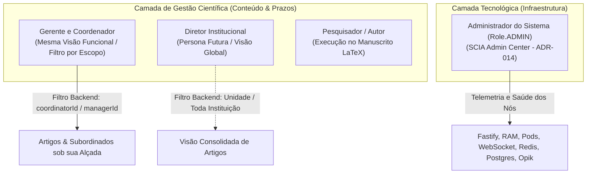

# 🏛️ Diretrizes de Gestão da Produção Científica no SCIA
## Modelo de Governança, Dashboard Unificado por Escopo e Preservação do Rigor Acadêmico

> **Status:** APROVADO COMO DIRETRIZ OFICIAL  
> **Data:** 13 de Novembro de 2026  
> **Domínio:** Governança Científica, Gestão Editorial, Inteligência Operacional e Acompanhamento de Ciclos  
> **Público-Alvo:** Engenharia de Software, Arquitetura, Product Designers e Equipes Acadêmicas  

---

## ⚡ 1. Resumo Executivo & Filosofia de Gestão

O **SCIA** (*Scientific Collaboration and Intelligent Assistance*) consolida sua evolução como uma **plataforma integrada de escrita científica colaborativa e governança estratégica da produção científica**. 

Ao absorver as melhores práticas da gestão de projetos moderna (como Estruturas Analíticas de Projeto - EAP, gráficos de Gantt, acompanhamento de capacidade e matrizes de risco), o SCIA estabelece um princípio inegociável: **adaptar a gestão à realidade acadêmica e científica, jamais transformando a plataforma em um ERP empresarial genérico ou burocrático**.

```
┌──────────────────────────────────────────────────────────────────────────────────┐
│                             OS TRÊS PILARES DO SCIA                              │
├─────────────────────────┬────────────────────────────┬───────────────────────────┤
│  1. PRODUÇÃO CIENTÍFICA │  2. GESTÃO ESTRATÉGICA     │  3. INTELIGÊNCIA (SciAI)  │
│  Editor LaTeX nativo,   │  Acompanhamento de prazos, │  Copiloto contextual,     │
│  OT em tempo real (RAM) │  6 etapas, portfólio,      │  análise de gargalos e    │
│  e revisões micro/macro │  riscos e orientações      │  apoio a decisões         │
└─────────────────────────┴────────────────────────────┴───────────────────────────┘
```

---

## 👥 2. Matriz Definitiva de Personas & Escopo de Acesso

A arquitetura do SCIA estabelece a separação estrita de quatro perfis de usuários, eliminando duplicidade de interfaces e garantindo soberania institucional:



### 2.1. A Regra de Ouro: Gerente e Coordenador Compartilham a Mesma Visão
* **Experiência Funcional Idêntica:** Gerente (`Role.MANAGER`) e Coordenador (`Role.COORDINATOR`) utilizam exatamente **o mesmo painel de gestão**, os mesmos gráficos, as mesmas telas e os mesmos indicadores.
* **Isolamento de Escopo no Backend:** Nenhum dos dois tem a visão do todo da instituição. O backend Fastify aplica o filtro relacional no PostgreSQL de forma rigorosa:
  ```sql
  -- Restrição estrita de escopo para Gerente e Coordenador:
  WHERE project.coordinatorId = :authenticatedUserId 
     OR project.managerId = :authenticatedUserId
     OR EXISTS (
       SELECT 1 FROM "ProjectMember" pm 
       WHERE pm."projectId" = project.id AND pm."userId" = :authenticatedUserId
     )
  ```
  O gestor visualiza única e exclusivamente os **artigos, pesquisadores, orientadores e tarefas que estão sob sua responsabilidade direta**.

### 2.2. O Diretor (Persona Futura)
* Terá a visão estratégica institucional consolidada de toda a universidade/instituto (comparativo entre departamentos, metas globais e grandes volumes). Não precisa ser desenvolvido de imediato; a base de dados já está preparada.

### 2.3. O Administrador do Sistema (`Role.ADMIN`)
* Cuida estritamente da **saúde técnica da infraestrutura e operação da plataforma** (ADR-014): microsserviços, latência p95, memória RAM de pods, fila de compilação TeX, leases do Redis e logs de auditoria imutáveis.
* **O Administrador NÃO é um super-gerente editorial:** ele não deve ter acesso visual a rascunhos de pesquisas ou notas acadêmicas internas apenas por ser admin da máquina.

---

## 📊 3. O Kanban no SCIA: Ferramenta Exclusiva de Visualização (Read-Only)

> [!IMPORTANT]
> **No SCIA, o Kanban é estritamente uma ferramenta de visualização e monitoramento (Dashboard View), e NUNCA um quadro de movimentação livre (drag-and-drop) que burle as regras de governança.**

### 3.1. Por que o Kanban Não Pode Ter Drag-and-Drop de Etapas?
No gerenciamento de projetos corporativo genérico (ex.: Jira, Trello), o usuário arrasta livremente um card de uma coluna para outra. No SCIA, permitir isso seria **catastrófico para a integridade acadêmica**:
1. **As 6 Etapas Canônicas são Imutáveis (ADR-008):** Nenhum artigo pode "pular" da Etapa 4 para a Etapa 6 ignorando a trava do NIT da Etapa 5.
2. **Gatekeepers Invioláveis:**
   * **Trava do NIT (Etapa 5 🔒):** Exige parecer institucional formal (`APPROVED_NIT`) para liberação.
   * **Trava de Submissão (Etapa 6 🔒):** Exige compilação aprovada e confirmação dos coautores.
3. **Integridade de Revisão:** Tarefas de escrita possuem ciclo de vida formal (`REVIEW_REQUESTED` ➡️ `IN_REVIEW` ➡️ `CHANGES_REQUESTED` ➡️ `COMPLETED`) atrelado a comentários inline ancorados no LaTeX (`ReviewComment`).

### 3.2. Como o Kanban Funciona no SCIA
* Atua como uma **lente visual rápida** para o Coordenador/Gerente inspecionar o estado das tarefas de um artigo ou ciclo:
  * *Coluna 1: A Fazer (Backlog)*
  * *Coluna 2: Em Escrita (Autores redigindo no CodeMirror)*
  * *Coluna 3: Aguardando Parecer do Orientador*
  * *Coluna 4: Ajustes Solicitados*
  * *Coluna 5: Concluídas*
* As transições de estado ocorrem **por ações deliberadas de negócio** (ex.: o orientador aprova a revisão no editor, o autor clica em "Submeter para Revisão"), e o Kanban apenas reflete o estado instantaneamente.

---

## 🧭 4. Estrutura do Módulo de Gestão da Produção Científica

A navegação unificada para Gerentes e Coordenadores é estruturada em 8 pilares operacionais:

### 4.1. Painel Gerencial (Home Executiva do Gestor)
Focado em respostas rápidas em menos de 5 segundos:
* **Cartões de Topo:** Artigos Ativos, Concluídos, Atrasados, Entregas nos Próximos 30 Dias, Aguardando Aprovação e Artigos em Risco.
* **Funil Visual das 6 Etapas:** Barra horizontal comparando o fluxo em cada fase oficial.
* **Lista de Ação Imediata:** Artigos com semáforo amarelo/vermelho que exigem despacho do gestor.

### 4.2. Portfólio Científico
Ponto de entrada central para gerenciar todos os manuscritos sob sua alçada:
* **Alternância Tabela / Cards:** Tabela detalhada com colunas de Artigo, Orientador, Etapa Atual, Barra de Progresso, Congresso-Alvo, Deadline e Status de Risco.
* **Semáforos Padronizados:**
  * 🟢 **No Prazo:** Ritmo e checkpoints condizentes com a data-alvo.
  * 🟡 **Em Atenção:** Prazo próximo (< 30 dias) com tarefas pendentes.
  * 🔴 **Atrasado:** Data limite de etapa ultrapassada.
  * 🔒 **Bloqueado:** Aguardando parecer de Gatekeeper (NIT).

### 4.3. Cronogramas & Entregas (Gantt com Não-Linearidade)
* **Distinção de Planejado vs. Realizado:** Comparação visual entre o cronograma acordado e as datas reais de checkpoint e commits.
* **Marcos Fixos de Congressos:** Diamantes de alerta no calendário marcando a data final do Congresso-Alvo e Congresso-Backup.
* **Suporte a Etapas Paralelas:** Não assume modelo em cascata forçado; reflete etapas que ocorrem em paralelo (ex.: *Experimentos* rodando junto com *Escrita*).

### 4.4. Gestão de Equipes e Capacidade (Workload Acadêmico)
Mede o fluxo de trabalho real sem invadir a privacidade do pesquisador:
* **Métricas Apropriadas:** Volume de artigos por orientador, manuscritos pendentes na fila de cada revisor técnico, tempo médio de permanência em revisão e identificação de tarefas sem responsável.
* **Métricas Proibidas (Anti-Padrões):** Monitoramento de tempo online, quantidade de teclas digitadas ou volume bruto de palavras por dia.

### 4.5. Gestão de Riscos e Alertas Proativos
* **Alerta de Estagnação (> 15 dias):** Identificação automática de artigos sem nenhuma alteração de texto, snapshot ou movimentação de tarefa há mais de 15 dias corridos.
* **Alerta de Descompasso:** Quando o tempo médio histórico necessário para as etapas restantes é maior do que os dias que faltam até o prazo final do congresso.
* **Alerta de Protocolo NIT:** Manuscrito na Etapa 4 com previsão de submissão em menos de 20 dias sem protocolo no NIT aberto.

---

## 📐 5. Fórmulas Formais dos Indicadores (Auditoria Determinística)

Para evitar números arbitrários ou divergências entre relatórios, todo indicador do SCIA possui fórmula documentada e calculada diretamente sobre o banco relacional:

### 1. Taxa de Conclusão de Artigos ($TC$)
$$TC = \left( \frac{\text{Artigos que finalizaram a Etapa 6 no Período}}{\text{Artigos iniciados no Período}} \right) \times 100$$

### 2. Taxa de Sucesso em Submissões ($T_{sub}$)
$$T_{sub} = \left( \frac{\text{Artigos aceitos no Congresso-Alvo ou Backup}}{\text{Total de Artigos Submetidos}} \right) \times 100$$

### 3. Taxa de Atraso de Prazos ($T_{atr}$)
$$T_{atr} = \left( \frac{\text{Etapas finalizadas após a data prevista}}{\text{Total de etapas finalizadas}} \right) \times 100$$

### 4. Taxa de Retrabalho Editorial ($TR$)
$$TR = \left( \frac{\text{Tarefas que retornaram para CHANGES\_REQUESTED}}{\text{Total de tarefas avaliadas em revisão}} \right) \times 100$$

### 5. Lead Time das Etapas ($LT_e$)
$$LT_e = \text{Média em dias corridos entre } \text{transição } IN\_PROGRESS \text{ e } COMPLETED \text{ para a etapa } e$$

---

## 🤖 6. Inteligência Gerencial com SciAI

O assistente **SciAI** atua como co-piloto analítico para o Gerente e o Coordenador, com limites claros de atuação:

* **O que o SciAI Faz:**
  * Responde perguntas em linguagem natural sobre o escopo do usuário (*"Quais artigos da minha equipe correm risco de não cumprir o prazo do congresso este mês?"*).
  * Explica causas prováveis de atraso correlacionando dados (*"A Etapa 4 está concentrando 60% do atraso devido a 3 artigos aguardando o mesmo revisor"*).
  * Gera minutas de relatórios executivos para colegiados e reuniões de pós-graduação.
* **O que o SciAI NÃO Faz (Blindagem de Segurança):**
  * Não aprova etapas nem emite pareceres do NIT.
  * Não altera datas de cronograma sem autorização humana.
  * Não acessa artigos fora do escopo atribuído ao gestor logado.

---

## 🚫 7. O que NÃO Fazer (O que Conflitaria com a Essência do SCIA)

| Prática Corporativa (Artia / Jira / ERP) | Como o SCIA se Posiciona | Motivo Técnico / Acadêmico |
| :--- | :--- | :--- |
| **Apontamento de Horas (Timesheet)** | ❌ **Terminantemente Proibido** | A pesquisa científica não é trabalho braçal horário; exige leitura e reflexão. Mede-se por entregas e qualidade. |
| **Kanban Livre com Drag-and-Drop** | ❌ **Proibido nas Etapas** (Permitido apenas como visualização de tarefas na Etapa 3) | Quebraria a conformidade institucional dos Gatekeepers e a integridade do banco relacional. |
| **Gestão Financeira & Faturamento** | ❌ **Fora de Escopo** | O SCIA é focado no manuscrito, na colaboração LaTeX e na propriedade intelectual (NIT). |
| **Acesso Irrestrito do Admin ao Conteúdo** | ❌ **Bloqueado por RBAC** | O Administrador técnico cuida dos nós e bancos; os dados dos artigos pertencem aos seus autores e gestores. |

---

## 🗺️ 8. Mapeamento do Código Atual & Próximos Passos

```
┌───────────────────────────────────────────────────────────────────────────────┐
│                     STATUS DE ENGENHARIA NO MONOREPO                          │
├─────────────────────────────────────────────────┬─────────────────────────────┤
│ Componente                                      │ Status                      │
├─────────────────────────────────────────────────┼─────────────────────────────┤
│ 1. Banco Relacional com 6 Etapas Imutáveis       │ 🟢 100% Concluído (ADR-008) │
│ 2. Fencing de Posse e Editor Colaborativo       │ 🟢 100% Concluído (ADR-007) │
│ 3. SCIA Admin Center (Operação Técnica)         │ 🟢 100% Concluído (ADR-014) │
│ 4. Cronograma Gantt Acadêmico                   │ 🟢 100% Concluído           │
│ 5. APIs de Cálculo de Atrasos e Estagnações     │ 🟢 100% Concluído           │
│ 6. Dashboard Unificado Gerente/Coordenador      │ 🟡 Planejado (Fase 7)       │
│ 7. Visualizador Kanban Read-Only de Tarefas     │ 🟡 Planejado (Fase 7)       │
│ 8. Assistente Executivo SciAI para Gestão       │ ⚪ Próxima Prioridade       │
└─────────────────────────────────────────────────┴─────────────────────────────┘
```

---

*Documento formalizado e integrado ao repositório institucional do SCIA.*
