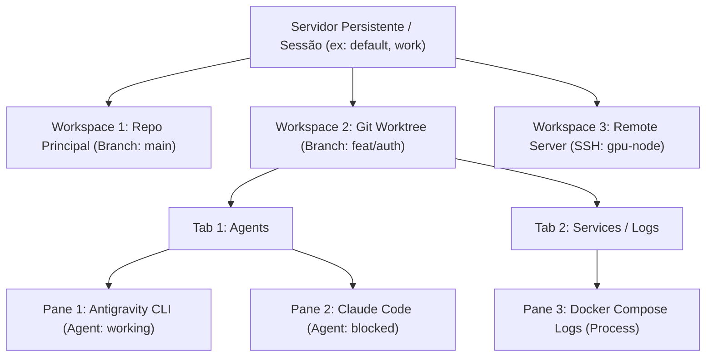

# Guia Definitivo do Herdr (v0.9.5)
## Terminal Workspace Manager para AI Coding Agents & Multi-Agent Workflows

---

## 1. Introdução e Visão Geral

O **Herdr** é um multiplexador de terminal e gerenciador de workspaces construído especificamente para a era dos **agentes de código de inteligência artificial** (como Antigravity / Gemini CLI, Claude Code, Codex, OpenCode, Devin CLI, Aider, entre outros).

Enquanto multiplexadores clássicos (`tmux`, `screen`, `zellij`) foram pensados exclusivamente para humanos digitando manualmente em sessões persistentes, o Herdr introduz um paradigma híbrido:
1. **Agent-Aware:** Inspeciona e reconhece o ciclo de vida dos agentes de IA em execução.
2. **Mouse-First TUI:** Interface totalmente interativa com cliques, arrasto de divisórias, menus de contexto (botão direito) e seleção fluida.
3. **Socket API & CLI Control:** Automação determinística em JSON para que scripts e os próprios agentes controlem janelas, layouts e processos.
4. **Git Worktree First-Class:** Criação instantânea de workspaces isolados por branch, permitindo paralelizar múltiplos agentes sem conflitos de arquivos.
5. **Multi-Máquina Nativo:** Controle unificado de sessões locais e instâncias remotas via SSH sob a mesma janela.

---

## 2. Arquitetura e Modelo de Conceitos

O Herdr organiza o ambiente de trabalho em 5 camadas lógicas:



### Ciclo de Vida dos Agentes
Na barra lateral (*sidebar*), o Herdr exibe em tempo real o status consolidado de cada agente:
- 🟢 **`working`**: Agente processando ativamente, executando ferramentas ou escrevendo código.
- 🟡 **`blocked`**: Agente pausado aguardando entrada humana (pergunta, confirmação de comando destrutivo ou permissão de arquivo).
- 🔵 **`done`**: Agente concluiu sua tarefa com sucesso.
- ⚪ **`idle`**: Agente pronto para receber novos comandos ou prompts.
- ❓ **`unknown`**: Processo detectado, mas estado ainda não classificado com segurança.

---

## 3. Guia de Teclas de Atalho e Navegação

O prefixo padrão do Herdr é `Ctrl+b` (pressione e solte `Ctrl+b`, e em seguida a tecla de ação).

> [!TIP]
> Pressione **`Ctrl+b` `?`** a qualquer momento dentro do Herdr para abrir a lista de atalhos ativos em tempo real!

### Gerenciamento de Workspaces e Worktrees
| Atalho | Ação | Descrição |
| :--- | :--- | :--- |
| `Ctrl+b` `Shift+N` | `new_workspace` | Cria um novo workspace vazio |
| `Ctrl+b` `Shift+G` | `new_worktree` | Cria um novo Git Worktree com branch e workspace isolados |
| `Ctrl+b` `w` | `workspace_picker`| Abre o seletor interativo de workspaces |
| `Ctrl+b` `Shift+W` | `rename_workspace`| Renomeia o workspace ativo |
| `Ctrl+b` `Shift+D` | `close_workspace` | Fecha o workspace atual e seus painéis |

### Gerenciamento de Abas (Tabs)
| Atalho | Ação | Descrição |
| :--- | :--- | :--- |
| `Ctrl+b` `c` | `new_tab` | Cria uma nova aba no workspace atual |
| `Ctrl+b` `n` | `next_tab` | Vai para a próxima aba |
| `Ctrl+b` `p` | `previous_tab` | Vai para a aba anterior |
| `Ctrl+b` `1..9` | `switch_tab` | Muda diretamente para a aba número 1 a 9 |
| `Ctrl+b` `Shift+T` | `rename_tab` | Renomeia a aba ativa |
| `Ctrl+b` `Shift+X` | `close_tab` | Fecha a aba ativa |

### Divisão e Navegação de Painéis (Panes)
| Atalho | Ação | Descrição |
| :--- | :--- | :--- |
| `Ctrl+b` `v` | `split_vertical` | Divide o painel atual verticalmente (lado a lado) |
| `Ctrl+b` `-` | `split_horizontal`| Divide o painel atual horizontalmente (cima/baixo) |
| `Ctrl+b` `h` / `j` / `k` / `l` | `focus_pane_*` | Move o foco para o painel à esquerda, baixo, cima ou direita |
| `Ctrl+b` `z` | `zoom_pane` | Alterna o zoom no painel atual (ocupa a tela inteira) |
| `Ctrl+b` `x` | `close_pane` | Fecha o painel atual (com confirmação) |
| `Ctrl+b` `Shift+P` | `rename_pane` | Define um título customizado para o painel |
| `Ctrl+b` `e` | `edit_scrollback` | Abre o histórico do terminal no seu editor padrão |

### Sessão e Sistema
| Atalho | Ação | Descrição |
| :--- | :--- | :--- |
| `Ctrl+b` `q` | `detach` | Desconecta do Herdr (tudo continua rodando em segundo plano) |
| `Ctrl+b` `Shift+R` | `reload_config` | Recarrega `config.toml` imediatamente sem reiniciar |
| `Ctrl+b` `s` | `settings` | Abre o menu de configurações interativo |
| `Ctrl+b` `o` | `open_notification`| Pula diretamente para o agente que disparou notificação |

---

## 4. Referência Completa da CLI do Herdr

O CLI do Herdr comunica-se via Socket local com o servidor e permite automação completa via terminal ou scripts.

### 4.1 Status e Diagnóstico
```bash
# Exibe status consolidado do cliente, servidor e canais de atualização
herdr status

# Exibe detalhes do servidor (socket, uptime, compatibilidade de protocolo)
herdr status server

# Exibe o schema completo da API JSON do Herdr
herdr api schema --json
```

### 4.2 Workspaces e Git Worktrees
```bash
# Listar workspaces existentes
herdr workspace list

# Criar um novo workspace em um diretório específico
herdr workspace create --cwd ~/development/sci-latex-vscode --name "Feature Auth"

# Criar um Git Worktree em um comando só (cria a branch e o workspace vinculado)
herdr worktree create --cwd ~/development/sci-latex-vscode --branch feat/redis-cache

# Listar todos os worktrees vinculados
herdr worktree list

# Fechar e remover com segurança um checkout de worktree
herdr worktree remove <worktree-path>
```

### 4.3 Controle de Painéis (Panes)
```bash
# Listar todos os painéis e seus IDs (ex: w1:p1, w1:p2)
herdr pane list

# Dividir painel em segundo plano (sem roubar o foco do usuário!)
herdr pane split --current --direction right --cwd "$PWD" --no-focus

# Executar um comando no painel alvo
herdr pane run w1:p2 "pytest -v tests/"

# Aguardar uma saída específica no terminal (com timeout em ms)
herdr pane wait-output w1:p2 --match "passed in" --timeout 60000

# Ler as últimas 100 linhas desenroladas de logs de um painel
herdr pane read w1:p2 --source recent-unwrapped --lines 100

# Alternar zoom do painel
herdr pane zoom w1:p2
```

### 4.4 Controle e Orquestração de Agentes
```bash
# Listar todos os agentes reconhecidos e seus estados atuais
herdr agent list

# Iniciar um agente interativo em um painel disponível
herdr agent start w1:p1 claude

# Submeter um prompt diretamente para um agente
herdr agent prompt w1:p1 "Refatore a função process_pdf para usar async/await"

# Fazer um script ou outro agente aguardar até que o agente alvo termine
herdr agent wait w1:p1 --until done --timeout 180000

# Explicar por que o detector do Herdr classificou o agente naquele estado
herdr agent explain w1:p1 --json
```

### 4.5 Gestão Multi-Máquinas (SSH)
```bash
# Adicionar um servidor remoto salvo
herdr machine add my-gpu-server --label "GPU Server Cloud"

# Listar máquinas configuradas
herdr machine list

# Executar comandos da CLI diretamente na máquina remota através do prefixo --machine
herdr --machine "GPU Server Cloud" agent list
herdr --machine "GPU Server Cloud" worktree create --cwd /opt/ml-project --branch experiment-1
```

---

## 5. Sistema de Plugins e Marketplace

O Herdr possui um sistema extensível de **plugins locais e comunitários**. Um plugin pode ser escrito em **Bash, Python, Node.js, Rust ou Go** e é definido por um manifesto `herdr-plugin.toml`.

### 5.1 Marketplace e Instalação
O Herdr indexa repositórios públicos do GitHub com o tópico `herdr-plugin`:
```bash
# Instalar um plugin diretamente do GitHub
herdr plugin install owner/repo

# Instalar sub-plugin em monorepo
herdr plugin install owner/repo/plugins/my-plugin

# Listar plugins instalados
herdr plugin list

# Atualizar todos os plugins do GitHub
herdr plugin update

# Linkar um plugin local em desenvolvimento
herdr plugin link /caminho/do/meu-plugin
```

### 5.2 Anatomia de um Plugin (`herdr-plugin.toml`)
```toml
id = "scia.dev-workflow"
name = "SCIA Dev Workflow"
version = "0.1.0"
min_herdr_version = "0.9.0"
description = "Automações de testes e rotinas de linting para SCIA"
platforms = ["linux", "macos"]

# Ações acionáveis via menu, atalho de teclado ou CLI
[[actions]]
id = "run-tests"
title = "Rodar Testes do Backend"
contexts = ["workspace"]
command = ["bash", "scripts/run_tests.sh"]

# Event Hooks: Disparados automaticamente em eventos do Herdr
[[events]]
on = "worktree.created"
command = ["herdr", "notification", "create", "--title", "Worktree Pronto", "--body", "Configurando ambiente virtual..."]

# Panes dedicados ou popups flutuantes
[[panes]]
id = "monitor-popup"
title = "Status do Cluster"
placement = "popup"
width = "85%"
height = 24
command = ["k9s"]

# Link Handlers: Captura cliques em links específicos no terminal
[[link_handlers]]
id = "open-jira"
title = "Abrir Issue no Jira"
pattern = "^https://jira\\.empresa\\.com/browse/[A-Z]+-[0-9]+$"
action = "run-tests"
```

### 5.3 Vinculando Ações de Plugins a Atalhos de Teclado
No seu `~/.config/herdr/config.toml`:
```toml
[[keys.command]]
key = "prefix+t"
type = "plugin_action"
command = "scia.dev-workflow.run-tests"
description = "Executa testes do projeto via plugin"
```

---

## 6. Personalização Avançada (`~/.config/herdr/config.toml`)

Abaixo está uma configuração recomendada e turbinada para produtividade:

```toml
# ~/.config/herdr/config.toml
onboarding = false

[theme]
# Temas embutidos: catppuccin, tokyo-night, dracula, nord, gruvbox, 
#                  one-dark, solarized, kanagawa, rose-pine, vesper
name = "tokyo-night"

# Alternância automática dia/noite baseada no tema do terminal do SO
auto_switch = false
dark_name = "tokyo-night"
light_name = "catppuccin-latte"

[terminal]
# Segue sempre o diretório do painel/workspace atual ao abrir novos painéis
new_cwd = "follow"
# Habilita renderização de imagens Kitty Graphics em terminais compatíveis
kitty_graphics = true

[ui.toast]
# Entrega de notificações: "system" (desktop nativo do Linux), "herdr" (toasts internos) ou "off"
delivery = "system"
delay_seconds = 1
position = "bottom-right"

[ui.sound]
# Avisos sonoros sutis quando agentes terminam ou precisam de aprovação
enabled = true

[session]
# Restaura automaticamente os agentes nas suas conversas após reiniciar o servidor
resume_agents_on_restore = true
startup_per_agent_delay_ms = 100

[keys]
# Prefixo padrão
prefix = "ctrl+b"

# Atalhos rápidos adicionais
workspace_picker = "prefix+w"
new_worktree = "prefix+shift+g"
reload_config = "prefix+shift+r"

# Modo Prefix-Free (Opcional):
# Você pode mapear atalhos diretos sem precisar pressionar Ctrl+B antes:
# split_vertical = "ctrl+alt+v"
# split_horizontal = "ctrl+alt+minus"
# next_tab = "ctrl+alt+right"
# previous_tab = "ctrl+alt+left"

[advanced]
# Limite do buffer de histórico por painel (10 MB padrão Ghostty)
scrollback_limit_bytes = 10000000
```

---

## 7. Melhores Práticas & Dicas para Multi-Agent Workflows

1. **Nunca bloqueie o foco do usuário em automações:**
   Ao criar painéis em segundo plano para rodar linters, builds ou testes, sempre use a flag `--no-focus`:
   ```bash
   herdr pane split --current --direction right --no-focus
   ```
2. **Combine Herdr com a CLI do Antigravity / Gemini:**
   Como a integração com `antigravity-cli` está instalada (`~/.gemini/config/hooks/herdr-agent-state.sh`), o Herdr monitora automaticamente o estado das execuções e subagentes, emitindo notificações quando tarefas longas terminam.
3. **Use Worktrees para PR Reviews e Refatorações Grandes:**
   Antes de pedir para um agente refatorar um módulo, crie um worktree com `prefix + shift + g`. Se o agente falhar ou o código não for satisfatório, basta fechar o workspace sem sujar sua árvore de trabalho principal.
4. **Desconexão sem medo (`Ctrl+b` `q`):**
   Deixe seus agentes trabalhando, saia do terminal ou desligue a sessão SSH; ao retornar, reconecte com `herdr` e tudo estará intacto.
