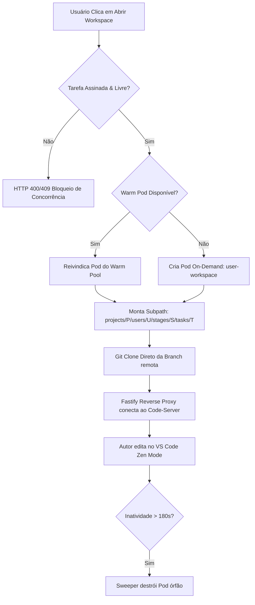
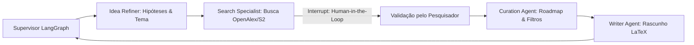
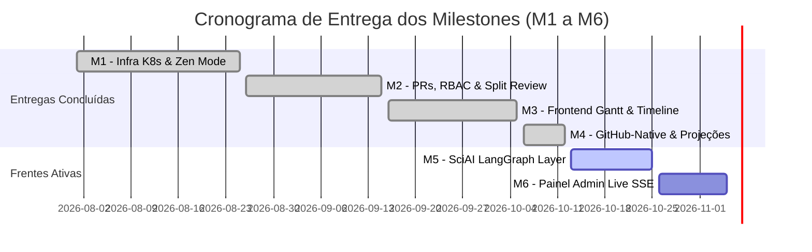

# 📋 Plano Mestre de Implementação Técnica (Master Implementation Plan)

> **Plataforma:** SCIA — Scientific Collaboration + AI (`sci-latex-vscode`)  
> **Versão do Documento:** 2.0.0  
> **Status:** Ativo / Em Execução  
> **Última Atualização:** Outubro de 2026  
> **Repositório Monorepo:** Backend Fastify + Frontend React 19 + AI-Service FastAPI + Infra Kubernetes  

---

## 📑 Sumário Executivo

1. [Visão Estratégica & Objetivos de Engenharia](#1-visão-estratégica--objetivos-de-engenharia)
2. [Arquitetura de Fases & Status de Entrega](#2-arquitetura-de-fases--status-de-entrega)
3. [Plano Detalhado por Frente de Trabalho (Workstreams)](#3-plano-detalhado-por-frente-de-trabalho-workstreams)
   - 3.1. [Frente 1: Infraestrutura K8s, Warm Pool & Ambientes de Edição](#31-frente-1-infraestrutura-k8s-warm-pool--ambientes-de-edição)
   - 3.2. [Frente 2: Backend Fastify & Engenharia de Dados](#32-frente-2-backend-fastify--engenharia-de-dados)
   - 3.3. [Frente 3: Frontend Web, Design System & UX Científica](#33-frente-3-frontend-web-design-system--ux-científica)
   - 3.4. [Frente 4: Camada de Inteligência Científica (`ai-service` / SciAI)](#34-frente-4-camada-de-inteligência-científica-ai-service--sciai)
   - 3.5. [Frente 5: Painel de Administração & Observabilidade Live SSE](#35-frente-5-painel-de-administração--observabilidade-live-sse)
   - 3.6. [Frente 6: Evolução Futura de Infraestrutura & Desktop Híbrido](#36-frente-6-evolução-futura-de-infraestrutura--desktop-híbrido)
4. [Matriz de Dependências Técnicas & Milestones](#4-matriz-de-dependências-técnicas--milestones)
5. [Critérios de Aceite Globais (Definition of Done - DoD)](#5-critérios-de-aceite-globais-definition-of-done---dod)
6. [Matriz de Riscos Técnicos & Planos de Mitigação](#6-matriz-de-riscos-técnicos--planos-de-mitigação)
7. [Plano de Ação Imediato (Next Actions Checklist)](#7-plano-de-ação-imediato-next-actions-checklist)

---

## 1. Visão Estratégica & Objetivos de Engenharia

O **SCIA (Scientific Collaboration + AI)** é uma plataforma integrada, 100% self-hosted, concebida para modernizar a produção científica de grupos de pesquisa. Ela orquestra todo o ciclo de vida do manuscrito acadêmico: desde a exploração inicial de temas com agentes inteligentes de busca bibliográfica até a escrita colaborativa em LaTeX no VS Code embutido, revisão por pares com visualização comparativa side-by-side, auditoria formal de propriedade intelectual (NIT) e submissão a conferências com controle de versões (v1, v2 e Camera-Ready).

```
┌─────────────────────────────────────────────────────────────────────────────────┐
│                           SCIA MONOREPO ARCHITECTURE                            │
├─────────────────────┬──────────────────────┬────────────────────────────────────┤
│ 1. Frontend Web     │ 2. Backend API       │ 3. AI Service (SciAI)              │
│    (React 19, Vite, │    (Fastify, Prisma, │    (Python 3.12, FastAPI,          │
│     MUI, TanStack)  │     PostgreSQL, K8s) │     LangGraph, OpenAlex, S2)       │
├─────────────────────┴──────────────────────┴────────────────────────────────────┤
│ 4. Execution & Orchestration Layer                                              │
│    (KinD/Kubernetes, Warm Standby Pods, TeX Live Containers, Redis 7 In-Memory)│
└─────────────────────────────────────────────────────────────────────────────────┘
```

### Princípios Técnicos Inegociáveis

1. **Zero Distração & Máxima Ergonomia:** Editor configurado em *Zen Mode* sem extensões ruidosas de terminal ou telemetria; interface web guiada pela regra cromática 85/15 (Soft UI sem pretos absolutos).
2. **Abstração Transparente do Git:** Pesquisadores utilizam a interface ou o editor sem manipular chaves SSH ou tokens. Todo o versionamento é assinado via Conta de Serviço com commits em nome do autor real e auditado no banco de dados.
3. **Resiliência Multi-Tenant em K8s:** Cada tarefa ou revisão executa em container isolado com montagem em subcaminhos de 4 níveis (`projects/P/users/U/stages/S/tasks/T`), mantendo 1 Pod de reserva aquecido (*Warm Pool*) para inicialização instantânea.
4. **Governança Institucional Estrita:** Nenhum paper é submetido à conferência alvo sem a emissão de Parecer Favorável do NIT (`APPROVED_NIT`) e sem a conclusão integral de todas as etapas de conteúdo.

---

## 2. Arquitetura de Fases & Status de Entrega

O plano de desenvolvimento do SCIA foi organizado em 7 fases sequenciais. A tabela abaixo sintetiza o estado consolidado da plataforma:

| Fase | Escopo Técnico | Status | Referência Principal |
| :--- | :--- | :---: | :--- |
| **Fase I** | Fundação de Dados, Infraestrutura K8s & Editor Zen Mode | 🟢 Concluído | [`ROADMAP.md#bloco-1`](planning/ROADMAP.md) |
| **Fase II** | Regras de Negócio de PRs, Revisão Side-by-Side & Isolamento | 🟢 Concluído | [`ROADMAP.md#bloco-2`](planning/ROADMAP.md) |
| **Fase III** | Frontend ReactJS, Stepper Ribbon & Gantt Unificado | 🟢 Concluído | [`ROADMAP.md#bloco-3`](planning/ROADMAP.md) |
| **Fase IV** | Integração GitHub-Native, Projeções de Issues & SSE | 🟢 Concluído | [`reports/relatorio-fase-4.md`](planning/reports/relatorio-fase-4.md) |
| **Fase V** | Camada de IA Científica Multi-Agente (`ai-service` / SciAI) | 🟡 **Em Execução** | Branch: `feature/sciai-integration-layer` |
| **Fase VI** | Painel Admin em Tempo Real (Live SSE Dashboard) | ⚪ **Prioridade Próxima** | [`ROADMAP.md#bloco-4`](planning/ROADMAP.md) |
| **Fase VII**| Resiliência de Infraestrutura, Hibernação & SSH Desktop | ⚪ Backlog Estratégico | [`ROADMAP.md#bloco-5`](planning/ROADMAP.md) |

---

## 3. Plano Detalhado por Frente de Trabalho (Workstreams)

### 3.1. Frente 1: Infraestrutura K8s, Warm Pool & Ambientes de Edição

**Objetivo:** Prover containers de escrita e compilação TeX Live isolados, de inicialização instantânea e ciclo de vida controlado via API nativa do Kubernetes (`@kubernetes/client-node`).



#### Entregas Concluídas
- [x] **Warm Standby Pool (`ensureWarmPool`):** Manutenção contínua de exatamente 1 Pod aquecido com imagem TeX Live pronta, reduzindo a latência de abertura do editor de ~15s para < 800ms.
- [x] **Isolamento de 4 Níveis:** Montagem de volume em subcaminho exclusivo `projects/${projectId}/users/${userId}/stages/${stageSegment}/tasks/${taskId}`.
- [x] **Detecção e Correção de `subPath` Desalinhado:** Validação em tempo de execução de `volumeMounts[0].subPath` do Pod ativo. Se o Pod estiver apontando para um subcaminho desatualizado (ex: `stages/general/` em vez de `stages/:stageId/`), o Pod é destruído e recriado automaticamente.
- [x] **Perfil Dinâmico do VS Code:** Injeção de `author.settings.json` (auto-save e compilação contínua) ou `reviewer.settings.json` (modo Read-Only estrito com `chmod 444/555` e barra roxa `#4A154B`).
- [x] **Sweeper de Pods Órfãos:** Rotina agendada no Fastify que executa a cada 60s, compara os Pods no cluster K8s com os heartbeats ativos no Redis (`workspace:active:*`) e destrói pods abandonados.
- [x] **Limpeza Pós-Merge:** Após o merge de uma Feature Branch na branch `dev`, os Pods do autor são liberados e os PVCs temporários são limpos (`cleanProjectPVC`).

---

### 3.2. Frente 2: Backend Fastify & Engenharia de Dados

**Objetivo:** Arquitetura Modular Monolith de alto rendimento com Node.js + Fastify + TypeScript, garantindo integridade ACID via Prisma 7 e auditoria total.

#### Entregas Concluídas
- [x] **Prisma ORM 7 + Driver Adapter (`@prisma/adapter-pg`):** 17 modelos relacionais mapeados cobrindo Usuários, Ciclos Acadêmicos, Equipes, Artigos, Etapas, Tarefas, PRs, Rodadas de Revisão, RCs e Projeções do GitHub ([`docs/DATABASE.md`](DATABASE.md)).
- [x] **Autenticação Segura OWASP:** Cookies HTTP-Only com JWT assinado, rotação segura de refresh tokens na tabela `Session` e proteção RBAC em nível de rota.
- [x] **Abstração Git via SDK Octokit:** Todas as chamadas para a API REST do GitHub utilizam `@octokit/rest`. Comandos de Git CLI utilizam autenticação efêmera via `-c http.extraHeader="Authorization: Basic <base64>"`, sem exposição de tokens em arquivos `.git/config` ou logs.
- [x] **Tradução Acadêmica de Diffs (`GET /tasks/:taskId/diff-summary`):** Converte diffs brutos do Git em categorias amigáveis ("Seção Introdução", "Referências", "Figuras") com detecção não-bloqueante de alterações fora de escopo (`hasChangesInOtherFiles`).
- [x] **Hub Unidirecional de Eventos em Tempo Real (SSE):** Endpoint `/api/v1/events/stream` com heartbeat via Web Worker em thread isolada (Blob) e sinal periódico `: ping\n\n` a cada 30s.

---

### 3.3. Frente 3: Frontend Web, Design System & UX Científica

**Objetivo:** Interface moderna em React 19 + TypeScript + Vite baseada no **SCIA Design System** ([`docs/DESIGN_SYSTEM.md`](DESIGN_SYSTEM.md)), proporcionando acompanhamento de cronogramas sem fadiga visual.

```
┌────────────────────────────────────────────────────────────────────────┐
│                     STEPPER RIBBON (ArticleTimelineHeader)             │
├────────────────────────────────────────────────────────────────────────┤
│ [1. Intro ✓] ── [2. Metodologia ●] ── [3. Resultados ○] ── [🔒 NIT] ──┤
│                                                                        │
│ Progresso da Etapa Selecionada: [██████████░░░░░░░░] 58%               │
└────────────────────────────────────────────────────────────────────────┘
```

#### Entregas Concluídas
- [x] **SCIA Soft UI Design System:** Paleta sem pretos absolutos (Slate 50 no light, Slate 900 no dark), botões de 10px, cards de 16px, chips pastel e tipografia 100% self-hosted via pacotes `@fontsource` (Inter, JetBrains Mono, Plus Jakarta Sans).
- [x] **Stepper Ribbon Horizontal (`ArticleTimelineHeader`):** Régua visual de etapas paralelas com reordenação Drag & Drop (`@dnd-kit`) e travas de gatekeeper fixadas ao final da fita.
- [x] **Visão Unificada em Linha do Tempo (Gantt Interativo):** Visualização hierárquica por etapa com árvore lateral de lançamento rápido de workspace, badges de bloqueio sequencial e gaveta de detalhes da tarefa (`GanttTaskDetailDrawer`).
- [x] **Padrão URL-First com Zero-Flicker UX:** Todas as tabelas de dados (`GenericDataGrid`) sincronizam filtros de busca e paginação com a query string via `useUrlFilters`, empregando `placeholderData: keepPreviousData` do TanStack Query para eliminar piscadas na tela.
- [x] **Modais Padronizados (`StandardModal`):** Unificação de todos os diálogos nos presets de dimensão fixa (`sm: 560x560`, `md: 740x640`, `lg: 920x720`, `xl: 1140x780`).

---

### 3.4. Frente 4: Camada de Inteligência Científica (`ai-service` / SciAI)

**Objetivo:** Microserviço autônomo em Python 3.12 + FastAPI + LangGraph para conduzir onboarding científico, exploração bibliográfica, curadoria e auxílio de redação em LaTeX, sem acoplamento a código legado.



#### Estado Atual da Frente (`feature/sciai-integration-layer`)
- [x] **Triagem Limpa & Descarte de Código Legado:** Eliminados compiladores síncronos redundantes, WebSockets YRoom e modelos duplicados do projeto legado `sci-project`.
- [x] **Núcleo de Agentes LangGraph com Estado Tipado (`ai-service/app/agents/`):**
  - `state.py`: Estado compartilhado `OnboardingState` contemplando histórico, artigos curados e tarefas preliminares.
  - `supervisor.py`: Orquestrador mestre dos 4 estágios com transições determinísticas.
  - `idea_refiner.py`: Agente de refinamento conceitual de pesquisa.
  - `search_specialist.py`: Agente de busca com Human-in-the-Loop interrupt.
  - `curation.py`: Agente de curadoria de literatura acadêmica.
  - `writer.py`: Agente redator com sintetizador de blocos TeX.
- [x] **Ferramentas de Pesquisa Científica com Connection Pooling:**
  - `openalex.py`: Conector com semáforo de concorrência e cliente `httpx.AsyncClient` reutilizável.
  - `semantic_scholar.py`: Conector S2 com exponential backoff para tratamento de rate limits.
  - `academic_search.py`: Fachada unificada com fallback transparente (S2 $\rightarrow$ OpenAlex $\rightarrow$ Tavily).
- [x] **Endpoints de Streaming SSE e M2M:**
  - `POST /api/v1/chat/stream`: Stream interativo SSE com `stream_processor.py`.
  - `POST /api/v1/runs`: Endpoints para execução assíncrona M2M autenticada via `X-Internal-Service-Key`.
- [x] **Arquitetura de Referência do Frontend (`frontend/references-ai-chat/`):**
  - Mapeados os componentes `OnboardingChat.reference.tsx`, `AIChatSidebar.reference.tsx` e `onboardingApi.reference.ts` prontos para transposição visual ao Design System oficial.

#### Pendências para Conclusão da Fase V
- [ ] **Integração do Chat Copilot na Interface do Workspace:** Implementar o componente de gaveta lateral `<AIChatSidebar />` no frontend oficial conectando ao proxy Fastify `/api/v1/ai/chat/stream`.
- [ ] **Fluxo Guiado de Criação de Artigo com IA (Onboarding Wizard):** Permitir que autores iniciem novos projetos científicos através do diálogo com o `IdeaRefiner` e gerem automaticamente as etapas e tarefas iniciais no banco PostgreSQL.
- [ ] **Persistência de Sessões de Chat do SciAI:** Mapear tabela relacional para armazenamento de mensagens e estados dos runs de IA vinculados ao `Project`.

---

### 3.5. Frente 5: Painel de Administração & Observabilidade Live SSE

**Objetivo:** Fornecer aos administradores e gerentes visibilidade em tempo real sobre a saúde da infraestrutura, sessões ativas e Pods alocados no cluster.

#### Atividades Planejadas (Bloco 4)
- [ ] **5.1 Canal SSE de Administração no Backend (`/api/v1/admin/events`):**
  - Emitir métricas instantâneas sobre: Pods em execução (`warm-standby` vs `user-workspace`), conexões SSE ativas, taxa de rascunhos salvos por minuto e consumo de memória.
- [ ] **5.2 Tela de Administração de Sessões e Pods no Frontend:**
  - Desenvolver página `/admin` protegida por `Role.ADMIN` com:
    - Tabela DataGrid de usuários online e duração da sessão ativa.
    - Monitor de Pods físicos do Kubernetes com botão para encerramento forçado (*Kill Session*).
    - Status do Warm Pool com gatilho manual de reabastecimento.

---

### 3.6. Frente 6: Evolução Futura de Infraestrutura & Desktop Híbrido

**Objetivo:** Otimização de custos de computação em grande escala e suporte a fluxos de trabalho avançados para pesquisadores seniores.

#### Atividades Mapeadas (Bloco 5 - Backlog)
- [ ] **6.1 Hibernação Inteligente de Pods com Retenção de PVC:**
  - Após 30 minutos de inatividade, o Pod é destruído, mas o PVC permanece montado e pronto para reinicialização em < 3 segundos na próxima interação.
- [ ] **6.2 Conexão Remota via VS Code Desktop (SSH Gateway):**
  - Provisionamento de um container SSH intermediário seguro permitindo que autores utilizem sua instalação nativa do VS Code Desktop conectada ao repositório do Pod.

---

## 4. Matriz de Dependências Técnicas & Milestones



### Detalhamento dos Milestones

| Milestone | Entregáveis Principais | Critério de Desbloqueio |
| :--- | :--- | :--- |
| **M1: Core Engine & K8s** | Pod Manager, Warm Pool, Zen Mode, Fastify API base. | Pods abrem em < 800ms sem terminais ou extensões externas. |
| **M2: Editorial Workflow** | RBAC, Review Split (TeX Diff + PDF), Registro NIT, Merge de PRs. | Revisor avalia sem permissão de escrita (`chmod 444`). |
| **M3: Unified UX** | Gantt Timeline unificado, Stepper Ribbon, URL-Filter DataGrids. | Zero flicker em buscas e 100% de adesão ao Design System. |
| **M4: GitHub Integration** | Webhook Inbox idempotente, sincronização bidirecional de Issues. | Projeções locais atualizadas via eventos SSE em tempo real. |
| **M5: SciAI Intelligence** | Microserviço `ai-service`, LangGraph Multi-Agente, Chat Copilot. | Onboarding interativo gerando hipóteses e literatura curada. |
| **M6: Real-Time Admin** | Canal `/admin/events`, monitor de Pods e gerenciador de sessões. | Administrador encerra sessões órfãs diretamente na UI. |

---

## 5. Critérios de Aceite Globais (Definition of Done - DoD)

Toda e qualquer nova funcionalidade incorporada ao monorepo **deve** atender rigorosamente aos seguintes critérios antes de ser considerada concluída:

1. **Qualidade de Código & Tipagem Estrita:**
   - **Zero Warnings no ESLint:** Execução limpa de `npm run lint` no backend e frontend.
   - **Zero Erros de Tipagem:** `npx tsc --noEmit` aprovado em 100% dos pacotes.
   - **Formatador Oficial:** `npm run format:check` passando com adesão estrita ao Prettier.
   - **Nomenclatura em Inglês:** Nomes de variáveis, modelos, endpoints e funções estritamente em inglês.
2. **Cobertura de Testes Automatizados:**
   - Módulos com regras de negócio devem incluir suítes unitárias/integração (`*.test.ts` / `*.spec.ts`).
   - A suíte global de testes do backend (`npm test`) deve manter 100% de aprovação (atualmente 18 suítes / 63 testes).
3. **Padrões de Arquitetura & Frontend:**
   - Componentes React funcionais com **Named Exports exclusivos** (`export const ComponentName = ...`), sem `export default`.
   - Ausência completa de `React.FC` e arquivos de re-exportação barril (`index.ts`).
   - Mutações e consultas assíncronas centralizadas em custom hooks do TanStack Query (`src/hooks/`).
4. **Governança de Documentação:**
   - Atualização mandatória do checkpoint de retomada em [`docs/planning/STATUS.md`](planning/STATUS.md).
   - Marcação de conclusão `[x]` no item correspondente em [`docs/planning/ROADMAP.md`](planning/ROADMAP.md).
   - Se houver alteração de modelo de banco de dados ou endpoints, atualização imediata em [`docs/DATABASE.md`](DATABASE.md) e [`docs/planning/specs/`](planning/specs/).

---

## 6. Matriz de Riscos Técnicos & Planos de Mitigação

| Risco Técnico | Probabilidade | Impacto | Estratégia de Mitigação Implementada |
| :--- | :---: | :---: | :--- |
| **1. Esgotamento de Memória por Pods K8s Órfãos** | Média | Alto | **Sweeper Automatizado:** Chaves de presença no Redis expiram em 180s. Daemon Fastify roda a cada 60s e destrói pods órfãos via API K8s. |
| **2. Conflitos de Escrita Concorrente em Branches Git** | Média | Alto | **Isolamento de 4 Níveis & Claim Lock:** Subcaminhos dedicados no filesystem. Tarefas exigem assinatura prévia (`claim`) e bloqueiam segundo acesso (`TASK_WORKSPACE_OCCUPIED`). |
| **3. Suspensão de Heartbeat SSE por Abas em Segundo Plano** | Alta | Médio | **Blob Web Worker em Thread Isolada:** Timers rodando fora da thread principal do navegador, com reativação imediata ao detectar `visibilitychange`. |
| **4. Rate Limit em Buscas Científicas (S2 / OpenAlex)** | Alta | Médio | **Fachada com Fallback & Connection Pooling:** Semáforo de concorrência local, exponential backoff e fallback automático em cadeia (S2 $\rightarrow$ OpenAlex $\rightarrow$ Tavily). |
| **5. Vazamento de Credenciais Git nos Containers** | Baixa | Crítico | **Token Efêmero via Header HTTP:** Comandos Git CLI injetam token via `-c http.extraHeader`, impedindo gravação no arquivo `.git/config` no disco. |

---

## 7. Plano de Ação Imediato (Next Actions Checklist)

### 🎯 Passo 1: Finalização da Camada SciAI (`feature/sciai-integration-layer`)
- [ ] Conectar os endpoints `/api/v1/chat/stream` e `/runs` ao proxy central do Fastify (`backend/src/modules/ai/`).
- [ ] Adaptar o componente de chat de referência (`frontend/references-ai-chat/AIChatSidebar.reference.tsx`) para o Design System oficial do SCIA, embutindo-o na Workspace do Autor.
- [ ] Validar a experiência de Human-in-the-Loop no refinamento de tema de pesquisa através de testes manuais e automatizados.

### 🎯 Passo 2: Abertura do Bloco 4 (Painel de Administração Live SSE)
- [ ] Criar a branch de feature: `feature/SLV-admin-live-sse-dashboard`.
- [ ] Implementar o canal SSE `/api/v1/admin/events` no backend Fastify transmitindo contadores de Pods K8s e sessões ativas.
- [ ] Desenvolver a página administrativa no frontend (`/admin`) com a visão em tempo real de infraestrutura.
- [ ] Registrar a entrega no Jira, rodar suíte de testes e abrir Pull Request via GitHub MCP.

---

*Documento mestre mantido sob controle de versão pela equipe de Engenharia do SCIA.*  
*Consulte [`docs/planning/STATUS.md`](planning/STATUS.md) para verificar o estado operacional em tempo real.*