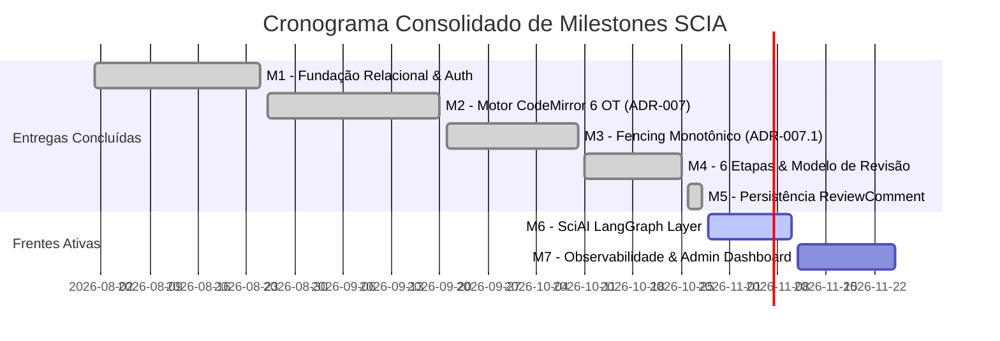

# 📋 Plano Mestre de Implementação Técnica (Master Implementation Plan)

> **Plataforma:** SCIA — Scientific Collaboration and Intelligent Assistance (`sci-latex-vscode`)  
> **Versão do Documento:** 3.0.0 (Consolidada com ADRs 007, 007.1, 008 e 010)  
> **Status:** Ativo / Em Execução  
> **Última Atualização:** Outubro de 2026  
> **Repositório Monorepo:** Backend Fastify + Frontend React 19 + AI-Service FastAPI + Infra Kubernetes  

---

## 📑 Sumário Executivo

1. [Visão Estratégica & Objetivos de Engenharia](#1-visão-estratégica--objetivos-de-engenharia)
2. [Arquitetura de Fases & Status de Entrega](#2-arquitetura-de-fases--status-de-entrega)
3. [Plano Detalhado por Frente de Trabalho (Workstreams)](#3-plano-detalhado-por-frente-de-trabalho-workstreams)
   - 3.1. [Frente 1: Motor de Edição Colaborativa Web-Nativa (CodeMirror 6 + OT)](#31-frente-1-motor-de-edição-colaborativa-web-nativa-codemirror-6--ot)
   - 3.2. [Frente 2: Workflow Oficial em 6 Etapas Fixas & Revisão em Dois Níveis](#32-frente-2-workflow-oficial-em-6-etapas-fixas--revisão-em-dois-níveis)
   - 3.3. [Frente 3: Backend Fastify, Persistência ACID & Compilador TeX](#33-frente-3-backend-fastify-persistência-acid--compilador-tex)
   - 3.4. [Frente 4: Frontend React 19, Gantt Interativo & SCIA Design System](#34-frente-4-frontend-react-19-gantt-interativo--scia-design-system)
   - 3.5. [Frente 5: Camada de Inteligência Científica (`ai-service` / SciAI)](#35-frente-5-camada-de-inteligência-científica-ai-service--sciai)
   - 3.6. [Frente 6: Observabilidade, Painel Admin & Métricas Institucionais](#36-frente-6-observabilidade-painel-admin--métricas-institucionais)
4. [Matriz de Dependências Técnicas & Milestones](#4-matriz-de-dependências-técnicas--milestones)
5. [Critérios de Aceite Globais (Definition of Done - DoD)](#5-critérios-de-aceite-globais-definition-of-done---dod)
6. [Matriz de Riscos Técnicos & Planos de Mitigação](#6-matriz-de-riscos-técnicos--planos-de-mitigação)
7. [Plano de Ação Imediato](#7-plano-de-ação-imediato)

---

## 1. Visão Estratégica & Objetivos de Engenharia

O **SCIA (Scientific Collaboration + AI)** é uma plataforma integrada, 100% self-hosted, concebida para modernizar a produção científica de grupos de pesquisa e universidades. Ela orquestra todo o ciclo de vida do manuscrito acadêmico: desde a exploração inicial de temas e curadoria bibliográfica com agentes de IA (LangGraph) até a escrita colaborativa em tempo real com **CodeMirror 6**, compilação síncrona TeX Live, revisão por pares com apontamentos ancorados duráveis (`ReviewComment`), governança formal de propriedade intelectual (**NIT**) e submissão a conferências com controle de versões (Target, Backup, v2 e Camera-Ready).

```
┌─────────────────────────────────────────────────────────────────────────────────┐
│                           SCIA MONOREPO ARCHITECTURE                            │
├─────────────────────┬──────────────────────┬────────────────────────────────────┤
│ 1. Frontend Web     │ 2. Backend API       │ 3. AI Service (SciAI)              │
│    (React 19, Vite, │    (Fastify, Prisma, │    (Python 3.12, FastAPI,          │
│     CodeMirror 6,   │     PostgreSQL,      │     LangGraph, OpenAlex, S2,       │
│     MUI, TanStack)  │     Redis Leases)    │     Tavily, Streaming SSE)         │
├─────────────────────┴──────────────────────┴────────────────────────────────────┤
│ 4. Compilation & Storage Layer                                                  │
│    (sci-latex-compiler TeX Live / latexmk, MinIO S3 Object Storage)             │
└─────────────────────────────────────────────────────────────────────────────────┘
```

### Princípios Técnicos Inegociáveis

1. **Zero Keystrokes no Banco:** A digitação colaborativa de alta frequência opera na memória RAM do Pod Fastify responsável pela sala WebSocket, com latência local <16ms e sincronização OT centralizada. O banco relacional é blindado por debounce híbrido multi-critério (ADR-007).
2. **Versionamento Relacional Nativo:** Autores e revisores trabalham em um ambiente web transparente. Todo o versionamento reside em snapshots relacionais e deltas operacionais gerenciados no banco de dados (ADR-008).
3. **Régua Institucional de 6 Etapas Fixas:** Todo artigo obedece à sequência imutável de 1 a 6, eliminando reordenação arbitrária e preservando a integridade das métricas gerenciais e travas de Gatekeeper (ADR-008).
4. **Proteção da Persona do Revisor:** O revisor acessa o editor em modo estritamente `readOnly`, prevenindo edições acidentais no LaTeX, com capacidade total de inserção de anotações e threads duráveis (`ReviewSidebar` / ADR-010).
5. **Governança por Gatekeepers Invioláveis:** Nenhum artigo é submetido à conferência alvo sem a emissão de Parecer Aprovado do NIT (`APPROVED_NIT`) após conclusão integral da Revisão Geral (Etapa 4).

---

## 2. Arquitetura de Fases & Status de Entrega

| Fase | Escopo Técnico | Status | Referência Principal |
| :--- | :--- | :---: | :--- |
| **Fase I** | Modelagem Relacional Prisma 7, Autenticação JWT e RBAC | 🟢 Concluído | [`docs/DATABASE.md`](DATABASE.md) |
| **Fase II** | Editor Colaborativo CodeMirror 6, OT e Debounce Híbrido | 🟢 Concluído | [`ADR-007`](planning/adrs/adr-007-collaborative-editor-architecture-scaling.md) |
| **Fase III** | Fencing Monotônico de Posse e Resiliência Multi-Pod | 🟢 Concluído | [`ADR-007.1`](planning/adrs/adr-007.1-document-ownership-fencing-and-routing.md) |
| **Fase IV** | Workflow em 6 Etapas Fixas, Modelo de Revisão e Versionamento Relacional | 🟢 Concluído | [`ADR-008`](planning/adrs/adr-008-workflow-6-etapas-revisao-desacoplamento-git.md) |
| **Fase V** | Persistência Relacional de Apontamentos (`ReviewComment`) | 🟢 Concluído | [`ADR-010`](planning/adrs/adr-010-review-comment-persistence-and-db-alignment.md) |
| **Fase VI** | Camada de IA Científica Multi-Agente (`ai-service` / SciAI) | 🟡 **Em Execução** | [`ADR-009`](planning/adrs/adr-009-sciai-api-first-experimentation-and-service-enablement.md) |
| **Fase VII**| Painel Admin em Tempo Real & Métricas Executivas de Ciclo | ⚪ **Prioridade Próxima** | [`ROADMAP.md`](planning/ROADMAP.md) |

---

## 3. Plano Detalhado por Frente de Trabalho (Workstreams)

### 3.1. Frente 1: Motor de Edição Colaborativa Web-Nativa (CodeMirror 6 + OT)

**Objetivo:** Prover editor LaTeX colaborativo web-nativo de alto rendimento com suporte a múltiplos autores, cursores remotos em tempo real e sincronização determinística.

#### Entregas Concluídas
- [x] **Single-Leader OT com `@codemirror/collab`:** Servidor Fastify atua como sequenciador central de versões com `rebaseUpdates` e difusão por WebSocket (`documents.websocket.ts`).
- [x] **Limpeza do Hot Path no Redis:** Removido buffer de digitação no Redis. A digitação opera em memória RAM do Pod dono com latência < 2ms (ADR-007).
- [x] **Debounce Híbrido Multi-Critério:** Checkpoints no PostgreSQL acionados por timer de inatividade (3s), teto máximo temporal (15s), volume de operações (50 ops) ou fechamento de sala.
- [x] **Fencing Monotônico de Posse (`ownerGeneration`):** Leases atômicos no Redis (TTL 15s / Heartbeat 2s) coordenados com token monotônico no PostgreSQL para blindagem contra *split-brain* e Pods zumbis (ADR-007.1).
- [x] **Graceful Shutdown:** Interceptação de `SIGTERM`/`SIGINT` persistindo atomicamente todos os documentos ativos no PostgreSQL antes do encerramento do processo.

---

### 3.2. Frente 2: Workflow Oficial em 6 Etapas Fixas & Revisão em Dois Níveis

**Objetivo:** Padronizar a esteira editorial acadêmica em seis etapas fixas e estruturar o versionamento nativo via banco de dados.

#### Entregas Concluídas
- [x] **Régua Institucional das 6 Etapas:** Criação automática e obrigatória das etapas 1 a 6 no cadastro do artigo. Deleção e reordenação bloqueadas na API (`DELETE /stages/:id -> 400 Bad Request`).
- [x] **Versionamento Relacional Nativo:** Versionamento integral gerenciado por `ProjectFile`, `DocumentSnapshot` e transações atômicas no PostgreSQL.
- [x] **Modelo de Revisão em Dois Níveis:**
  - *Nível 1 (Micro):* Bate e volta por tarefas de escrita na Etapa 3 (`IN_PROGRESS` ➡️ `REVIEW_REQUESTED` ➡️ `CHANGES_REQUESTED` ➡️ `COMPLETED`).
  - *Nível 2 (Macro):* Revisão Geral na Etapa 4 com rodadas iterativas (v1, v2) sem desarmar a conclusão histórica da Etapa 3.
- [x] **Persona do Revisor Acadêmico:** CodeMirror em modo `readOnly: true`, com total capacidade de anotação ancorada via `ReviewSidebar` (ADR-008).
- [x] **Persistência Durável de Apontamentos (`ReviewComment`):** Gravação relacional de seleções (`from`, `to`), conteúdo, status (`open`/`resolved`) e respostas em threads no PostgreSQL (ADR-010).

---

### 3.3. Frente 3: Backend Fastify, Persistência ACID & Compilador TeX

**Objetivo:** Arquitetura Modular Monolith de alto rendimento com Node.js + Fastify + TypeScript, integridade transacional via Prisma 7 e compilação síncrona desacoplada.

#### Entregas Concluídas
- [x] **Prisma ORM 7 + Driver Adapter (`@prisma/adapter-pg`):** 14 modelos canônicos mapeados e saneados ([`docs/DATABASE.md`](DATABASE.md)).
- [x] **Autenticação Segura OWASP:** Cookies HTTP-Only com JWT assinado, rotação segura de refresh tokens na tabela `Session` e proteção RBAC em nível de rota.
- [x] **Transações Atômicas de Checkpoint (`documents.repository.ts`):** `saveCheckpoint` unifica a versão do projeto, conteúdo de `main.tex`, arquivos secundários e `DocumentSnapshot` em uma única chamada `prisma.$transaction`.
- [x] **Microserviço TeX Live (`sci-latex-compiler`):** Compilação isolada com `latexmk -pdf -interaction=nonstopmode -synctex=1` em diretório efêmero, com timeout de 60s e captura estruturada de erros de compilação.
- [x] **Barramento SSE com Redis Pub/Sub:** Endpoint `/api/v1/events` emitindo eventos de domínio (`TASK_REVIEW_REQUESTED`, `STAGE_UPDATED`, `NIT_STATUS_CHANGED`) sincronizados entre instâncias.

---

### 3.4. Frente 4: Frontend React 19, Gantt Interativo & SCIA Design System

**Objetivo:** Interface moderna em React 19 + TypeScript + Vite baseada no **SCIA Design System** ([`docs/DESIGN_SYSTEM.md`](DESIGN_SYSTEM.md)), proporcionando acompanhamento de cronogramas e edição fluida.

#### Entregas Concluídas
- [x] **SCIA Soft UI Design System:** Paleta sem pretos absolutos (Slate 50 / Slate 900), botões de 10px, cards de 16px, chips pastel e tipografia self-hosted (`@fontsource/inter`, JetBrains Mono, Plus Jakarta Sans).
- [x] **Visão Gantt Interativa das 6 Etapas:** Visualização temporal hierárquica por etapa com datas planejadas (`plannedCompletionDate`), cálculo dinâmico de semáforos de prazos (`DeadlineStatus`) e gaveta de detalhes da tarefa.
- [x] **Editor Workspace Completo:** Abas de arquivos (`EditorTabBar`), árvore lateral (`FileTreeSidebar`), barra de colaboradores ativos (`CollaboratorsBar`), preview de PDF sincronizado (`PdfPreview`) e comparador de diffs de snapshots (`EditorDiffViewer`).
- [x] **Padrão URL-First & Zero-Flicker:** Filtros sincronizados com query strings via `useUrlFilters` e `placeholderData: keepPreviousData` do TanStack Query.
- [x] **Exclusividade de Named Exports:** 100% dos componentes em `export const ComponentName = ...` sem exports default.

---

### 3.5. Frente 5: Camada de Inteligência Científica (`ai-service` / SciAI)

**Objetivo:** Microserviço autônomo em Python 3.12 + FastAPI + LangGraph para conduzir ideação científica, exploração bibliográfica, curadoria e auxílio de redação em LaTeX.

#### Entregas Concluídas
- [x] **Núcleo de Agentes LangGraph com Estado Tipado (`ai-service/app/agents/`):**
  - `state.py`: Estado compartilhado `OnboardingState` com artigos e tarefas.
  - `supervisor.py`: Orquestrador mestre dos 4 estágios.
  - `idea_refiner.py`: Agente de refinamento conceitual de pesquisa.
  - `search_specialist.py`: Agente de busca bibliográfica com `interrupt` Human-in-the-Loop.
  - `curation.py`: Agente de curadoria acadêmica.
  - `writer.py`: Agente redator com sintetizador de blocos TeX.
- [x] **Ferramentas de Pesquisa Científica com Connection Pooling:**
  - `openalex.py`: Conector com semáforo de concorrência e reaproveitamento de conexões TCP.
  - `semantic_scholar.py`: Conector S2 com exponential backoff para tratamento de rate limits.
  - `academic_search.py`: Fachada unificada com fallback transparente (S2 ➡️ OpenAlex ➡️ Tavily).
- [x] **Endpoints de Streaming SSE e M2M:**
  - `POST /api/v1/chat/stream`: Stream interativo SSE com `stream_processor.py`.
  - `POST /api/v1/runs`: Endpoints para execução assíncrona M2M autenticada via `X-Internal-Service-Key`.

#### Atividades em Andamento / Próximas
- [ ] **Integração do Chat Copilot na Interface:** Desenvolver gaveta lateral `<AIChatSidebar />` no frontend oficial conectando ao proxy Fastify `/api/v1/ai/chat/stream`.
- [ ] **Onboarding Wizard Guiado com IA:** Diálogo interativo para criação de novos projetos gerando automaticamente etapas e tarefas iniciais no PostgreSQL.

---

### 3.6. Frente 6: Observabilidade, Painel Admin & Métricas Institucionais

**Objetivo:** Fornecer aos administradores e gerentes visibilidade em tempo real sobre conexões ativas, taxa de checkpoints e métricas de cumprimento de metas por período acadêmico.

#### Atividades Planejadas
- [ ] **Canal SSE de Administração (`/api/v1/admin/events`):** Métricas instantâneas sobre conexões WebSocket ativas, taxa de checkpoints/minuto e latência do cluster.
- [ ] **Painel Administrativo no Frontend (`/admin`):** Visualização de usuários online, tempo de sessão e ações de desconexão preventiva.
- [ ] **Dashboard Executivo de Metas do Ciclo Acadêmico:** Consolidação de taxas de aceitação em congressos alvo vs. backup e tempo médio de ciclo de revisão.

---

## 4. Matriz de Dependências Técnicas & Milestones



---

## 5. Critérios de Aceite Globais (Definition of Done - DoD)

1. **Qualidade de Código & Linter:** 0 erros e 0 warnings no ESLint e Oxlint do frontend e backend (`npm run lint`).
2. **Formatação Estrita:** 100% dos arquivos em conformidade com o Prettier (`npm run format:check`).
3. **Checagem de Tipos Estrita:** Compilação TypeScript do backend e frontend com zero erros (`npx tsc --noEmit`).
4. **Cobertura de Testes:** Suíte de testes unitários e de integração aprovada no Vitest (`npm test`).
5. **Foco Acadêmico Fluido:** Nenhuma operação de escrita, revisão ou submissão depende de configurações locais ou complexidade técnica.
6. **Integridade de Documentação:** Alterações arquiteturais devem atualizar o [`STATUS.md`](planning/STATUS.md) e as ADRs correspondentes.

---

## 6. Matriz de Riscos Técnicos & Planos de Mitigação

| Risco Técnico | Probabilidade | Impacto | Estratégia de Mitigação Adotada |
| :--- | :---: | :---: | :--- |
| **Sobrecarga de I/O por digitação contínua** | Baixa | Alto | Debounce híbrido multi-critério (3s idle, 15s maxWait, 50 ops) com hot path em RAM. |
| **Split-brain entre Pods concorrentes** | Média | Crítico | Leases de dono único no Redis combinados com Fencing Monotônico (`ownerGeneration`) no PostgreSQL. |
| **Corrupção de LaTeX por edição do Revisor** | Baixa | Alto | Injeção obrigatória de `EditorState.readOnly.of(true)` no CodeMirror da persona Revisor. |
| **Perda de apontamentos de revisão em crash** | Baixa | Médio | Gravação transacional síncrona de `ReviewComment` no PostgreSQL (ADR-010). |
| **Rate Limit em APIs acadêmicas (S2/OpenAlex)** | Média | Médio | Semáforo assíncrono de concorrência e chaveamento de contingência na Fachada de Busca do SciAI. |

---

## 7. Plano de Ação Imediato

1. **Atividade 1 (SciAI Chat Frontend):** Transpor os componentes de referência (`frontend/references-ai-chat/`) para o layout oficial do editor no frontend, integrando a gaveta lateral de chat com o proxy Fastify `/api/v1/ai/chat/stream`.
2. **Atividade 2 (Onboarding Wizard):** Conectar o fluxo guiado de criação de artigo com o `IdeaRefiner` para instanciar automaticamente projetos com as 6 etapas fixas no PostgreSQL.
3. **Atividade 3 (Admin Live Dashboard):** Implementar canal SSE administrativo `/api/v1/admin/events` e tela de métricas em tempo real.

---

*Consulte [`docs/planning/STATUS.md`](planning/STATUS.md) para verificar o estado operacional em tempo real.*
