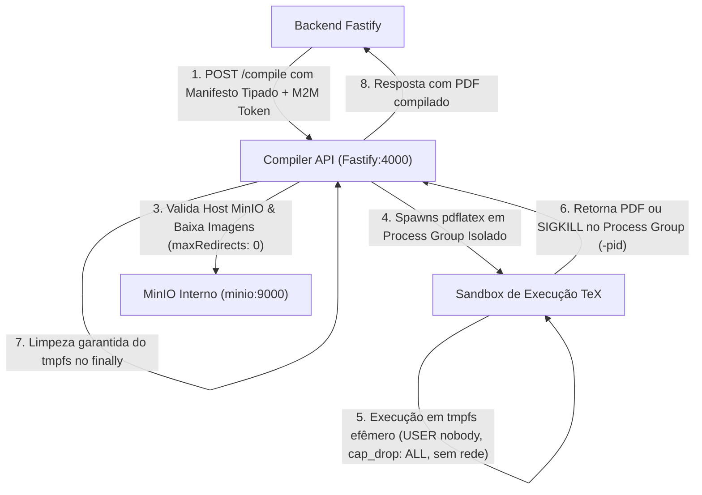

# Relatório Técnico & Planejamento: Comunicação Inter-Serviços, Segurança e Isolamento no SCIA

- **Status:** VIGENTE / REVISÃO ARQUITETURAL APROVADA COM DIRETRIZES
- **Data:** 09 de Novembro de 2026
- **Autor(es):** Equipe de Arquitetura, Engenharia e Segurança SCIA
- **Documentos Relacionados:** [`ADR-012 (Identidade M2M e Delegação)`](docs/planning/adrs/adr-012-m2m-security-evolution.md), [`ADR-007 (Collab Architecture)`](docs/planning/adrs/adr-007-collaborative-editor-architecture-scaling.md), [`ADR-007.1 (Fencing Tokens e Routing)`](docs/planning/adrs/adr-007.1-document-ownership-fencing-and-routing.md), [`ADR-011 (MinIO Evidences)`](docs/planning/adrs/adr-011-task-evidences-storage-architecture.md)

---

## 1. Sumário Executivo & Parecer Arquitetural

O **SCIA (Scientific Collaboration and Intelligent Assistance)** opera como uma malha distribuída de microsserviços integrados:
* **Backend Gateway (Fastify / TypeScript):** Núcleo de autoridade de negócio, autenticação de usuários, autorização RBAC, persistência relacional ACID (PostgreSQL) e motor colaborativo WebSocket (Single-Writer OT em RAM).
* **SciAI Service (FastAPI / LangGraph / Python):** Orquestrador de inteligência artificial, agentes de assistência científica e streaming Server-Sent Events (SSE).
* **Compiler Worker (Fastify / TeX Live / Node.js):** Execução isolada de compilação de documentos LaTeX em artefatos PDF.
* **MinIO Object Storage (S3 API):** Armazenamento privado de assets, imagens científicas, templates e evidências de tarefas.
* **PostgreSQL 16:** Base relacional transacional com integridade referencial, histórico imutável e snapshots de versão.
* **Redis 7:** Coordenador distribuído de posse de documentos (*Document Ownership Lease* com *Fencing Token*) e checkpointer de grafos do SciAI.
* **Frontend SPA (React / Vite):** Interface web com editor colaborativo CodeMirror 6.

Este relatório consolida o **diagnóstico arquitetural de comunicação (*As-Is*)**, resolve **inconsistências técnicas** identificadas nas revisões e detalha o **plano de engenharia corretivo (*To-Be*)** estruturado em quatro fases por redução progressiva de risco.

> [!TIP]
> ### ⚡ Guia Rápido & Resumo Executivo ("Elevator Pitch")
> **1. O que vamos implementar:**
> * **Compiler:** Fechar porta externa `4000`, autenticar chamadas M2M e isolar em **sandbox real** (`USER nobody`, sem acesso à internet, limites rígidos de RAM/CPU e `SIGKILL` em todo o grupo de processos).
> * **MinIO:** **100% privado**, gerando URLs pré-assinadas com endpoint interno (`minio:9000`) para o compilador e endpoint público para o navegador do pesquisador.
> * **SciAI:** Eliminar `Role.ADMIN`, adotar identidade de serviço com escopos mínimos e exigir **Token JWT de Delegação assinado** com trava *Human-in-the-Loop* para ações irreversíveis.
> * **Auditoria:** Gravação imutável no banco (`REVOKE UPDATE, DELETE`) e rastreabilidade com W3C Trace Context (`traceparent`).
>
> **2. Como explicar a comunicação entre serviços do SCIA:**
> *"Usuários conectam-se ao Backend via REST, SSE e WebSockets (colaboração direto na RAM do Pod Dono < 2ms, persistido atomicamente no PostgreSQL). Uploads pesados vão direto para o MinIO via URLs pré-assinadas. Internamente, os serviços comunicam-se em rede privada via M2M com privilégios mínimos: a IA só opera com delegação assinada em nome do autor e o compilador roda em sandbox estrito sem rede."*

---

## 2. Princípios Fundamentais de Segurança e Comunicação

1. **Nenhum microsserviço possui privilégios administrativos implicitamente.**
2. **Nenhum serviço confia exclusivamente na localização de rede de outro serviço.**
3. **O Backend Fastify é a autoridade máxima e central de autorização das operações de negócio.**
4. **O Compiler Worker é um ambiente de execução de código potencialmente não confiável (Sandbox Obrigatório).**
5. **Todos os arquivos, figuras e dados de pesquisa no MinIO permanecem 100% privados.**
6. **Operações realizadas pelo SciAI devem preservar e comprovar a identidade delegada do autor.**
7. **Toda comunicação inter-serviços deve ser auditável e rastreável ponta a ponta por Correlation ID e W3C Trace Context.**

---

## 3. Matriz das 12 Correções Arquiteturais Obrigatórias (`COR-01` a `COR-12`)

| ID | Área / Canal | Diagnóstico & Risco | Diretriz de Engenharia Aprovada |
| :-: | :--- | :--- | :--- |
| **COR-01** | **MinIO Dual-Endpoint** | Assinatura HMAC de presigned URLs usa o cabeçalho `Host`. Navegador e Compiler usam redes diferentes. | **Dois clientes S3:** `minioPresignClient` gera URLs com `MINIO_PUBLIC_URL` para o navegador; `minioClient` gera URLs com endpoint interno (`minio:9000`) para o Compiler. |
| **COR-02** | **Compiler SSRF** | Compiler aceitar URLs arbitrárias pode causar SSRF contra serviços internos. | **Manifesto estrito de assets:** Compiler valida que as URLs pertencem estritamente ao host/bucket do MinIO interno (`maxRedirects: 0`). |
| **COR-03** | **Sandbox Container** | `USER nobody` não isola filesystem nem processos completamente. | **Container Hardening:** `cap_drop: ALL`, `no-new-privileges: true`, rootfs read-only (com `/tmp` em `tmpfs`) e limites de cgroups. |
| **COR-04** | **Process Tree Kill** | `SIGKILL` no PID pai deixa processos filhos órfãos (`bibtex`, `pdflatex`). | **Encerramento de Process Group:** Timeout envia `SIGKILL` para o grupo de processos (`process.kill(-pid, 'SIGKILL')`). |
| **COR-05** | **Contrato M2M** | Header `X-On-Behalf-Of` puro permite spoofing de usuário. | **Token JWT de Delegação:** Assinado com `actor: { userId }`, `projectId`, `scopes`, `iss`, `aud`, `exp` e `jti`. |
| **COR-06** | **Trava Human-in-the-Loop** | IA não pode ter poder para mutações institucionais críticas. | **Categorização de Ferramentas:** Mutações irreversíveis (submissão, exclusão, avanço de etapa) exigem confirmação humana na UI. |
| **COR-07** | **Reconciliação Redis Lease** | Dúvida sobre como o PostgreSQL rejeita writes de pods zumbis. | **Fencing Monotônico:** PostgreSQL valida `ownerGeneration` no banco; se o Pod tiver geração inferior, a transação ACID é abortada. |
| **COR-08** | **Queda do Redis** | Falha de lease pode gerar split-brain. | **Consistência sobre Disponibilidade (PC/EC):** Se o pod não renova o lease, ele **pausa as edições**, protegendo a integridade. |
| **COR-09** | **Auditoria Imutável** | Gravar em tabela comum não impede alteração ou delete acidental/malicioso. | **Restrição SQL no Postgres:** `REVOKE UPDATE, DELETE ON TABLE "AuditEvent" FROM "scia_app_user"`. |
| **COR-10** | **Observabilidade** | Correlation ID simples não mede latências distribuídas. | **W3C Trace Context (`traceparent`):** Propagação padronizada compatível com OpenTelemetry. |
| **COR-11** | **Limites de Carga do Compiler** | Falta de limites de concorrência e I/O no worker de compilação. | **Limites Explícitos:** Máx 50MB por projeto, máx 200 arquivos, máx 20MB/arquivo, máx 100MB PDF e concorrência máx de 2 por worker. |
| **COR-12** | **Migração sem Interrupção** | Fechar rotas bruscamente pode quebrar integrações existentes. | **Transição Gradual:** Validação de compatibilidade e inventário de dependências antes da revogação final. |

---

## 4. Detalhamento Técnico das Soluções de Engenharia

### 4.1. Canal Backend Fastify $\leftrightarrow$ Compiler Worker (Sandbox Real & Anti-SSRF)



#### A. Proteção no Fastify com Route Config (`COR-02`)
Evita-se validações frágeis de string de URL:
```typescript
// No Compiler Fastify:
fastify.get('/health/live', { config: { public: true } }, async () => ({ status: 'live' }));
fastify.get('/health/ready', { config: { public: true } }, async () => ({ status: 'ready' }));

fastify.addHook('onRequest', async (request, reply) => {
  if (request.routeOptions?.config?.public === true) {
    return;
  }
  const token = request.headers['x-internal-service-key'];
  if (!token || token !== process.env.COMPILER_SERVICE_KEY) {
    return reply.status(401).send({ error: 'Unauthorized M2M Access' });
  }
});
```

#### B. Perfil de Segurança e Limites de Recursos (`COR-03`, `COR-04`, `COR-11`)
* **Isolamento de Processos:** Invocado com `setpgrp: true`. Se atingir o timeout de 30 segundos:
  ```typescript
  process.kill(-subprocess.pid, 'SIGKILL'); // Encerra toda a árvore de processos descendentes
  ```
* **Limites de I/O e Concorrência:**
  * Tamanho total do projeto: máx. 50 MB.
  * Quantidade máxima de arquivos: 200 arquivos.
  * Tamanho máximo de arquivo individual: 20 MB.
  * Tamanho máximo do PDF gerado: 100 MB.
  * Concorrência máxima: 2 compilações simultâneas por worker (as demais recebem `429 Too Many Requests - Compiler Busy`).
* **Container Hardening (Docker/K8s):**
  * `read_only: true` com apenas `/tmp` montado em `tmpfs`.
  * `security_opt: ["no-new-privileges:true"]`.
  * `cap_drop: ["ALL"]`.
  * **Zero Conexão de Saída:** O processo `pdflatex` roda sem permissão de abrir sockets de rede.

---

### 4.2. Canal Backend / Compiler / SPA $\leftrightarrow$ MinIO (Arquitetura Dual-Endpoint) (`COR-01`)

```
┌────────────────────────────────────────────────────────────────────────────────────────┐
│                        ARQUITETURA DE DUAL-ENDPOINT NO MINIO S3                        │
├───────────────────────────────────────────┬────────────────────────────────────────────┤
│ 1. Consumidor: SPA Navegador (Externo)    │ 2. Consumidor: Compiler Worker (Interno)   │
│ - Host assinado: MINIO_PUBLIC_URL         │ - Host assinado: MINIO_HOST (minio:9000)   │
│ - Cliente: minioPresignClient             │ - Cliente: minioClient                     │
│ - Função: generatePresignedPut/GetUrl()   │ - Função: generateInternalPresignedGetUrl()│
│ - Tráfego: HTTPS direto com CORS          │ - Tráfego: HTTP interno do cluster/Docker  │
└───────────────────────────────────────────┴────────────────────────────────────────────┘
```

* **Eliminação de Vazamentos nos Logs:**
  * As URLs pré-assinadas contêm tokens sensíveis na query string (`X-Amz-Signature`).
  * Todos os interceptores de log (Pino no Fastify e logging no Python) implementam sanitização:
    ```typescript
    function sanitizeUrlForLogs(url: string): string {
      const parsed = new URL(url);
      parsed.search = '?REDACTED';
      return parsed.toString();
    }
    ```

---

### 4.3. Canal SciAI Service $\leftrightarrow$ Backend Fastify (Identidade, Delegação e Trava de IA) (`COR-05`, `COR-06`)

O Backend implementa a tipagem `AuthenticatedPrincipal` e rejeita concessão indiscriminada de `Role.ADMIN`:

```typescript
export type PrincipalType = 'USER' | 'SERVICE';

export interface AuthenticatedPrincipal {
  type: PrincipalType;
  sub: string;            // 'service:sciai'
  scopes: string[];       // ['templates:read', 'project:read_draft', 'project:append_draft']
  actor?: {
    userId: string;
    email: string;
  };
  projectId?: string;
}
```

#### Trava Contra Mutações Institucionais Não Autorizadas:
Se o agente de IA for manipulado via Prompt Injection para tentar aprovar um artigo ou avançar uma etapa com Gatekeeper (ex: Etapa 5 NIT / Etapa 6 Congresso Alvo), a requisição é **rejeitada com 403 Forbidden** no Backend: operações institucionais e irreversíveis exigem obrigatoriamente a assinatura de sessão direta de um `USER` humano.

---

### 4.4. Reconciliação do Redis Lease e Consistência sob Queda (`COR-07`, `COR-08`)

Em conformidade com a [ADR-007](file:///mnt/c0b6217c-c2f3-4c1f-8ba2-c8d177f718a9/development/professional/sci-latex-vscode/docs/planning/adrs/adr-007-collaborative-editor-architecture-scaling.md) e a [ADR-007.1](file:///mnt/c0b6217c-c2f3-4c1f-8ba2-c8d177f718a9/development/professional/sci-latex-vscode/docs/planning/adrs/adr-007.1-document-ownership-fencing-and-routing.md):

1. **Geração Monotônica:**
   * A aquisição da posse de um documento no Redis incrementa atomicamente a chave `editor:document:<docId>:generation` via `INCR`, produzindo um `ownerGeneration` estritamente monotônico.
2. **Validação Atômica no PostgreSQL:**
   * Na tabela `Project`, a coluna `ownerGeneration Int` armazena a geração ativa.
   * Ao persistir o checkpoint no [`documents.repository.ts`](file:///mnt/c0b6217c-c2f3-4c1f-8ba2-c8d177f718a9/development/professional/sci-latex-vscode/backend/src/modules/documents/documents.repository.ts#L145-L160), a cláusula valida:
     ```typescript
     if (currentProject.ownerGeneration > data.ownerGeneration) {
       throw new Error(`[Fencing Token Conflict] Pod foi destronado: geração no banco (${currentProject.ownerGeneration}) > geração do processo (${data.ownerGeneration}).`);
     }
     ```
   * Isso prova que o PostgreSQL é imune a split-brain mesmo se o Redis sofrer partições temporárias.
3. **Comportamento em Falha do Redis (Consistência > Disponibilidade):**
   * O sistema adota a classificação **PC/EC**.
   * Se o Redis ficar indisponível, o Pod Dono não consegue renovar seu lease nos heartbeats a cada 2s.
   * Ao expirar a lease (15s), o pod **pausa a aceitação de novas edições de texto e alerta os clientes**. O SCIA prioriza a integridade do artigo acadêmico em vez de aceitar edições divergentes.

---

### 4.5. Auditoria Efetivamente Imutável & Rastreabilidade W3C (`COR-09`, `COR-10`)

* **Imutabilidade Real no Banco:**
  ```sql
  -- No PostgreSQL em produção:
  REVOKE UPDATE, DELETE ON TABLE "AuditEvent" FROM "scia_app_user";
  GRANT INSERT, SELECT ON TABLE "AuditEvent" TO "scia_app_user";
  ```
* **Observabilidade W3C Trace Context:**
  * Propagação mandatória do cabeçalho `traceparent` em todas as chamadas HTTP (Backend $\to$ SciAI $\to$ Compiler).

---

## 5. Plano de Implementação em 4 Fases (Critérios Claros de Conclusão)

### 🗓️ Fase 1: Eliminação de Exposição e Privilégios Excessivos
- [ ] Fechar a porta `4000:4000` do Compiler para interfaces externas no Compose.
- [ ] Implementar hook `onRequest` no Compiler com validação M2M e exceção por `config: { public: true }`.
- [ ] Revogar `PublicRead` de `collab-assets` no MinIO.
- [ ] Implementar `generateInternalPresignedGetUrl` no `minio.ts` para downloads do Compiler.
- [ ] Remover `Role.ADMIN` para a chave de serviço em `auth.middleware.ts`.
- [ ] Restringir portas `5432` e `6379` no Compose/manifestos de produção.

### 🗓️ Fase 2: Isolamento do Sandbox e Autorização Granular
- [ ] Configurar encerramento de toda a árvore de processos via grupo de processos (`process.kill(-pid, 'SIGKILL')`).
- [ ] Aplicar Docker hardening no Compiler: `USER nobody`, `cap_drop: ALL`, `read_only: true`, limits de CPU/RAM.
- [ ] Implementar tipagem e middleware de `AuthenticatedPrincipal` (`USER` vs `SERVICE`).
- [ ] Implementar geração e validação do Token JWT de Delegação assinado para o SciAI.
- [ ] Implementar validação anti-SSRF de assets no Compiler.

### 🗓️ Fase 3: Observabilidade, Auditoria e Resiliência
- [ ] Criar tabela `AuditEvent` com restrições SQL `REVOKE UPDATE, DELETE`.
- [ ] Implementar propagação do W3C Trace Context (`traceparent`) e `X-Correlation-ID`.
- [ ] Sanitizar parâmetros de query string nos formatadores de logs (ocultação de assinaturas S3).
- [ ] Configurar limites explícitos de concorrência e timeout por integração.

### 🗓️ Fase 4: Evolução Operacional e Escala
- [ ] Avaliação de fila assíncrona BullMQ com Redis isolado (ou instância dedicada), desenhando ciclo de vida de jobs e limpeza de PDFs.
- [ ] Manifestos de `NetworkPolicy` no Kubernetes para controle Zero-Trust L4/L7.
- [ ] Testes de carga concorrente de compilação TeX sob rajadas.
