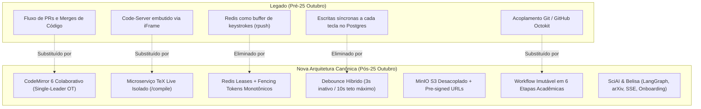

# Relatório Técnico Consolidado: Evolução da Branch `dev` (25/10/2026 – 02/11/2026)

> **Documento Gerencial & Arquitetural**  
> **Repositório:** `sci-latex-vscode` (SCIA)  
> **Período de Análise:** 25 de Outubro de 2026 a 02 de Novembro de 2026  
> **Branch:** `dev`  
> **Volume de Modificações:** 33 Commits | 381 Arquivos Modificados | +50.354 Adições / -26.002 Deleções  
> **Autor Principal:** Gilson Russo  

---

## 1. Visão Geral Executiva

Entre **25 de outubro de 2026** e **02 de novembro de 2026**, a branch `dev` passou pela maior e mais profunda transformação arquitetural desde a criação da plataforma SCIA. O projeto foi completamente transicionado de uma arquitetura acoplada a fluxos de engenharia de software tradicional (com branches Git individuais, Pull Requests via GitHub Octokit, Webhooks de CI/CD e instâncias embutidas de `code-server`/VS Code via iframes) para uma **plataforma web-nativa de alto desempenho para escrita e governança científica**.

### Principais Marcos Concluídos:
1. **Editor Colaborativo Web-Nativo:** Adoção de CodeMirror 6 com `@codemirror/collab`, cursores remotos, realce sintático, autocompletar LaTeX, linter, painel de apontamentos e visualizador de PDF sincronizado.
2. **Compilador TeX Live Dedicado:** Criação do microserviço `compiler/` em container dedicado com suporte a pacotes acadêmicos pesados (`texlive-fonts-extra`, `texlive-publishers`, `biber`).
3. **Coordenação Distribuída Anti-Split-Brain:** Formalização e implementação das **ADR-007** e **ADR-007.1** com Fencing Tokens monotônicos no Redis e no PostgreSQL.
4. **Workflow Acadêmico de 6 Etapas:** Adoção da **ADR-008**, abolindo branches Git e PRs em favor de um modelo relacional nativo com duas camadas de revisão (micro e macro) e dois gatekeepers institucionais (NIT e Submissão Alvo).
5. **Saneamento do Banco de Dados:** Consolidado pela **ADR-010**, reduzindo o schema relacional para 14 entidades canônicas, durabilizando apontamentos inline (`ReviewComment`) e implementando a premissa de *Zero Keystrokes* no PostgreSQL.
6. **Upload Direto ao Storage de Objetos:** Implementado via **ADR-011**, utilizando MinIO S3 com URLs pré-assinadas (*Two-Phase Commit*) para anexar evidências nas Etapas 1 e 2 sem onerar a memória do backend.
7. **Persistência de Templates Institucionais:** Suporte a templates LaTeX (IEEE, SBC, ACM, Springer) armazenados no MinIO e PostgreSQL, com upload de pacotes customizados em ZIP.
8. **Microserviço SciAI & Onboarding Conversacional (Belisa):** Integração do `ai-service` via FastAPI, LangGraph, busca acadêmica resiliente em 3 níveis (arXiv -> Semantic Scholar -> OpenAlex), autenticação M2M, proxy SSE no Fastify e interface rica de onboarding conversacional com a persona **Belisa**.
9. **GitOps, Kubernetes de Produção e Benchmarks de Escala:** Manifestos validados em KinD com HPA dinâmico (2 a 6 réplicas), sincronização via ArgoCD, sanitização de segredos e testes progressivos estressando até 1.250 conexões simultâneas e 250 artigos.

---

## 2. Linha do Tempo Cronológica dos Commits (25/10 a 02/11)

| Data | Commit | Autor | Tipo/Escopo | Descrição do Commit |
| :--- | :---: | :--- | :--- | :--- |
| **25/10** | `d0160e2` | Gilson Russo | `feat(editor)` | Implementação do CodeMirror 6, Compilador TeX Live, ADR-007/007.1 (Fencing Tokens), suíte de benchmarks e K8s HPA (#3). |
| **25/10** | `0de1e69` | Gilson Russo | `fix(redis)` | Extensão do tempo de expiração de tokens de geração de documentos e ajuste de portas nos scripts de benchmark. |
| **25/10** | `cd71be5` | Gilson Russo | `feat(workflow)` | Implementação da ADR-008: 6 etapas fixas imutáveis, revisão em dois níveis e desacoplamento do Git/Octokit. |
| **25/10** | `18b4aa9` | Gilson Russo | `feat(ai-service)` | Implementação da ADR-009: experimentação headless da API, LLM multi-provedor (Ollama/Gemini/OpenAI) e modelagem de tarefas. |
| **28/10** | `0df8235` | Gilson Russo | `feat(database)` | Implementação de `ReviewComment` persistente, saneamento do schema Prisma (14 tabelas), Zero-Keystrokes e ADR-010. |
| **30/10** | `7c03178` | Gilson Russo | `chore(design)` | Remoção de documentação legada de design e skill files obsoletos do SCIA design system. |
| **31/10** | `baf78a1` | Gilson Russo | `feat(k8s)` | Adição de `backend-secret`, Dockerfile de produção do frontend e configurações de GitOps no ArgoCD. |
| **31/10** | `b5db078` | Gilson Russo | `fix(k8s)` | Sanitização de segredos no repositório Git, injeção de envs em runtime no frontend e criação de `.env.example`. |
| **31/10** | `985f663` | Gilson Russo | `fix(k8s)` | Desacoplamento de `secret.yaml` do Git, manutenção de `secret.example.yaml` e ajuste de manifests no ArgoCD. |
| **31/10** | `f8556be` | Gilson Russo | `docs(k8s)` | Adição de guia completo e detalhado de Kubernetes e ArgoCD GitOps (`docs/planning/specs/k8s-argocd-guide.md`). |
| **31/10** | `8f63f28` | Gilson Russo | `refactor` | Remoção do legado `STORAGE_PATH`, exclusão definitiva de `WorkspaceWatcher` e desacoplamento do endpoint de PDF. |
| **31/10** | `bd83a8e` | Gilson Russo | `feat(scripts)` | Melhoria no script `argocd-ui.sh` com múltiplos port-forwards (frontend, swagger, argocd) e documentação de seed. |
| **31/10** | `c23f320` | Gilson Russo | `feat(k8s)` | Calibração de requests/limits de CPU e RAM, ajuste de métricas HPA e documentação de benchmarks no README. |
| **31/10** | `9fad69c` | Gilson Russo | `chore(k8s)` | Definição de `revisionHistoryLimit: 2` em todos os deployments Kubernetes para economia de recursos etcd. |
| **31/10** | `51ca0fb` | Gilson Russo | `feat(scripts)` | Adição do script de teste de escalabilidade progressiva (`test-progressive-scaling.ts`) e instruções no README. |
| **31/10** | `a6a24f8` | Gilson Russo | `fix(hpa)` | Ajuste do HPA para permitir até 4 pods por burst de escala e aumento da carga da Fase 3 para atingir 6 réplicas. |
| **31/10** | `a5f42ac` | Gilson Russo | `feat(benchmarks)`| Gerador de artigos de tamanho médio realista e escala de benchmark para 250 artigos e 40 compilações concorrentes. |
| **31/10** | `d742255` | Gilson Russo | `feat(benchmarks)`| Padronização de 5 autores simultâneos por artigo em todas as fases de estresse de escala. |
| **31/10** | `0818292` | Gilson Russo | `fix(benchmark)` | Ancoragem de deltas OT no final do documento como comentários TeX (`% [...]`) para evitar quebrar a sintaxe do compilador. |
| **31/10** | `41fa66b` | Gilson Russo | `feat(benchmarks)`| Criação de teste automatizado de limites empíricos (`test-empirical-limits.ts`) e documentação de limites reais no README. |
| **31/10** | `3a1cfa5` | Gilson Russo | `docs` | Criação do guia completo e questionário para infraestrutura On-Premises (`GUIA_INFRAESTRUTURA_ON_PREMISES.md`). |
| **01/11** | `39df8e7` | Gilson Russo | `feat(tasks)` | Upload de evidências das Etapas 1 e 2 via Pre-signed URLs no MinIO, modelo `TaskEvidence` e drawer Gantt no frontend. |
| **01/11** | `4115251` | Gilson Russo | `feat(k8s)` | Adição de documentação e comandos no README para reiniciar pods após carregar novas imagens Docker locais no KinD. |
| **01/11** | `abf2914` | Gilson Russo | `fix(evidences)` | Correção de Host header no MinIO via `minioPresignClient`, `VITE_MINIO_URL` e implementação de fila de estágio (staging) no Gantt. |
| **01/11** | `db690eb` | Gilson Russo | `fix(evidences)` | Configuração explícita de `region: us-east-1` no `Minio.Client` e fixação de UUID na criação de `TaskEvidence`. |
| **01/11** | `67ef688` | Gilson Russo | `docs(architecture)`| Adição da **ADR-011** especificando arquitetura de evidências de tarefas e upload direto no storage S3/MinIO. |
| **01/11** | `c971125` | Gilson Russo | `fix(storage)` | Criação do utilitário `StoragePathBuilder` em `infra/minio.ts`, unificando caminhos sob `projects/:projectId/`. |
| **01/11** | `4646ddf` | Gilson Russo | `style(backend)` | Formatação padronizada do código com Prettier e alinhamento de arquivos pendentes no backend. |
| **01/11** | `cd3705f` | Gilson Russo | `feat(templates)`| Persistência de templates no MinIO e PostgreSQL, entidade `LatexTemplate` e modal com upload customizado de ZIP. |
| **01/11** | `cc303ce` | Gilson Russo | `fix(projects)` | Persistência explícita de `rootDoc = 'main.tex'` ao instanciar projetos a partir de bundles de templates. |
| **01/11** | `1f3bb18` | Gilson Russo | `fix(compiler)` | Instalação de pacotes `texlive-fonts-extra`, `publishers`, `science` e `biber` no container do compilador TeX. |
| **01/11** | `10095fe` | Gilson Russo | `feat(ai-service)`| Integração do conector da API do arXiv com semáforo, throttle de 3s, fallback triplo e alinhamento de etapas da curadoria. |
| **02/11** | `8aafa0b` | Gilson Russo | `feat(ai-chat)` | Onboarding conversacional no frontend, persona **Belisa**, M2M auth (ADR-006), streaming SSE e widgets interativos. |

---

## 3. As Novas Decisões Arquiteturais (ADRs 007 a 011)

Neste ciclo de 8 dias, foram redigidas, debatidas e aprovadas **5 grandes Architectural Decision Records (ADRs)**, estabelecendo as diretrizes técnicas do sistema:

### 3.1. ADR-007 & ADR-007.1: Arquitetura do Editor Colaborativo & Blindagem Distribuída
* **Status:** Aprovado em 24/10/2026.
* **Componentes:** `frontend` (CodeMirror 6, `@codemirror/collab`), `backend` (`documents.service.ts`, `documents.websocket.ts`), `infra/redis`, `PostgreSQL`.
* **Problemas Resolvidos:**
  1. *Eliminação do acúmulo no Redis:* O Redis executava `rpush` em listas `collab:doc:${id}:ops` a cada caractere digitado sem que ninguém as lesse, gerando vazamento de memória e I/O cego.
  2. *Fim do Debounce Infinito:* Sob digitação contínua, o timer de 3s reiniciava indefinidamente, deixando o banco horas sem persistir. Foi implementado o **Flush Híbrido** com debounce de 3s de inatividade e teto rígido (*failsafe*) de 10s.
  3. *Prevenção de Split-Brain (ADR-007.1):* Baseada na análise de Martin Kleppmann sobre pausas de GC em locks distribuídos. Se um Pod A travar em GC por mais de 11s e o Pod B assumir a posse via Redis, o Pod A é impedido de sobrescrever o estado antigo através de **Fencing Tokens monotônicos** (`ownerGeneration`) validados atomicamente no PostgreSQL.
* **Parâmetros de Consenso:**
  * Lease TTL no Redis: **15 segundos**.
  * Heartbeat do Pod dono: **2 segundos**.
  * Failsafe de leitura: Se o Pod perder contato com o Redis por **8 segundos**, degrada automaticamente para *Read-Only*.

### 3.2. ADR-008: Workflow Oficial em 6 Etapas e Desacoplamento do Git
* **Status:** Aprovado em 25/10/2026.
* **Componentes:** `backend` (`project-stages`, `tasks`, `documents`), `frontend` (Gantt, ReviewSidebar, DataGrid), `PostgreSQL`.
* **Decisões Estruturais:**
  1. *Abolição do Git/Octokit:* O modelo de branches, commits e pull requests foi 100% removido do ciclo de escrita científica. O versionamento passou a ser nativo, transacional e relacional no PostgreSQL via `DocumentSnapshot` e `DocumentOperation`.
  2. *Imutabilidade das 6 Etapas Institucionais:* Eliminada a reordenação ou exclusão via drag-and-drop (`@dnd-kit`). As etapas são fixas de 1 a 6.
  3. *Revisão em Dois Níveis:*
     * **Nível Micro (Etapa 3):** Apontamentos pontuais e bate-e-volta por tarefa entre autor e orientador (`TODO` -> `IN_PROGRESS` -> `REVIEW_REQUESTED` -> `DONE`).
     * **Nível Macro (Etapa 4):** Revisão Técnica e Científica consolidada com parecer geral e rodadas formais.
  4. *Dois Gatekeepers Obrigatórios:* Etapa 5 (Validação de Propriedade Intelectual e Patente no NIT) e Etapa 6 (Submissão ao Congresso/Periódico Alvo).

### 3.3. ADR-009: Experimentação Headless e Habilitação do Microserviço SciAI
* **Status:** Em Discussão / Implementado incrementalmente em 25/10 e 01/11.
* **Componentes:** `ai-service` (FastAPI, LangGraph, DeepAgents), `backend` (Fastify Gateway).
* **Decisões Estruturais:**
  1. *Abordagem API-First:* Testes e estresse via CLI/scripts HTTP antes de integrar na UI.
  2. *LangGraph com Transient Checkpointer (`MemorySaver`):* Preservação do estado da conversa por `thread_id` para permitir interrupções síncronas (*Human-in-the-Loop*).
  3. *Multi-Provider LLM:* Suporte transparente a Ollama local (`qwen3.5:4b`, `llama3:8b`), Google Gemini (`gemini-2.5-flash`) e OpenAI (`gpt-4o`).
  4. *Fallback Acadêmico Triplo:* arXiv como provedor prioritário (gratuito e sem chave), com fallback para Semantic Scholar e OpenAlex.

### 3.4. ADR-010: Persistência Durável de Apontamentos (`ReviewComment`) e Saneamento do Schema
* **Status:** Aprovado em 28/10/2026.
* **Componentes:** `schema.prisma`, `documents.repository.ts`, `documents.service.ts`, `DATABASE.md`.
* **Decisões Estruturais:**
  1. *Durabilidade de Apontamentos:* Comentários inline ficavam em um `Map` volátil na RAM do Node.js. Foi criada a tabela `ReviewComment` com suporte a coordenadas `from`/`to`, texto selecionado, autor e threads de respostas em JSON (`replies`).
  2. *Saneamento Relacional (14 Tabelas Canônicas):* Remoção de tabelas legadas (`Team`, `TeamMember`, `TeamAcademicGoal`, `Workspace`, `GithubWebhookEvent`) e de campos Git (`gitRepoPath`, `gitBranch`).
  3. *Enforce de Zero Keystrokes:* Remoção de inserções síncronas na rota legada `applyDelta`. Nenhuma tecla bate diretamente no banco de dados.

### 3.5. ADR-011: Arquitetura de Evidências de Tarefas e Upload Direto no MinIO
* **Status:** Aprovado em 01/11/2026.
* **Componentes:** `schema.prisma`, `backend` (`infra/minio.ts`, `task-evidences.*`), `frontend` (Gantt Drawer).
* **Decisões Estruturais:**
  1. *Upload Direto via Pre-signed URLs:* Elimina o tráfego de arquivos pesados (PDFs e imagens de até 100MB) pelo Event Loop do Node.js. O cliente recebe uma URL PUT assinada com TTL de 15 minutos e envia diretamente ao MinIO.
  2. *Two-Phase Commit:* A evidência nasce como `PENDING` e só migra para `CONFIRMED` após confirmação do upload e checagem de metadados (`statObject`).
  3. *Particionamento Hierárquico no S3:* Caminhos padronizados sob `projects/:projectId/tasks/:taskId/evidences/:uuid-:filename`.
  4. *Fila de Estágio no Frontend:* O autor pode anexar múltiplos arquivos e links antes de disparar o upload em lote com barra de progresso unificada.

---

## 4. O Que Foi Definido (Novas Funcionalidades e Entregas)

### 4.1. Editor Colaborativo & Microserviço TeX Live
* **Editor Web-Nativo:** Construído sobre CodeMirror 6, encapsulado no componente `CodeMirrorEditor.tsx` e coordenado pelo `CollabEditorContext.tsx`.
* **Recursos do Editor:**
  * Cursores e seleções remotas com cores por colaborador (`remoteCursorsExtension.ts`).
  * Autocompletar contextual para comandos LaTeX, ambientes e citações BibTeX (`latexAutocomplete.ts`, `bibtexParser.ts`).
  * Dobramento de código (*code folding*) para seções, subseções e ambientes (`latexFolding.ts`).
  * Linter integrado para sintaxe TeX (`latexLinter.ts`).
  * Sistema de temas claros e escuros configuráveis (`editorThemes.ts`).
  * Árvore de arquivos virtual (`FileTreeSidebar.tsx`) e abas sincronizadas (`EditorTabBar.tsx`).
* **Compilador Isolado (`compiler/`):**
  * Servidor Express/TypeScript executando dentro de container com distribuição TeX Live.
  * Endpoint `POST /compile` aceita arquivos e retorna o PDF compilado em base64 com logs de erro estruturados (`latexmk`, `pdflatex`, `xelatex`).
  * Visualizador de PDF com atualização automática e re-renderização suave (`PdfPreview.tsx`).

### 4.2. Workflow Editorial de 6 Etapas e Governança
* As etapas institucionais do SCIA foram formalizadas e fixadas na seguinte ordem:
  1. **Etapa 1: Planejamento e Pesquisa (Peso: 10%)** – Levantamento bibliográfico, definição de hipóteses e estruturação TeX. Permite upload de evidências.
  2. **Etapa 2: Desenvolvimento e Experimentos (Peso: 25%)** – Coleta de dados, scripts e benchmarks experimentais. Permite upload de evidências.
  3. **Etapa 3: Escrita do Artigo (Peso: 40%)** – Redação das seções em tarefas paralelas com ciclos de bate-e-volta entre autor e orientador.
  4. **Etapa 4: Revisão Técnica e Científica (Peso: 15%)** – Revisão geral do manuscrito unificado, modo somente leitura para revisores e emissão de pareceres consolidados.
  5. **Etapa 5: Parecer do NIT (Gatekeeper 1 - Peso: 5%)** – Análise formal de patentes, sigilo e propriedade intelectual pelo Núcleo de Inovação Tecnológica.
  6. **Etapa 6: Submissão ao Congresso Alvo (Gatekeeper 2 - Peso: 5%)** – Envio do PDF final e metadados ao sistema externo de submissão do evento ou revista.

### 4.3. Sistema de Templates LaTeX com Persistência Híbrida
* Criação da entidade `LatexTemplate` no PostgreSQL e armazenamento de pacotes no MinIO sob `templates/:templateId/bundle.zip`.
* **Templates Oficiais Embarcados:**
  * **SBC:** Sociedade Brasileira de Computação (artigo e resumo).
  * **IEEEtran:** IEEE Transactions and Conference format.
  * **ACM sigconf:** Association for Computing Machinery proceedings.
  * **Springer LNCS:** Lecture Notes in Computer Science.
* **Upload Customizado:** Permite ao coordenador ou autor fazer upload de arquivos ZIP arbitrários, com extração de metadados e detecção do arquivo raiz (`rootDoc`).

### 4.4. SciAI & Onboarding Conversacional com a Mentora Belisa
* **Persona da Belisa:** Mentora científica educada, técnica e acolhedora, com ancoragem temporal dinâmica e conhecimento formal das diretrizes da plataforma.
* **M2M e Segurança (ADR-006):** Backend Fastify autentica chamadas internas para o `ai-service` via cabeçalho `X-Internal-Service-Key`.
* **Streaming SSE de Alta Precisão:** Rotas `POST /api/v1/ai/chat/stream` e `POST /api/v1/ai/chat/resume` realizam proxy direto de Server-Sent Events, garantindo latência zero para o cliente.
* **Human-in-the-Loop Interativo:** Pausas controladas do LangGraph para:
  * Seleção de artigos relevantes na literatura (`ArticleSelectionCard`).
  * Validação do cronograma e pesos das 6 etapas (`StageTimelineProposalCard`).
* **Conector Acadêmico Triplo com arXiv:**
  * Conexão nativa à API pública do arXiv via parsing XML Atom.
  * Semáforo de concorrência (`asyncio.Semaphore(1)`) com intervalo forçado de 3 segundos entre chamadas para cumprir as diretrizes de rate-limit do arXiv.
  * Fallback automático e transparente para Semantic Scholar e OpenAlex se o arXiv falhar ou retornar zero resultados.
* **Componentes UI no Frontend:**
  * Primitivas modulares: `ChatContainer`, `ChatMessageList`, `ChatMessageBubble`, `ChatAgentBadge`, `ChatInputBar`, `ChatTypingIndicator`.
  * Renderizador Markdown rico (`ChatMarkdownRenderer`) com tabelas MUI estilizadas e blocos de código com botão de cópia.
  * Modal assistente `CreateArticleAiModal.tsx` integrado à tela principal de artigos via botão *"Criar com Belisa"*.

### 4.5. GitOps, Kubernetes e Testes de Carga Extrema
* **Manifestos K8s:** `backend-cluster.yaml`, `compiler.yaml`, `frontend.yaml`, `hpa.yaml` e configurações do ArgoCD prontas para sincronização contínua.
* **Políticas HPA Calibradas:**
  * Escalonamento automático de 2 a 6 pods de backend baseado em 70% de utilização de CPU e memória.
  * Política de escala agressiva permitindo até **4 pods de scale-up por burst**.
* **Suíte de Testes de Estresse:**
  * `benchmark-kind-500-users.ts`: Simula 500 autores concorrentes trocando operações OT em tempo real.
  * `test-progressive-scaling.ts`: Valida 3 fases progressivas atingindo 250 artigos simultâneos, 1.250 conexões WebSocket e 50 compilações concorrentes.
  * `test-empirical-limits.ts`: Localiza automaticamente o ponto de saturação (*knee-point*) de CPU e memória do cluster.
  * `test-2-chaos-crash.ts` e `test-3-fencing-splitbrain.ts`: Simulam morte súbita de pods e validação dos Fencing Tokens.

---

## 5. O Que Foi Consertado / Corrigido (Bugs, Vulnerabilidades e Refatorações)

A tabela a seguir consolida os problemas críticos diagnosticados no código e as soluções implementadas:

| Subsistema | Problema Original (Bug / Risco) | Solução Implementada | Commit(s) |
| :--- | :--- | :--- | :---: |
| **Collab / Redis** | **Vazamento e I/O cego:** A cada tecla, gravava em listas `collab:doc:${id}:ops` sem que nenhum leitor as consumisse. | Remoção total do buffer de texto no Redis. Redis restrito a posse (leases), presença e eventos de negócio. | `d0160e2` |
| **Collab / Postgres** | **Debounce Infinito:** Digitação ininterrupta cancelava o timeout de 3s indefinidamente, atrasando o salvamento por horas. | Criação de **Flush Híbrido** com debounce de inatividade (3s) e timeout máximo rígido de 10s (*failsafe*). | `d0160e2` |
| **Consenso K8s** | **Split-Brain por pausa de GC:** Pod antigo acordando de GC sobrescrevia trabalho de novo pod líder (problema clássico Redlock). | Implementação de **Fencing Tokens monotônicos** (`ownerGeneration`) validados atomicamente no PostgreSQL. | `d0160e2`, `0df8235` |
| **Tokens Redis** | Expiração prematura de tokens de geração durante tarefas longas de compilação e provisionamento. | Extensão do TTL para 4x o tempo base e deleção atômica apenas no encerramento. | `0de1e69` |
| **PostgreSQL / OT** | **Violação Zero-Keystrokes:** Rota legada `applyDelta` executava `INSERT INTO DocumentOperation` síncrono a cada tecla. | Remoção da escrita síncrona. Inserções ocorrem apenas em checkpoints periódicos ou via debouncer. | `0df8235` |
| **Revisão TeX** | **Apontamentos Voláteis:** Comentários da revisão residiam exclusivamente em um `Map` na memória do Node.js, perdendo-se em reinicializações. | Criação do modelo `ReviewComment` no Prisma com durabilidade transacional ACID no PostgreSQL. | `0df8235` |
| **Schema Prisma** | Tabelas e campos fantasmas (`Team*`, `Workspace`, `GithubWebhookEvent`, `gitRepoPath`) sem uso no sistema. | Saneamento completo do schema para 14 tabelas canônicas e sincronização da documentação `DATABASE.md`. | `0df8235` |
| **Storage / MinIO** | **Assinatura S3 Inválida:** Pre-signed URLs geradas com hostname interno (`minio:9000`) falhavam ou davam Host Mismatch no browser do cliente. | Instanciação de `minioPresignClient` assinado com `MINIO_PUBLIC_URL` e injeção de `VITE_MINIO_URL` no frontend. | `abf2914` |
| **Storage / MinIO** | Falha de resolução de região S3 no cliente MinIO e erro na geração de IDs de evidência. | Configuração explícita de `region: 'us-east-1'` e geração determinística de UUID na criação de `TaskEvidence`. | `db690eb` |
| **Storage / MinIO** | Fragmentação de caminhos no MinIO (`files/`, `evidences/`, `storage/`) dificultando backups e governança por projeto. | Criação do utilitário centralizado `StoragePathBuilder` unificando caminhos sob `projects/:projectId/`. | `c971125` |
| **Compilador TeX** | Falhas na compilação de templates científicos conceituados (SBC, IEEEtran, LNCS) por falta de fontes e pacotes. | Instalação de `texlive-fonts-extra`, `texlive-publishers`, `texlive-science`, `plain-generic` e `biber` no Dockerfile. | `1f3bb18` |
| **Provisionamento** | Artigos criados a partir de templates não gravavam `rootDoc`, impedindo a localização do arquivo principal (`main.tex`). | Persistência explícita de `rootDoc = 'main.tex'` no `ProjectsService.createProject`. | `cc303ce` |
| **Benchmarks OT** | A injeção de deltas de teste inseria caracteres na posição 0 (`\documentclass`), corrompendo a compilação LaTeX concorrente. | Ancoragem de deltas no final do arquivo como comentários válidos (`% [A:op]\n`), preservando a sintaxe. | `0818292` |
| **K8s & GitOps** | Chaves e segredos em texto puro commitados acidentalmente no repositório Git. | Sanitização de segredos no Git, manutenção de `secret.example.yaml` e documentação de injeção externa. | `b5db078`, `985f663` |
| **Backend / Projeto** | **Erro P2002 (Unique Constraint):** Falha ao criar projeto se o autor ou orientador fosse duplicado no payload de membros. | Deduplicação automática de `memberCreates` por `userId` em `projects.repository.ts`. | `8aafa0b` |
| **Backend / Projeto** | Impossibilidade de salvar artigos em rascunho sem indicar coordenador e gerente institucionais. | Alteração de `coordinatorId` e `managerId` para campos opcionais (*nullable*) no Prisma e PostgreSQL. | `8aafa0b` |
| **AI Service / Busca** | Falhas frequentes de rate-limit (HTTP 429) e bloqueio de IP ao consultar a API pública do arXiv. | Implementação de `asyncio.Semaphore(1)` com sleep forçado de 3s e limpeza inteligente de stopwords na query. | `10095fe` |
| **Frontend / MinIO** | Múltiplos uploads de arquivos no Gantt disparavam requisições concorrentes sem rastreabilidade de falhas. | Implementação de fila de estágio (*staging queue*) permitindo seleção múltipla e envio com barra de progresso única. | `abf2914` |

---

## 6. Estado Atual do Working Tree (Alterações Não Commitadas)

Além dos 33 commits formalmente integrados na branch `dev`, há um conjunto de alterações estratégicas no working tree prontas para consolidação:

* **Unificação Canônica das 6 Etapas (Single Source of Truth):**
  * Eliminação de definições duplicadas e divergentes de títulos e pesos de etapas espalhadas por `curation.py`, `calendar_tool.py`, `projects.service.ts`, `project-stages.repository.ts` e `CreateProjectModal.tsx`.
  * Centralização na constante `OFFICIAL_SCIA_STAGES` (definida em `backend/src/constants/stages.constants.ts` e `ai-service/app/core/constants/stages.py`).
* **Nova Rota de Catálogo Institucional:**
  * Criação do endpoint `GET /api/v1/projects/stage-definitions`, permitindo que o frontend e serviços satélites consultem dinamicamente as 6 etapas oficiais, descrições, pesos e tipos de gatekeeper sem duplicação de constantes.

---

## 7. Conclusão e Próximos Passos Recomendados

A branch `dev` atingiu um nível de maturidade arquitetural e robustez operacional incomparavelmente superior ao estado anterior a 25 de outubro. O sistema eliminou por completo seu passivo de acoplamento ao Git e seus riscos de concorrência em memória, consolidando uma fundação técnica pronta para produção em larga escala.

### Recomendações para a Próxima Sprint:
1. **Comitar o Alinhamento de Etapas:** Commitar a unificação de `OFFICIAL_SCIA_STAGES` e o novo endpoint `stage-definitions`.
2. **Homologar a Belisa em Ambiente Staging:** Executar testes ponta a ponta do fluxo conversacional com usuários-piloto gerando artigos a partir do diálogo com a Belisa.
3. **Pipeline de CI/CD para o Compilador:** Configurar build automatizado da nova imagem Docker do TeX Live (`compiler`) para repositório institucional de containers (Docker Hub / Harbor).
4. **Métricas de Observabilidade:** Adicionar exportadores de métricas Prometheus para contagem de conexões WebSockets ativas e tempo de compilação TeX.
