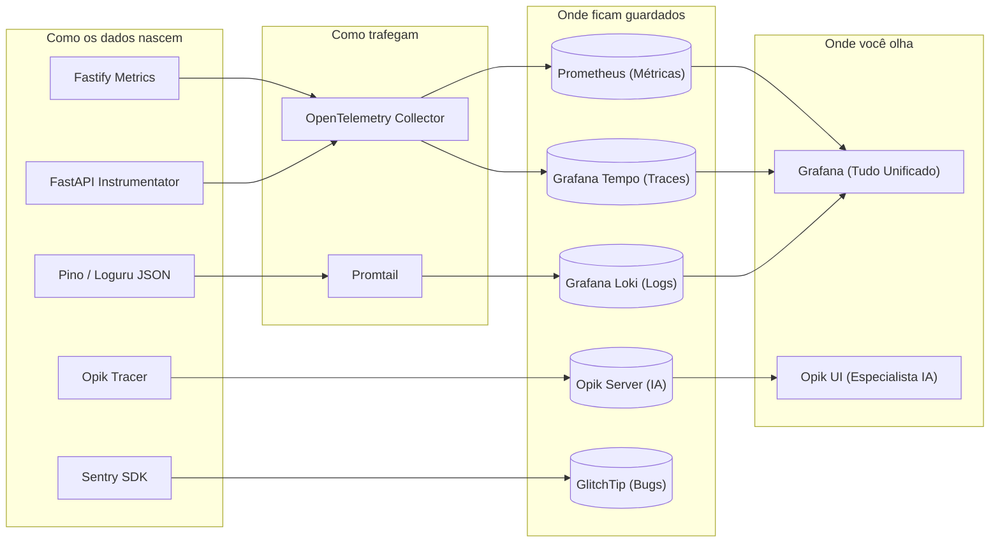

# 🧭 Tutorial Completo de Observabilidade On-Premise Licença Zero — Plataforma SCIA

> **Para quem é este guia:** Para você, desenvolvedor ou arquiteto da plataforma SCIA, que precisa ter o controle cirúrgico de cada camada de um sistema que está crescendo rápido, sem pagar faturas de nuvem, sem vazamento de dados de pesquisa e sem ficar perdido em um mar de ferramentas.

---

## 1. Por Que Precisamos de Tudo Isso? (A Dor do Crescimento)

Quando uma aplicação é simples (apenas um frontend conversando com uma API), debugar é fácil: basta olhar o terminal ou o console do navegador.

Porém, a plataforma **SCIA** agora possui **5 camadas heterogêneas e interdependentes**:
1. O **Frontend** (React + Vite) onde o pesquisador digita e visualiza o documento.
2. O **Backend** (Node.js + Fastify) que valida autenticação, gerencia permissões e guarda o estado das 6 etapas.
3. O **AI Service** (Python + FastAPI + LangGraph) que orquestra agentes, busca no arXiv e gera textos científicos com LLMs.
4. O **Compilador LaTeX** que compila PDFs em um sandbox isolado consumindo picos de CPU.
5. Os **Bancos e Armazenamento** (PostgreSQL, Redis e MinIO).

Se um usuário clicar em *"Refinar Ideia e Gerar LaTeX"* e a tela ficar carregando infinitamente ou retornar um erro genérico:
* *A culpa foi da internet do usuário?*
* *Foi o Fastify que travou o Event Loop?*
* *Foi o arXiv que aplicou rate-limit no nosso IP?*
* *Foi o modelo de IA que demorou 20 segundos para gerar o texto?*
* *Ou foi o compilador LaTeX que entrou em loop infinito de compilação?*

Sem observabilidade moderna, você passará horas abrindo 4 terminais diferentes tentando adivinhar. Com a nossa stack, **você descobre em menos de 10 segundos**.

---

## 2. A Analogia do Hospital: O Papel de Cada Conceito

Para nunca mais esquecer a diferença entre os termos da observabilidade:

```
┌────────────────────────────────────────────────────────────────────────┐
│                      A ANALOGIA CLÍNICA DA TELEMETRIA                  │
├────────────────────┬────────────────────┬──────────────────────────────┤
│ Conceito           │ No Hospital        │ No Software (SCIA)           │
├────────────────────┼────────────────────┼──────────────────────────────┤
│ 1. Métricas        │ Frequência cardíaca│ RPS, % de CPU, uso de RAM,   │
│    (Prometheus)    │ e temperatura.     │ latência média e p99.        │
├────────────────────┼────────────────────┼──────────────────────────────┤
│ 2. Logs            │ O prontuário com o │ Mensagens detalhadas de      │
│    (Loki)          │ histórico do dia.  │ cada linha ("Iniciou busca").│
├────────────────────┼────────────────────┼──────────────────────────────┤
│ 3. Traces (APM)    │ Exame de contraste │ Linha do tempo de uma única  │
│    (Tempo / OTel)  │ no sangue.         │ requisição por 4 servidores. │
├────────────────────┼────────────────────┼──────────────────────────────┤
│ 4. LLMOps          │ Exame neurológico  │ Detalhe de cada nó de IA,    │
│    (Opik)          │ e cognitivo.       │ tokens, prompts e custo.     │
├────────────────────┼────────────────────┼──────────────────────────────┤
│ 5. Error Tracking  │ Alarme da UTI de   │ Alerta imediato com o código │
│    (GlitchTip)     │ parada cardíaca.   │ que quebrou na hora.         │
└────────────────────┴────────────────────┴──────────────────────────────┘
```

---

## 3. Quem é Quem na Nossa Stack (O Que Cada Uma Faz e Como Faz)

Todas as ferramentas escolhidas são **100% livres de licença comercial (Apache 2.0 / MIT / AGPLv3)** e rodam **localmente (on-premise)** nos seus próprios servidores ou Kubernetes.



### 3.1. Prometheus (O Cronômetro e o Termômetro)
* **O que faz:** Coleta e guarda números ao longo do tempo (séries temporais).
* **Como faz:** De 15 em 15 segundos, o Prometheus faz uma requisição HTTP nos seus serviços (no endpoint `/metrics`) e raspa os números: *"Quantas requisições chegaram?", "Qual a memória atual?", "Quantas conexões estão no banco?"*.
* **Por que usamos:** É o padrão absoluto da indústria, ultra leve, não consome quase nada de CPU e permite criar gráficos de linha instantâneos.

### 3.2. Grafana Loki (O Buscador de Logs Econômico)
* **O que faz:** Centraliza todos os logs do Backend, AI Service e Compilador em um só lugar pesquisável.
* **Como faz diferente do Elasticsearch:** Sistemas tradicionais (como o Elasticsearch) indexam todas as palavras de todos os logs, consumindo 20 a 30 GB de memória RAM. O **Loki** faz o oposto: ele indexa apenas as etiquetas (`app=backend`, `env=production`, `level=error`). O texto do log fica comprimido em disco.
* **Resultado:** Você pesquisa logs de semanas inteiras usando uma fração minúscula de memória.

### 3.3. OpenTelemetry + Grafana Tempo (O Detetive de Requisições)
* **O que faz:** Desenha a cascata exata de uma requisição que passou por vários microsserviços.
* **Como faz:** Quando o usuário clica no Frontend, o sistema anexa um cabeçalho HTTP padrão chamado `traceparent: 00-4bf92f3577b34da6a3ce929d0e0e4736-00f067aa0ba902b7-01`. 
  Quando o Fastify chama o FastAPI do AI Service, ele repassa esse mesmo ID. O **Tempo** junta esses pedaços e te mostra uma régua visual:
  ```
  [Frontend] Clique no Botão: 2.3s
    └── [Backend Fastify] POST /api/chat: 2.2s
          ├── [AI Service] POST /chat/stream: 2.0s
          │     ├── [LangGraph] Supervisor: 50ms
          │     ├── [arXiv API] Busca XML: 1.4s (GARGALO ENCONTRADO!)
          │     └── [Gemini Flash] Stream tokens: 550ms
          └── [PostgreSQL] UPDATE projects: 4ms
  ```
  Você não precisa adivinhar onde o sistema demorou: o Tempo te mostra o bloco em vermelho.

### 3.4. Opik (Comet) — O Microscópio do Motor de IA
* **O que faz:** Monitoramento profundo e especializado para LLMs, Agentes e LangGraph.
* **Por que o Prometheus/Loki não bastam para IA?** Porque o Prometheus só sabe que uma requisição demorou 3 segundos. Ele não sabe:
  * Qual prompt foi enviado para o Gemini ou OpenAI?
  * Quantos tokens de entrada e saída foram gastos?
  * Quanto essa única mensagem custou em dólares?
  * O agente tomou o caminho do Supervisor, do Curador ou do Escritor LaTeX?
  * O modelo alucinou ou violou alguma regra?
* **Como o Opik faz:** Ele se conecta como um *callback listener* no LangGraph (`OpikTracer`). Cada vez que um nó do seu grafo roda ou um modelo de linguagem é invocado, o Opik captura silenciosamente o evento em segundo plano e envia para o servidor local do Opik.

### 3.5. GlitchTip (O Notificador de Panes)
* **O que faz:** Captura qualquer exceção não tratada (`crash`) no navegador do usuário ou no servidor e te avisa.
* **Por que não o Sentry oficial?** O Sentry é maravilhoso, mas a versão auto-hospedada dele exige mais de 16 GB de RAM e usa licença comercial restritiva. O **GlitchTip** é feito em Python/Django, consome apenas 300 MB de RAM, usa licença livre AGPLv3 e **usa exatamente a mesma biblioteca SDK do Sentry** no seu código (`@sentry/react` e `@sentry/node`).

### 3.6. Grafana (A Central de Comando)
* **O que faz:** É a tela que junta tudo.
* **Como funciona:** Você não precisa abrir 5 abas. No Grafana, você cria uma tela onde no topo estão os gráficos do Prometheus, no meio os logs do Loki e embaixo os traces do Tempo.

---

## 4. Como Ter o Controle de Cada Camada (O Passo a Passo)

### Camada 1: O Frontend (React / Vite)
* **O que você quer controlar:** "A tela travou? O usuário recebeu tela branca?".
* **Como você controla:** 
  1. No arquivo principal do React (`main.tsx`), inicializamos o `@sentry/react` apontando para a URL do seu GlitchTip on-premise.
  2. Adicionamos um `<ErrorBoundary>` em volta da aplicação. Se um componente React quebrar por causa de um `undefined`, o GlitchTip grava o bug, a linha do código TypeScript e o navegador do usuário.

### Camada 2: O Backend (Fastify / TypeScript)
* **O que você quer controlar:** "O servidor está aguentando o volume de conexões? As rotas estão rápidas? O banco está com queries travadas?".
* **Como você controla:**
  1. Registramos o plugin `fastify-metrics`. Ele cria a rota `/metrics` automaticamente.
  2. O Fastify já utiliza o logger `pino` nativamente. Garantimos que ele cuspa JSON estruturado na saída padrão (`stdout`), contendo o `trace_id`.
  3. O Promtail lê esse terminal e envia pro Loki.

### Camada 3: O AI Service (FastAPI + LangGraph)
* **O que você quer controlar:** "Quanto estamos gastando de IA? Qual agente está lento? As buscas no arXiv estão sendo bloqueadas?".
* **Como você controla:**
  1. Usamos `prometheus-fastapi-instrumentator` para medir a velocidade dos endpoints HTTP.
  2. No LangGraph, passamos o `OpikTracer()` no momento de chamar o grafo.
  3. Você abre a interface web do **Opik** (`http://localhost:5174`) e enxerga todos os diálogos acadêmicos, a árvore de nós do agente e a contagem exata de tokens.

### Camada 4: O Compilador LaTeX (Sandbox de Compilação)
* **O que você quer controlar:** "Algum documento travou o compilador? O uso de CPU explodiu?".
* **Como você controla:**
  1. A cada compilação disparada, o serviço emite uma métrica de duração (`latex_compile_duration_seconds`) com labels do motor usado (`engine="pdflatex"` ou `"xelatex"`).
  2. Se a compilação ultrapassar 30 segundos, o processo é cancelado via `SIGKILL` (conforme ADR-012) e um evento de alerta de timeout é registrado no log.

### Camada 5: Bancos e Armazenamento (Postgres, Redis, MinIO)
* **O que você quer controlar:** "O disco do MinIO está enchendo? O pool do Postgres esgotou?".
* **Como você controla:**
  1. Usamos os "Exporters" oficiais do Prometheus (`postgres_exporter`, `redis_exporter`).
  2. Eles se conectam aos bancos e transformam o status interno deles em gráficos de uso de memória e conexões abertas no Grafana.

---

## 5. Exemplo Real: O Que Acontece Quando o Usuário Clica em "Gerar Cronograma"?

Veja como as ferramentas trabalham em harmonia durante um fluxo real da plataforma:

```
1. USUÁRIO CLICA NO BOTÃO "GERAR CRONOGRAMA"
   │
   ├──> O Frontend gera o Trace ID: "trace-abc-123"
   │
   ├──> Requisição chega no FASTIFY:
   │    • Prometheus registra: +1 requisição na rota /api/v1/ai/runs (RPS sobe)
   │    • Pino grava log: {"trace_id": "trace-abc-123", "msg": "Iniciando geração de cronograma"}
   │
   ├──> Fastify chama FASTAPI (AI SERVICE) repassando o Trace ID:
   │    • O LangGraph inicia a execução do grafo multi-agente
   │    • O OpikTracer intercepta a execução:
   │      - Nó 1: Supervisor analisa a intenção do autor (50ms)
   │      - Nó 2: Search Specialist busca artigos no arXiv (1.8s)
   │      - Nó 3: Curation calcula as datas das 6 etapas institucionais (200ms)
   │      - Nó 4: Modelo LLM formula a proposta final (1.200 tokens gerados, custo: $0.003)
   │    • O Opik salva essa execução completa no seu banco local
   │
   ├──> Resposta final volta para o FASTIFY e é salva no POSTGRESQL:
   │    • Tempo registra a duração total de ponta a ponta: 2.1s
   │
   └──> TELA DO USUÁRIO É ATUALIZADA COM SUCESSO.
```

Se o nó do arXiv tivesse falhado por rate limit:
1. O **Opik** marcaria o nó `search_specialist` com status vermelho de erro.
2. O **Loki** mostraria o log exato: `"ArXiv 429 Too Many Requests, falling back to Semantic Scholar"`.
3. O **Tempo** mostraria o bloco de chamada externa em amarelo/vermelho.
4. O **Grafana** alertaria no canal da equipe caso essa taxa de erros persistisse por mais de 2 minutos.

---

## 6. Como Subir e Ver Tudo Funcionando Localmente

Para subir todo o ecossistema de observabilidade no seu ambiente de desenvolvimento:

### Passo 1: Subir a Stack de Observabilidade
Execute no terminal da raiz do projeto:
```bash
docker compose -f infra/observability/docker-compose.observability.yml up -d
```

### Passo 2: Acessar os Painéis no Seu Navegador
* **Grafana (Central de Dashboards):** [http://localhost:3001](http://localhost:3001)
  * *Usuário:* `admin` | *Senha:* `admin_scia_local`
* **Opik (LLMOps & LangGraph):** [http://localhost:5174](http://localhost:5174)
  * Interface limpa para inspecionar cada nó dos agentes de IA.
* **Prometheus (Explorador de Métricas):** [http://localhost:9090](http://localhost:9090)
* **GlitchTip (Bugs e Exceções):** [http://localhost:8005](http://localhost:8005)

### Passo 3: Instrumentar o seu Código de IA com Opik
No `ai-service`, basta instalar o pacote e plugar o callback:

```bash
cd ai-service
uv add opik
```

No arquivo onde você invoca o LangGraph (ex: `app/api/v1/endpoints/chat.py`):
```python
from opik.integrations.langchain import OpikTracer

# Inicializa o rastreador apontando para sua instância on-premise
opik_tracer = OpikTracer(
    project_name="scia-academic-copilot",
    host="http://localhost:8081" # Endpoint da API do Opik
)

# Ao chamar o grafo LangGraph:
async for chunk in graph.astream(
    initial_state,
    config={"callbacks": [opik_tracer]}
):
    yield chunk
```
Pronto! A partir desse momento, cada interação de IA aparecerá instantaneamente na interface do Opik.

---

## 7. Guia Rápido de Sobrevivência do Desenvolvedor

| Sintoma Observado | Onde ir primeiro? | O que procurar? |
| :--- | :--- | :--- |
| **"O chat copiloto está demorando muito para responder"** | Abra o **Opik** (`:5174`) | Veja qual nó do LangGraph consumiu mais tempo. Foi a chamada externa ao arXiv ou a geração de tokens do modelo? |
| **"Os usuários estão reclamando de erro 500 no site"** | Abra o **GlitchTip** (`:8005`) | Veja o crash exato com arquivo e linha onde a exceção estourou. |
| **"A API parece engasgada e lenta em todas as rotas"** | Abra o **Grafana** (`:3001`) $\rightarrow$ Dashboard Node.js | Olhe o gráfico de **Event Loop Lag** e o tamanho do pool de conexões do PostgreSQL. |
| **"Quero ver o caminho completo de uma chamada que falhou"** | Abra o **Grafana** $\rightarrow$ Explore $\rightarrow$ **Tempo** | Cole o `Trace ID` que apareceu no log e veja a régua de tempo visual de cada serviço. |
