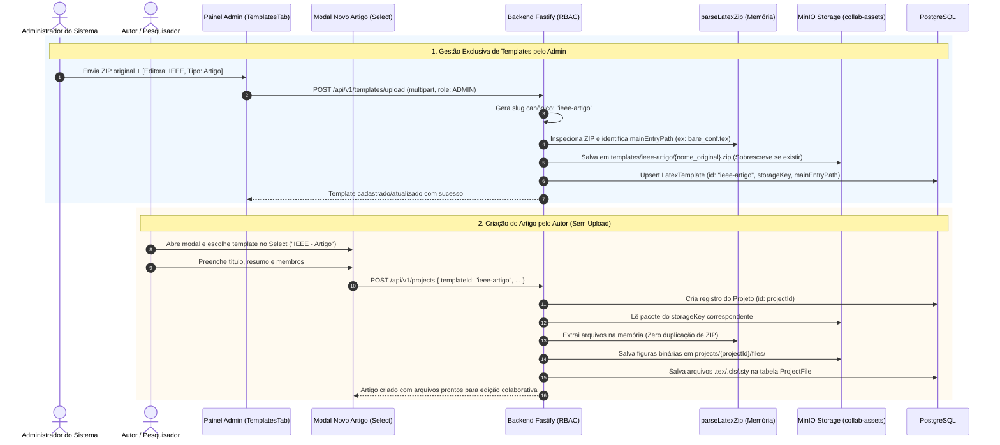

# ADR 017: Governança de Templates LaTeX de Conferências e Periódicos, Centralização no Admin, Storage MinIO e Extração Direta

- **Status:** APROVADO (Atualizado com Centralização no Admin, Sobrescrita Mandatória e Slugs Estritos [EDITORA]-[TIPO])
- **Data:** 14 de Novembro de 2026 (Revisado em 20 de Novembro de 2026)
- **Autor(es):** Equipe de Engenharia, Produto e Arquitetura SCIA
- **Domínio:** Governança Editorial LaTeX, Compilação TeXLive, Storage de Objetos (MinIO/S3), Integridade de Arquivos Acadêmicos, Painel Administrativo e UX de Criação de Projetos
- **Componentes Relacionados:** `backend` (`templates.service.ts`, `templates.controller.ts`, `projects.service.ts`, `documents.service.ts`, `latex-zip-parser.ts`, `minio.ts`), `compiler` (`src/server.ts`), `frontend` (`AdminCenterPage.tsx`, `TemplatesTab.tsx`, `CreateProjectModal.tsx`, `templatesService.ts`), `prisma` (`seed.ts`, `schema.prisma`), `latex-templates/`

---

## 1. Contexto & Diagnóstico dos Problemas

O SCIA visa fornecer aos pesquisadores e laboratórios acadêmicos um ambiente de escrita colaborativa focado no rigor científico e na conformidade estrita com chamadas de trabalhos de conferências e periódicos nacionais e internacionais (SBC, IEEE, ACM, Springer, Elsevier, etc.).

Durante a auditoria da esteira de templates e compilação, foram identificadas falhas conceituais e técnicas críticas:

1. **Templates Falsos / Mocks em Código (*Hardcoded Strings*):**
   - O arquivo `backend/src/modules/templates/templates.service.ts` continha constantes com textos fictícios de `main.tex` e `references.bib` montados em memória via `AdmZip` e injetados compulsoriamente no MinIO e no banco de dados tanto no `seed` quanto a cada chamada de listagem (`listTemplates`).
   - Esses pacotes não continham as classes oficiais (`.cls`), estilos (`.sty`), tabelas de bibliografia (`.bst`) nem a estrutura real exigida pelas conferências, gerando falhas no TeXLive do compilador ou gerando documentos fora dos padrões editoriais.

2. **Permissão Indevida de Upload para Autores Comuns:**
   - Anteriormente, o autor podia fazer upload de templates arbitrários durante a modal de criação de artigos (`CreateProjectModal`). Isso gerava duplicidade descontrolada, pacotes corrompidos e ausência de governança institucional sobre os layouts homologados.
   - **Decisão:** Apenas o **ADMIN** deve ter prerrogativa de cadastrar e atualizar templates. Autores comuns apenas selecionam templates homologados a partir de um `<Select>`.

3. **Renomeação Destrutiva Arbitrária para `main.tex`:**
   - Ao descompactar um template em um novo projeto, o backend forçava a renomeação do arquivo principal para `main.tex`, descartando o nome original fornecido pelo evento (ex: `bare_conf.tex` do IEEE, `sbc-template.tex` da SBC, `artigo.tex`).
   - Essa prática quebrava macros LaTeX, diretivas `\input{}`, `\include{}`, scripts de compilação e dependências de bibliografia (`\bibliography{IEEEexample}`).

4. **Nome Chumbado de Arquivo (`bundle.zip`):**
   - Nem todo `.zip` de template baixado ou enviado se chama `bundle.zip`. O sistema não deve chumbar nomes estáticos; o caminho no MinIO deve preservar o nome do arquivo original sanitizado e persistir dinamicamente a chave no atributo `storageKey`.

5. **Duplicação de ZIPs vs. Extração Direta e Autônoma:**
   - Duplicar o pacote `.zip` completo para cada artigo criado (`projects/{projectId}/template.zip`) gerava redundância massiva de storage e I/O desnecessário.
   - O artigo é autônomo porque **todos os seus arquivos** (`.tex`, `.cls`, `.sty`, figuras) são extraídos diretamente para o banco de dados (`ProjectFile`) e para o MinIO (`projects/{projectId}/files/`). O editor e o compilador utilizam exclusivamente esses arquivos extraídos, tornando o `.zip` desnecessário dentro do escopo do projeto.

---

## 2. Decisões Arquiteturais Adotadas

```
┌──────────────────────────────────────────────────────────────────────────────────────────────────┐
│      GOVERNANÇA DE TEMPLATES LATEX: ADMIN-ONLY, SOBRESCRITA, SLUGS [EDITORA]-[TIPO] E EXTRAÇÃO   │
├──────────────────────────────┬─────────────────────────────┬─────────────────────────────────────┤
│ 1. Centralização no Admin    │ 2. Slugs [EDITORA]-[TIPO]   │ 3. Sobrescrita Mandatória           │
│ - Exclusivo para perfil ADMIN│ - Ex: ieee-artigo           │ - Conferências raramente mudam      │
│ - Nova aba no Admin Center   │ - Sem prefixos de ano       │ - Atualiza MinIO e DB imediatamente │
├──────────────────────────────┼─────────────────────────────┼─────────────────────────────────────┤
│ 4. Sem bundle.zip Chumbado   │ 5. Extração Direta Projeto  │ 6. Zero Renomeação Interna          │
│ - Preserva nome original     │ - Descompacta em ProjectFile│ - Preserva bare_conf.tex            │
│ - storageKey dinâmico        │ - Zero .zip na pasta artigo │ - Identifica mainEntryPath original │
└──────────────────────────────┴─────────────────────────────┴─────────────────────────────────────┘
```

### 2.1. Regra 1: Gestão Estrita e Centralizada pelo Administrador (RBAC)
- **Bloqueio ao Autor:** O modal de criação de projeto (`CreateProjectModal.tsx`) do autor não permite mais upload de templates customizados. Exibe unicamente um `<Select>` com os templates homologados ativos.
- **Painel Administrativo (`AdminCenterPage`):** Criação de uma aba dedicada **"Templates LaTeX"** (`TemplatesTab.tsx`) para administradores:
  - Tabela com lista completa de templates (MUI GenericDataGrid), contendo Slug, Nome, Editora, Tipo, Arquivo Raiz, Data de Envio e Ações (Download do ZIP, Desativação/Ativação, Exclusão).
  - Modal de cadastro para upload de novo template com drag-and-drop, solicitando: Editora (ex: IEEE, SBC, ACM), Tipo (ex: artigo, resumo, periodico) e o arquivo `.zip`.

### 2.2. Regra 2: Padrão Semântico de Slugs Estrito `[editora]-[tipo]`
Para eliminar a proliferação de anos desnecessários e manter a identificação direta e concisa:
$$\mathbf{[editora]-[tipo]}$$

- **Exemplos Canônicos:**
  - `ieee-artigo` (Editora: IEEE, Tipo: Artigo)
  - `sbc-artigo` (Editora: SBC, Tipo: Artigo)
  - `sbc-resumo` (Editora: SBC, Tipo: Resumo Expandido)
  - `acm-artigo` (Editora: ACM, Tipo: Artigo)
  - `springer-periodico` (Editora: Springer, Tipo: Periódico)
- **Normalização:** Minúsculas, sem acentos, caracteres não alfanuméricos convertidos para hífens (`^[a-z0-9]+(-[a-z0-9]+)*$`).

### 2.3. Regra 3: Política de Sobrescrita Sempre Ativa
- Como as diretrizes de conferências e sociedades científicas raramente sofrem alterações estruturais em seus templates, **não haverá versionamento ou sufixos no slug** (`-v2`, `-2026`).
- Caso o administrador faça o upload de um template para um slug já existente (ex: `ieee-artigo`), **o sistema sempre sobrescreve** o arquivo no MinIO e atualiza o registro no banco de dados.
- Artigos já criados não são corrompidos, pois seus arquivos foram extraídos e isolados na tabela `ProjectFile` no momento de sua criação. Artigos novos criados após o upload passarão a utilizar o novo template atualizado.

### 2.4. Regra 4: Armazenamento Dinâmico no MinIO (Fim do `bundle.zip` Chumbado)
- O arquivo compactado enviado pelo administrador pode possuir **qualquer nome original** (ex: `conference-latex-template_10-17-19.zip`, `sbc_2026.zip`).
- **É terminantemente proibido chumbar `bundle.zip`.**
- O backend higieniza o nome original do arquivo e salva dinamicamente:
  ```text
  templates/{slug}/{sanitizedOriginalFileName}.zip
  ```
- O caminho relativo exato gerado é persistido na coluna `storageKey` da tabela `LatexTemplate`.

### 2.5. Regra 5: Extração Direta e Autônoma dos Arquivos (Sem Cópia de ZIP)
Ao confirmar a criação do artigo (`POST /api/v1/projects`):
1. O backend busca o pacote do template escolhido no MinIO via `storageKey`.
2. **Descompactação em Memória (`parseLatexZip`):**
   - O buffer do ZIP é lido em memória sem salvar cópias adicionais do `.zip` na pasta do artigo.
   - Arquivos de texto e código TeX (`.tex`, `.cls`, `.sty`, `.bib`) são salvos diretamente na tabela `ProjectFile` do PostgreSQL.
   - Arquivos binários (imagens `.png`, `.jpg`, logos, figuras) são persistidos no MinIO sob:
     ```text
     projects/{projectId}/files/{fileId}-{sanitizedFileName}
     ```
   - No documento raiz, substitui-se `\title{...}` e `\begin{abstract}...` pelos metadados preenchidos pelo autor.
3. **Nenhum arquivo `.zip` é copiado para a pasta do projeto.**

### 2.6. Regra 6: Integridade Absoluta dos Arquivos Internos (Zero Renomeação)
- Fica **proibido** renomear arquivos internos fornecidos no pacote `.zip` da conferência (`.cls`, `.sty`, `.bst`, `.bib`).
- O arquivo `.tex` principal **NUNCA deve ser forçado a se chamar `main.tex`**:
  - `parseLatexZip` detecta o arquivo de entrada através da macro `\documentclass` e salva o caminho original no atributo `mainEntryPath` (ex: `bare_conf.tex`, `sbc-template.tex`).
  - A compilação TeXLive utiliza dinamicamente o parâmetro `mainEntry`.

### 2.7. Regra 7: Expurgar Mocks Falsos do Código
- Eliminar qualquer constante mockada (`SYSTEM_TEMPLATES`), fallbacks locais em disco ou injeções forçadas em rotas de listagem.
- O MinIO e o PostgreSQL são as únicas fontes de dados para templates.

---

## 3. Fluxo de Vida dos Templates e Artigos (Arquitetura)



---

## 4. Estrutura do Storage no MinIO (`collab-assets`)

```text
collab-assets/
├── templates/                                        <-- CATÁLOGO DE TEMPLATES (Gerenciado por ADMIN)
│   ├── ieee-artigo/
│   │   └── conference-template-letter.zip            <-- Nome dinâmico original
│   ├── sbc-artigo/
│   │   └── sbc-template-2026.zip                     <-- Nome dinâmico original
│   └── acm-artigo/
│       └── acmart-primary.zip
│
└── projects/                                         <-- ARQUIVOS EXTRAÍDOS DOS ARTIGOS (Autônomos)
    └── {projectId}/
        ├── files/                                    <-- ASSETS BINÁRIOS EXTRAÍDOS (Imagens, logos)
        │   ├── {fileId}-fig1.png
        │   └── {fileId}-logo.png
        └── tasks/{taskId}/evidences/                 <-- EVIDÊNCIAS DE TAREFAS
            └── {evidenceId}-documento.pdf
```

---

## 5. Estrutura do Modelo de Dados (`schema.prisma`)

```prisma
model LatexTemplate {
  id               String    @id // Slug estrito: ex. "ieee-artigo", "sbc-artigo"
  name             String    // Ex: "IEEE Conference Template"
  description      String?   // Instruções ou observações
  publisher        String    // Ex: "IEEE", "SBC", "ACM"
  templateType     String    // Ex: "artigo", "resumo", "periodico", "poster"
  storageKey       String    // MinIO dinâmico: "templates/ieee-artigo/conference-template.zip"
  originalFileName String    // Nome original do arquivo recebido: "conference-template.zip"
  mainEntryPath    String    @default("main.tex") // Detectado: "bare_conf.tex", "sbc-template.tex"
  isSystem         Boolean   @default(true)
  isActive         Boolean   @default(true) // Desativação lógica (soft delete) para preservar integridade
  uploadedById     String?
  uploadedBy       User?     @relation("UserUploadedTemplates", fields: [uploadedById], references: [id], onDelete: SetNull)
  createdAt        DateTime  @default(now())
  updatedAt        DateTime  @updatedAt

  projects         Project[]

  @@index([publisher])
  @@index([templateType])
  @@index([isActive])
}
```

---

## 6. Consequências & Benefícios

### Positivas:
1. **Governança Editorial Centralizada:** Elimina-se a dispersão de templates mal formatados ou corrompidos enviados por autores; a instituição homologa oficialmente os pacotes.
2. **Identificação Simples e Determinística:** Slugs no padrão `[editora]-[tipo]` (ex.: `ieee-artigo`) facilitam consultas, automações e URLs limpas.
3. **Sobrescrita Transparente:** Atualizações de templates pelas conferências não requerem migração de IDs nem sufixos artificiais; novos artigos usam o novo layout e artigos existentes mantêm seus arquivos extraídos intactos.
4. **Armazenamento Flexível e Não-Chumbado:** Suporte a arquivos compactados com qualquer nomenclatura original, persistindo a chave exata em `storageKey`.
5. **Zero Redundância de ZIPs:** O `.zip` existe unicamente no catálogo do MinIO. O artigo recebe apenas seus arquivos individuais descompactados em `ProjectFile` e MinIO.
6. **Autonomia e Imutabilidade dos Artigos:** Como os arquivos são extraídos no momento da criação, qualquer futura alteração do template base não afeta os artigos existentes.
7. **Experiência do Autor Descomplicada:** O autor não precisa baixar ou configurar pacotes ZIP da conferência; apenas escolhe a editora e o tipo desejados em um dropdown intuitivo.

### Riscos Mitigados:
- **Corrupção de Classes e Macros TeX:** A manutenção dos nomes de arquivo originais e do arquivo de entrada detectado (`mainEntryPath`) garante compilação idêntica à especificação da sociedade científica.
- **Quebra de Chaves Estrangeiras:** O suporte a `isActive: false` (soft delete) garante que a descontinuação de um template nunca quebre artigos já publicados no sistema.
