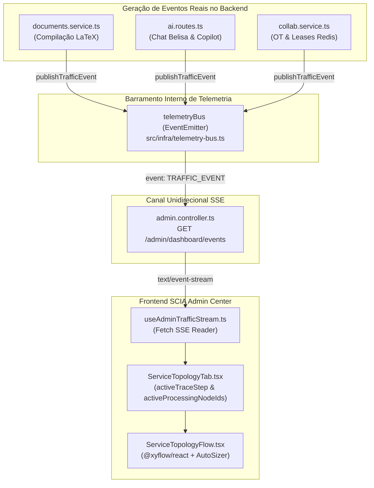

# ADR 019: Topologia de Microsserviços e Rastreamento de Comunicação Inter-Serviços em Tempo Real no SCIA Admin Center com React Flow e Server-Sent Events

- **Status:** APROVADO (Consolidado e Alinhado às ADR-007.1, ADR-012, ADR-013, ADR-014, ADR-015 e ADR-018)
- **Data:** 16 de Novembro de 2026
- **Autor(es):** Equipe de Arquitetura, Engenharia, SRE e Segurança SCIA
- **Domínio:** Observabilidade Visual, Malha de Serviços, Telemetria em Tempo Real, Server-Sent Events (SSE), React Flow (`@xyflow/react`), AutoSizer, Resiliência Assíncrona Fail-Open e Escalabilidade Horizontal (HPA)
- **Componentes Relacionados:**
  - `frontend`: `src/features/admin/tabs/ServiceTopologyTab.tsx`, `src/features/admin/components/topology/`, `src/features/admin/hooks/useAdminTrafficStream.ts`, `src/features/admin/AdminCenterPage.tsx`
  - `backend`: `src/infra/telemetry-bus.ts`, `src/modules/admin/admin.controller.ts`, `src/modules/documents/documents.service.ts`, `src/modules/ai/ai.routes.ts`
  - `ai-service`: `app/api/v1/endpoints/chat.py` (Resiliência assíncrona fail-open com `asyncio.to_thread`)
  - `infra`: Redis (`:6379`), MinIO S3 (`:9000`), TeX Live Compiler (`:4000`), Opik LLMOps (`:5174`/`:8081`), PostgreSQL 16 & PgBouncer (`:6543`)

---

## ⚡ Guia Rápido & Resumo Executivo ("Elevator Pitch")

> [!TIP]
> **Consulte esta seção para entender a motivação, o funcionamento e as fronteiras do Visualizador de Topologia de Serviços em Tempo Real.**

### 1. O que estamos decidindo e adotando:
1. **Preservação Estrita do Admin Center (Não Substituição):** Todas as 5 abas originais do [SCIA Admin Center (ADR-014)](file:///mnt/c0b6217c-c2f3-4c1f-8ba2-c8d177f718a9/development/professional/sci-latex-vscode/docs/architecture/adrs/adr-014-painel-admin-saude-e-metricas-aplicacao.md) permanecem 100% preservadas e intactas. A visualização de topologia é adicionada como a **Aba 6 (`Topologia de Serviços`)**, acessível via navegação lateral/abas sem alterar o fluxo de telas pré-existente.
2. **Visualização Dinâmica de Tráfego Inter-Serviços em Tempo Real:** Substituição do paradigma de diagramas puramente estáticos por uma **malha viva reativa**. Quando um autor dispara uma compilação de artigo ou conversa com a agente Belisa, partículas luminosas animadas percorrem as arestas SVG conectando os microsserviços correspondentes em tempo real.
3. **Barramento de Telemetria Desacoplado no Backend (`telemetryBus`):**
   - Criação de um barramento leve baseado em `EventEmitter` em `backend/src/infra/telemetry-bus.ts`.
   - Transmissão unidirecional para o frontend via Server-Sent Events (SSE) através do canal persistente `GET /api/v1/admin/dashboard/events`.
   - Sem dependência de bibliotecas pesadas de terceiros no servidor; sem polling agressivo no cliente.
4. **Ciclo de Vida de Nós em Processamento Ativo (`processingNodeIds`):**
   - Quando um microsserviço (como o `compiler-worker` ou a `sciai-engine`) recebe uma carga de trabalho, o nó correspondente entra em estado ativo (`isProcessing: true`), exibindo o badge flutuante `⚡ Ativo` e pulso luminoso suave (`@keyframes topologyNodeBlink`).
   - O nó **permanece aceso continuamente** durante 100% da duração da compilação ou do streaming de tokens SSE, desligando-se apenas quando a resposta final é entregue ao navegador do cliente.
5. **Arestas SVG sob Demanda com Animação de Partículas (`LiveCommunicationEdge`):**
   - Linhas em roxo/índigo vibrante (`#6366f1`) e ciano (`#38bdf8`) representam as conexões de rede ativas.
   - Partículas (`<animateMotion>`) só trafegam quando há tráfego de dados real ou simulação em andamento (`isTransmitting: true`), mantendo a tela limpa e sem poluição visual em estado ocioso (*idle*).
   - Conexões com serviços inacessíveis são pintadas em vermelho com traço tracejado.
6. **Suporte Nativo a Múltiplos Pods Kubernetes (HPA):**
   - A topologia detecta dinamicamente a presença de múltiplas réplicas de pods do backend Fastify correlacionando os leases de ownership de documentos no Redis (`documentsByPod` da ADR-007.1).
   - Quando réplicas sobem via HPA, nós adicionais `backend-pod-2`, `backend-pod-3` são injetados no grafo com suas respectivas arestas para Redis e Banco.
7. **UX Limpa e Livre de Poluição Visual:**
   - Cards informativos sem botões internos de ação operacional (os nós servem exclusivamente para consulta e telemetria).
   - Remoção de alertas flutuantes dinâmicos abaixo do cabeçalho que causavam trepidação (*layout shifts*) na tela.
   - Canvas responsivo com `AutoSizer` (100% da altura e largura da viewport), zoom, pan e minimap.
8. **Resiliência Fail-Open no AI Service:**
   - Desacoplamento da chamada de flush do Opik SDK (`tracer.flush()`) em `ai-service/app/api/v1/endpoints/chat.py` utilizando `asyncio.to_thread` com timeout estrito de 2.0s (`asyncio.wait_for`).
   - Impede que instabilidades em serviços externos de observabilidade bloqueiem o event loop do Uvicorn ou derrubem a probe `/health`.

---

## 1. Contexto & Diagnóstico dos Problemas

Com a arquitetura distribuída consolidada nas ADRs anteriores, a plataforma SCIA passou a operar com 8 componentes de microsserviços e persistência:
1. `client-frontend` (SPA React 19 + Vite)
2. `backend-fastify` (Node.js API Gateway & Collab Authority)
3. `compiler-worker` (TeX Live Sandbox com cgroups na porta :4000)
4. `sciai-engine` (FastAPI + LangGraph + Gemini no ai-service na porta :8000)
5. `postgres-db` (PostgreSQL 16 & PgBouncer em Transaction Pooling na porta :6543)
6. `redis-cache` (Coordenação de Leases de Documentos e Pub/Sub na porta :6379)
7. `minio-storage` (S3 Object Storage interno na porta :9000)
8. `opik-llmops` (Observabilidade de Spans e Traces de LLM na porta :5174/:8081)

### Desafios Identificados:
1. **Opacidade do Tráfego Inter-Serviços:** Os operadores não tinham visibilidade de qual caminho de rede uma requisição percorre. Uma compilação LaTeX, por exemplo, transita por `Frontend -> Backend -> Compiler -> MinIO -> Backend -> Frontend`. Se houver lentidão, não era visível de imediato qual trecho estava retendo a carga.
2. **Limitações de Telas Tradicionais:** Tabelas e listas estáticas não comunicam a topologia espacial da malha e dificultam a percepção de gargalos de rede e escalabilidade de réplicas de pods.
3. **Necessidade de Rastreamento em Tempo Real sem Poluição:** Animações constantes de bolinhas em repouso geravam fadiga visual e mascaravam o tráfego real. Os indicadores precisavam acender **apenas sob demanda real** e manter os nós de processamento acesos durante toda a execução.

---

## 2. Decisão Arquitetural: Malha de Serviços e Telemetria em Tempo Real

Fica aprovada a implementação do **Visualizador de Topologia de Microsserviços em Tempo Real** na **Aba 6** do SCIA Admin Center, fundamentada nas seguintes diretrizes:

### 2.1. Arquitetura do Barramento de Telemetria (`telemetryBus`)



### 2.2. Contrato de Dados do Evento de Tráfego (`TrafficTelemetryEvent`)

```typescript
export interface TrafficTelemetryEvent {
  id: string;
  flowType: 'COMPILATION' | 'AI_CHAT' | 'COLLAB_OT' | 'DATABASE';
  edgeId: string;
  sourceNodeId: string;
  targetNodeId: string;
  direction: 'forward' | 'backward';
  description: string;
  durationMs: number;
  particleColor?: string;
  processingNodeIds?: string[];
  timestamp: number;
}
```

---

## 3. Comportamento Operacional dos Fluxos Principais

### 3.1. Fluxo de Compilação TeX Live
1. **Frontend $\rightarrow$ Fastify:** Disparo de `e-frontend-backend` (partícula ciano `#38bdf8`), `processingNodeIds: ['backend-fastify']`.
2. **Fastify $\rightarrow$ Compiler:** Disparo de `e-backend-compiler` (partícula laranja `#f97316`), `processingNodeIds: ['compiler-worker']`.
3. **Compiler $\rightarrow$ MinIO:** Download de figuras e assets científicos via `e-compiler-minio` (partícula verde `#10b981`), `processingNodeIds: ['compiler-worker']`.
4. **Processamento em Sandbox:** O nó `compiler-worker` **permanece aceso** com badge `⚡ Ativo` e pulso luminoso durante toda a execução do `pdflatex`/`cgroups`.
5. **Compiler $\rightarrow$ Fastify:** PDF entregue via `e-backend-compiler` backward (partícula verde `#22c55e`), mantendo `compiler-worker` ativo.
6. **Fastify $\rightarrow$ Frontend:** Entrega do PDF ao autor via `e-frontend-backend` backward com `processingNodeIds: []`, liberando o nó do compilador.

### 3.2. Fluxo de Chat com a Agente Belisa (SciAI)
1. **Frontend $\rightarrow$ Fastify:** Envio da mensagem via `e-frontend-backend` (partícula roxa `#a855f7`).
2. **Fastify $\rightarrow$ SciAI Engine:** Despacho do prompt via `e-backend-sciai` (partícula violeta `#8b5cf6`), ativando `processingNodeIds: ['sciai-engine']`.
3. **SciAI Engine $\rightarrow$ Opik LLMOps:** Registro de spans via `e-sciai-opik` (partícula magenta `#d946ef`), mantendo `sciai-engine` em processamento.
4. **Streaming de Tokens SSE:** O nó `sciai-engine` **permanece continuamente aceso** com `Processamento: Inferência Ativa` e `Streams SSE: 1 ativo(s)` durante todo o loop de geração de tokens da LLM.
5. **Conclusão:** Quando o stream é finalizado, disparo de encerramento via `e-backend-sciai` e entrega final para o cliente `e-frontend-backend` com `processingNodeIds: []`.

### 3.3. Simulação de Escalabilidade HPA de Pods
- O visualizador suporta tanto tráfego real do cluster quanto 4 cenários de simulação interativa:
  1. *Compilação LaTeX (PDF)*
  2. *Agente SciAI (LangGraph & Opik)*
  3. *Colaboração em Tempo Real (Redis & Postgres)*
  4. *Escala Pods K8s (HPA)*: Injeção de múltiplos nós de pods (`backend-pod-2`, `backend-pod-3`) demonstrando o particionamento de leases de documentos por autoridade single-writer OT.

---

## 4. Resiliência e Prevenção de Bloqueios no AI Service

Durante a homologação, identificou-se que instabilidades de rede ou timeouts no coletor do Opik provocavam bloqueios síncronos no event loop do Uvicorn ao descarregar buffers no final das requisições de streaming.

### Decisão Técnica:
Em `ai-service/app/api/v1/endpoints/chat.py`, o flush do tracer foi formalmente desacoplado:
```python
async def _safe_flush_tracer(tracer: Any) -> None:
    """
    Executa o flush síncrono do tracer em worker thread desacoplada com timeout de 2s.
    Garante resiliência (fail-open) e impede que retentativas de I/O bloqueiem o event loop do Uvicorn.
    """
    if tracer and hasattr(tracer, "flush"):
        try:
            await asyncio.wait_for(asyncio.to_thread(tracer.flush), timeout=2.0)
        except Exception as flush_err:
            logger.warning(f"[Opik] Erro ao descarregar buffer (fail-open): {flush_err}")
```
**Resultado:** A liveness probe `/health` responde em menos de 5ms mesmo se o serviço de observabilidade estiver indisponível ou degradado.

---

## 5. Consequências da Decisão

### Positivas:
* **Observabilidade Operacional Intuitiva:** Administradores e SREs identificam visualmente a saúde, latência e gargalos de comunicação inter-serviços em segundos.
* **Isolamento de Impacto (Zero Regressão):** As 5 abas originais do Admin Center continuam inalteradas e funcionais.
* **Experiência Visual Refinada:** Arestas vibrantes roxo/índigo com partículas ciano animadas sob demanda eliminam o ruído de telas piscando continuamente.
* **Fidelidade de Estado:** Nós de processamento intensivo (Compiler e SciAI) permanecem acesos durante todo o ciclo de vida real da requisição.

### Negativas / Mitigações:
* **Custo Computacional no Frontend:** A renderização contínua de canvas com SVG pode aumentar o uso de CPU.
  - *Mitigação:* As partículas só são animadas quando `isTransmitting: true`. Em estado idle, as arestas operam como SVG estático de custo zero de GPU/CPU. Uso do `React.memo` nos nós e arestas.

---

## 6. Verificação e Conformidade
* **Testes de Backend:** 85/85 testes aprovados (`npm test` no backend).
* **Testes de Frontend:** 6/6 testes de topologia aprovados em `ServiceTopologyFlow.test.tsx`.
* **Build de Produção:** 0 erros de compilação TypeScript (`tsc -b && vite build`).
* **Health Probes:** Todos os 20 contêineres da stack Docker operando em estado `healthy`.
