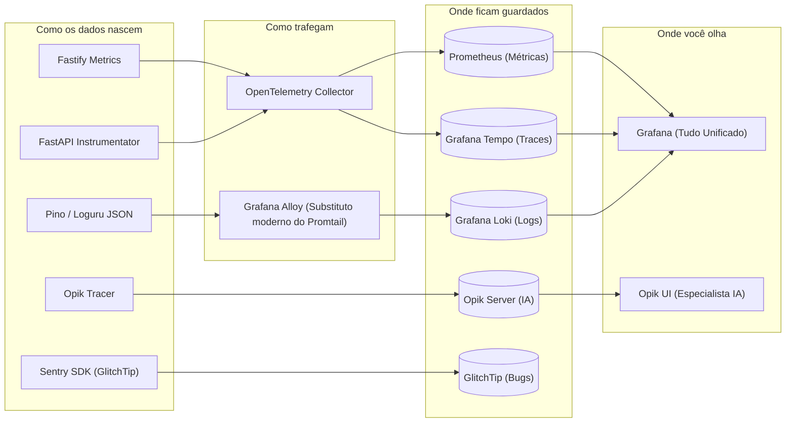

# 🧭 Guia Completo de Observabilidade On-Premise Licença Zero — Plataforma SCIA

> **Público-alvo:** Desenvolvedores, SREs e arquitetos da plataforma SCIA que precisam ter controle cirúrgico de cada camada do ecossistema distribuído, com soberania de dados, sem custos recorrentes de nuvem e com diagnóstico em segundos.

---

## 1. Por Que Precisamos de Tudo Isso? (A Dor do Crescimento)

Quando uma aplicação é simples (apenas um frontend conversando com uma API), debugar é fácil: basta olhar o terminal ou o console do navegador.

Porém, a plataforma **SCIA** opera com **5 camadas heterogêneas e interdependentes**:
1. O **Frontend** (React + Vite) onde o pesquisador digita e visualiza o documento.
2. O **Backend** (Node.js + Fastify) que valida autenticação, gerencia permissões e guarda o estado das 6 etapas.
3. O **AI Service** (Python + FastAPI + LangGraph) que orquestra agentes, busca no arXiv e gera textos científicos com LLMs.
4. O **Compilador LaTeX** que compila PDFs em um sandbox isolado consumindo picos de CPU.
5. Os **Bancos e Armazenamento** (PostgreSQL, Redis e MinIO).

Se um usuário clicar em *"Refinar Ideia e Gerar LaTeX"* e a tela ficar carregando infinitamente ou retornar um erro genérico:
* *A culpa foi da rede do usuário?*
* *Foi o Fastify que travou o Event Loop?*
* *Foi o arXiv que aplicou rate-limit no nosso IP?*
* *Foi o modelo de IA que demorou para gerar o texto?*
* *Ou foi o compilador LaTeX que entrou em loop infinito de compilação?*

Sem observabilidade moderna, você passará horas abrindo 4 terminais diferentes tentando adivinhar. Com a nossa stack, **você descobre em menos de 10 segundos**.

---

## 2. A Analogia do Hospital: O Papel de Cada Pilar

```
┌────────────────────────────────────────────────────────────────────────┐
│                      A ANALOGIA CLÍNICA DA TELEMETRIA                  │
├────────────────────┬────────────────────┬──────────────────────────────┤
│ Conceito           │ No Hospital        │ No Software (SCIA)           │
├────────────────────┼────────────────────┼──────────────────────────────┤
│ 1. Métricas        │ Frequência cardíaca│ RPS, % de CPU, uso de RAM,   │
│    (Prometheus)    │ e temperatura.     │ latência média e p99.        │
├────────────────────┼────────────────────┼──────────────────────────────┤
│ 2. Logs            │ O prontuário com o │ Mensagens detalhadas de      │
│    (Loki)          │ histórico do dia.  │ cada linha ("Iniciou busca").│
├────────────────────┼────────────────────┼──────────────────────────────┤
│ 3. Traces (APM)    │ Exame de contraste │ Linha do tempo de uma única  │
│    (Tempo / OTel)  │ no sangue.         │ requisição por 4 servidores. │
├────────────────────┼────────────────────┼──────────────────────────────┤
│ 4. LLMOps          │ Exame neurológico  │ Detalhe de cada nó de IA,    │
│    (Opik)          │ e cognitivo.       │ tokens, prompts e custo.     │
├────────────────────┼────────────────────┼──────────────────────────────┤
│ 5. Error Tracking  │ Alarme da UTI de   │ Alerta imediato com o código │
│    (GlitchTip)     │ parada cardíaca.   │ que quebrou na hora.         │
└────────────────────┴────────────────────┴──────────────────────────────┘
```

---

## 3. Quem é Quem na Nossa Stack (100% On-Premise e Licença Zero)

Todas as ferramentas escolhidas são **100% livres de licença comercial (Apache 2.0 / MIT / AGPLv3)** e rodam **localmente** nos seus próprios servidores ou Kubernetes.



### 3.1. Prometheus (O Cronômetro e o Termômetro)
* **O que faz:** Coleta e guarda séries temporais numéricas via scraping HTTP (`/metrics`) a cada 15 segundos.
* **Por que usamos:** Padrão absoluto da indústria CNCF, ultra-leve, essencial para gráficos de RPS, memória e conexões.

### 3.2. Grafana Loki + Grafana Alloy (O Buscador de Logs Econômico)
* **O que faz:** Centraliza logs do Backend, AI Service e Compilador em formato JSON.
* **O papel do Grafana Alloy:** Agente unificado oficial da Grafana que substituiu o antigo Promtail (EOL em 2026).
* **Structured Metadata:** Em vez de indexar todas as palavras (como o Elasticsearch, consumindo 30 GB de RAM), o Loki indexa apenas labels essenciais (`service="backend"`). Identificadores como `trace_id` e `user_id` são gravados como *Structured Metadata*, permitindo busca exata instantânea com memória mínima.

### 3.3. OpenTelemetry + Grafana Tempo (O Detetive de Requisições)
* **O que faz:** Desenha a cascata exata de uma requisição que atravessou múltiplos microsserviços via cabeçalho padrão W3C `traceparent`.
* **Visão no Grafana Tempo:**
  ```
  [Frontend] Clique no Botão: 2.3s
    └── [Backend Fastify] POST /api/chat: 2.2s
          ├── [AI Service] POST /chat/stream: 2.0s
          │     ├── [LangGraph] Supervisor: 50ms
          │     ├── [arXiv API] Busca XML: 1.4s (GARGALO ENCONTRADO!)
          │     └── [Gemini Flash] Stream tokens: 550ms
          └── [PostgreSQL] UPDATE projects: 4ms
  ```

### 3.4. Opik (Comet) — O Microscópio do Motor de IA (LLMOps)
* **O que faz:** Monitoramento profundo e especializado para LLMs, Agentes e LangGraph:
  * Prompt enviado, tokens de entrada/saída e custo em dólares.
  * Caminho tomado no grafo (Supervisor, Curador ou Escritor).
  * Correlação com o Tempo via `otel_trace_id`.
* **Proteção de Prompts & Sigilo Científico:**
  * *Nível 1 (Operacional / Produção):* Grava apenas tokens, tempo e modelos. Conteúdo de texto do autor é omitido.
  * *Nível 2 (Diagnóstico):* Metadados de chamadas e ferramentas.
  * *Nível 3 (Completo):* Restrito a homologação com expurgo em 7 dias.

### 3.5. GlitchTip (O Notificador de Panes Leve)
* **O que faz:** Captura qualquer exceção não tratada (`crash`) no navegador ou no servidor.
* **Por que usamos:** O Sentry oficial exige dezenas de containers pesados (>16 GB RAM). O GlitchTip é uma alternativa ágil (AGPLv3) com Django e PostgreSQL que consome pouca memória e aceita os SDKs oficiais `@sentry/react` e `@sentry/node`.

### 3.6. Grafana (A Central de Comando Unificada)
* Centraliza os gráficos do Prometheus no topo, logs do Loki no meio e traces do Tempo na parte inferior em um único painel correlacionado.

---

## 4. Práticas Operacionais Essenciais

### 4.1. Os 4 Sinais de Ouro do Google SRE
Para configurar alertas eficientes sem causar fadiga de notificações:
1. **Latência:** Tempo de resposta das requisições (foco em $p95$ e $p99$).
2. **Tráfego:** Demanda do sistema (RPS, execuções de compilação por minuto).
3. **Erros:** Taxa de requisições com falha (respostas 5xx > 1%).
4. **Saturação:** Quão perto do limite estão os recursos (filas, conexões do pool, threads).

> [!IMPORTANT]
> **Alerte sobre Sintomas, Não Causas:** Dispare alertas de alta prioridade quando os usuários forem impactados (ex: taxa 5xx > 1% por 3 min ou latência $p95$ > 4s). Alertas de causa (ex: CPU em 80%) devem ser apenas informativos.

### 4.2. Padrão de Logs Estruturados em JSON
Logs devem ser gerados nativamente em JSON com `pino` (Node.js) e `loguru` (Python):
```json
{
  "timestamp": "2026-11-20T17:15:00.123Z",
  "level": "error",
  "service": "ai-service",
  "traceId": "4bf92f3577b34da6a3ce929d0e0e4736",
  "agent": "search_specialist",
  "provider": "arxiv",
  "message": "ArXiv connection throttled, retrying in 3s",
  "retryCount": 1
}
```

---

## 5. Como Subir e Operar Localmente

### Passo 1: Subir a Stack de Observabilidade
Execute no terminal da raiz do repositório:
```bash
docker compose -f infra/observability/docker-compose.observability.yml up -d
```

### Passo 2: Acessar os Painéis no Navegador
* **Grafana (Central de Dashboards):** [http://localhost:3001](http://localhost:3001) (`admin` / `admin_scia_local`)
* **Opik (LLMOps & Agentes):** [http://localhost:5174](http://localhost:5174)
* **Prometheus (Explorador de Métricas):** [http://localhost:9090](http://localhost:9090)
* **GlitchTip (Bugs e Exceções):** [http://localhost:8005](http://localhost:8005)

### Passo 3: Instrumentar o Código de IA com Opik
No `ai-service`:
```python
from opik.integrations.langchain import OpikTracer

opik_tracer = OpikTracer(
    project_name="scia-academic-copilot",
    host="http://localhost:8081"
)

async for chunk in graph.astream(
    initial_state,
    config={"callbacks": [opik_tracer]}
):
    yield chunk
```

---

## 6. Guia Rápido de Sobrevivência do Desenvolvedor

| Sintoma Observado | Onde ir primeiro? | O que procurar? |
| :--- | :--- | :--- |
| **"O copiloto está demorando para responder"** | Abra o **Opik** (`:5174`) | Veja qual nó do LangGraph consumiu mais tempo (busca externa no arXiv ou streaming do LLM). |
| **"Usuários relatam erro 500 ou tela branca"** | Abra o **GlitchTip** (`:8005`) | Veja a stack trace exata com o arquivo `.ts` / `.py` e a linha do bug. |
| **"A API inteira parece lenta e engasgada"** | Abra o **Grafana** (`:3001`) | Verifique o gráfico de **Event Loop Lag** e as conexões ativas no pool do PostgreSQL. |
| **"Quero ver o caminho completo de uma chamada que falhou"** | Abra o **Grafana** $\rightarrow$ **Tempo** | Cole o `Trace ID` do log e inspecione a régua visual entre frontend, backend, AI e compiler. |
