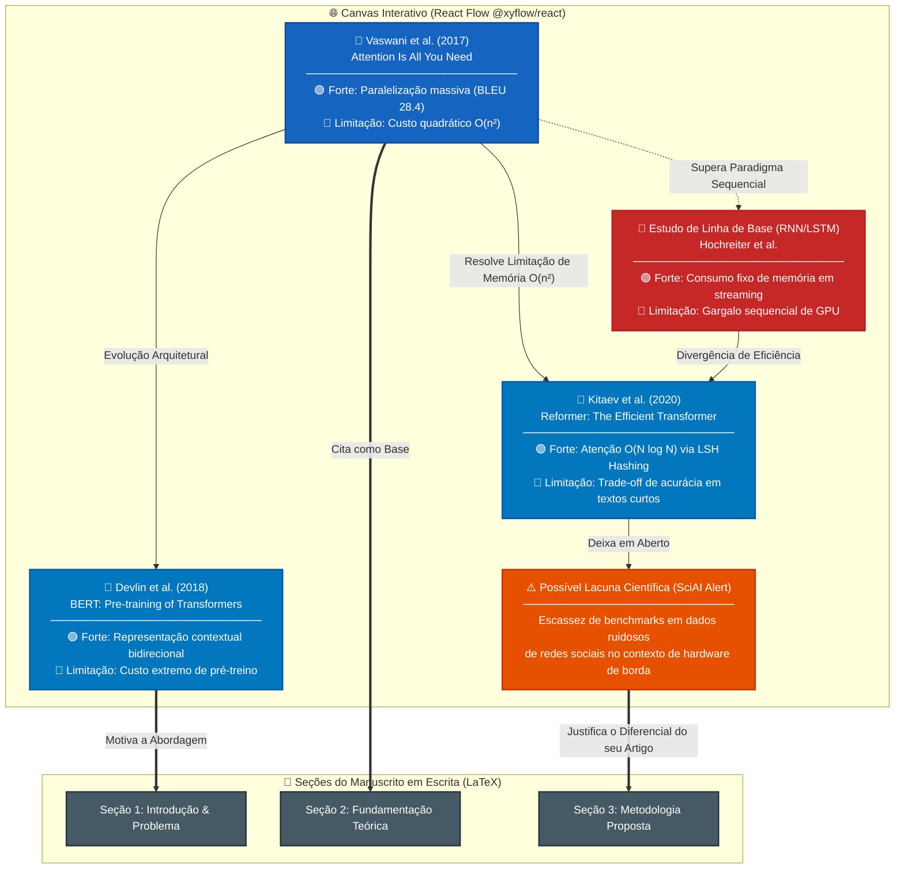

# 🌐 Visualização do Mapa Mental de Literatura Científica com React Flow (`@xyflow/react`)

**Projeto:** SCIA — Scientific Collaboration and Intelligent Assistance  
**Módulo:** Literature Intelligence  
**Documento de Referência:** [`ADR-016`](file:///home/gilson-russo/development/professional/sci-latex-vscode/docs/planning/adrs/adr-016-scia-literature-intelligence-paper-analysis-and-react-flow.md) | [`literature-intelligence-spec.md`](file:///home/gilson-russo/development/professional/sci-latex-vscode/docs/planning/specs/literature-intelligence-spec.md)  
**Status:** Especificação de Interface e Diagrama Conceitual  

---

## 1. Diagrama Arquitetural do Canvas do React Flow

Abaixo está a representação de como o grafo interativo renderiza os artigos analisados pela IA, destacando **pontos fortes**, **limitações**, **arestas semânticas** e o **vínculo com o manuscrito em escrita do autor**:

---

## 2. Componentes Visuais do React Flow (`@xyflow/react`)

| Componente | Arquivo React Sugerido | Papel no Canvas |
| :--- | :--- | :--- |
| **Card do Artigo** | `PaperNode.tsx` | Renderiza o nó customizado com título, autores, ano, chips bicolores (🟢 Pontos Fortes e 🔴 Limitações) e botão para abrir a Ficha Científica. |
| **Alerta de Lacuna** | `GapNode.tsx` | Nó de alerta destacado em laranja com possíveis lacunas detectadas pela IA. |
| **Seção do TeX** | `SectionAnchorNode.tsx` | Representa as seções do arquivo `.tex` do autor com status de cobertura bibliográfica. |
| **Aresta Semântica** | `RelationshipEdge.tsx` | Linhas curvas com labels tipados (*Convergência*, *Divergência*, *Evolução*, *Complementar*). |
| **MiniMap e Controles** | `<MiniMap />`, `<Controls />` | Navegação fluida com zoom, pan e visualização de visão geral do grafo. |
