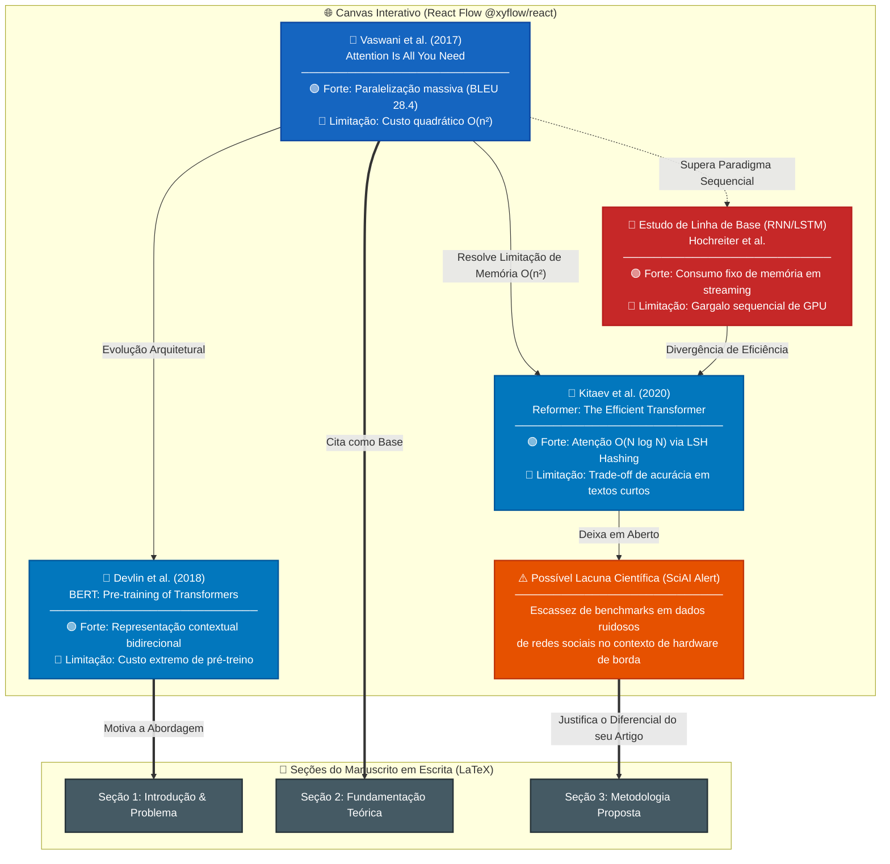

# 🌐 Visualização do Mapa Mental de Literatura Científica com React Flow (`@xyflow/react`)

**Projeto:** SCIA — Scientific Collaboration and Intelligent Assistance  
**Módulo:** Literature Intelligence  
**Documento de Referência:** [`ADR-016`](file:///home/gilson-russo/development/professional/sci-latex-vscode/docs/planning/adrs/adr-016-scia-literature-intelligence-paper-analysis-and-react-flow.md) | [`literature-intelligence-spec.md`](file:///home/gilson-russo/development/professional/sci-latex-vscode/docs/planning/specs/literature-intelligence-spec.md)  
**Status:** Especificação de Interface e Diagrama Conceitual  

---

## 1. Diagrama Arquitetural do Canvas do React Flow

Abaixo está a representação de como o grafo interativo renderiza os artigos analisados pela IA, destacando **pontos fortes**, **limitações**, **arestas semânticas** e o **vínculo com o manuscrito em escrita do autor**:



---

## 2. Componentes Visuais do React Flow (`@xyflow/react`)

| Componente | Arquivo React Sugerido | Papel no Canvas |
| :--- | :--- | :--- |
| **Card do Artigo** | `PaperNode.tsx` | Renderiza o nó customizado com título, autores, ano, chips bicolores (🟢 Pontos Fortes e 🔴 Limitações) e botão para abrir a Ficha Científica. |
| **Alerta de Lacuna** | `GapNode.tsx` | Nó de alerta destacado em laranja com possíveis lacunas detectadas pela IA. |
| **Seção do TeX** | `SectionAnchorNode.tsx` | Representa as seções do arquivo `.tex` do autor com status de cobertura bibliográfica. |
| **Aresta Semântica** | `RelationshipEdge.tsx` | Linhas curvas com labels tipados (*Convergência*, *Divergência*, *Evolução*, *Complementar*). |
| **MiniMap e Controles** | `<MiniMap />`, `<Controls />` | Navegação fluida com zoom, pan e visualização de visão geral do grafo. |

---

## 3. Análise de Ponto de Entrada: Criação do Artigo vs. Workspace Posterior

Existe uma decisão em aberto sobre o momento exato em que o autor deve interagir com o Mapa Mental de Literatura:

| Ponto de Entrada | Vantagens | Desafios / Fricção |
| :--- | :--- | :--- |
| **Opção A: Na Criação do Artigo (Onboarding / Ideação)** | Proporciona uma visão 360° do estado da arte logo no início, auxiliando na delimitação da hipótese e na escolha consciente do congresso e das referências base. | Pode gerar lentidão inicial no onboarding (tempo de processamento de múltiplos papers pela LLM) e sobrecarga cognitiva para autores que desejam apenas inicializar o projeto com agilidade. |
| **Opção B: No Workspace / Editor (Sob Demanda)** | O autor já possui o manuscrito estruturado em seções TeX (`main.tex`). Ele aciona o mapa quando necessário, conectando papers diretamente às seções em escrita e enriquecendo a fundamentação teórica. | Se acessado tardiamente, o pesquisador pode ter formulado a hipótese sem a percepção crítica visual das lacunas existentes na literatura. |

---

## 4. Arquitetura Recomendada: O Modelo Híbrido em Duas Fases

Para unir o melhor dos dois mundos sem impor gargalos ao usuário, adota-se um **Modelo Híbrido Progressivo**:

```
┌────────────────────────────────────────────────────────────────────────┐
│                        FLUXO EM DUAS FASES                             │
├───────────────────────────────────┬────────────────────────────────────┤
│ 1. Na Criação (Onboarding Leve)   │ 2. No Workspace (Mapa Completo)    │
│ - Busca de papers pelo agente     │ - Aba dedicada "Literature Intel"  │
│ - Botão opcional: [Ver Mapa]      │ - Canvas full-screen (zoom e pan)  │
│ - Preview rápido de convergências │ - Conexão drag-and-drop com seções │
│ - O autor pode pular e criar logo │ - Citação 1-clique no LaTeX (.bib) │
└───────────────────────────────────┴────────────────────────────────────┘
```

1. **Fase 1: No Onboarding de Criação (Sneak Peek Opcional)**:
   - Quando o `search_specialist_agent` apresenta os artigos selecionados, a UI exibe o botão opcional: **"Visualizar Relações da Literatura"**.
   - O autor pode abrir um preview leve do grafo conceitual preliminar para validar se a literatura atende à sua ideia, ou simplesmente avançar direto para a criação do projeto.

2. **Fase 2: No Workspace (Centro de Inteligência Permanente)**:
   - Disponível a qualquer momento como uma aba ou ferramenta visual nativa do projeto (`Literature Intelligence`).
   - O mapa torna-se um artefato vivo: conforme novos PDFs e referências BibTeX são adicionados ao longo das semanas de pesquisa, o autor pode regenerar o grafo, inspecionar novas lacunas sugeridas pela IA e arrastar conexões visuais diretamente para as seções correspondentes do editor LaTeX.

