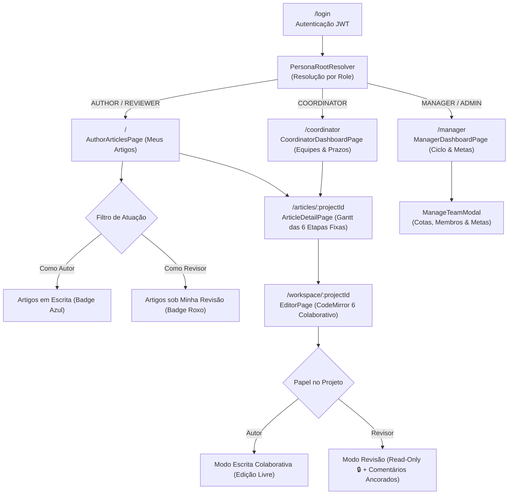
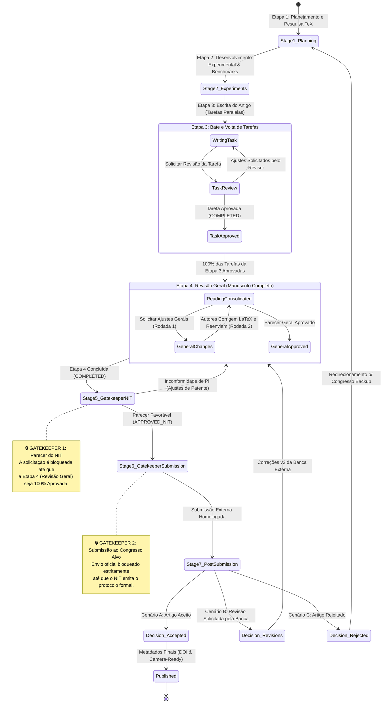
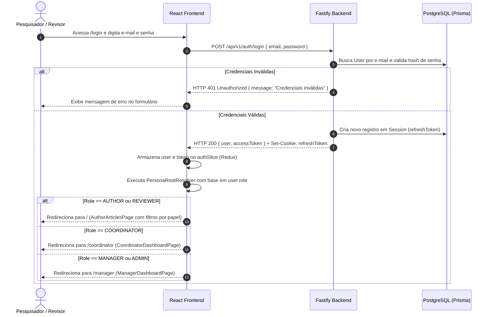
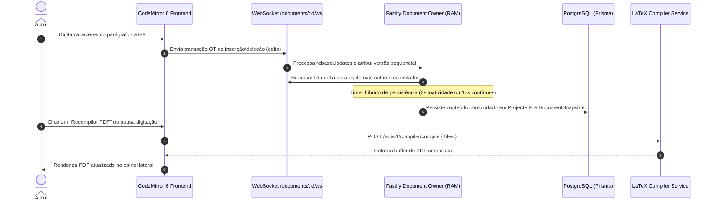
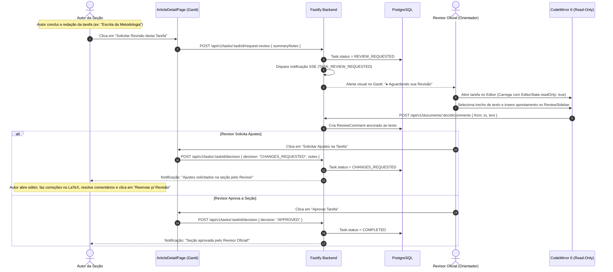
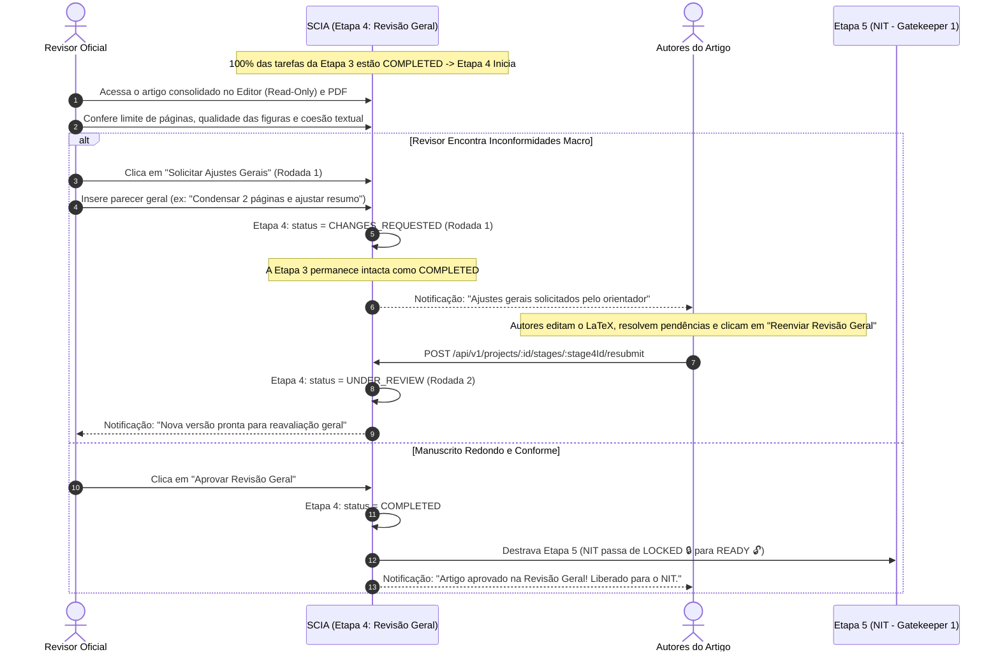
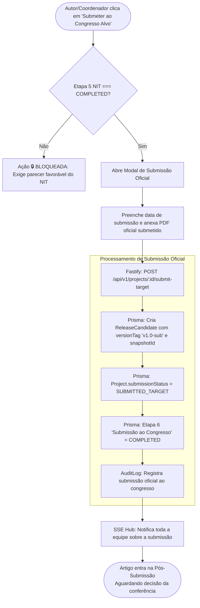
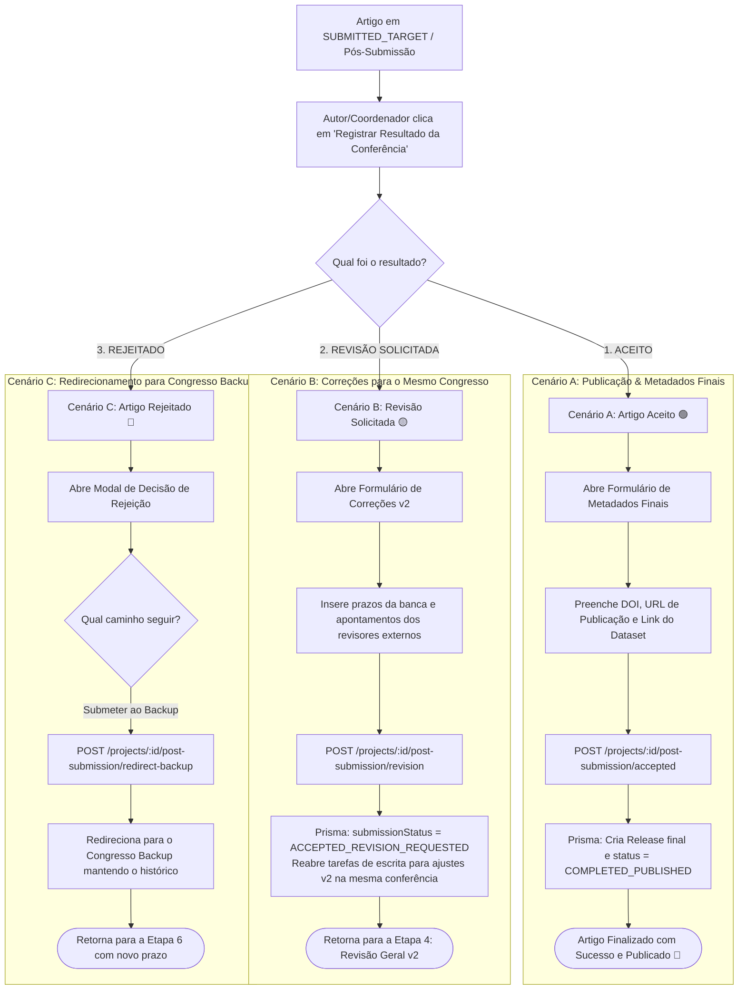
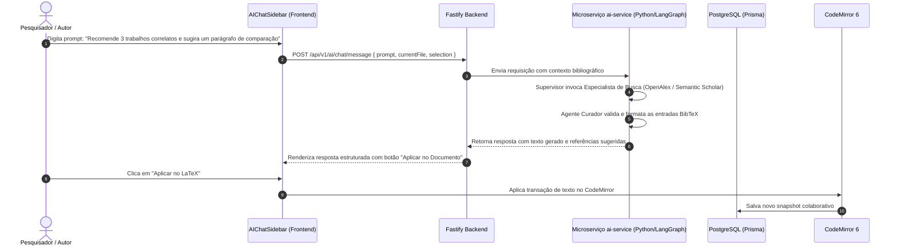

# 🔄 Documento de Fluxos da Aplicação e Jornadas de Usuário (`APP_FLOWS.md`)

**Produto:** SCIA — Scientific Collaboration and Intelligent Assistance (Plataforma Web Self-Hosted)  
**Versão:** 3.0 (Consolidada com ADR-007, ADR-008, 6 Etapas Fixas e Editor CodeMirror 6)  
**Status:** Aprovado / Em Desenvolvimento Ativo  
**Documentos Relacionados:**  
* 📄 [`PRD.md`](file:///home/gilson-russo/development/professional/sci-latex-vscode/docs/planning/PRD.md) — Documento de Requisitos de Produto (Visão, Personas & 6 Etapas Fixas)  
* ⚙️ [`TRD.md`](file:///home/gilson-russo/development/professional/sci-latex-vscode/docs/planning/TRD.md) — Documento de Requisitos Técnicos (Arquitetura, K8s & APIs)  
* 🏛️ [`ADR-007`](file:///home/gilson-russo/development/professional/sci-latex-vscode/docs/planning/adrs/adr-007-collaborative-editor-architecture-scaling.md) — Arquitetura do Editor Colaborativo CodeMirror 6  
* 🏛️ [`ADR-008`](file:///home/gilson-russo/development/professional/sci-latex-vscode/docs/planning/adrs/adr-008-workflow-6-etapas-revisao-desacoplamento-git.md) — Workflow em 6 Etapas Fixas e Modelo de Revisão em 2 Níveis  
* 🔍 [`specs/reviewer-view-spec.md`](file:///home/gilson-russo/development/professional/sci-latex-vscode/docs/planning/specs/reviewer-view-spec.md) — Especificação da Visão e Persona do Revisor  

---

## 📑 1. Identificação, Propósito & Visão Geral dos Fluxos

### 1.1 Propósito
O **Documento de Fluxos da Aplicação (App Flows)** mapeia detalhadamente todas as **jornadas de usuário (User Journeys)**, **transições de máquina de estados**, **interações de tela**, **comportamento de modais** e **processos assíncronos em tempo real (SSE & WebSockets)** da plataforma SCIA. Ele serve como o guia visual e operacional definitivo para desenvolvedores frontend, backend, UX designers e QA garantirem conformidade estrita entre a experiência de usuário e as regras de negócio.

### 1.2 Os Quatro Pilares da Experiência SCIA (v3.0)
```
┌────────────────────────────────────────────────────────────────────────────────────────┐
│                               OS 4 PILARES DE FLUXO SCIA                               │
├──────────────────────────┬─────────────────────────────┬───────────────────────────────┤
│ 1. Escrita Web Colab     │  2. Revisão em Dois Níveis  │  3. Régua de 6 Etapas Fixas   │
│ CodeMirror 6 nativo com  │ - Micro: Bate e volta por   │ Ordem 1 a 6 padronizada,      │
│ OT em tempo real, auto-  │   tarefas na Etapa 3.       │ imutável, sem exclusão ou     │
│ compilação de PDF e     │ - Macro: Revisão Geral na   │ drag-and-drop. Consistência   │
│ persistência no Postgres.│   Etapa 4 (antes do NIT).   │ institucional absoluta.       │
├──────────────────────────┴─────────────────────────────┴───────────────────────────────┤
│ 4. Governança Rígida e Gatekeepers: Etapa 5 (NIT 🔒) e Etapa 6 (Congresso Alvo 🔒)    │
│ com travas sequenciais automáticas e painéis preditivos de prazos para a Gerência.     │
└────────────────────────────────────────────────────────────────────────────────────────┘
```

---

## 🗺️ 2. Mapa de Navegação & Hierarquia de Telas (Sitemap Unificado)

O revisor não possui um sitemap apartado; ele utiliza a mesma interface dos autores com resolução dinâmica de permissões de leitura e escrita:



---

## 🔄 3. O Fluxo Macro do Artigo Científico: 6 Etapas Fixas & 2 Gatekeepers

O artigo científico obedece a uma máquina de estados linear estrita em **6 etapas fixas**, com duas barreiras institucionais invioláveis (**Gatekeepers**):



---

## 🔑 4. Fluxo 1: Autenticação, Sessão e Resolução de Papel (Login & RBAC)



---

## 📁 5. Fluxo 2: Criação do Artigo e Instanciação das 6 Etapas Fixas

A criação de um novo artigo científico gera automaticamente a estrutura sequencial imutável:

```mermaid
sequenceDiagram
    autonumber
    actor Author as Autor / Pesquisador
    participant Modal as CreateProjectModal (SPA)
    participant Gateway as Fastify Backend
    participant DB as PostgreSQL (Prisma)

    Author->>Modal: Preenche título, conferência alvo, período acadêmico e orientador (Revisor Oficial)
    Author->>Modal: Configura datas planejadas para as 6 etapas fixas
    Author->>Modal: Clica em "Criar Artigo Científico"
    Modal->>Gateway: POST /api/v1/projects { title, conference, managerId, coordinatorId, reviewerId, stages }
    
    subgraph "Criação Transacional no Backend"
        Gateway->>DB: Cria registro em Project
        Gateway->>DB: Associa membros (Author como criador, ReviewerId como REVIEWER)
        Gateway->>DB: Cria as 6 etapas sequenciais obrigatórias (order: 1 a 6):
        Note over Gateway,DB: 1. Planejamento e Pesquisa<br/>2. Desenvolvimento Experimental & Benchmarks<br/>3. Escrita do Artigo<br/>4. Revisão Técnica e Científica (Revisão Geral)<br/>5. Parecer do NIT (Gatekeeper 1)<br/>6. Submissão Final ao Congresso (Gatekeeper 2)
        Gateway->>DB: Semeia arquivos TeX padrão (main.tex, references.bib, Makefile)
    end

    Gateway-->>Modal: HTTP 201 Created { project }
    Modal-->>Author: Notificação de sucesso e redirecionamento para o Gantt do Artigo
```

---

## ✍️ 6. Fluxo 3: Escrita Colaborativa no Editor CodeMirror 6

Conforme estabelecido na **ADR-007**, a edição é colaborativa em tempo real com Transformação Operacional:



---

## 🔍 7. Fluxo 4: Bate e Volta de Tarefas de Escrita (Etapa 3 — Nível Micro)

Ciclo iterativo e paralelo entre autores e orientador para seções específicas:



---

## 🧐 8. Fluxo 5: Revisão Geral do Artigo (Etapa 4 — Nível Macro)

Avaliação holística do manuscrito consolidado antes do envio ao NIT:



---

## 🏛️ 9. Fluxo 6: Gatekeeper 1 — Processo de Avaliação Institucional do NIT

```mermaid
sequenceDiagram
    autonumber
    actor Author as Autor / Pesquisador
    participant Frontend as ArticleDetailPage (SPA)
    participant Gateway as Fastify Backend
    participant DB as PostgreSQL (Prisma)
    actor NITReviewer as Parecerista NIT / Coordenador

    Note over Frontend: Etapa do NIT está inicialmente com status LOCKED 🔒

    alt Etapa 4 (Revisão Geral) Não Concluída
        Author->>Frontend: Tenta clicar no botão "Solicitar Análise do NIT"
        Frontend-->>Author: Ação bloqueada: "Aprovação na Etapa 4 de Revisão Geral obrigatória"
    else Etapa 4 Está COMPLETED
        Frontend-->>Author: Etapa NIT desbloqueia! 🔓 Botão habilitado
        Author->>Frontend: Clica em "Solicitar Análise do NIT" e preenche protocolo
        Frontend->>Gateway: POST /api/v1/projects/:id/nit/request { notes, protocol }
        Gateway->>DB: Atualiza NitProcess (status: WAITING_NIT)
        Gateway-->>Frontend: Protocolo registrado com sucesso!
        Frontend-->>Author: Badge "Em Análise pelo NIT" (Relógio Amarelo ⏳)
    end

    NITReviewer->>Frontend: Analisa artigo e emite parecer de propriedade intelectual
    alt Parecer Aprovado
        NITReviewer->>Frontend: Registra parecer "Aprovado" com número de patente/protocolo
        Frontend->>Gateway: POST /api/v1/projects/:id/nit/decision { status: "APPROVED_NIT", protocol }
        Gateway->>DB: Atualiza NitProcess (status: APPROVED_NIT) e Etapa 5 = COMPLETED
        Gateway->>DB: Desbloqueia Gatekeeper 2 (Submissão ao Congresso Alvo 🔓)
        Frontend-->>Author: Notificação: "NIT Aprovado! Submissão ao Congresso Alvo liberada."
    else Parecer com Inconformidades
        NITReviewer->>Frontend: Registra parecer "Rejeitado" com apontamentos de PI
        Frontend->>Gateway: POST /api/v1/projects/:id/nit/decision { status: "REJECTED_NIT" }
        Frontend-->>Author: Notificação de inconformidade; ajustes de propriedade intelectual necessários
    end
```

---

## 🎯 10. Fluxo 7: Gatekeeper 2 — Submissão Oficial ao Congresso Alvo



---

## 🏆 11. Fluxo 8: Árvore de Decisão Pós-Submissão (Post-Submission Outcomes)



---

## 📊 12. Fluxo 9: Governança do Coordenador e Gerente (Métricas de Revisão)

A Coordenação e a Gerência acompanham a saúde editorial através de métricas automáticas geradas pelo ciclo de revisão:

1. **Dashboard do Coordenador (`CoordinatorDashboardPage`):**
   - Matriz de Prazos por Equipe (🟢 No Prazo, 🟡 Atenção, 🔴 Atrasado).
   - Contador de Tarefas em `REVIEW_REQUESTED` aguardando ação de cada orientador.
   - Identificação precoce de gargalos antes que a data do congresso expire.
2. **Dashboard do Gerente (`ManagerDashboardPage`):**
   - Agrupamento por **Período Acadêmico** (ex: *Ciclo 2026/2027*).
   - Metas de submissão por equipe (`TeamAcademicGoal`).
   - Métrica de **Taxa de Retrabalho** (média de rodadas de ajustes necessárias na Etapa 4 por equipe).

---

## 🤖 13. Fluxo 10: Interação com a Inteligência Artificial Científica (SciAI Copilot)



---

## 📋 14. Matriz Consolidada de Telas, Modais, Ações & Permissões RBAC

| Rota / Tela | Componente Principal | Modais e Painéis Associados | Ações Principais | Chamadas de API / Eventos | Papéis Autorizados |
| :--- | :--- | :--- | :--- | :--- | :--- |
| `/login` | `LoginPage` | — | Autenticação via e-mail e senha | `POST /auth/login` | Pública |
| `/` | `AuthorArticlesPage` | `CreateProjectModal` | Listar artigos, filtrar por atuação (Autor / Revisor), criar artigo | `GET /projects`, `POST /projects` | `AUTHOR`, `REVIEWER` |
| `/articles/:projectId` | `ArticleDetailPage` | `CreateTaskModal`, `AddMemberModal`, `ProjectSettingsModal`, `ReleaseCandidatesModal`, `PostSubmissionModal` | Navegar no Gantt das 6 etapas fixas, gerenciar prazos, solicitar NIT e submissão | `GET /projects/:id`, `POST /tasks`, `POST /nit/request`, `POST /submit-target` | `AUTHOR`, `REVIEWER`, `COORDINATOR`, `MANAGER` |
| `/workspace/:projectId` | `EditorPage` | `SettingsModal`, `ReviewSidebar` | Escrever TeX (Autor), auditar em modo leitura e comentar (Revisor), compilar PDF | `WS /documents/:id/ws`, `POST /compiler/compile`, `POST /documents/:id/comments` | `AUTHOR` (Escrita), `REVIEWER` (Read-Only) |
| `/coordinator` | `CoordinatorDashboardPage` | `ProjectSettingsModal` | Visualizar matriz de prazos de todas as equipes (🟢/🟡/🔴), reatribuir revisores | `GET /coordinator/summary` | `COORDINATOR`, `MANAGER` |
| `/manager` | `ManagerDashboardPage` | `ManageTeamModal`, `CreateAcademicPeriodModal`, `CreateUserModal` | Filtrar por Ciclo Acadêmico, definir cotas por equipe (`TeamAcademicGoal`), analisar gargalos | `GET /manager/dashboard`, `POST /academic-periods`, `PATCH /teams/:id/goals` | `MANAGER`, `ADMIN` |

---

## 📚 15. Referências e Navegação

* 📄 **Documento de Requisitos do Produto:** [`PRD.md`](file:///home/gilson-russo/development/professional/sci-latex-vscode/docs/planning/PRD.md)
* ⚙️ **Documento de Requisitos Técnicos:** [`TRD.md`](file:///home/gilson-russo/development/professional/sci-latex-vscode/docs/planning/TRD.md)
* 🏛️ **Decisão Arquitetural do Workflow (6 Etapas):** [`adrs/adr-008-workflow-6-etapas-revisao-desacoplamento-git.md`](file:///home/gilson-russo/development/professional/sci-latex-vscode/docs/planning/adrs/adr-008-workflow-6-etapas-revisao-desacoplamento-git.md)
* 🔍 **Especificação da Visão do Revisor:** [`specs/reviewer-view-spec.md`](file:///home/gilson-russo/development/professional/sci-latex-vscode/docs/planning/specs/reviewer-view-spec.md)
* 📌 **Status Atual e Guia de Retomada:** [`STATUS.md`](file:///home/gilson-russo/development/professional/sci-latex-vscode/docs/planning/STATUS.md)
