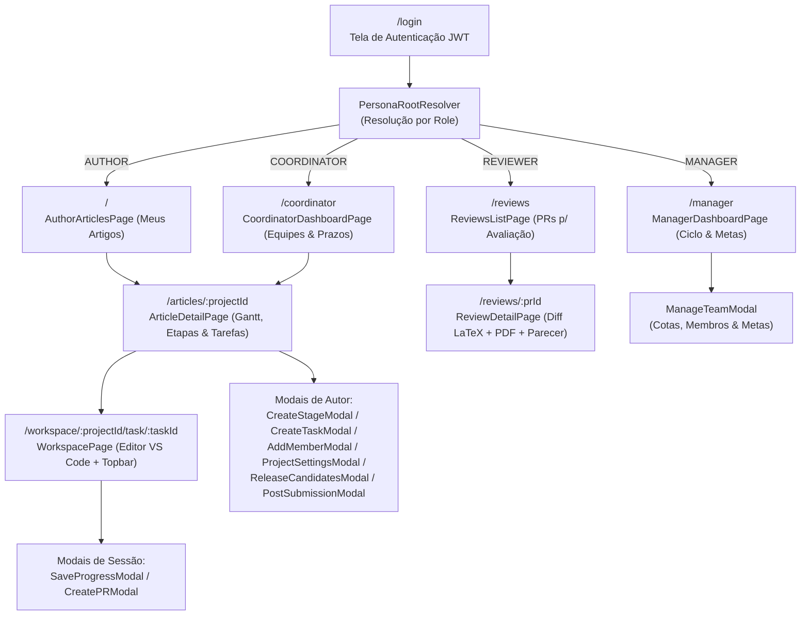
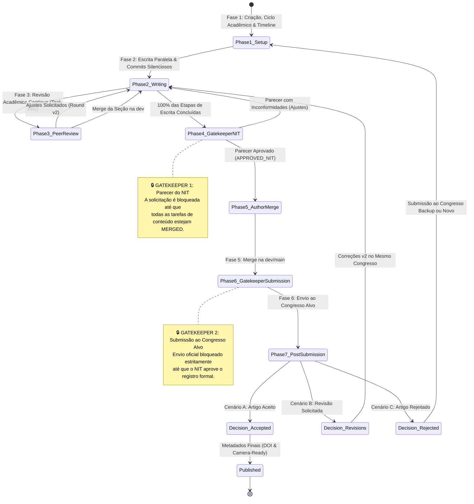
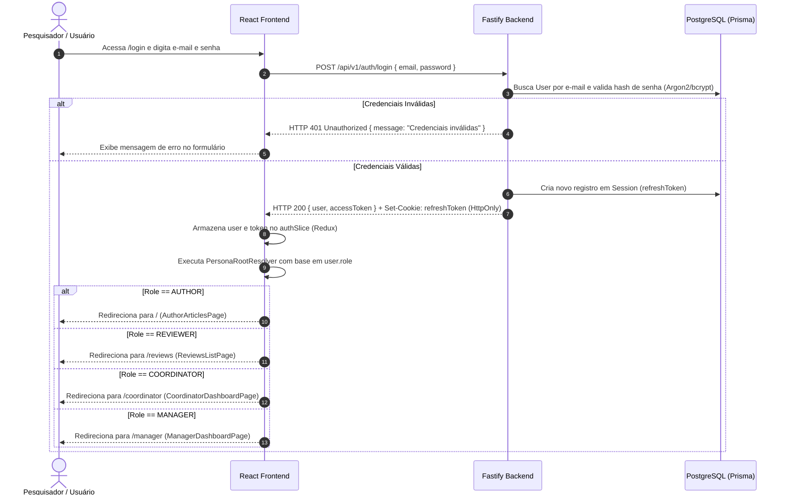
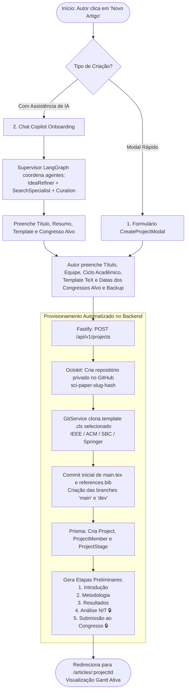
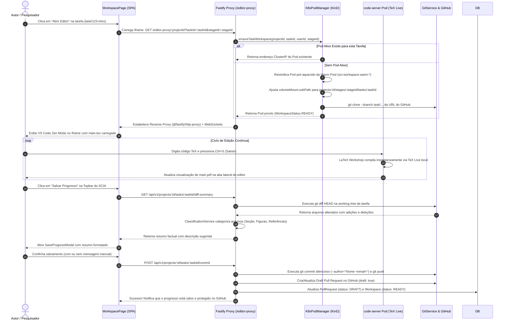
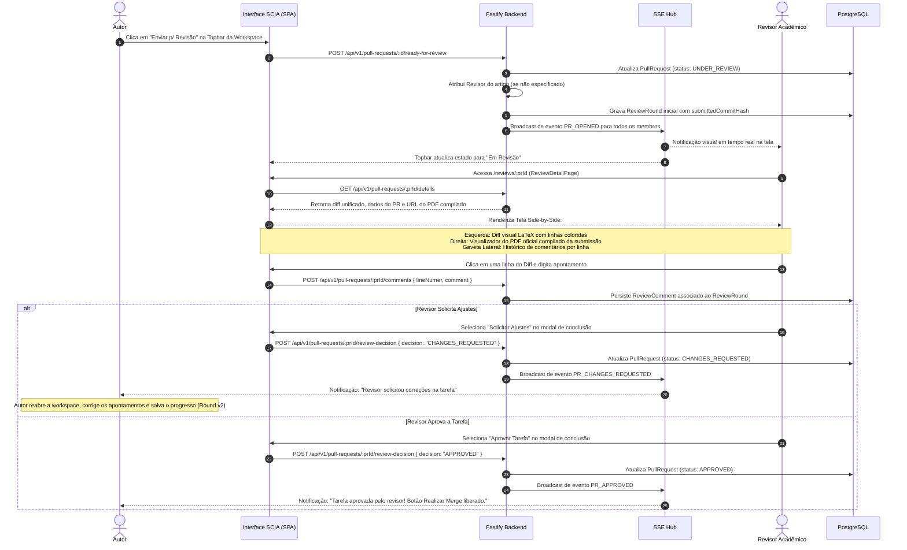
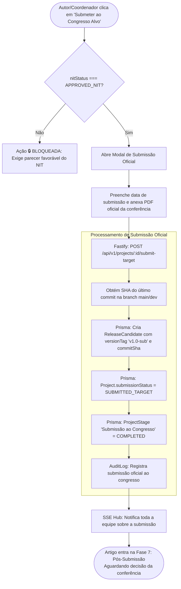
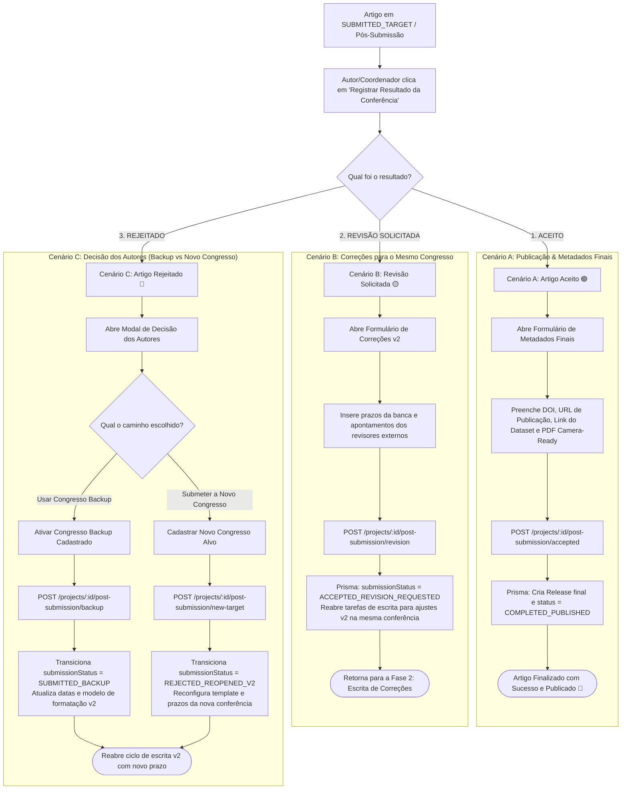
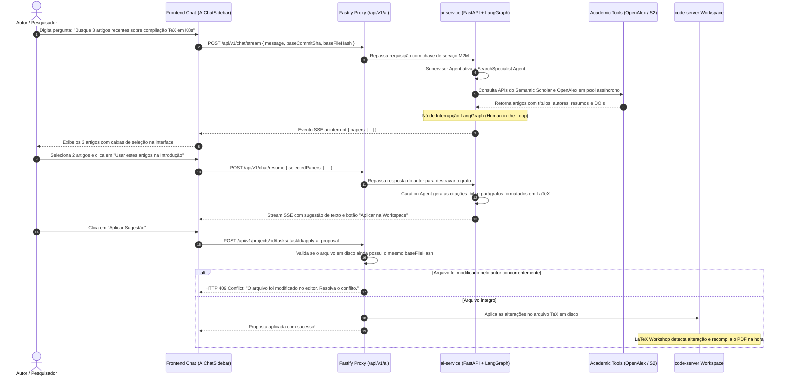

# 🔄 Documento de Fluxos da Aplicação e Jornadas de Usuário (`APP_FLOWS.md`)

**Produto:** SCIA — Scientific Collaboration + AI (Plataforma Web Self-Hosted)  
**Versão:** 2.0 (Consolidada com ADRs 001 a 006, specs v2.0 e TRD v2.0)  
**Status:** Aprovado / Em Desenvolvimento Ativo  
**Documentos Relacionados:**  
* 📄 [`PRD.md`](file:///home/gilson-russo/development/professional/sci-latex-vscode/docs/planning/PRD.md) — Documento de Requisitos de Produto (Visão, Personas & 7 Fases)  
* ⚙️ [`TRD.md`](file:///home/gilson-russo/development/professional/sci-latex-vscode/docs/planning/TRD.md) — Documento de Requisitos Técnicos (Arquitetura, K8s, Git & APIs)  
* 🛠️ [`WORKFLOW.md`](file:///home/gilson-russo/development/professional/sci-latex-vscode/docs/planning/WORKFLOW.md) — Fluxo de Trabalho de Desenvolvimento Git/Jira  
* 📌 [`STATUS.md`](file:///home/gilson-russo/development/professional/sci-latex-vscode/docs/planning/STATUS.md) — Status Atual & Checkpoint de Retomada  

---

## 📑 1. Identificação, Propósito & Visão Geral dos Fluxos

### 1.1 Propósito
O **Documento de Fluxos da Aplicação (App Flows)** mapeia detalhadamente todas as **jornadas de usuário (User Journeys)**, **transições de máquina de estados**, **interações de tela**, **comportamento de modais** e **processos assíncronos em tempo real (SSE & K8s)** da plataforma SCIA. Ele serve como o guia visual e operacional definitivo para desenvolvedores frontend, backend, UX designers e QA garantirem conformidade estrita entre a experiência de usuário e as regras de negócio.

### 1.2 Os Quatro Pilares da Experiência SCIA
```
┌────────────────────────────────────────────────────────────────────────────────────────┐
│                               OS 4 PILARES DE FLUXO SCIA                               │
├──────────────────────────┬─────────────────────────────┬───────────────────────────────┤
│ 1. Escrita Zen & Rápida  │  2. Revisão Viva Side-by-Side│  3. Governança Rígida NIT     │
│ VS Code nativo no iframe,│ Comparador Diff LaTeX + PDF │ Gatekeeper 1 (NIT) e          │
│ auto-build no Ctrl+S e   │ compilado da versão oficial,│ Gatekeeper 2 (Congresso) com  │
│ commits silenciosos.     │ drawer de notas por linha.  │ travas sequenciais automáticas│
├──────────────────────────┴─────────────────────────────┴───────────────────────────────┤
│ 4. Governança de Prazos & Copilot com IA: Dual View [Fluxo] vs [Timeline], alertas de  │
│ estouro de datas e assistência multi-agente (OpenAlex / Semantic Scholar).             │
└────────────────────────────────────────────────────────────────────────────────────────┘
```

---

## 🗺️ 2. Mapa de Navegação & Hierarquia de Telas (Sitemap)



---

## 🔄 3. O Fluxo Macro do Artigo Científico: 7 Fases & 2 Gatekeepers

O artigo científico obedece a uma máquina de estados linear estrita em 7 fases, com duas barreiras institucionais invioláveis (**Gatekeepers**):



---

## 🔑 4. Fluxo 1: Autenticação, Sessão e Resolução de Papel (Login & RBAC)



### Regras de Negócio do Fluxo de Autenticação:
1. **Cookies HttpOnly:** O `refreshToken` é armazenado em cookie seguro `HttpOnly`, invulnerável a ataques XSS via JavaScript.
2. **Renovação Transparente (Silent Refresh):** O interceptor HTTP (`src/services/api.ts`) captura respostas `401 Unauthorized`, aciona automaticamente `POST /api/v1/auth/refresh` com o cookie e reprocessa a requisição original sem deslogar o usuário.
3. **Proteção de Rota (`ProtectedRoute`):** Caso o usuário tente acessar manualmente uma URL sem possuir a role exigida (ex: Autor acessando `/manager`), o componente exibe feedback de acesso negado e redireciona para sua home canônica.

---

## 🚀 5. Fluxo 2: Onboarding & Criação do Artigo Científico

Este fluxo abrange desde a parametrização inicial até o provisionamento automático de repositório no GitHub e a geração do cronograma de etapas paralelas.



### Regras de Negócio da Criação do Artigo:
1. **Nome Único do Repositório:** O nome no GitHub adota o padrão `sci-paper-<slug-do-titulo>-<hash-8-chars>`, garantindo unicidade mesmo com títulos semelhantes.
2. **Template Auto-contido:** O arquivo de classe (`.cls` ou `.sty`) selecionado é gravado fisicamente na raiz do repositório, garantindo que o TeX Live compile o documento de forma autônoma sem dependências externas.
3. **Branches Padrão:** O repositório nasce com a branch `main` (protegida para releases e submissões oficiais) e a branch `dev` (trunk de integração das tarefas em andamento).

---

## ✍️ 6. Fluxo 3: Escrita Paralela do Autor no Workspace VS Code

O Autor escreve em um ambiente VS Code (`code-server`) isolado em container Kubernetes, com auto-build de PDF e commits com classificação semântica de arquivos.



### Regras de Negócio da Escrita e Salvamento:
1. **Compilação sem Filas:** Ao salvar (`Ctrl+S`), a extensão LaTeX Workshop compila o documento diretamente no container em menos de 2 segundos. Não há envio de mensagens para brokers externos de recompilação.
2. **Linha de Base do Diff:** O cálculo de progresso é sempre relativo a `git diff HEAD` daquela tarefa. O pesquisador vê apenas o que modificou desde o último salvamento.
3. **Classificação Amigável:** Caminhos técnicos como `sections/01_intro.tex` são apresentados como `"Seção Introdução"`, e `references.bib` como `"Referências Bibliográficas"`.
4. **Draft PR Permanente:** Cada salvamento de progresso sincroniza o Draft PR no GitHub, garantindo que a equipe acompanhe a evolução do código sem risco de perda de trabalho.

---

## 🔍 7. Fluxo 4: Revisão Acadêmica Contínua (Peer Review & Diff Side-by-Side)

Processo de avaliação vivo acionado em cada sub-tarefa. O Revisor analisa as alterações em uma interface especializada lado a lado.



### Regras de Negócio da Revisão:
1. **SHA Imutável:** A tela de revisão do Revisor é congelada no commit exato submetido pelo Autor (`submittedCommitHash`). Se o autor continuar digitando em sua workspace local, a revisão não é alterada dinamicamente.
2. **Histórico por Rodadas (`ReviewRound`):** Caso o revisor solicite ajustes, as correções subsequentes criam um novo `ReviewRound` (ex: Rodada 2), preservando o histórico completo de pareceres e réplicas anteriores.
3. **Habilitação de Botões Guiada pelo Domínio:** O botão "Realizar Merge" no painel do autor permanece estritamente bloqueado enquanto `activePR.status !== APPROVED`.

---

## 🔀 8. Fluxo 5: Merge pelo Autor & Limpeza de Pod (Workspace Cleanup)

O encerramento de uma sub-tarefa de escrita é executado pelo próprio Autor após a aprovação formal do Revisor.

```mermaid
flowchart TD
    Start([Autor clica em 'Realizar Merge' na Topbar]) --> CheckStatus{activePR.status === APPROVED?}
    
    CheckStatus -->|Não| Blocked[Botão Desabilitado / Ação Bloqueada]
    CheckStatus -->|Sim| OpenModal[Abre Modal de Confirmação de Merge]
    
    OpenModal --> Confirm[Autor confirma mesclagem da seção]
    Confirm --> BackendCall[Fastify: POST /api/v1/projects/:id/tasks/:taskId/merge]
    
    subgraph "Execução Atômica de Merge e Limpeza"
        BackendCall --> GitMerge[Octokit / GitService: Executa git merge da branch da tarefa na dev]
        GitMerge --> DeleteBranch[Octokit: Remove a branch remota temporária do GitHub]
        DeleteBranch --> ReleasePod[K8sPodManager: releasePodForProject - Devolve/destrói Pod]
        ReleasePod --> CleanStorage[Limpa diretório/PVC temporário da tarefa no host]
        CleanStorage --> UpdateDB[Prisma: Task.status = MERGED, Workspace.status = TERMINATED]
        UpdateDB --> Audit[AuditLog: Grava registro de merge com usuário e timestamp]
    end
    
    Audit --> SSEEvent[SSE Hub: Dispara broadcast TASK_UPDATED]
    SSEEvent --> Redirect[Frontend redireciona autor para /articles/:projectId]
    Redirect --> EndSuccess([Tarefa exibida com badge 'Concluída (Merged)'<br/>Botão 'Abrir Editor' desabilitado])
```

### Regras de Negócio do Merge:
1. **Eliminação de Branches Órfãs:** A branch temporária da sub-tarefa (`task/<slug>-<shortHash>`) é excluída remotamente no GitHub logo após a confirmação do merge na `dev`.
2. **Desalocação Imediata de Memória:** O Pod Kubernetes e o PVC temporário são destruídos imediatamente, liberando recursos computacionais do cluster para outras tarefas.
3. **Invalidação de Acesso:** Com o status `MERGED`, a workspace é marcada como `TERMINATED` e o endpoint do editor recusa novas conexões para aquela tarefa.

---

## 🏛️ 9. Fluxo 6: Gatekeeper 1 — Processo de Avaliação Institucional do NIT

O **Núcleo de Inovação Tecnológica (NIT)** é o órgão institucional que avalia o potencial de patente e propriedade intelectual do artigo antes de qualquer publicação externa.

```mermaid
sequenceDiagram
    autonumber
    actor Author as Autor / Pesquisador
    participant Frontend as ArticleDetailPage (SPA)
    participant Gateway as Fastify Backend
    participant DB as PostgreSQL (Prisma)
    actor NITReviewer as Parecerista NIT / Coordenador

    Note over Frontend: Etapa do NIT está inicialmente com status LOCKED 🔒

    loop Verificação Contínua
        Frontend->>Frontend: Verifica se 100% das etapas de conteúdo estão COMPLETED
    end

    alt Alguma Etapa de Conteúdo Pendente
        Author->>Frontend: Tenta clicar no botão "Solicitar Análise do NIT"
        Frontend-->>Author: Botão desabilitado com tooltip informativo:<br/>"Conclua 100% das etapas de escrita para solicitar o parecer do NIT"
    else 100% das Etapas de Escrita Concluídas
        Frontend-->>Author: Etapa NIT desbloqueia! 🔓 Botão "Solicitar Análise do NIT" habilitado
        Author->>Frontend: Clica em "Solicitar Análise do NIT" e preenche notas
        Frontend->>Gateway: POST /api/v1/projects/:id/nit/request { notes, protocol }
        Gateway->>DB: Valida em transação atômica se all(stages.writing === COMPLETED)
        Gateway->>DB: Cria registro em NitProcess (status: WAITING_NIT)
        Gateway->>DB: Atualiza Project (submissionStatus: WAITING_NIT)
        Gateway->>DB: Grava AuditLog com ação "NIT_ANALYSIS_REQUESTED"
        Gateway-->>Frontend: Solicitação protocolada com sucesso!
        Frontend-->>Author: Etapa exibe badge "Em Análise pelo NIT" (Relógio Amarelo ⏳)
    end

    NITReviewer->>Frontend: Acessa painel do NIT / modal de parecer institucional
    NITReviewer->>Frontend: Analisa o artigo consolidado na branch dev e emite o parecer

    alt Parecer Aprovado
        NITReviewer->>Frontend: Registra parecer "Aprovado" com número de protocolo
        Frontend->>Gateway: POST /api/v1/projects/:id/nit/decision { status: "APPROVED_NIT", protocol, notes }
        Gateway->>DB: Atualiza NitProcess (status: APPROVED_NIT, approvedAt: now)
        Gateway->>DB: Atualiza ProjectStage NIT (status: COMPLETED)
        Gateway->>DB: Desbloqueia Gatekeeper 2 (Submissão ao Congresso Alvo 🔓)
        Gateway-->>Frontend: Parecer registrado!
        Frontend-->>Author: Notificação: "NIT Aprovado! Submissão ao Congresso Alvo liberada."
    else Parecer com Inconformidades (Rejeitado)
        NITReviewer->>Frontend: Registra parecer "Rejeitado" com apontamentos de PI
        Frontend->>Gateway: POST /api/v1/projects/:id/nit/decision { status: "REJECTED_NIT", notes }
        Gateway->>DB: Atualiza NitProcess (status: REJECTED_NIT)
        Gateway->>DB: Mantém Gatekeeper 2 bloqueado (🔒 LOCKED)
        Frontend-->>Author: Notificação de inconformidade institucional; ajustes necessários
    end
```

### Regras de Negócio do Gatekeeper 1 (NIT):
1. **Trava Sequencial Rígida:** É impossível solicitar o NIT com etapas de escrita pendentes. A verificação é validada tanto na interface quanto no backend (`HTTP 409 Conflict` se houver etapa aberta).
2. **Auditabilidade de Propriedade Intelectual:** Todos os despachos, protocolos e notas emitidos pelo NIT são gravados de forma imutável na tabela `AuditLog`.

---

## 🎯 10. Fluxo 7: Gatekeeper 2 — Submissão Oficial ao Congresso Alvo

O envio formal do artigo compilado para a conferência científica é estritamente condicionado à aprovação do NIT.



### Regras de Negócio do Gatekeeper 2:
1. **Inviolabilidade de Envio:** Nenhuma submissão para conferências externas (IEEE, ACM, SBC, etc.) é liberada pelo sistema sem o selo `APPROVED_NIT`.
2. **Congelamento do Artefato (Freeze):** O estado do código no momento exato da submissão é imutavelmente registrado através de uma `ReleaseCandidate` contendo a tag de versão e o SHA do commit.

---

## 🏆 11. Fluxo 8: Árvore de Decisão Pós-Submissão (Post-Submission Outcomes)

Após a avaliação da banca revisora do congresso, os autores recebem o parecer externo e registram o desfecho na plataforma através do `PostSubmissionModal`.



### Regras de Negócio do Pós-Submissão:
1. **Cenário A (Aceito):** Permite o upload da versão *Camera-Ready* e gravação do DOI oficial para citação acadêmica. O projeto é arquivado como concluído.
2. **Cenário B (Revisão Solicitada):** Mantém o mesmo congresso alvo, porém cria novas sub-tarefas de correção (ex: *"Revisão v2: Ajustar Figuras e Equações"*).
3. **Cenário C (Rejeitado):** Oferece transição instantânea para o congresso backup definido na Fase 1 ou permite parametrizar uma conferência totalmente nova, preservando todo o texto já produzido.

---

## 📈 12. Fluxo 9: Governança, Prazos & Análise Preditiva (Coordenação e Gerência)

O acompanhamento de cronogramas e entregas de artigos científicos opera através de duas visões integradas no componente `<ArticleTimelineHeader />`:

```mermaid
flowchart LR
    Header[ArticleTimelineHeader] --> ViewSelector{Seletor de Modo}
    
    ViewSelector -->|Modo [Fluxo]| FlowView[Visão Sequencial de Etapas:<br/>Cards horizontais de etapas com travas 🔒<br/>e progresso percentual concluído]
    
    ViewSelector -->|Modo [Timeline]| TimelineView[Visão Cronológica de Gantt:<br/>Régua temporal com datas planejadas e reais:<br/>plannedStartAt até plannedEndAt]

    TimelineView --> DeadlineLogic[Cálculo de Status de Prazo do Artigo]
    
    DeadlineLogic --> OnTime[🟢 ON_TIME: Faltam > 15 dias para o prazo final]
    DeadlineLogic --> Warning[🟡 WARNING_SOON: Faltam <= 15 dias para o vencimento]
    DeadlineLogic --> Overdue[🔴 OVERDUE: Prazo final da conferência expirado]

    TimelineView --> TaskAudit{Data da Tarefa > Prazo da Etapa?}
    TaskAudit -->|Sim| TaskWarning[⚠️ Exibe Chip Vermelho no Card da Tarefa:<br/>'A data limite da tarefa excede o final da etapa']
    TaskAudit -->|Não| TaskOk[Exibe data normal de vencimento]
```

### Regras de Negócio de Governança e Coordenação:
1. **Validação de Inconsistência de Datas:** Se um autor definir o vencimento de sua sub-tarefa para uma data posterior ao término planejado da etapa (`task.dueDate > stage.plannedEndAt`), o sistema destaca a inconsistência visualmente em vermelho e emite alerta ao Coordenador.
2. **Metas Globais de Gerência (`TeamAcademicGoal`):** O Gerente define a quantidade de artigos esperados por equipe dentro de um determinado **Ciclo Acadêmico**. O painel calcula automaticamente a taxa de atingimento e over-achievement.
3. **Análise Preditiva de Gargalos:** O sistema identifica preventivamente equipes com tarefas travadas há mais de 7 dias sem novos commits, alertando a coordenação antes que o prazo do congresso seja violado.

---

## 🤖 13. Fluxo 10: Interação com a Inteligência Artificial Científica (SciAI Copilot)

A assistência de IA é acessível pelo painel lateral de chat (`AIChatSidebar`) ou durante o onboarding guiado (`OnboardingChat`).



### Regras de Negócio do SciAI:
1. **Human-in-the-Loop Obrigatório:** O agente de busca bibliográfica jamais insere artigos ou referências no texto sem a validação explícita do pesquisador na interface.
2. **Proteção de Concorrência:** O envio de `baseFileHash` (SHA-256 do arquivo aberto) impede que uma proposta demorada da IA sobrescreva acidentalmente alterações manuais feitas pelo autor no editor.
3. **Connection Pooling & Retries:** Chamadas a APIs externas acadêmicas utilizam semáforos assíncronos e retentativas com backoff exponencial para evitar bloqueios de taxa (*rate limiting*).

---

## 📋 14. Matriz Consolidada de Telas, Modais, Ações & Permissões RBAC

| Rota / Tela | Componente Principal | Modais e Painéis Associados | Ações Principais | Chamadas de API / Eventos | Papéis Autorizados |
| :--- | :--- | :--- | :--- | :--- | :--- |
| `/login` | `LoginPage` | — | Autenticação via e-mail e senha | `POST /auth/login` | Pública |
| `/` | `AuthorArticlesPage` | `CreateProjectModal` | Listar artigos do usuário, criar novo artigo | `GET /projects`, `POST /projects` | `AUTHOR` |
| `/articles/:projectId` | `ArticleDetailPage` | `CreateStageModal`, `CreateTaskModal`, `AddMemberModal`, `ProjectSettingsModal`, `ReleaseCandidatesModal`, `PostSubmissionModal` | Navegar no Gantt, alternar `[Fluxo]` e `[Timeline]`, gerenciar etapas e membros, solicitar NIT e submissão | `GET /projects/:id`, `POST /stages`, `POST /tasks`, `POST /nit/request`, `POST /submit-target` | `AUTHOR`, `COORDINATOR`, `MANAGER` |
| `/workspace/:projectId/task/:taskId` | `WorkspacePage` | `SaveProgressModal`, `CreatePRModal`, `AIChatSidebar` | Escrever TeX no VS Code embutido, compilar PDF instantâneo, salvar progresso (commit) e enviar p/ revisão | `GET /editor-proxy/:id`, `GET /tasks/:id/diff-summary`, `POST /tasks/:id/commit`, `POST /prs/:id/ready-for-review`, `POST /tasks/:id/merge` | `AUTHOR` |
| `/reviews` | `ReviewsListPage` | — | Listar Pull Requests pendentes de avaliação acadêmica | `GET /pull-requests` | `REVIEWER`, `COORDINATOR`, `AUTHOR` |
| `/reviews/:prId` | `ReviewDetailPage` | `NITParecerModal`, Drawer de Comentários | Avaliar Diff LaTeX side-by-side com PDF oficial, comentar por linha, solicitar ajustes ou aprovar | `GET /prs/:id/details`, `POST /prs/:id/comments`, `POST /prs/:id/review-decision`, `POST /nit/decision` | `REVIEWER`, `COORDINATOR` |
| `/coordinator` | `CoordinatorDashboardPage` | `ProjectSettingsModal` | Visualizar matriz de prazos de todas as equipes (🟢/🟡/🔴), reatribuir revisores | `GET /coordinator/summary`, `PATCH /prs/:id/reviewer` | `COORDINATOR`, `MANAGER` |
| `/manager` | `ManagerDashboardPage` | `ManageTeamModal`, `CreateAcademicPeriodModal`, `CreateUserModal` | Filtrar por Ciclo Acadêmico, definir cotas por equipe (`TeamAcademicGoal`), analisar gargalos | `GET /manager/dashboard`, `POST /academic-periods`, `PATCH /teams/:id/goals` | `MANAGER`, `ADMIN` |

---

## 📚 15. Referências e Navegação

* 📄 **Documento de Requisitos do Produto:** [`PRD.md`](file:///home/gilson-russo/development/professional/sci-latex-vscode/docs/planning/PRD.md)
* ⚙️ **Documento de Requisitos Técnicos:** [`TRD.md`](file:///home/gilson-russo/development/professional/sci-latex-vscode/docs/planning/TRD.md)
* 🛠️ **Workflow de Desenvolvimento Git & Jira:** [`WORKFLOW.md`](file:///home/gilson-russo/development/professional/sci-latex-vscode/docs/planning/WORKFLOW.md)
* 📘 **Especificação Geral do Sistema:** [`specs/system-specs.md`](file:///home/gilson-russo/development/professional/sci-latex-vscode/docs/planning/specs/system-specs.md)
* 📌 **Status Atual e Guia de Retomada:** [`STATUS.md`](file:///home/gilson-russo/development/professional/sci-latex-vscode/docs/planning/STATUS.md)
