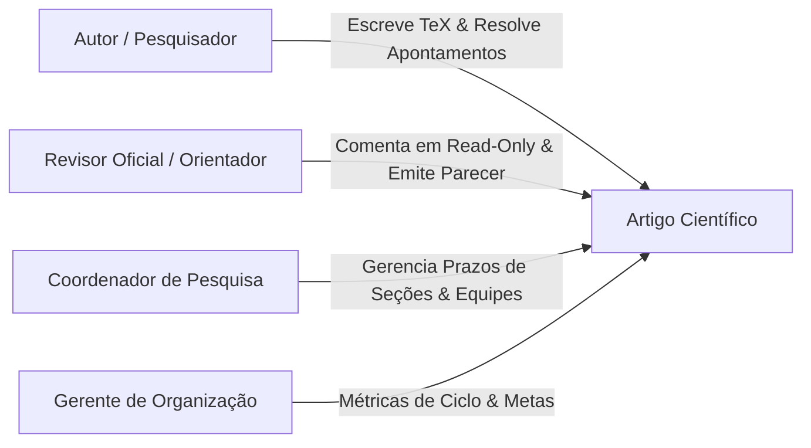
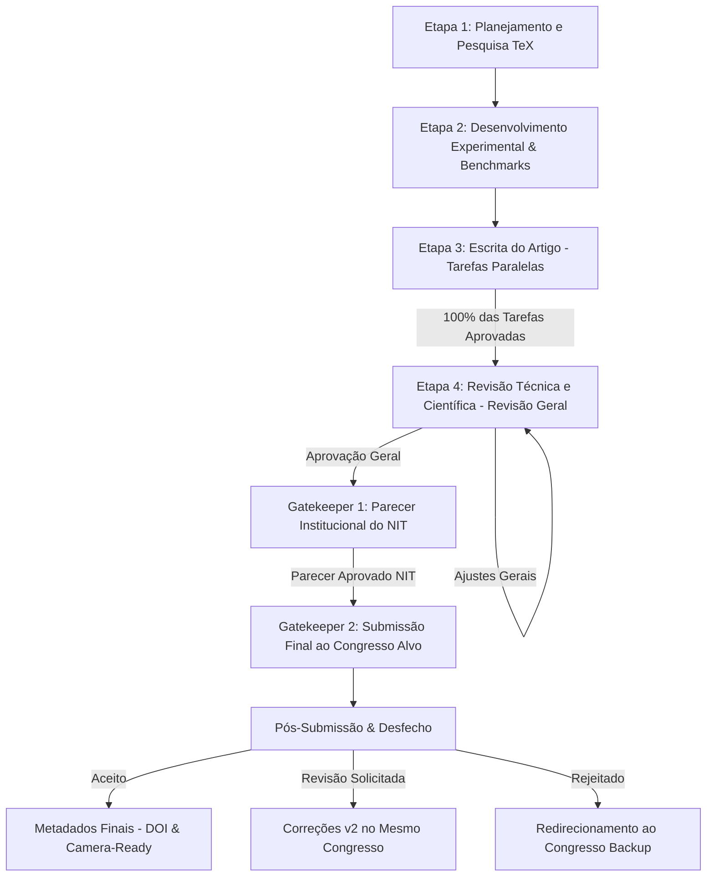

# 📄 Documento de Requisitos do Produto (PRD)

**Produto:** SCIA — Scientific Collaboration and Intelligent Assistance (Plataforma Web Self-Hosted)  
**Versão:** 2.0 (Consolidada)  
**Status:** Em Desenvolvimento Ativo  

---

## 🎯 1. Visão do Produto & Problema

### O Problema
Pesquisadores e grupos de acadêmicos enfrentam desafios ao redigir artigos científicos em **LaTeX**:
* Necessidade de configuração complexa de ambiente TeX Live local.
* Falta de controle de versão formal e auditoria sobre alterações por seção.
* Ausência de integração com processos institucionais (como avaliação de propriedade intelectual pelo **NIT - Núcleo de Inovação Tecnológica**).
* Dificuldade no acompanhamento de prazos rígidos de conferências científicas e gerenciamento de congressos alvos e congressos backups.

### A Solução
O **SCIA (Scientific Collaboration + AI)** é uma plataforma web **100% Self-Hosted** voltada para a gestão e redação científica colaborativa, baseada no editor **CodeMirror 6** com sincronização em tempo real (OT) e persistência transacional em **PostgreSQL**, com:
* **Edição Web-Nativa sem Git:** Zero atrito de chaves SSH, branches Git ou conflitos de merge; sincronização contínua e snapshots de versão.
* **Compilação TeX Nativa:** Visualização instantânea de PDF lado a lado com compilação direta via container LaTeX.
* **Workflow em 6 Etapas Fixas & Revisão em Dois Níveis:** Bate e volta granular por tarefas (nível micro) e Revisão Geral consolidada (nível macro na Etapa 4) antes do Gatekeeper do NIT.
* **Governança por Prazos:** Dashboard com matrizes de prazos, notificações em tempo real (SSE) e visão por Período Acadêmico.

---

## 👥 2. Personas do Sistema & Atribuições

| Persona | Atribuições & Responsabilidades |
| :--- | :--- |
| **Autor** | Cria o artigo, estabelece datas planejadas das etapas fixas, redige no editor CodeMirror 6, solicita revisão de tarefas, atua em ajustes apontados pelo revisor, solicita análise do NIT (ao aprovar a Etapa 4) e executa a submissão final ao congresso. |
| **Revisor** | Atua como Orientador ou Revisor Técnico do projeto. Acessa as mesmas telas do autor (com filtro e badges dedicados), avalia o texto no CodeMirror em modo **Read-Only** com capacidade total de comentários inline ancorados (`ReviewSidebar`), emitindo pareceres em nível de tarefa (Etapa 3) e na Revisão Geral (Etapa 4). |
| **Coordenador** | Coordena 1 ou mais Times (`1:N`). Gerencia prazos, monitora tarefas em revisão, reatribui orientadores/revisores e resolve gargalos das equipes. |
| **Gerente** | Suporte a **Múltiplos Gerentes (`Role.MANAGER`)** por departamento/área. Visão estratégica executiva por **Ciclo Acadêmico**, define a Meta Global da sua unidade, distribui cotas entre os times (`TeamAcademicGoal`), acompanha métricas de tempo de revisão e rodadas de retrabalho. |

---

## 🔄 3. As 6 Etapas Fixas do Ciclo de Vida do Artigo (ADR-008)

1. **Etapa 1 — Planejamento e Pesquisa:** Levantamento bibliográfico, formulação de hipóteses e estruturação preliminar da árvore TeX.
2. **Etapa 2 — Desenvolvimento Experimental & Benchmarks:** Coleta de dados experimentais, execução de scripts e geração automatizada de gráficos.
3. **Etapa 3 — Escrita do Artigo (Tarefas Paralelas & Bate e Volta):** Redação das seções TeX distribuídas entre coautores com solicitação de revisão por tarefa (`REVIEW_REQUESTED`), comentários ancorados e aprovação (`COMPLETED`).
4. **Etapa 4 — Revisão Técnica e Científica (Revisão Geral):** Avaliação holística do manuscrito completo consolidado pelo Revisor Oficial. Caso haja inconformidades macro, a Etapa 4 itera em rodadas de ajustes (`CHANGES_REQUESTED`), mantendo a Etapa 3 intacta como concluída.
5. **Etapa 5 — Parecer do NIT (Gatekeeper 1 🔒):** Trava sequencial estrita liberada para solicitação dos autores unicamente após a aprovação integral da Etapa 4 de Revisão Geral.
6. **Etapa 6 — Submissão Final ao Congresso Alvo (Gatekeeper 2 🔒):** Trava sequencial estrita liberada para envio formal somente após a homologação de parecer favorável pelo NIT (`APPROVED_NIT`).

---

## 🏗️ 4. Principais Decisões de Arquitetura (Consolidadas)

* **Editor Web-Nativo com CodeMirror 6 & @codemirror/collab (ADR-007):** Arquitetura Single-Leader OT com rebase em memória, zero dependência de terminais e flush periódico no PostgreSQL.
* **Extensão Read-Only Nativa para o Revisor:** Proteção contra edição acidental via `EditorState.readOnly.of(true)`, permitindo seleção de trechos e inclusão de anotações via `ReviewSidebar`.
* **Régua Institucional de 6 Etapas Imutáveis (ADR-008):** Todas as etapas são sequenciais e obrigatórias; remoção de reordenação e deleção de etapas, eliminando a dependência de `@dnd-kit`.
* **Modelo de Revisão em Dois Níveis:** Separação entre o bate e volta granular por tarefas (Etapa 3) e a Revisão Geral macro institucional (Etapa 4).
* **Sincronização em Tempo Real (SSE & WebSockets):** Atualização instantânea na interface React através de SSE e WebSockets, sem necessidade de reload de página.

---

## 🔗 5. Links para Especificações Detalhadas

* ⚙️ **Documento de Requisitos Técnicos (TRD):** [`docs/planning/TRD.md`](file:///home/gilson-russo/development/professional/sci-latex-vscode/docs/planning/TRD.md)
* 🔄 **Documento de Fluxos da Aplicação (App Flows):** [`docs/planning/APP_FLOWS.md`](file:///home/gilson-russo/development/professional/sci-latex-vscode/docs/planning/APP_FLOWS.md)
* 📘 **Especificações Técnicas Completas:** [`docs/planning/specs/system-specs.md`](file:///home/gilson-russo/development/professional/sci-latex-vscode/docs/planning/specs/system-specs.md)
* 📐 **Arquitetura Geral & Infra:** [`docs/planning/specs/architecture-plan.md`](file:///home/gilson-russo/development/professional/sci-latex-vscode/docs/planning/specs/architecture-plan.md)
* ⚙️ **Especificações Backend:** [`docs/planning/specs/backend-specs.md`](file:///home/gilson-russo/development/professional/sci-latex-vscode/docs/planning/specs/backend-specs.md)
* 🎨 **Especificações Frontend:** [`docs/planning/specs/frontend-specs.md`](file:///home/gilson-russo/development/professional/sci-latex-vscode/docs/planning/specs/frontend-specs.md)
* 🛠️ **Workflow de Trabalho & Git:** [`docs/planning/WORKFLOW.md`](file:///home/gilson-russo/development/professional/sci-latex-vscode/docs/planning/WORKFLOW.md)
