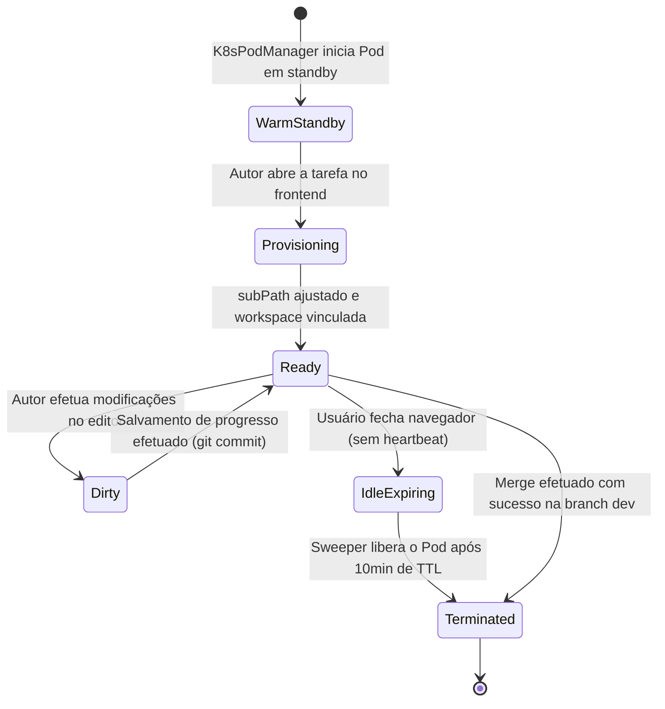
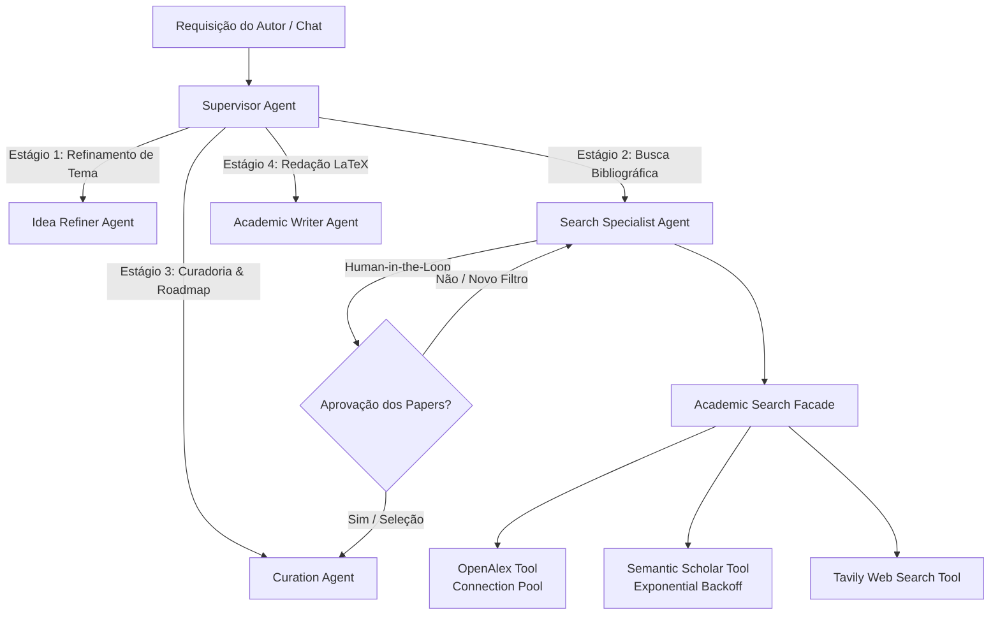
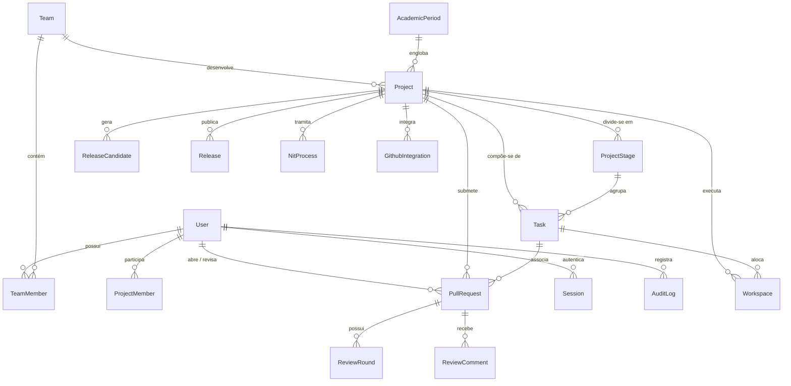
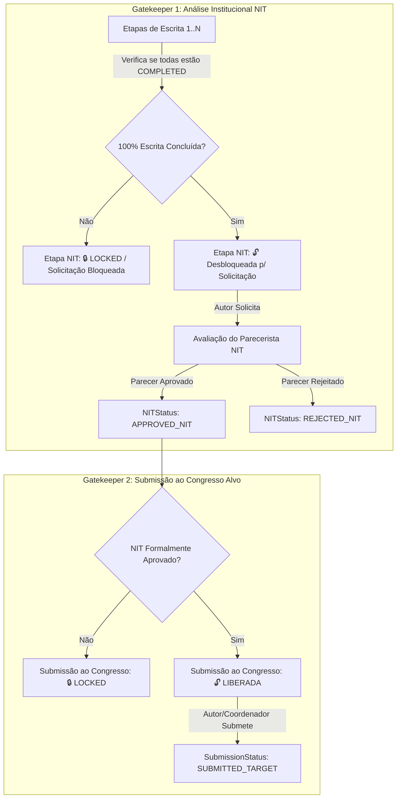
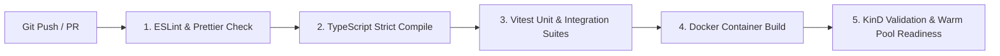

# ⚙️ Documento de Requisitos Técnicos (TRD - Technical Requirements Document)

**Produto:** SCIA — Scientific Collaboration and Intelligent Assistance (Plataforma Web Self-Hosted)  
**Versão:** 2.0 (Consolidada com ADRs 001 a 006 e specs v2.0)  
**Status:** Aprovado / Em Desenvolvimento Ativo  
**Documento de Origem (Produto):** [`PRD.md`](file:///home/gilson-russo/development/professional/sci-latex-vscode/docs/planning/PRD.md)  
**Especificação Técnica Detalhada:** [`specs/system-specs.md`](file:///home/gilson-russo/development/professional/sci-latex-vscode/docs/planning/specs/system-specs.md)  

---

## 📑 1. Identificação, Propósito & Rastreabilidade

### 1.1 Propósito do Documento
O **Technical Requirements Document (TRD)** formaliza a arquitetura de engenharia, contratos de integração, modelos de persistência, requisitos de infraestrutura e padrões de implementação da plataforma **SCIA**. Ele traduz todos os objetivos de negócio, jornadas de usuário e restrições expressas no [`PRD.md`](file:///home/gilson-russo/development/professional/sci-latex-vscode/docs/planning/PRD.md) em requisitos técnicos determinísticos e verificáveis para a equipe de desenvolvimento e DevOps.

### 1.2 Princípios de Engenharia
1. **Padrão de Código Estrito em Inglês:** Todos os identificadores de código (modelos, tabelas, colunas, enums, interfaces, variáveis, métodos, rotas de API, propriedades e classes) devem ser estritamente em **Inglês**. A documentação de arquitetura e comentários de negócio podem ser em **Português**.
2. **Arquitetura 100% Self-Hosted & Infraestrutura Leve:** Eliminação de intermediários pesados (ex: RabbitMQ/Erlang) em favor da compilação TeX nativa no Pod do editor e orquestração direta em Kubernetes local (**KinD**).
3. **GitHub como Fonte Única da Verdade (Single Source of Truth):** Custódia centralizada de artigos científicos via Conta de Serviço com Token de Acesso (`GITHUB_TOKEN`), sem necessidade de configuração de chaves SSH pelos pesquisadores.
4. **Isolamento de Workspaces por Pods Efêmeros:** Workspaces de escrita e revisão executados em containers isolados (`code-server`) montando diretórios específicos de persistência (`subPath`).
5. **Governança por Máquinas de Estado & Gatekeepers Rígidos:** Imposição técnica das travas institucionais do **NIT (Núcleo de Inovação Tecnológica)** e da **Submissão ao Congresso Alvo**, garantindo integridade de propriedade intelectual e prazos.

---

## 🏛️ 2. Arquitetura do Sistema & Topologia de Rede

### 2.1 Visão Geral da Topologia de Serviços

```mermaid
graph TB
    subgraph "Navegador do Usuário (Client Layer)"
        SPA["Frontend SPA (React 19 + TypeScript + Vite)<br/>Porta 5173"]
        Iframe["Iframe Embutido (VS Code Web / code-server)"]
    end

    subgraph "Gateway & Core Backend (Host / Docker Network)"
        Gateway["Fastify Backend Gateway (Node.js 20 + TypeScript)<br/>Porta 3333"]
        ProxyModule["Editor Reverse Proxy (@fastify/http-proxy)<br/>Suporte a HTTP + WebSockets"]
        SSEHub["SSE Hub (Server-Sent Events Broadcast)"]
        GitWorker["GitService (Octokit REST + Git CLI Nativo)"]
        CronWorker["Scheduler (node-cron Prazos & Sweeper)"]
    end

    subgraph "Persistência e Cache"
        Postgres[("PostgreSQL 16 Alpine<br/>Porta 5432 / sci_latex_db")]
        Redis[("Redis 7 Alpine<br/>Porta 6379 / PubSub & TTL")]
    end

    subgraph "Orquestração Kubernetes (KinD Cluster - Rede 'kind')"
        WarmPool["Warm Standby Pool (sci-workspace-warm-*)"]
        ActivePods["Active Pods (sci-workspace-project-*-task-*)<br/>code-server + TeX Live + LaTeX Workshop"]
        PVStorage["Persistência de Arquivos (HostPath / Storage PVC)"]
    end

    subgraph "Camada de Inteligência Científica (ai-service)"
        AIService["SciAI Engine (FastAPI + Python 3.12 + LangGraph)<br/>Porta 8000"]
        MultiAgents["Multi-Agent Graph (Supervisor, IdeaRefiner, Search, Curation, Writer)"]
    end

    subgraph "Serviços Externos Institucionais & Acadêmicos"
        GitHubAPI["GitHub REST & GraphQL API (Projetos & Repositórios)"]
        AcademicAPIs["OpenAlex & Semantic Scholar & Tavily Search"]
    end

    SPA -->|REST API & SSE /api/v1| Gateway
    Iframe -->|Reverse Proxy /editor-proxy/:projectId| ProxyModule
    ProxyModule -->|WebSocket & HTTP Stream| ActivePods
    Gateway -->|Prisma ORM| Postgres
    Gateway -->|Heartbeats, Presença & Lock| Redis
    Gateway -->|K8s SDK Client| WarmPool
    Gateway -->|K8s SDK Client| ActivePods
    ActivePods -->|Montagem de Volume| PVStorage
    Gateway -->|M2M Auth X-Internal-Service-Key| AIService
    AIService --> AcademicAPIs
    GitWorker --> GitHubAPI
```



### 2.2 Tabela de Portas, Endereçamento e Protocolos

| Serviço | Host / Container | Porta Interna | Porta Exposta | Protocolo | Finalidade |
| :--- | :--- | :--- | :--- | :--- | :--- |
| **Frontend** | `sci_latex_frontend` | `5173` | `5173` | HTTP / WS | Aplicação SPA React e servidor de desenvolvimento Vite |
| **Backend** | `sci_latex_backend` | `3333` | `3333` | HTTP / SSE / WS | API REST v1, Gateway SSE e Reverse Proxy para o editor |
| **PostgreSQL** | `sci_latex_postgres` | `5432` | `5432` | TCP | Banco de dados relacional oficial do SCIA |
| **Redis** | `sci_latex_redis` | `6379` | `6379` | TCP / RESP | Controle de presença, locks de edição e heartbeat TTL |
| **SciAI Engine** | `ai-service` | `8000` | `8000` | HTTP / SSE | Motor de agentes de IA, grafos LangGraph e busca acadêmica |
| **Kubernetes (KinD)** | Cluster `kind` | `6443` | `43257` (dinâmica) | HTTPS | API Server do Kubernetes para orquestração de Pods sob demanda |
| **code-server Pod** | Pods isolados K8s | `8080` | ClusterIP dinâmico | HTTP / WS | Instâncias individuais de edição VS Code com TeX Live |

---

## ☸️ 3. Requisitos de Infraestrutura & Workspaces K8s

### 3.1 Ciclo de Vida dos Pods de Edição (On-Demand)
1. **Warm Pool (Pods Pré-aquecidos):** O backend mantém uma piscina permanente de Pods em estado `Idle` (`sci-workspace-warm-*`) para garantir que o tempo de inicialização percebido pelo Autor ou Revisor ao clicar em uma tarefa seja **inferior a 1.5 segundos**.
2. **Alocação Dinâmica por Tarefa:** Ao solicitar acesso à workspace (`GET /editor-proxy/:projectId?taskId=:taskId&stageId=:stageId`), o serviço `K8sPodManagerService`:
   * Verifica se já existe um Pod ativo vinculado à tupla `(projectId, taskId, userId)`.
   * Caso não exista, reivindica um Pod da Warm Pool, reconfigura seus metadados (`labels`, `subPath` do volume) e o associa à workspace no PostgreSQL (`WorkspaceStatus.READY`).
3. **Validação Estrita de `subPath`:** O backend valida continuamente o `volumeMounts[0].subPath` do container. Se a tarefa pertencer a uma etapa específica (`stages/:stageId/tasks/:taskId`) e o Pod estiver montando um caminho divergente, o Pod antigo é automaticamente destruído e recriado com o caminho canônico.
4. **Descomissionamento e Limpeza (Garbage Collection):**
   * **No Merge:** Ao concluir o merge da branch da tarefa na branch `dev`, o Pod é liberado (`releasePodForProject`), o diretório temporário é limpo e a workspace transiciona para `TERMINATED`.
   * **Por Ociosidade (Inactivity Sweeper):** Pods sem heartbeat ativo no Redis por mais de 10 minutos são liberados da memória, preservando os arquivos no volume compartilhado.

### 3.2 Configuração Zen Mode & Sandbox do VS Code
Para manter foco acadêmico estrito e prevenir consumo excessivo de recursos:
* **Desativação de Telemetria:** Telemetria da Microsoft, crash reporters e buscas de atualizações automáticas são desativadas via `settings.json`.
* **Extensões Homologadas:** O container contém exclusivamente a extensão **LaTeX Workshop** e o pacote **TeX Live Full/Medium**. Não é permitido aos usuários instalar extensões arbitrárias no editor embutido.
* **Auto-compilação TeX:** A extensão é pré-configurada para compilar o documento principal (`main.tex`) imediatamente após cada salvamento (`"latex-workshop.latex.autoBuild.run": "onSave"`), gravando o artefato `main.pdf` diretamente na raiz da workspace.



---

## 🐙 4. Requisitos de Versionamento Git & Integração GitHub-Native

### 4.1 Gestão de Credenciais e Repositórios Remotos
1. **Token de Serviço Único (`GITHUB_TOKEN`):** Toda interação com a API remota do GitHub é executada pela aplicação backend utilizando uma Conta de Serviço institucional. 
2. **Fallback para Ambiente de Desenvolvimento:** Caso o ambiente local utilize token dummy ou indefinido, o método `GitService.getEffectiveToken()` executa o fallback transparente via CLI nativa do GitHub (`gh auth token`).
3. **Provisionamento Automático de Repositórios:** Ao criar um novo artigo científico (`Project`), o sistema cria obrigatoriamente um repositório privado no GitHub com o padrão:
   $$	ext{sci-paper-} + 	ext{slug(título)} + 	ext{"-"} + 	ext{UUID.slice(0, 8)}$$
4. **Templates Institucionais (.cls / .sty):** Durante a inicialização do repositório, o arquivo de classe selecionado (IEEEtran, ACM, SBC ou Springer LNCS) e a estrutura base (`main.tex`, `references.bib`, diretórios `sections/` e `figures/`) são provisionados e commitados diretamente na branch `dev` e `main`.

### 4.2 Modelo de Branches & Fluxo de Commits
* **Branch `main`:** Representa a versão canônica e versões publicadas (`Releases`, `ReleaseCandidates` submetidas). Protegida contra escrita direta.
* **Branch `dev`:** Branch de integração contínua do artigo. Recebe os merges das tarefas concluídas.
* **Branch de Tarefa (`task/<slug>-<shortHash>`):** Branch isolada criada a partir de `dev` para cada sub-tarefa de escrita.

```mermaid
gitGraph
    commit id: "Init Template (main.tex)"
    branch dev
    checkout dev
    commit id: "Configuração do Artigo"
    branch task/introducao
    checkout task/introducao
    commit id: "Escrita Seção 1 (Draft PR)"
    commit id: "Correção do Revisor (Round 2)"
    checkout dev
    merge task/introducao id: "Merge pelo Autor (Aprovado)"
    branch task/metodologia
    checkout task/metodologia
    commit id: "Escrita Metodologia"
    checkout dev
    merge task/metodologia id: "Merge pelo Autor (Aprovado)"
    checkout main
    merge dev id: "Release Candidate (NIT Aprovado)"
```

### 4.3 Mecanismo Factual de Commits & Abstração Acadêmica
* **Inspeção via Git CLI Nativo:** O serviço `GitService` executa `git diff HEAD` na árvore de trabalho da tarefa e identifica com precisão arquivos novos, alterados e excluídos.
* **Classificação Acadêmica de Domínio (`ClassificationService`):** O sistema categoriza alterações técnicas para uma linguagem natural amigável ao pesquisador:
  * `sections/*.tex` $
ightarrow$ Categoria `section` ("Seção [Nome]")
  * `main.tex` $
ightarrow$ Categoria `main_structure` ("Estrutura Principal do Artigo")
  * `*.bib` $
ightarrow$ Categoria `references` ("Referências Bibliográficas")
  * `figures/*`, `images/*` $
ightarrow$ Categoria `figures` ("Figuras e Gráficos")
  * `tables/*`, `*.csv` $
ightarrow$ Categoria `tables` ("Tabelas e Dados Numéricos")
* **Autoria e Assinatura Transparente:** O commit silencioso grava a identidade real do usuário logado através do argumento `--author="Nome <email>"`, garantindo auditoria completa no GitHub sem necessidade de chaves de usuário.
* **Geração Automática de Descrição:** Caso o pesquisador não forneça mensagem manual ao salvar o progresso, o backend gera uma síntese factual padronizada (ex: `"Atualizações na Seção Introdução e Referências Bibliográficas"`).

---

## 🤖 5. Requisitos da Camada de Inteligência Artificial (`ai-service`)

### 5.1 Arquitetura da Camada e Grafo Multi-Agente
A camada de IA opera como um microserviço desacoplado em **Python 3.12 + FastAPI + LangGraph**, orquestrando cinco agentes especializados:



### 5.2 Ferramentas de Pesquisa Científica & Resiliência
1. **Academic Search Facade:** Provê ponto único de busca bibliográfica com chaveamento de contingência automático (Semantic Scholar $
ightarrow$ Fallback para OpenAlex).
2. **Pool de Conexões HTTP:** `httpx.AsyncClient` reutilizável com limites de concorrência (`asyncio.Semaphore`) para evitar bloqueios por rate limit das APIs acadêmicas.
3. **Mecanismo de Backoff Exponencial:** Retentativas automáticas em erros HTTP `429 (Too Many Requests)` e `5xx`.

### 5.3 Contrato de Concorrência & Proteção da Workspace
Para impedir que sugestões de IA sobrescrevam alterações recentes do autor no editor:
* **Hash da Árvore de Trabalho (`baseFileHash`):** Ao solicitar uma geração de IA, o frontend envia o SHA-256 do arquivo TeX em edição.
* **Commit Base (`baseCommitSha`):** A proposta de IA vincula-se ao SHA do commit ativo.
* **Validação Pré-Aplicação:** Caso o arquivo em disco tenha sido alterado entre a solicitação e o retorno da IA, a aplicação da sugestão é suspensa e um aviso de conflito é apresentado ao usuário.

### 5.4 Contrato de Endpoints M2M e Streaming SSE

| Endpoint | Método | Autenticação | Descrição |
| :--- | :--- | :--- | :--- |
| `/api/v1/runs` | `POST` | `X-Internal-Service-Key` | Inicia execução assíncrona do grafo multi-agente |
| `/api/v1/runs/:runId/resume` | `POST` | `X-Internal-Service-Key` | Retoma nó pausado por Human-in-the-Loop (`interrupt`) |
| `/api/v1/runs/:runId/cancel` | `POST` | `X-Internal-Service-Key` | Cancela execução em andamento do worker |
| `/api/v1/chat/stream` | `POST` | `Bearer JWT` | Chat interativo streaming SSE com o Copilot Acadêmico |
| `/api/v1/chat/resume` | `POST` | `Bearer JWT` | Envia resposta do autor para perguntas pendentes do agente |

---

## ⚡ 6. Requisitos Técnicos do Backend Fastify & API REST

### 6.1 Padrão Arquitetural em Camadas
O backend é estruturado como um monólito modular com injeção de dependências limpa:
* **Routes (`*Routes.ts`):** Definição de rotas, middlewares de segurança e validação de contratos Zod.
* **Controllers (`*Controller.ts`):** Extração de parâmetros HTTP, mapeamento para DTOs e envio de respostas formatadas.
* **Services (`*Service.ts`):** Regras de negócio, transações ACID, orquestração de Git, pods e emissão de eventos.
* **Repositories / Infra:** Interação isolada com Prisma Client, Octokit, K8s SDK e Redis.

### 6.2 Reverse Proxy para o Editor (`EditorProxyService`)
* **Bypass de Autenticação Segura:** O endpoint base `/editor-proxy/:projectId` exige cookie JWT válido. As requisições de sub-recursos (`/app/*`, scripts JS, fontes, CSS do code-server) e os WebSockets de sincronização (`Upgrade: websocket`) são roteados diretamente para o Pod do usuário sem reprocessamento pesado de sessão.
* **Resiliência a Erros Externos:** Erros de comunicação com o GitHub são mapeados para `502 Bad Gateway`, prevenindo logout inadvertido no frontend por falsos `401 Unauthorized`.

### 6.3 Motor de Notificações em Tempo Real (SSE)
* **Stream Unidirecional Leve:** Implementado via endpoint nativo Fastify (`GET /api/v1/events`), dispensando conexões bidirecionais complexas (WebSockets de aplicação).
* **Topologia de Eventos Emitidos:**
  * `PR_OPENED`: Disparado para todos os membros do projeto quando uma tarefa é submetida para revisão.
  * `PR_REVIEWER_ASSIGNED`: Disparado quando um revisor é atribuído à tarefa.
  * `PR_APPROVED` / `PR_CHANGES_REQUESTED`: Atualiza o painel do autor e libera o botão de merge.
  * `NIT_STATUS_CHANGED`: Notifica a equipe sobre o parecer institucional do NIT.
  * `TASK_UPDATED`: Atualiza o quadro de progresso e prazos dos coordenadores.
  * `HEARTBEAT`: Ping periódico a cada 15s para manter túneis HTTP e proxies reversos abertos.

---

## 🗄️ 7. Requisitos de Modelagem de Dados & Persistência (PostgreSQL)

### 7.1 Diagrama Entidade-Relacionamento (ERD)



### 7.2 Enumerações Canônicas do Sistema

```prisma
enum Role {
  AUTHOR
  REVIEWER
  COORDINATOR
  MANAGER
  ADMIN
}

enum PRStatus {
  DRAFT
  UNDER_REVIEW
  CHANGES_REQUESTED
  APPROVED
  MERGED
  CANCELLED
}

enum NITStatus {
  NOT_REQUIRED
  WAITING_NIT
  APPROVED_NIT
  REJECTED_NIT
}

enum SubmissionStatus {
  IN_PROGRESS
  WAITING_NIT
  SUBMITTED_TARGET
  SUBMITTED_BACKUP
  ACCEPTED_REVISION_REQUESTED
  ACCEPTED_CAMERA_READY
  REJECTED_WAITING_DECISION
  REJECTED_REOPENED_V2
  COMPLETED_PUBLISHED
}

enum StageStatus {
  NOT_STARTED
  IN_PROGRESS
  COMPLETED
  LOCKED
}

enum TaskStatus {
  NOT_STARTED
  IN_PROGRESS
  UNDER_REVIEW
  CHANGES_REQUESTED
  APPROVED
  MERGED
}

enum WorkspaceStatus {
  PROVISIONING
  READY
  DIRTY
  SYNCING
  BEHIND
  CONFLICTED
  ERROR
  TERMINATED
}

enum RCStatus {
  SUBMITTED
  UNDER_REVIEW
  CHANGES_REQUESTED
  APPROVED
}
```

### 7.3 Entidades Principais e Índices de Performance

1. **`User` & `Session`:** Controle de acesso com senhas em Argon2/bcrypt e rotação de Refresh Tokens criptográficos com expiração absoluta.
2. **`Project` & `ProjectStage`:** Cronograma de escrita paralela com ordenação estrita (`@@unique([projectId, order])`).
3. **`Task`:** Tarefas atômicas de redação atreladas a uma branch Git dedicada (`branchName`).
4. **`PullRequest`, `ReviewRound` & `ReviewComment`:** Gestão de revisões viva com rastreamento do commit submetido (`submittedCommitHash`) e ancoragem de comentários por linha do arquivo TeX.
5. **`Workspace`:** Associação dinâmica de Pods K8s indexada por unicidade `@@unique([projectId, userId, stageId, taskId])`.
6. **`AuditLog`:** Trilha imutável em JSONB registrando `userId`, `action`, `entityType`, `entityId` e `details` de todas as operações sensíveis.
7. **Projeções do GitHub:** `GithubIssueProjection` e `GithubProjectItemProjection` sincronizadas via webhooks para viabilizar consultas instantâneas na Dashboard sem sobrecarregar a API do GitHub.

---

## 🔒 8. Requisitos de Segurança, Autenticação & Governança

### 8.1 Autenticação Segura (OWASP Compliant)
* **Tokens em Cookies HTTP-Only:** O `accessToken` e o `refreshToken` são transmitidos exclusivamente através de cookies protegidos com as flags `HttpOnly`, `Secure` (em produção) e `SameSite=Lax`.
* **Zero Exposição em URLs:** É expressamente proibida a passagem de tokens sensíveis como parâmetros de consulta em URLs (`?token=...`), mitigando riscos de vazamento em logs de proxy e histórico de navegação.

### 8.2 Matriz de Controle de Acesso Baseada em Papel (RBAC)

| Funcionalidade / Recurso | Autor (`AUTHOR`) | Revisor (`REVIEWER`) | Coordenador (`COORDINATOR`) | Gerente (`MANAGER`) | Administrador (`ADMIN`) |
| :--- | :---: | :---: | :---: | :---: | :---: |
| **Escrever no VS Code da Tarefa** | ✅ (Atribuída) | ❌ | ❌ | ❌ | ✅ |
| **Salvar Progresso (Commit Silencioso)** | ✅ | ❌ | ❌ | ❌ | ✅ |
| **Submeter p/ Revisão Acadêmica** | ✅ | ❌ | ❌ | ❌ | ✅ |
| **Acessar Visão Diff & PDF Revisor** | 👁️ (Somente Leitura) | ✅ | ✅ | 👁️ | ✅ |
| **Emitir Parecer (Aprovar / Ajustes)** | ❌ | ✅ | ✅ | ❌ | ✅ |
| **Executar Merge da Tarefa** | ✅ (Se Aprovada) | ❌ | ✅ | ❌ | ✅ |
| **Solicitar Avaliação do NIT** | ✅ (100% Escrito) | ❌ | ✅ | ❌ | ✅ |
| **Registrar Parecer Institucional NIT**| ❌ | ✅ | ✅ | ✅ | ✅ |
| **Submeter ao Congresso Alvo** | ✅ (NIT Aprovado)| ❌ | ✅ | ❌ | ✅ |
| **Alocar Membros e Prazos do Time**| ❌ | ❌ | ✅ | ✅ | ✅ |
| **Definir Metas por Ciclo Acadêmico** | ❌ | ❌ | ❌ | ✅ | ✅ |

### 8.3 Implementação dos Dois Gatekeepers Rígidos



1. **Gatekeeper 1 (NIT):** A etapa de submissão ao NIT é marcada no banco como `StageStatus.LOCKED`. A mutação `POST /projects/:id/nit/request` valida em transação atômica se `every(stages.writing.status === COMPLETED)`. Caso haja etapa pendente, rejeita a requisição com `HTTP 409 Conflict`.
2. **Gatekeeper 2 (Congresso Alvo):** A transição de submissão do artigo (`POST /projects/:id/submit-target`) valida se `nitStatus === APPROVED_NIT`. Nenhum arquivo ou versão do artigo é liberada para submissão oficial sem o protocolo e parecer favorável do NIT.

---

## 💻 9. Requisitos Técnicos do Frontend (React 19 SPA)

### 9.1 Padrões de Código e Separação de Responsabilidades (SoC)
* **Tipagem Estrita sem `any`:** Todos os contratos de dados, respostas de API e propriedades de componentes utilizam interfaces e tipos TypeScript consolidados em `src/constants/` e `src/@types/`.
* **Named Exports Exclusivos:** Adoção de `export const ComponentName = ...` em 100% dos componentes, telas e utilitários, eliminando `export default` para maior previsibilidade de imports e suporte a refatorações automáticas.
* **Encapsulamento de Mutações com TanStack Query:** Componentes de interface (como modais e formulários) não invocam `api.post` ou `api.patch` diretamente. Todas as operações de mutação e invalidação de cache são isoladas em hooks especializados (`useTaskQueries`, `useProjectQueries`, `useManagementQueries`).
* **Resolução de Avisos e Performance:** Proibição de chamadas assíncronas soltas (`@typescript-eslint/no-floating-promises`); callbacks de mutação (`onSuccess`, `onError`) são encapsulados em funções assíncronas com tratamento correto de promessas.

### 9.2 Interface do Revisor: Comparador Side-by-Side
* **Diff Visual LaTeX Nativo:** Integração do visualizador de diferenças destacando adições, exclusões e modificações relativas à versão anterior ou à branch `dev`.
* **Visualizador de PDF Compilado:** Renderização lado a lado do PDF oficial gerado na rodada de revisão (`output.pdf`), permitindo validação visual imediata de diagramas, fórmulas matemáticas e referências bibliográficas.
* **Gaveta Retrátil de Feedback (Drawer):** Painel expansível contendo a listagem cronológica de apontamentos anteriores com indicador da linha (`lineNumer`) e formulário para emissão do veredito com uma das ações:
  * *Apenas Comentar*
  * *Solicitar Alterações (`CHANGES_REQUESTED`)*
  * *Aprovar Tarefa (`APPROVED`)*

---

## 📊 10. Requisitos Não-Funcionais & SLOs/SLAs de Desempenho

| Critério | Métrica / SLO | Mecanismo de Garantia Técnica |
| :--- | :--- | :--- |
| **Inicialização de Workspace** | $< 1.5	ext{ segundos}$ | Warm Standby Pool mantendo Pods K8s pré-aquecidos |
| **Compilação TeX no Salvamento** | $< 2.0	ext{ segundos}$ | Compilação nativa no container via LaTeX Workshop (sem filas) |
| **Latência de Notificação SSE** | $< 150	ext{ ms}$ | Conexões HTTP `keep-alive` persistentes e canal Fastify direto |
| **Tempo de Resposta REST API (P95)**| $< 100	ext{ ms}$ | Projeções locais no PostgreSQL e eliminação de chamadas síncronas ao GitHub |
| **Pegada de Memória do Servidor** | $< 500	ext{ MB RAM}$ (Backend + BD + Redis) | Remoção do cluster RabbitMQ/Erlang (~300MB economizados) |
| **Preservação de Dados** | Zero Perda ($RPO = 0$) | Repositório privado no GitHub como *Single Source of Truth* |
| **Disponibilidade Operacional** | $99.5\%$ | Auto-recuperação de Pods via K8s Controller e healthchecks Docker |

---

## 🧪 11. Estratégia de Testes, Validação de Qualidade & CI/CD

### 11.1 Pirâmide de Testes e Metas de Cobertura
1. **Testes Unitários de Domínio:** Validação das regras de negócio de prazos (`deadline.utils`), classificação de arquivos (`ClassificationService`), geração de mensagens e cálculos de progresso via **Vitest**. Meta: $\ge 85\%$ de cobertura em `src/utils/` e `src/services/`.
2. **Testes de Integração de API:** Validação de endpoints Fastify via **Supertest / Fastify Inject**, garantindo autenticação JWT, validação Zod e operações de transação Prisma. Mínimo de 18 suítes / 60+ testes passando continuamente.
3. **Análise Estática de Código:**
   * Execução mandatória de `npm run lint` com zero erros e zero avisos permitidos.
   * Execução de `npm run format:check` garantindo formatação rigorosa via Prettier.
   * Compilação TypeScript de produção (`npm run build`) com zero erros de checagem de tipos.

### 11.2 Pipeline de Integração e Deploy Contínuo (CI/CD)


---

## 🗺️ 12. Matriz de Rastreabilidade (PRD $\longleftrightarrow$ TRD)

| Seção do PRD | Requisito do Produto | Implementação Técnica (TRD) | Componentes & Módulos |
| :--- | :--- | :--- | :--- |
| **PRD §1: Visão & Problema** | Compilação TeX sem configuração local | Edição e compilação nativa em Pods `code-server` com TeX Live | `K8sPodManagerService`, `code-server-template.yaml` |
| **PRD §1: Visão & Problema** | Versionamento e custódia institucional | Provisionamento remoto no GitHub via Token de Serviço | `GitService`, Octokit SDK, `GithubIntegration` |
| **PRD §2: Personas** | Atribuições de Autor, Revisor, Coordenador e Gerente | Matriz RBAC, guards Fastify e filtros na SPA por permissão | `RoleGuard`, `User.role`, `useAuth`, `RoleLayoutResolver` |
| **PRD §2: Personas** | Suporte a Múltiplos Gerentes por departamento | Modelo `Team.managerId` e visões por Período Acadêmico | `AcademicPeriod`, `TeamAcademicGoal`, `managerRoutes` |
| **PRD §3: Fase 1** | Timeline de etapas paralelas e prazos | Estrutura de etapas com datas planejadas e ordenação estrita | `ProjectStage`, `tasksService`, `GanttTimelineView` |
| **PRD §3: Fase 2** | Escrita paralela & commits silenciosos | Branches `task/*`, `git diff HEAD`, classificação e `--author` | `ClassificationService`, `GitService`, `SaveProgressModal` |
| **PRD §3: Fase 3** | Revisão acadêmica contínua | Draft PRs, promoção para review, comparador side-by-side e rounds | `PullRequest`, `ReviewRound`, `ReviewDetailPage`, SSE Hub |
| **PRD §3: Fase 4** | Gatekeeper 1: Análise do NIT | Trava sequencial `LOCKED`, validação atômica de 100% das etapas | `NitProcess`, `POST /nit/request`, `AuditLog` |
| **PRD §3: Fase 5** | Merge pelo Autor na dev/main | Validação de aprovação do revisor, merge via Git e limpeza de Pod/PVC | `mergePullRequest`, `releasePodForProject`, `cleanProjectPVC` |
| **PRD §3: Fase 6** | Gatekeeper 2: Submissão ao Congresso | Trava de submissão externa condicionada a `APPROVED_NIT` | `POST /submit-target`, `Project.submissionStatus` |
| **PRD §3: Fase 7** | Pós-submissão & Decisão (Aceito/v2/Backup)| Modais de metadados finais (DOI), reabertura v2 e congresso backup | `PostSubmissionModal`, `ReleaseCandidate`, `Release` |
| **PRD §4: Arquitetura** | Editor Zen Mode em Iframe | Configuração restrita `settings.json`, sem telemetria, proxy reverso | `EditorProxyService`, `@fastify/http-proxy`, Iframe |
| **PRD §4: Arquitetura** | Sincronização em tempo real sem reload | Stream HTTP Server-Sent Events e invalidação com TanStack Query | `eventsRoutes`, `useSSEEventSource`, `QueryClient` |

---

## 📚 13. Referências e Documentos Complementares

* 📄 **Documento de Requisitos do Produto:** [`PRD.md`](file:///home/gilson-russo/development/professional/sci-latex-vscode/docs/planning/PRD.md)
* 🔄 **Documento de Fluxos da Aplicação (App Flows):** [`APP_FLOWS.md`](file:///home/gilson-russo/development/professional/sci-latex-vscode/docs/planning/APP_FLOWS.md)
* 📘 **Especificação Técnica Geral:** [`specs/system-specs.md`](file:///home/gilson-russo/development/professional/sci-latex-vscode/docs/planning/specs/system-specs.md)
* 📐 **Planejamento de Arquitetura & Infra K8s:** [`specs/architecture-plan.md`](file:///home/gilson-russo/development/professional/sci-latex-vscode/docs/planning/specs/architecture-plan.md)
* ⚙️ **Especificações Backend:** [`specs/backend-specs.md`](file:///home/gilson-russo/development/professional/sci-latex-vscode/docs/planning/specs/backend-specs.md)
* 🎨 **Especificações Frontend:** [`specs/frontend-specs.md`](file:///home/gilson-russo/development/professional/sci-latex-vscode/docs/planning/specs/frontend-specs.md)
* 🤖 **Contratos de Integração SciAI:** [`specs/sciai-contracts-spec.md`](file:///home/gilson-russo/development/professional/sci-latex-vscode/docs/planning/specs/sciai-contracts-spec.md)
* 📌 **Status Atual e Guia de Retomada:** [`STATUS.md`](file:///home/gilson-russo/development/professional/sci-latex-vscode/docs/planning/STATUS.md)
