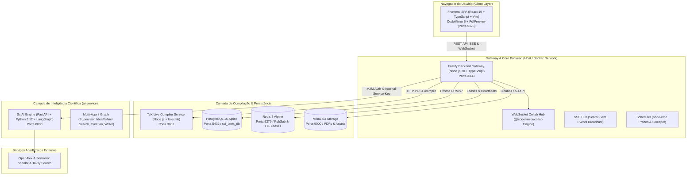
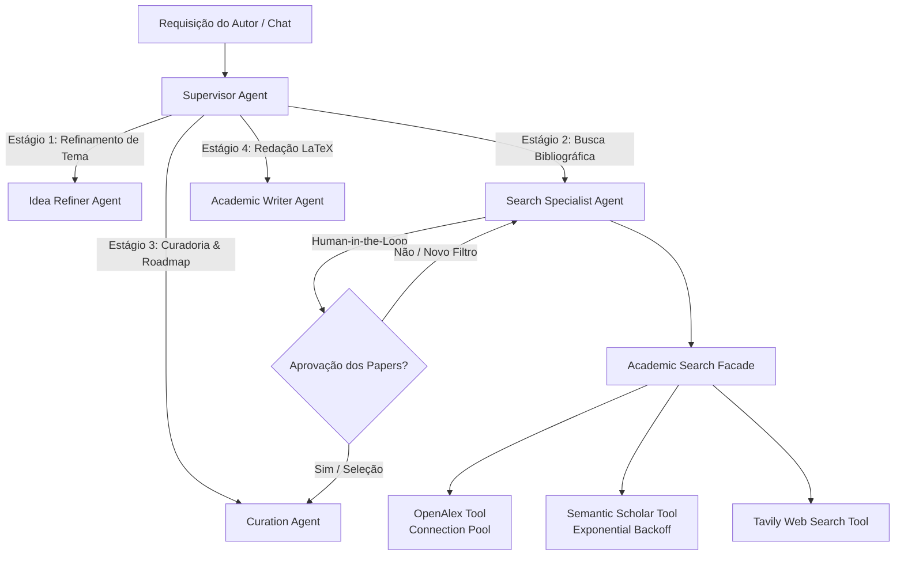
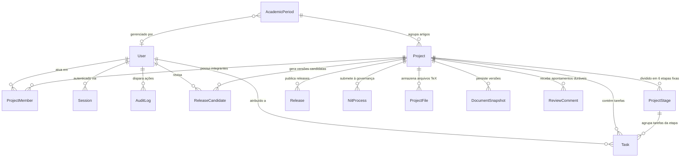
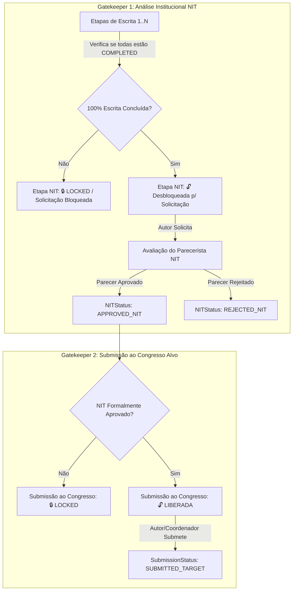
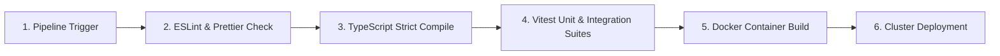

# ⚙️ Documento de Requisitos Técnicos (TRD - Technical Requirements Document)

**Produto:** SCIA — Scientific Collaboration and Intelligent Assistance (Plataforma Web Self-Hosted)  
**Versão:** 3.0 (Consolidada com ADRs 007, 007.1, 008 e 010)  
**Status:** Aprovado / Em Desenvolvimento Ativo  
**Documento de Origem (Produto):** [`PRD.md`](file:///home/gilson-russo/development/professional/sci-latex-vscode/docs/planning/PRD.md)  
**Especificações Complementares:** [`specs/reviewer-view-spec.md`](specs/reviewer-view-spec.md) | [`specs/sciai-contracts-spec.md`](specs/sciai-contracts-spec.md)  
---

## 📑 1. Identificação, Propósito & Rastreabilidade

### 1.1 Propósito do Documento
O **Technical Requirements Document (TRD)** formaliza a arquitetura de engenharia, contratos de integração, modelos de persistência, requisitos de infraestrutura e padrões de implementação da plataforma **SCIA**. Ele traduz todos os objetivos de negócio, jornadas de usuário e restrições expressas no [`PRD.md`](file:///home/gilson-russo/development/professional/sci-latex-vscode/docs/planning/PRD.md) em requisitos técnicos determinísticos e verificáveis para a equipe de desenvolvimento e DevOps.

### 1.2 Princípios de Engenharia
1. **Padrão de Código Estrito em Inglês:** Todos os identificadores de código (modelos, tabelas, colunas, enums, interfaces, variáveis, métodos, rotas de API, propriedades e classes) devem ser estritamente em **Inglês**. A documentação de arquitetura e comentários de negócio podem ser em **Português**.
2. **Arquitetura 100% Self-Hosted & Infraestrutura Leve:** Eliminação de intermediários pesados em favor do editor web-nativo CodeMirror 6, microserviço de compilação TeX Live (`sci-latex-compiler`) e orquestração direta em Kubernetes local (**KinD**).
3. **PostgreSQL como Única Fonte de Verdade Persistente (ADR-007 / ADR-008):** Custódia centralizada e durável de metadados, arquivos e snapshots TeX via transações ACID no PostgreSQL com Prisma v7 (`@prisma/adapter-pg`).
4. **Edição Colaborativa Single-Writer com Fencing Monotônico (ADR-007.1):** Coordenação distribuída entre Pods via leases no Redis (TTL 15s / Heartbeat 2s / Failsafe 8s) e validação estrita de posse no PostgreSQL (`ownerGeneration`).
5. **Governança por Máquinas de Estado & Gatekeepers Rígidos:** Imposição técnica das travas institucionais do **NIT (Núcleo de Inovação Tecnológica)** e da **Submissão ao Congresso Alvo**, garantindo integridade de propriedade intelectual e prazos.
---

## 🏛️ 2. Arquitetura do Sistema & Topologia de Rede

### 2.1 Visão Geral da Topologia de Serviços



### 2.2 Tabela de Portas, Endereçamento e Protocolos

| Serviço | Host / Container | Porta Interna | Porta Exposta | Protocolo | Finalidade |
| :--- | :--- | :--- | :--- | :--- | :--- |
| **Frontend** | `sci_latex_frontend` | `5173` | `5173` | HTTP / WS | Aplicação SPA React e servidor de desenvolvimento Vite |
| **Backend** | `sci_latex_backend` | `3333` | `3333` | HTTP / SSE / WS | API REST v1, Gateway SSE e Hub WebSocket de Colaboração |
| **PostgreSQL** | `sci_latex_postgres` | `5432` | `5432` | TCP | Banco de dados relacional oficial do SCIA (ACID) |
| **Redis** | `sci_latex_redis` | `6379` | `6379` | TCP / RESP | Controle de presença, leases de posse e heartbeat TTL |
| **TeX Compiler** | `sci-latex-compiler` | `3001` | `3001` | HTTP | Microserviço TeX Live / latexmk para compilação síncrona |
| **MinIO S3** | `sci-latex-minio` | `9000` / `9001`| `9000` / `9001`| HTTP | Storage S3-compatible para PDFs compilados e figuras |
| **SciAI Engine** | `ai-service` | `8000` | `8000` | HTTP / SSE | Motor de agentes de IA, grafos LangGraph e busca acadêmica |
| **Kubernetes (KinD)** | Cluster `kind` | `6443` | `43257` (dinâmica) | HTTPS | API Server do Kubernetes para orquestração de Pods sob demanda |

## ☸️ 3. Requisitos de Infraestrutura, Compilação TeX & Auto-Scaling (HPA)

### 3.1 Microserviço de Compilação TeX Live (`sci-latex-compiler`)
1. **Isolamento de Processamento Pesado:** A compilação TeX Live e a geração de PDFs são desacopladas da API REST do backend, executando em um microserviço síncrono dedicado (`sci-latex-compiler`, porta 3001) baseado em Node.js com TeX Live e utilitário `latexmk`.
2. **Execução Segura em Diretório Efêmero:**
   * Ao receber a requisição de compilação com o arquivo principal e arquivos secundários (.tex, .bib, figuras), o serviço cria um diretório temporário isolado em `/tmp/compilations/<id>`;
   * Invoca `latexmk -pdf -interaction=nonstopmode -synctex=1 main.tex` com timeout de proteção de 60 segundos;
   * Captura stdout/stderr estruturados e mapeia erros de sintaxe TeX com número de linha e contexto (`parseLatexCompilerError`);
   * Retorna o buffer do PDF gerado ou payload de diagnósticos e limpa o diretório de compilação.
3. **Auto-Scaling Horizontal Gradual (HPA no Kubernetes):**
   * **Backend Fastify (`sci-latex-backend`):** Baseline de 2 pods, escala até 6 réplicas com target de CPU em 70% e memória em 75% (`stabilizationWindowSeconds: 300` para scale-down suave).
   * **Compilador TeX (`sci-latex-compiler`):** Baseline de 1 pod, escala até 4 réplicas com target de CPU em 80%.

### 3.2 Gerenciamento de Presença e Leases Efêmeros no Redis
1. **Leases de Posse de Documento (Single-Writer):** Chave `editor:document:<projectId>:owner` com TTL de 15 segundos renovada a cada 2 segundos via heartbeat do Pod dono (ADR-007.1).
2. **Presença em Tempo Real:** Chave `workspace:active:<mode>:<projectId>:<userId>:<taskId>` com TTL de 180 segundos renovada a cada 20 segundos via Web Worker isolado no frontend (ADR-004).

---

## ✍️ 4. Requisitos do Motor de Edição Colaborativa e Persistência Confiável (ADR-007 / ADR-007.1 / ADR-008 / ADR-010)

### 4.1 Arquitetura Single-Writer com `@codemirror/collab`
1. **Zero Keystrokes no Banco e no Redis:** A digitação em alta frequência transita exclusivamente entre o navegador do usuário e a memória RAM do Pod Fastify responsável pela sala (`activeDocs`). Nenhuma tecla gera operações síncronas de I/O em disco ou rede no Redis.
2. **Autoridade Central de Ordenação (OT):** O Pod dono sequencia as operações, atribui numeração monotônica de versões e realiza `rebaseUpdates` para reconciliar edições simultâneas de coautores.
3. **Versionamento Relacional Nativo (ADR-008):** Todo o histórico é mantido através de deltas em memória e snapshots relacionais no PostgreSQL, com auditoria estrita e restauração pontual.

### 4.2 Fencing Monotônico de Posse (`ownerGeneration`)
Para prevenir corrupção por Pods zumbis durante pausas prolongadas de Garbage Collection ou partições de rede:
1. **Etapa 1 (Handshake no Banco):** Ao adquirir o lease no Redis (`generation: N`), o Pod dono executa imediatamente:
   ```sql
   UPDATE "Project" SET "ownerGeneration" = :newGen WHERE id = :projectId AND "ownerGeneration" < :newGen;
   ```
2. **Etapa 2 (Checkpoint Protegido com Dupla Barreira):**
   ```sql
   UPDATE "Project"
   SET "currentVersion" = :newVersion, "ownerGeneration" = :myGen, "updatedAt" = NOW()
   WHERE id = :projectId AND "ownerGeneration" = :myGen AND "currentVersion" = :expectedVersion;
   ```
3. **Reconciliação Local do Cliente:** Se um Pod antigo for rejeitado (`rows_affected == 0`), ele encerra o WebSocket com erro `4409 Fencing Conflict`. O cliente CodeMirror 6 retém suas operações pendentes em buffer local (`sendableUpdates`) e as rebaseia automaticamente ao reconectar com o novo Pod dono.

### 4.3 Persistência Híbrida com Debounce e Apontamentos Duráveis
1. **Gatilhos de Checkpoint:**
   * *Idle Timer:* 3 segundos de inatividade;
   * *MaxWait Ceiling:* 15 segundos ininterruptos sob digitação contínua;
   * *Volume Threshold:* 50 operações atômicas acumuladas;
   * *Fechamento de Sala:* Saída do último usuário conectado.
2. **Entidades Persistidas no Checkpoint (`prisma.$transaction`):**
   * `Project`: Atualização de `currentVersion` e `ownerGeneration`;
   * `ProjectFile`: Conteúdo textual atualizado de `main.tex` e arquivos secundários;
   * `DocumentSnapshot`: Criação de ponto de restauração histórico do artigo;
   * `ReviewComment`: Persistência durável de anotações inline, seleções de texto, status e threads de respostas (ADR-010).
3. **Armazenamento de Binários Pesados no MinIO (S3):** PDFs compilados, imagens 300 DPI e templates são enviados ao MinIO, armazenando apenas o `storageKey` ou URL no PostgreSQL.

## 🤖 5. Requisitos da Camada de Inteligência Artificial (`ai-service`)

### 5.1 Arquitetura da Camada e Grafo Multi-Agente
A camada de IA opera como um microserviço desacoplado em **Python 3.12 + FastAPI + LangGraph**, orquestrando cinco agentes especializados:



### 5.2 Ferramentas de Pesquisa Científica & Resiliência
1. **Academic Search Facade:** Provê ponto único de busca bibliográfica com chaveamento de contingência automático (Semantic Scholar $
ightarrow$ Fallback para OpenAlex).
2. **Pool de Conexões HTTP:** `httpx.AsyncClient` reutilizável com limites de concorrência (`asyncio.Semaphore`) para evitar bloqueios por rate limit das APIs acadêmicas.
3. **Mecanismo de Backoff Exponencial:** Retentativas automáticas em erros HTTP `429 (Too Many Requests)` e `5xx`.

### 5.3 Contrato de Concorrência & Proteção da Workspace
Para impedir que sugestões de IA sobrescrevam alterações recentes do autor no editor:
* **Hash da Árvore de Trabalho (`baseFileHash`):** Ao solicitar uma geração de IA, o frontend envia o SHA-256 do arquivo TeX em edição.
* **Commit Base (`baseCommitSha`):** A proposta de IA vincula-se ao SHA do commit ativo.
* **Validação Pré-Aplicação:** Caso o arquivo em disco tenha sido alterado entre a solicitação e o retorno da IA, a aplicação da sugestão é suspensa e um aviso de conflito é apresentado ao usuário.

### 5.4 Contrato de Endpoints M2M e Streaming SSE

| Endpoint | Método | Autenticação | Descrição |
| :--- | :--- | :--- | :--- |
| `/api/v1/runs` | `POST` | `X-Internal-Service-Key` | Inicia execução assíncrona do grafo multi-agente |
| `/api/v1/runs/:runId/resume` | `POST` | `X-Internal-Service-Key` | Retoma nó pausado por Human-in-the-Loop (`interrupt`) |
| `/api/v1/runs/:runId/cancel` | `POST` | `X-Internal-Service-Key` | Cancela execução em andamento do worker |
| `/api/v1/chat/stream` | `POST` | `Bearer JWT` | Chat interativo streaming SSE com o Copilot Acadêmico |
| `/api/v1/chat/resume` | `POST` | `Bearer JWT` | Envia resposta do autor para perguntas pendentes do agente |

---

## ⚡ 6. Requisitos Técnicos do Backend Fastify & API REST

### 6.1 Padrão Arquitetural em Camadas
O backend é estruturado como um monólito modular com injeção de dependências limpa:
* **Routes (`*Routes.ts`):** Definição de rotas, middlewares de segurança e validação de contratos Zod.
* **Controllers (`*Controller.ts`):** Extração de parâmetros HTTP, mapeamento para DTOs e envio de respostas formatadas.
* **Services (`*Service.ts`):** Regras de negócio, transações ACID, controle de concorrência/posse e emissão de eventos.
* **Repositories / Infra:** Interação isolada com Prisma Client, MinIO S3 SDK e Redis.

### 6.2 Hub WebSocket de Colaboração (`DocumentCollabWebSocket`)
* **Gerenciamento de Salas e Sincronização:** O endpoint `/ws/documents/:projectId` autentica a conexão via cookie JWT e registra o cliente no canal do documento ativo (`documents.websocket.ts`).
* **Engine de Transformação Operacional (OT):** Integração direta com `documents.service.ts` e `@codemirror/collab` para handshake de versões (`SYNC_INIT`), submissão de deltas (`PUSH_UPDATES`), difusão de atualizações para coautores (`PULL_UPDATES_RESPONSE`) e propagação em tempo real de cursores remotos.
### 6.3 Motor de Notificações em Tempo Real (SSE)
* **Stream Unidirecional Leve:** Implementado via endpoint nativo Fastify (`GET /api/v1/events`), dispensando conexões bidirecionais complexas (WebSockets de aplicação).
* **Topologia de Eventos Emitidos:**
  * `TASK_REVIEW_REQUESTED`: Disparado para coautores e revisores quando uma tarefa é submetida para revisão.
  * `TASK_CHANGES_REQUESTED`: Notifica o autor sobre apontamentos de revisão pendentes.
  * `TASK_COMPLETED`: Atualiza o painel e cronograma Gantt com a conclusão da tarefa.
  * `STAGE_UPDATED`: Atualiza o status da etapa (1 a 6) e destrava etapas subsequentes no Gantt.
  * `NIT_STATUS_CHANGED`: Notifica a equipe sobre o parecer institucional do NIT.
  * `HEARTBEAT`: Ping periódico a cada 20s para manter conexões SSE ativas.
---

## 🗄️ 7. Requisitos de Modelagem de Dados & Persistência (PostgreSQL)

### 7.1 Diagrama Entidade-Relacionamento (ERD)



### 7.2 Enumerações Canônicas do Sistema

```prisma
enum Role {
  AUTHOR
  REVIEWER
  COORDINATOR
  MANAGER
  ADMIN
}

enum NITStatus {
  NOT_REQUIRED
  WAITING_NIT
  APPROVED_NIT
  REJECTED_NIT
}

enum SubmissionStatus {
  IN_PROGRESS
  WAITING_NIT
  SUBMITTED_TARGET
  SUBMITTED_BACKUP
  ACCEPTED_REVISION_REQUESTED
  ACCEPTED_CAMERA_READY
  REJECTED_WAITING_DECISION
  REJECTED_REOPENED_V2
  COMPLETED_PUBLISHED
}

enum DeadlineStatus {
  ON_TIME
  WARNING_SOON
  OVERDUE
}

enum PeriodStatus {
  ACTIVE
  ARCHIVED
  COMPLETED
}

enum StageStatus {
  NOT_STARTED
  IN_PROGRESS
  COMPLETED
  LOCKED
}

enum TaskStatus {
  NOT_STARTED
  IN_PROGRESS
  REVIEW_REQUESTED
  IN_REVIEW
  CHANGES_REQUESTED
  COMPLETED
}

enum RCStatus {
  SUBMITTED
  UNDER_REVIEW
  CHANGES_REQUESTED
  APPROVED
}
```

### 7.3 Entidades Principais e Índices de Performance

1. **`User` & `Session`:** Controle de acesso com senhas em Argon2/bcrypt e rotação de Refresh Tokens criptográficos com expiração absoluta.
2. **`Project`:** Entidade mestra com controle de concorrência e posse (`currentVersion`, `ownerGeneration`), vinculada a `coordinatorId` e `managerId`.
3. **`ProjectStage`:** Cronograma de 6 etapas fixas com ordenação estrita (`@@unique([projectId, order])`).
4. **`Task`:** Tarefas atômicas de escrita científica com ciclo iterativo de revisão entre autor e orientador (`TaskStatus`).
5. **`ProjectFile`:** Conteúdo textual durável (.tex e .bib) e referências a binários (`storageKey`), indexado por `@@unique([projectId, path])`.
6. **`ReviewComment`:** Apontamentos inline duráveis ancorados por offset de caracteres (`from`, `to`), com suporte a threads de respostas e resolução (`open` / `resolved`).
7. **`DocumentSnapshot`:** Pontos de restauração históricos completos do artigo gerados por checkpoints debounced.
8. **`AuditLog`:** Trilha imutável em JSONB registrando `userId`, `action`, `entityType`, `entityId` e `details` de todas as operações sensíveis, com relação polimórfica desvinculada.
---

## 🔒 8. Requisitos de Segurança, Autenticação & Governança

### 8.1 Autenticação Segura (OWASP Compliant)
* **Tokens em Cookies HTTP-Only:** O `accessToken` e o `refreshToken` são transmitidos exclusivamente através de cookies protegidos com as flags `HttpOnly`, `Secure` (em produção) e `SameSite=Lax`.
* **Zero Exposição em URLs:** É expressamente proibida a passagem de tokens sensíveis como parâmetros de consulta em URLs (`?token=...`), mitigando riscos de vazamento em logs de proxy e histórico de navegação.

### 8.2 Matriz de Controle de Acesso Baseada em Papel (RBAC)

| Funcionalidade / Recurso | Autor (`AUTHOR`) | Revisor (`REVIEWER`) | Coordenador (`COORDINATOR`) | Gerente (`MANAGER`) | Administrador (`ADMIN`) |
| :--- | :---: | :---: | :---: | :---: | :---: |
| **Editar no CodeMirror 6** | ✅ (Atribuída) | ❌ (Read-Only) | ❌ | ❌ | ✅ |
| **Inserir Apontamento Inline** | ✅ | ✅ | ✅ | ❌ | ✅ |
| **Solicitar Revisão de Tarefa** | ✅ | ❌ | ❌ | ❌ | ✅ |
| **Acessar Visão Geral & Parecer** | 👁️ (Somente Leitura) | ✅ | ✅ | 👁️ | ✅ |
| **Emitir Parecer (Aprovar / Ajustes)**| ❌ | ✅ | ✅ | ❌ | ✅ |
| **Concluir Tarefa na Etapa 3** | ✅ (Se Aprovada) | ❌ | ✅ | ❌ | ✅ |
| **Aprovar Revisão Geral (Etapa 4)** | ❌ | ✅ | ✅ | ❌ | ✅ |
| **Solicitar Avaliação do NIT** | ✅ (Etapa 4 Aprovada)| ❌ | ✅ | ❌ | ✅ |
| **Registrar Parecer Institucional NIT**| ❌ | ✅ | ✅ | ✅ | ✅ |
| **Submeter ao Congresso Alvo** | ✅ (NIT Aprovado)| ❌ | ✅ | ❌ | ✅ |
| **Alocar Membros e Prazos do Projeto**| ❌ | ❌ | ✅ | ✅ | ✅ |
| **Definir Metas por Ciclo Acadêmico** | ❌ | ❌ | ❌ | ✅ | ✅ |
### 8.3 Implementação dos Dois Gatekeepers Rígidos



1. **Gatekeeper 1 (NIT):** A etapa de submissão ao NIT é marcada no banco como `StageStatus.LOCKED`. A mutação `POST /projects/:id/nit/request` valida em transação atômica se `every(stages.writing.status === COMPLETED)`. Caso haja etapa pendente, rejeita a requisição com `HTTP 409 Conflict`.
2. **Gatekeeper 2 (Congresso Alvo):** A transição de submissão do artigo (`POST /projects/:id/submit-target`) valida se `nitStatus === APPROVED_NIT`. Nenhum arquivo ou versão do artigo é liberada para submissão oficial sem o protocolo e parecer favorável do NIT.

---

## 💻 9. Requisitos Técnicos do Frontend (React 19 SPA)

### 9.1 Padrões de Código e Separação de Responsabilidades (SoC)
* **Tipagem Estrita sem `any`:** Todos os contratos de dados, respostas de API e propriedades de componentes utilizam interfaces e tipos TypeScript consolidados em `src/constants/` e `src/@types/`.
* **Named Exports Exclusivos:** Adoção de `export const ComponentName = ...` em 100% dos componentes, telas e utilitários, eliminando `export default` para maior previsibilidade de imports e suporte a refatorações automáticas.
* **Encapsulamento de Mutações com TanStack Query:** Componentes de interface (como modais e formulários) não invocam `api.post` ou `api.patch` diretamente. Todas as operações de mutação e invalidação de cache são isoladas em hooks especializados (`useTaskQueries`, `useProjectQueries`, `useManagementQueries`).
* **Resolução de Avisos e Performance:** Proibição de chamadas assíncronas soltas (`@typescript-eslint/no-floating-promises`); callbacks de mutação (`onSuccess`, `onError`) são encapsulados em funções assíncronas com tratamento correto de promessas.

### 9.2 Interface do Revisor: CodeMirror Read-Only & Anotações Ancoradas
* **Modo Estrito de Leitura:** CodeMirror 6 recebe dinamicamente a extensão `EditorState.readOnly.of(true)`, prevenindo edições acidentais no código LaTeX enquanto mantém total interatividade.
* **Visualizador de PDF Compilado:** Renderização lado a lado do PDF oficial gerado pelo compilador (`PdfPreview`), permitindo validação visual imediata de diagramas, fórmulas matemáticas e referências bibliográficas.
* **Gaveta Lateral de Feedback (`ReviewSidebar`):** Painel retrátil contendo listagem cronológica de apontamentos ancorados por offsets de caracteres (`from`, `to`), com formulário de resposta em thread e resolução de pendências (ADR-010).
---

## 📊 10. Requisitos Não-Funcionais & SLOs/SLAs de Desempenho

| Critério | Métrica / SLO | Mecanismo de Garantia Técnica |
| :--- | :--- | :--- |
| **Inicialização do Editor** | $< 800\text{ ms}$ | Carregamento web-nativo do CodeMirror 6 a partir de snapshots em PostgreSQL |
| **Compilação TeX no Salvamento** | $< 2.0\text{ segundos}$ | Microserviço síncrono dedicado `sci-latex-compiler` TeX Live (latexmk) |
| **Latência de Notificação SSE** | $< 150\text{ ms}$ | Conexões HTTP `keep-alive` persistentes e canal Fastify direto |
| **Tempo de Resposta REST API (P95)**| $< 100\text{ ms}$ | Consultas otimizadas com Prisma v7 e índices compostos no PostgreSQL |
| **Pegada de Memória do Servidor** | $< 500\text{ MB RAM}$ (Backend + BD + Redis) | Monólito modular Fastify sem dependência de containers pesados por usuário |
| **Preservação de Dados** | Zero Perda ($RPO = 0$) | Transações ACID no PostgreSQL com debounce híbrido e Fencing Monotônico |
| **Disponibilidade Operacional** | $99.5\%$ | Auto-recuperação de Pods via K8s Controller e healthchecks Docker |
---

## 🧪 11. Estratégia de Testes, Validação de Qualidade & CI/CD

### 11.1 Pirâmide de Testes e Metas de Cobertura
1. **Testes Unitários de Domínio:** Validação das regras de negócio de prazos (`deadline.utils`), classificação de arquivos (`ClassificationService`), geração de mensagens e cálculos de progresso via **Vitest**. Meta: $\ge 85\%$ de cobertura em `src/utils/` e `src/services/`.
2. **Testes de Integração de API:** Validação de endpoints Fastify via **Supertest / Fastify Inject**, garantindo autenticação JWT, validação Zod e operações de transação Prisma. Mínimo de 18 suítes / 60+ testes passando continuamente.
3. **Análise Estática de Código:**
   * Execução mandatória de `npm run lint` com zero erros e zero avisos permitidos.
   * Execução de `npm run format:check` garantindo formatação rigorosa via Prettier.
   * Compilação TypeScript de produção (`npm run build`) com zero erros de checagem de tipos.

### 11.2 Pipeline de Integração e Deploy Contínuo (CI/CD)


---

## 🗺️ 12. Matriz de Rastreabilidade (PRD $\longleftrightarrow$ TRD)
| Seção do PRD | Requisito do Produto | Implementação Técnica (TRD) | Componentes & Módulos |
| :--- | :--- | :--- | :--- |
| **PRD §1: Visão & Problema** | Compilação TeX sem configuração local | Compilação isolada no microserviço dedicado TeX Live | `sci-latex-compiler`, `useLatexCompiler` |
| **PRD §1: Visão & Problema** | Versionamento e custódia durável | Snapshots e deltas de Transformação Operacional no PostgreSQL | `ProjectFile`, `DocumentSnapshot`, Prisma ORM |
| **PRD §2: Personas** | Atribuições de Autor, Revisor, Coordenador e Gerente | Matriz RBAC, guards Fastify e filtros na SPA por permissão | `RoleGuard`, `User.role`, `useAuth`, `RoleLayoutResolver` |
| **PRD §2: Personas** | Suporte a Múltiplos Gerentes por departamento | Relação direta `Project.managerId` e visões por Período Acadêmico | `AcademicPeriod`, `managerRoutes`, `ManagerDashboardPage` |
| **PRD §3: Etapa 1 a 3** | Linha do tempo das 6 etapas fixas | Cronograma imutável com datas planejadas e tarefas paralelas | `ProjectStage`, `Task`, `GanttTimelineView`, `tasksService` |
| **PRD §3: Etapa 3** | Escrita colaborativa em tempo real | CodeMirror 6 com `@codemirror/collab` e debounce híbrido | `documents.service.ts`, `documents.websocket.ts`, `CodeMirrorEditor` |
| **PRD §3: Etapa 4** | Revisão Técnica e Científica (Geral) | CodeMirror Read-Only para revisor e comentários ancorados | `ReviewSidebar`, `ReviewComment`, `commentsExtension` |
| **PRD §3: Etapa 5** | Gatekeeper 1: Análise Institucional do NIT | Trava sequencial `LOCKED`, validação atômica da Etapa 4 | `NitProcess`, `POST /nit/request`, `AuditLog` |
| **PRD §3: Etapa 6** | Gatekeeper 2: Submissão ao Congresso | Trava de submissão externa condicionada a `APPROVED_NIT` | `POST /submit-target`, `Project.submissionStatus` |
| **PRD §3: Pós-Submissão** | Decisão Pós-Submissão (Aceito/v2/Backup) | Modais de metadados finais (DOI), reabertura v2 e congresso backup | `ReleaseCandidatesModal`, `ReleaseCandidate`, `Release` |
| **PRD §4: Arquitetura** | Editor Colaborativo Web-Nativo | CodeMirror 6, OT em RAM e Single-Writer Lease no Redis | `RedisService`, `documents.repository.ts`, `CollabEditorContext` |
| **PRD §4: Arquitetura** | Sincronização em tempo real sem reload | Stream HTTP Server-Sent Events e invalidação com TanStack Query | `events.manager.ts`, `useSSEEventSource`, `QueryClient` |
---

## 📚 13. Referências e Documentos Complementares

* 📄 **Documento de Requisitos do Produto:** [`PRD.md`](file:///home/gilson-russo/development/professional/sci-latex-vscode/docs/planning/PRD.md)
* 🔄 **Documento de Fluxos da Aplicação (App Flows):** [`APP_FLOWS.md`](file:///home/gilson-russo/development/professional/sci-latex-vscode/docs/planning/APP_FLOWS.md)
* 🔍 **Especificação da Visão do Revisor:** [`specs/reviewer-view-spec.md`](file:///home/gilson-russo/development/professional/sci-latex-vscode/docs/planning/specs/reviewer-view-spec.md)
* 🤖 **Contratos de Integração SciAI:** [`specs/sciai-contracts-spec.md`](file:///home/gilson-russo/development/professional/sci-latex-vscode/docs/planning/specs/sciai-contracts-spec.md)
* 💬 **Chat Copilot & Onboarding Multi-Agente:** [`specs/sciai-chat-copilot-spec.md`](file:///home/gilson-russo/development/professional/sci-latex-vscode/docs/planning/specs/sciai-chat-copilot-spec.md)
* 🗄️ **Documentação Técnica do Banco de Dados:** [`DATABASE.md`](file:///home/gilson-russo/development/professional/sci-latex-vscode/docs/DATABASE.md)
* 🎨 **SCIA Design System:** [`DESIGN_SYSTEM.md`](file:///home/gilson-russo/development/professional/sci-latex-vscode/docs/DESIGN_SYSTEM.md)
* 📋 **Plano Mestre de Implementação:** [`IMPLEMENTATION_PLAN.md`](file:///home/gilson-russo/development/professional/sci-latex-vscode/docs/IMPLEMENTATION_PLAN.md)
* 📌 **Status Atual e Guia de Retomada:** [`STATUS.md`](file:///home/gilson-russo/development/professional/sci-latex-vscode/docs/planning/STATUS.md)
