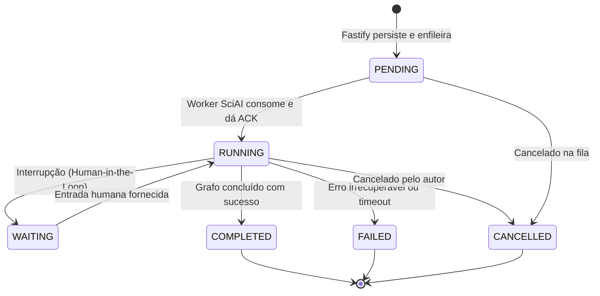

# ADR 006: Modelo de Integração da Inteligência Artificial Científica (SciAI) com a Plataforma SCIA

- **Status:** APROVADO
- **Data:** 11 de Outubro de 2026
- **Autor(es):** Equipe de Arquitetura SCIA
- **Domínio:** Inteligência Artificial, Arquitetura de Serviços, Governança Acadêmica e Integração de Dados
- **Componentes Relacionados:** `backend` (Fastify / TypeScript), `SciAI` (FastAPI / LangGraph / Python), `infra/redis`, `infra/k8s`

---

## 1. Contexto & Desafio

A plataforma **SCIA** é o ambiente corporativo de escrita científica, governança em 6 etapas fixas, editor web-nativo CodeMirror 6 com Transformação Operacional e persistência transacional em PostgreSQL.

Paralelamente, o projeto **`sci-project` (SciAgent OS)** desenvolveu o motor de pesquisa acadêmica multi-agente utilizando **LangGraph, LangChain, OpenAlex, Semantic Scholar, Tavily e Ollama**.

Surgiu a necessidade de definir como integrar a inteligência científica à plataforma SCIA sem comprometer:
1. **A governança institucional estrita:** O fluxo de 6 etapas fixas e a trava do **NIT (Núcleo de Inovação Tecnológica)**.
2. **A performance e estabilidade:** O backend Fastify (I/O intensivo de baixa latência e sincronização de edição em tempo real) não pode ser bloqueado por tarefas de IA que levam de 30 a 90 segundos.
3. **A integridade dos dados:** Evitar que agentes de IA tenham acesso irrestrito às tabelas do banco de dados ou alterem o estado de tarefas por conta própria.
---

## 2. Decisão Arquitetural Adotada

Ficou decidido estruturar a integração com base em **cinco pilares arquiteturais fundamentais**:

```mermaid
graph TD
    subgraph Client ["Interface do Usuário (React 19)"]
        UI[Frontend SCIA]
    end

    subgraph Authority ["Autoridade da Plataforma (Fastify / TypeScript)"]
        FastifyAPI[Fastify API & RBAC]
        Governance[Motor de Governança & Gatekeeper NIT]
        EventStream[SSE Event Hub]
    end

    subgraph Broker ["Mensageria & Estado Operacional"]
        RedisQueue[(Redis: Fila de Tarefas & Status de Runs)]
    end

    subgraph AI_Engine ["Motor Científico Isolado (SciAI - Python / FastAPI)"]
        SciAIService[SciAI API]
        LangGraphCore[LangGraph Multi-Agent Engine]
        Checkpointer[(Postgres Checkpointer: Memória dos Agentes)]
    end

    subgraph External ["Fontes Acadêmicas & Modelos"]
        ScholarSources[OpenAlex / Semantic Scholar / Tavily]
        LLMModels[Ollama / Claude / OpenAI]
    end

    UI -->|1. Solicita Ação de IA| FastifyAPI
    FastifyAPI -->|2. Valida Autorização & Cria run_id| RedisQueue
    FastifyAPI -->|3. Dispara Run Assíncrono| SciAIService
    FastifyAPI -.->|4. Streaming de Progresso (SSE)| UI
    SciAIService -->|Executa Grafo| LangGraphCore
    LangGraphCore --> Checkpointer
    LangGraphCore --> ScholarSources
    LangGraphCore --> LLMModels
    SciAIService -->|Publica Progresso| RedisQueue
    SciAIService -->|5. Retorna Proposta Estruturada| FastifyAPI
    UI -->|6. Autor aceita e aplica| FastifyAPI
    FastifyAPI -->|7. Efetiva mutação| Governance
```

---

### Decisão 1: Preservação do Python para o Motor de IA (SciAI como Serviço Independente com Worker Dedicado)
* O núcleo de agentes (`app/agents/`) do `sci-project` será mantido em **Python 3.12 / FastAPI** rodando como um serviço independente no Kubernetes (KinD) ou container Docker na rede interna.
* **Worker Dedicado:** O SciAI executa um processo *Worker* dedicado responsável por consumir as mensagens da fila e processar os grafos do LangGraph, evitando que o servidor web do FastAPI bloqueie ou dependa de tarefas voláteis em memória (`BackgroundTasks`).

---

### Decisão 2: Fastify como Autoridade Exclusiva & Segurança M2M (Zero-Trust Interno)
* O backend **Fastify / TypeScript** permanece como o único ponto de entrada para o frontend e o guardião da verdade do negócio.
* **Segurança Entre Serviços (M2M):**
  1. A comunicação ocorre exclusivamente na rede interna do cluster (`http://sci-ai-service.scia.svc.cluster.local:8000`).
  2. As requisições utilizam autenticação máquina-a-máquina com token de serviço interno de curta duração (`X-Internal-Service-Key`).
  3. **Princípio do Menor Privilégio:** O SciAI **não recebe** credenciais do banco de dados do SCIA nem o JWT com permissões amplas do usuário; recebe apenas o payload contextual estritamente necessário (ex: ID da tarefa, texto da seção a ser pesquisada).
  4. O SciAI aplica limites rígidos de timeout, tamanho de payload e concorrência máxima de grafos.

---

### Decisão 3: Propriedade Lógica Estrita de Dados & Delimitação de Fontes da Verdade
É vedado o compartilhamento indiscriminado de tabelas ou acesso cruzado direto de ORMs entre Fastify (Prisma) e SciAI (SQLModel/SQLAlchemy):
* **Domínio Fastify/Prisma:** Usuários, permissões, projetos, tarefas, etapas acadêmicas, revisões e aprovações NIT.
* **Domínio SciAI/LangGraph:** Checkpoints transacionais dos grafos, memória interna de nós e histórico de buscas.
* **Domínio do Editor em Tempo Real (Memória RAM do Pod Dono):** Estado quente de digitação sob Transformação Operacional centralizada.
* **Domínio Relacional (PostgreSQL):** Fonte da verdade persistente de arquivos (`ProjectFile`), snapshots (`DocumentSnapshot`), anotações (`ReviewComment`) e propostas estruturadas (`ai_proposals`).
---

### Decisão 4: Máquina de Estados Operacional e Fila Durável (`run_id`)
Para eliminar janelas de inconsistência e perda de trabalhos em reinicializações de Pods:



1. **Papéis na Fila e Persistência:**
   * **Persistência Durável:** O Fastify persiste o `run_id` e seu estado operacional no **PostgreSQL de negócio (`ai_runs`)** antes de publicar na fila. O Redis atua exclusivamente como transporte de mensagens e pub/sub de eventos.
   * **Produtor:** Fastify registra a execução com status inicial obrigatório `PENDING`.
   * **Consumidor:** O worker do SciAI processa a fila, confirma recebimento (ACK), transita o estado durável para `RUNNING` e executa o LangGraph com garantia de idempotência.
2. **Dissociação de Estados:**
   * **Estado Operacional:** `PENDING`, `RUNNING`, `WAITING`, `COMPLETED`, `FAILED`, `CANCELLED` gerenciado no PostgreSQL/Redis pelo Fastify para acompanhamento do usuário e recuperação pós-falha.
   * **Checkpoint do LangGraph:** Estado interno dos nós do grafo gravado no Postgres do SciAI para retomada transparente de interrupções.

---

### Decisão 5: Princípio de Propostas Estruturadas com Detecção de Conflito (`baseVersion` + `baseFileHash`)
A inteligência artificial **recomenda e produz minutas**, mas **nunca altera o estado de governança**:
* A saída da IA é sempre uma **Proposta Estruturada** contendo a `baseVersion` e o `baseFileHash` (SHA-256 do arquivo) do momento em que a geração iniciou:
  ```typescript
  type AiProposal = {
    id: string;
    runId: string;
    projectId: string;
    taskId?: string;
    reviewStatus: "PENDING_REVIEW" | "ACCEPTED" | "REJECTED" | "EXPIRED";
    applyStatus: "NOT_APPLIED" | "APPLYING" | "APPLIED" | "CONFLICT" | "APPLY_FAILED";
    summary: string;
    references: Array<{
      title: string;
      doi?: string;
      url?: string;
    }>;
    changes: Array<{
      path: string;
      baseVersion: number;
      baseFileHash: string; // SHA-256 do arquivo original
      diff: string;
    }>;
  };
  ```
* **Proteção contra Sobrescrita Cega de Arquivos em Edição:** Se o autor editar o arquivo no CodeMirror enquanto a IA estiver pesquisando, o Fastify detecta que o `baseFileHash` atual mudou e bloqueia a aplicação automática, exigindo revisão visual manual do conflito.
* **Atomicidade:** A aplicação de patches pelo Fastify é transacional (com rollback automático em caso de falha de I/O).
* A aceitação de uma proposta pelo autor aplica o texto no documento ativo, mas **não equivale** à aprovação de Gatekeeper do NIT nem à conclusão de etapa.
---

## 3. Alternativas Rejeitadas & Análise de Trade-offs

| Alternativa | Motivo da Rejeição |
| :--- | :--- |
| **Alternativa A: Camada Interna 100% TypeScript (LangGraph.js no Fastify)** | Rejeitada para o MVP. Embora unificasse a linguagem, exigiria reescrever todos os sub-agentes, prompts e conectores de busca acadêmica de Python para TypeScript, atrasando a validação sem ganho arquitetural real. |
| **Alternativa B: Chamadas HTTP Síncronas Longas (`POST /ai/generate`)** | Rejeitada. Conexões abertas por mais de 30-60 segundos causam timeouts em proxies reversos, falhas ao navegar entre abas e perda de execução se o pod reiniciar. |
| **Alternativa C: Acesso Direto da IA ao Banco da Aplicação (Shared Database)** | Rejeitada por acoplamento severo. Permitir que a IA escreva diretamente em tarefas ou projetos quebraria as travas de governança do NIT e criaria conflitos de migração entre Prisma e Alembic. |

---

## 4. O que NÃO Fazer na Fase de MVP (Anti-Overengineering)

1. ❌ **Não introduzir orquestradores pesados de workflow (Temporal, Celery):** A fila nativa em Redis com semântica explícita de entrega já supre a demanda do MVP.
2. ❌ **Não fragmentar cada agente em um microserviço diferente:** O serviço SciAI é uma unidade coesa que contém o supervisor e seus nós especialistas.
3. ❌ **Não expor o serviço Python diretamente para o navegador:** Todo tráfego passa pela autenticação e auditoria do Fastify.
4. ❌ **Não permitir escritas não coordenadas:** Qualquer alteração no texto LaTeX transita pelo motor colaborativo oficial.
---

## 5. Roteiro Incremental de Implementação

1. **Sprint IA-1 (Serviço SciAI & Contratos M2M):** Isolar o módulo `app/agents/` do `sci-project`, criar o worker e expor os endpoints internos com autenticação via `X-Internal-Service-Key`.
2. **Sprint IA-2 (Fila, Máquina de Estados & SSE):** Implementar no Fastify o produtor de execuções com a máquina de estados (`PENDING` ➡️ `RUNNING` ➡️ `COMPLETED`), persistência e despacho de eventos via SSE.
3. **Sprint IA-3 (Contrato AiProposal & Resolução de Conflitos):** Implementar a geração da proposta com `baseCommitSha`, validação de conflito de versão e interface no frontend para o autor aprovar o diff visual.

---

## 6. Consequências da Decisão

- **Positivas:**
  - Preserva todo o esforço de engenharia já investido no motor de IA do `sci-project`.
  - Garante resiliência e estabilidade absoluta da plataforma principal SCIA.
  - Elimina riscos de concorrência com o `baseFileHash` nas propostas de IA.
  - Mantém a governança das 6 etapas fixas e a trava do NIT 100% invioláveis.
- **Negativas / Desafios:**
  - Manutenção de duas stacks (Node.js e Python) no repositório de infraestrutura.
  - Necessidade de gerenciar a máquina de estados e expiração de propostas pendentes no Fastify.

