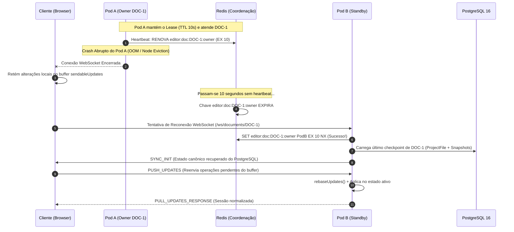

# ADR 007: Arquitetura, Persistência e Escalabilidade do Editor Colaborativo

- **Status:** APROVADO
- **Data:** 24 de Outubro de 2026
- **Autor(es):** Equipe de Engenharia e Arquitetura SCIA
- **Domínio:** Edição Colaborativa em Tempo Real, Persistência Transacional, Orquestração Kubernetes
- **Componentes Relacionados:** `frontend` (CodeMirror 6 / `@codemirror/collab`), `backend` (Fastify / `documents.service.ts` / WebSockets), `infra/redis` (Coordenação & Lease), `PostgreSQL` (Fonte de Verdade)

---

## 1. Contexto & Desafio

O SCIA adota o **CodeMirror 6** com a extensão **`@codemirror/collab`** para escrita científica colaborativa. A sincronização de texto utiliza Transformação Operacional com Rebase (Single-Leader OT), onde o servidor sequencia atualizações e atribui versões canônicas estritas.

Uma auditoria técnica no código revelou quatro fragilidades arquiteturais críticas que impediam a operação segura em ambiente de produção:

1. **Vício de Infraestrutura no Redis:** A cada tecla digitada, o backend executava `rpush` em listas transitórias (`collab:doc:${id}:ops`), mas **nenhuma rotina lia ou recuperava essas operações**. O Redis operava como um sumidouro cego de operações de texto, consumindo I/O e RAM sem agregar durabilidade real.
2. **Debounce Infinito sob Digitação Contínua:** O checkpoint no PostgreSQL dependia exclusivamente de um timer de inatividade de 3 segundos (`setTimeout`). Sob digitação contínua, o timer era reiniciado a cada caractere, impedindo qualquer gravação no banco por minutos ou horas e criando uma grave janela de perda de dados em caso de crash.
3. **Incompatibilidade com Múltiplas Réplicas (Kubernetes):** O estado `activeDocs` reside na memória do processo Node.js. Sem afinidade de tráfego, dois pods atendendo o mesmo documento causariam *split-brain*, divergência de versões e sobrescrita mútua no banco.
4. **Instabilidade do WebSocket na Troca de Abas:** O hook do frontend recriava e derrubava a conexão WebSocket a cada clique em arquivos secundários (`activeFile`), gerando reconexões desnecessárias.

Fazia-se imperativo adotar um desenho de arquitetura limpo e comprovado pela indústria (como o padrão operacional do **Overleaf**), eliminando redundâncias e definindo claramente o papel de cada tecnologia.

---

## 2. Decisão Arquitetural Adotada

Fica estabelecido o modelo arquitetural baseado em **cinco pilares fundamentais**:

```
┌────────────────────────────────────────────────────────────────────────┐
│                        ARQUITETURA CANÔNICA DO EDITOR                  │
├────────────────────┬────────────────────┬──────────────┬───────────────┤
│ Frontend           │ Backend Fastify    │ Redis 7      │ PostgreSQL 16 │
├────────────────────┼────────────────────┼──────────────┼───────────────┤
│ - CodeMirror 6     │ - Document Owner   │ - Ownership  │ - Fonte de    │
│ - Zero Latência    │   (Single Writer)  │   Lease TTL  │   Verdade     │
│ - WS Estável       │ - @cm/collab em RAM│ - Presença   │ - Snapshots   │
│ - Buffer Local     │ - Rebase Server    │ - Eventos de │ - ProjectFile │
│   Resiliente       │ - Flush Híbrido    │   Negócio    │ - Versão ACID │
└────────────────────┴────────────────────┴──────────────┴───────────────┘
```

### Pilar 1: PostgreSQL como Única Fonte de Verdade Persistente
O PostgreSQL com Prisma é a única autoridade durável para o conteúdo dos arquivos (`ProjectFile.content`) e histórico de versões (`DocumentSnapshot`). Nenhuma operação do editor é considerada finalizada até ser confirmada pelo PostgreSQL. O MongoDB foi rejeitado por não atender à governança relacional do SCIA (NIT, ciclos e auditoria).

### Pilar 2: Remoção do Redis do Caminho de Cada Tecla (*Zero Keystrokes no Redis*)
O Redis **não** atua como banco de dados de edição, nem como buffer transitório de operações de texto. O `rpush` e o `del` de deltas no Redis são **completamente eliminados**. A digitação transita exclusivamente:
$$\text{Cliente (CodeMirror)} \xrightarrow{\text{WebSocket}} \text{Memória do Pod Dono} \xrightarrow{\text{Flush Periódico}} \text{PostgreSQL}$$

### Pilar 3: Escala por Documento (*Document Ownership / Single-Writer*)
Não se escala o editor replicando operações do mesmo documento entre pods via Pub/Sub. **A escala horizontal ocorre por partição de documentos**:
* Cada documento ativo possui exatamente **um Pod Dono (*Document Owner*)** responsável por sequenciar operações, aplicar `rebaseUpdates` e fazer broadcast na sala.
* O Redis é utilizado unicamente para coordenar a posse do documento via chave de lease com TTL de 10 segundos:
  ```
  SET editor:document:<documentId>:owner "<podId>" EX 10 NX
  ```
* O Ingress do Kubernetes (ou proxy reverso inteligente) roteia todos os WebSockets de um mesmo `documentId` para o Pod que detém o lease.

### Pilar 4: Persistência com Debounce Híbrido e Concorrência Otimista
Para mitigar a perda de dados sem sobrecarregar o banco, o checkpoint no PostgreSQL obedece a regras multi-critério:
1. **Idle Timer:** 3 segundos sem novas digitações.
2. **MaxWait Ceiling:** Forçar gravação a cada 15 segundos de digitação contínua.
3. **Volume Threshold:** Forçar gravação a cada 50 operações atômicas pendentes.
4. **Fechamento de Sala:** Gravação imediata na desconexão do último autor ativo.
5. **Concorrência Otimista:** O `UPDATE` no PostgreSQL valida a versão anterior (`WHERE id = :id AND "currentVersion" = :expectedVersion`), barrando gravações de pods zumbis.

### Pilar 5: Estabilidade de Conexão no Frontend
O WebSocket do editor deve ser resiliente e independente da aba de visualização:
* A troca de abas (`main.tex` $\to$ `references.bib`) trafega eventos de seleção sobre o mesmo socket aberto, sem desconexões cíclicas.
* Em instabilidades de rede, as alterações pendentes permanecem no buffer do CodeMirror (`sendableUpdates`) e são descarregadas automaticamente ao reabrir a conexão.

---

## 3. Diagrama da Arquitetura Target

```mermaid
flowchart TD
    subgraph Clients["Camada de Apresentação (Navegador)"]
        UserA["Autor A (CodeMirror 6)"]
        UserB["Autor B (CodeMirror 6)"]
    end

    subgraph IngressK8s["Roteamento Kubernetes"]
        IngressRouter["Ingress / Gateway (Afinidade por /ws/documents/:id)"]
    end

    subgraph PodCluster["Cluster de Pods Fastify Backend"]
        Pod1["Pod Backend 1 (Owner: DOC-1, DOC-4)"]
        Pod2["Pod Backend 2 (Owner: DOC-2, DOC-3)"]
    end

    subgraph RedisCoord["Coordenação Distribuída (Redis 7)"]
        DocLease["Document Leases (editor:doc:*:owner, TTL 10s)"]
        PlatformEvents["Eventos de Negócio (Tarefas, NIT)"]
    end

    subgraph StorageTier["Camada de Persistência Confiável"]
        PG[("PostgreSQL 16 (Fonte de Verdade)")]
        MinIO[("MinIO S3 (PDFs e Imagens)")]
    end

    UserA <-->|WebSocket: /ws/documents/DOC-1| IngressRouter
    UserB <-->|WebSocket: /ws/documents/DOC-1| IngressRouter
    
    IngressRouter -->|Encaminha para o Pod Dono| Pod1
    
    Pod1 <-->|Heartbeat a cada 3s (Renova Lease)| DocLease
    Pod1 -->|Flush Híbrido: Idle 3s / Max 15s / 50 ops| PG
    Pod1 -->|Assets Binários| MinIO
```

---

## 4. Ciclo de Vida e Recuperação de Falhas (Failover)



---

## 5. Plano de Implementação Detalhado

O plano de execução está dividido em quatro etapas sequenciais e cirúrgicas:

### Fase 1: Limpeza do Hot Path e Correção do Debounce no Backend
- [x] **Remover Redis do caminho de escrita:**
  - Arquivo: `backend/src/modules/documents/documents.service.ts`
  - Ação: Excluir `redisPubClient.rpush('collab:doc:${documentId}:ops', ...)` e `redisPubClient.del(...)`.
- [x] **Implementar Flush Híbrido Multi-Critério:**
  - Arquivo: `backend/src/modules/documents/documents.service.ts`
  - Ação: Adicionar controle de `maxWaitTimer` (15 segundos ininterruptos) e corte por volume (`active.pendingOps >= 50`).
- [x] **Graceful Shutdown do Processo:**
  - Arquivo: `backend/src/server.ts`
  - Ação: Registrar tratadores de `SIGTERM` e `SIGINT` que executam `flushCheckpoint()` em todos os documentos ativos antes de fechar o pool de conexões do Prisma.

### Fase 2: Estabilização do WebSocket e Gestão Multi-Arquivo no Frontend
- [x] **Desacoplar o Socket da Alternância de Arquivos:**
  - Arquivo: `frontend/src/features/editor/hooks/useCollabWebSocket.ts`
  - Ação: Remover `activeFile` do array de dependências do `useEffect`.
- [x] **Fila de Reconexão Offline (Retry Queue):**
  - Arquivo: `frontend/src/features/editor/hooks/useCollabWebSocket.ts`
  - Ação: Em vez de descartar deltas quando `readyState !== OPEN`, enfileirar em buffer e descarregar no evento `onopen`.
- [x] **Versionamento Isolado por Arquivo:**
  - Arquivo: `frontend/src/features/editor/context/CollabEditorContext.tsx`
  - Ação: Rastrear `fileCollabVersions: Record<string, number>` em vez de uma versão global única vinculada a `main.tex`.

### Fase 3: Concorrência Otimista e Transacionalidade no PostgreSQL
- [x] **Update Condicional com Bloqueio de Concorrência:**
  - Arquivo: `backend/src/modules/documents/documents.repository.ts`
  - Ação: Modificar `updateContent` para verificar `currentVersion` anterior. Abortar e emitir log de alerta caso `count === 0`.
- [x] **Transação Atômica Global para Checkpoints:**
  - Arquivo: `backend/src/modules/documents/documents.service.ts` e `documents.repository.ts`
  - Ação: Unificar a atualização de `ProjectFile` (`main.tex`), arquivos secundários (`filesCollab`) e `DocumentSnapshot` em uma única chamada `prisma.$transaction`.

### Fase 4: Coordenação de Posse (Document Ownership Lease) via Redis
- [x] **Implementar Serviço de Lease Distribuído:**
  - Arquivo: `backend/src/infra/redis/redis.service.ts`
  - Ação: Adicionar métodos `acquireDocumentLease(docId, podId, ttl)` e `renewDocumentLease(docId, podId, ttl)`.
- [x] **Controle de Liderança no WebSocket:**
  - Arquivo: `backend/src/modules/documents/documents.websocket.ts`
  - Ação: Ao receber conexão, validar ou reivindicar a posse do documento. Configurar heartbeat periódico de renovação a cada 3 segundos.
- [x] **Descarte de Memória Inativa (*Eviction*):**
  - Arquivo: `backend/src/modules/documents/documents.service.ts`
  - Ação: Quando uma sala permanecer com zero conexões por mais de 10 minutos, realizar o flush final e remover o documento do Map `activeDocs`.

---

## 6. Consequências e Trade-offs

### Consequências Positivas:
1. **Redução Drástica de I/O Desnecessário:** Elimina centenas de operações inúteis de gravação por segundo no Redis.
2. **Eliminação do Risco de Perda por Digitação Contínua:** O teto de 15 segundos garante checkpoints periódicos mesmo durante redação intensa e contínua.
3. **Escalabilidade Horizontal Segura:** O modelo de Single-Writer com Lease no Redis impede split-brain e viabiliza a execução em múltiplos pods no Kubernetes.
4. **Resiliência do Cliente:** Troca de abas instantânea no editor sem desconexões ou recarregamentos de página.

### Trade-offs Aceitos:
* **Janela de Perda Limitada ao Intervalo de Checkpoint:** Em caso de morte súbita do pod (`SIGKILL`), as alterações realizadas nos últimos 3 a 15 segundos (desde o último checkpoint) não persistidas no PostgreSQL serão perdidas. Trata-se de um compromisso deliberado e padrão da indústria (idêntico ao Overleaf e Google Docs) para evitar a sobrecarga de I/O de um `fsync` a cada tecla.
* **Janela de Failover de 10 Segundos:** Se um pod falecer, a sala aguarda até 10 segundos para o lease expirar no Redis antes que outro pod assuma a autoridade do documento. Durante este breve intervalo, os clientes permanecem em estado de reconexão transparente no frontend.
