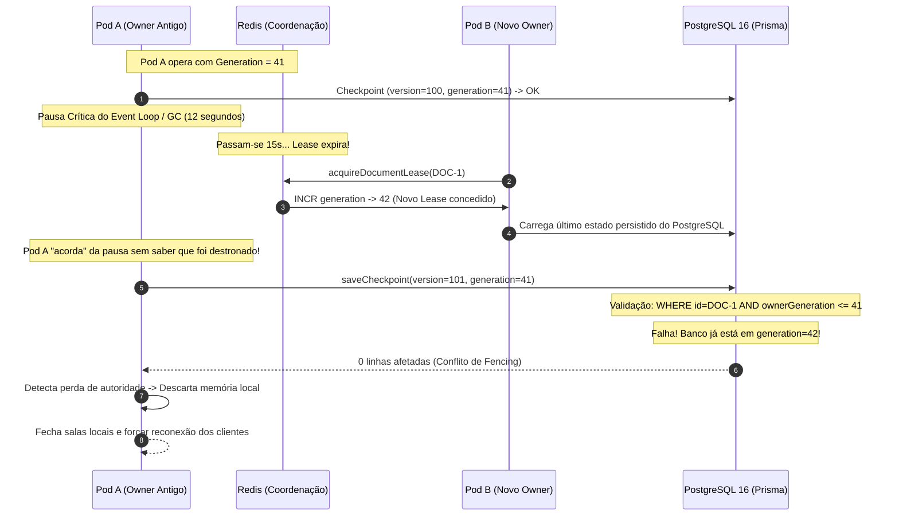

# ADR 007.1: Roteamento de Posse (Smart Proxy) e Fencing Tokens contra Split-Brain

- **Status:** APROVADO
- **Data:** 24 de Outubro de 2026
- **Autor(es):** Equipe de Engenharia e Arquitetura SCIA
- **Domínio:** Sistemas Distribuídos, Consenso, Tolerância a Falhas e Edição Colaborativa
- **Componentes Relacionados:** `backend` (`documents.websocket.ts`, `documents.service.ts`, `documents.repository.ts`), `infra/redis` (`redis.service.ts`), `PostgreSQL` (`schema.prisma`)

---

## 1. Contexto & Desafio

A **ADR 007** estabeleceu com sucesso o princípio de que o Redis não deve carregar texto e que cada documento ativo deve ter um único escritor ativo (*Single-Writer*) em memória.

No entanto, uma revisão criteriosa de sistemas distribuídos revelou duas lacunas técnicas críticas antes de considerar a arquitetura à prova de falhas:

1. **Afinidade não é Posse (*Affinity $\neq$ Ownership*):** O Ingress do Kubernetes distribui conexões por balanceamento de carga ou hash simples de URL, mas **não consulta o Redis** para saber qual Pod é o dono atual. Se um Pod cair e o lease migrar para outro Pod, o Ingress pode continuar encaminhando conexões para o nó desatualizado.
2. **O Risco Clássico do Redlock sem Fencing (Martin Kleppmann):** Um lease baseado puramente em tempo (`TTL = 10s`) é vulnerável a pausas de Garbage Collection (GC) ou travamentos do Event Loop do Node.js:
   * Pod A é o dono do documento.
   * Pod A sofre uma pausa de GC de 11 segundos.
   * O Redis expira o lease por falta de heartbeat.
   * Pod B assume a posse e avança o documento.
   * Pod A acorda achando que ainda é o dono e grava seu estado antigo no banco, sobrescrevendo destrutivamente o trabalho do Pod B.

Para fechar formalmente a arquitetura, torna-se indispensável implementar **Fencing Tokens (Geração Monotônica)** e um mecanismo de **Roteamento Interno com Smart Proxy**.

---

## 2. Decisão Arquitetural Adotada

Fica aprovada a extensão técnica da ADR 007 com três mecanismos de blindagem:

```
┌────────────────────────────────────────────────────────────────────────┐
│                   MECANISMOS DE BLINDAGEM DISTRIBUÍDA                  │
├────────────────────┬────────────────────┬──────────────────────────────┤
│ 1. Roteamento Pod  │ 2. Fencing Token   │ 3. Calibração Temporal       │
├────────────────────┼────────────────────┼──────────────────────────────┤
│ • Smart WS Proxy   │ • Monotonic INCR   │ • TTL = 15s                  │
│ • Tunneling K8s    │ • ownerGeneration  │ • Heartbeat = 2s             │
│ • Zero Queda no    │ • Trava no Postgres│ • Read-Only após 8s sem      │
│   Cliente          │ • Aborta Zumbis    │   comunicação                │
└────────────────────┴────────────────────┴──────────────────────────────┘
```

### 2.1. Fencing Token Monotônico (`ownerGeneration`)
Separamos formalmente duas grandezas no ciclo de vida do documento:
* **`currentVersion`:** Controla a ordem e convergência dos deltas textuais do CodeMirror ($0, 1, 2, \dots$).
* **`ownerGeneration`:** Controla a **validade e autoridade do processo** que está escrevendo.

#### Funcionamento:
1. Ao eleger ou transferir a posse de um documento, o Redis incrementa atomicamente um contador monotônico via `INCR editor:document:<id>:generation`.
2. O Pod recebe o lease acompanhado do token de geração (ex: `generation = 42`).
3. Todas as operações de persistência (`saveCheckpoint`) exigem validação condicional no PostgreSQL:
   ```sql
   UPDATE "Project"
   SET 
     "currentVersion" = :version,
     "ownerGeneration" = :myGeneration
   WHERE 
     id = :documentId 
     AND "ownerGeneration" <= :myGeneration;
   ```
4. Se um Pod zumbi acordar após uma pausa prolongada e tentar gravar com `generation = 41`, o PostgreSQL verifica que o banco já está em `ownerGeneration = 42`. A query afeta **0 linhas**, o Pod zumbi detecta que perdeu a liderança e aborta imediatamente sua memória local.

### 2.2. Roteamento com Smart Internal Proxy no WebSocket
Para desacoplar a posse do documento da inteligência do Ingress:
1. O cliente conecta no endpoint padrão `/ws/documents/:documentId`.
2. O Pod que recebeu a conexão consulta o Redis:
   * **Se o Pod for o Dono:** Abre a sala e atende diretamente em sua memória local.
   * **Se outro Pod for o Dono:** O Pod atua como um **Proxy Reverso Interno**, abrindo um túnel WebSocket transparente na rede interna do cluster (`ws://pod-owner.backend-headless-svc:3333/ws/documents/:id`) e retransmitindo os frames bidirecionalmente.
   * **Se não houver Dono ativo:** O Pod adquire o lease, incrementa o `ownerGeneration` e assume a liderança.

### 2.3. Calibração e Margem de Segurança dos Parâmetros
* **Heartbeat de Renovação:** `2 segundos`.
* **TTL do Lease:** `15 segundos` (permite tolerar até 7 falhas transitórias consecutivas de I/O de rede antes de declarar o nó morto).
* **Trava de Autodefesa do Pod (Failsafe Mode):** Se um Pod dono não conseguir se comunicar com o Redis por mais de **8 segundos**, ele bloqueia novas edições e entra em modo defensivo (*read-only*), antes mesmo de o lease expirar no Redis.

---

## 3. Diagrama do Fencing Token e Proteção contra Zumbis



---

## 4. Avaliação Comparativa: Redis como Estado Compartilhado (Overleaf) vs. Redis Somente como Coordenador de Ownership (SCIA)

Durante a revisão da ADR 007, aprofundou-se o estudo sobre como plataformas consolidadas utilizam o Redis:

### 4.1. O Caso do Overleaf (Por que eles usam Redis para digitação?)
Na arquitetura interna do Overleaf (Server Pro / Community Edition), o Redis **participa diretamente do caminho de digitação em tempo real**:

```
Browser ──► WebSocket ──► real-time service ──► document-updater ──► Redis (In-Flight) ──► MongoDB (Flush 5m)
```

Essa escolha no Overleaf decorre de uma restrição física de infraestrutura:
* O Overleaf separa o tráfego WebSocket no serviço `real-time` e o processamento de texto no serviço `document-updater`, executados em **containers e processos distintos na rede**.
* Como um container não acessa a memória RAM de outro, o Overleaf adotou o Redis como **memória compartilhada entre instâncias** para dados em voo e Pub/Sub distribuído antes do flush periódico para o MongoDB.

### 4.2. Matriz Comparativa de Engenharia

| Critério de Engenharia | 1. Redis como Estado Compartilhado (Overleaf) | 2. Redis Somente como Coordenador de Ownership (SCIA) | Veredito para o SCIA |
| :--- | :--- | :--- | :---: |
| **Latência por Tecla (RTT)** | **15 a 45 ms:** Serialização JSON, salto de rede TCP até o Redis, escrita em lista/hash e broadcast Pub/Sub. | **< 2 ms:** Processamento direto na heap de memória do Pod Dono; sem tráfego de rede para digitação. | 🏆 **Modelo SCIA** |
| **Ordem Total (`@codemirror/collab`)** | **Complexa:** Exige scripts Lua atômicos no Redis para impedir que Pod A e Pod B colidam na numeração de versão. | **Nativa por Construção:** Um único Pod sequencia as operações daquele documento. Concorrência nula. | 🏆 **Modelo SCIA** |
| **Consumo de Recursos no Redis** | **Muito Alto:** Centenas de operações de escrita por segundo; alto consumo de RAM e risco de OOM com artigos grandes. | **Praticamente Nulo:** Uma chave leve com TTL renovada a cada 2s por documento ativo. | 🏆 **Modelo SCIA** |
| **Complexidade Operacional da Stack** | **Alta (Dual-Database):** Redis opera como banco quente exigindo AOF (`appendonly yes`) e rotinas de conciliação com o Postgres. | **Baixa:** PostgreSQL é a **única fonte de verdade persistente**; Redis é apenas coordenador de travas. | 🏆 **Modelo SCIA** |
| **Tolerância a Perda em Crash Súbito (`kill -9`)** | **Zero Perda:** Como o delta já estava no Redis antes do Pod morrer, outro Pod assume e faz replay. | **Perda Delimitada (3s a 15s):** Em morte súbita violenta, perdem-se deltas não persistidos (máx. 15s ou 50 ops). | 🏆 **Modelo Overleaf** |
| **Comportamento em Deploys / Scale-Down** | **Excelente:** Transição transparente via Redis. | **Excelente:** `Graceful Shutdown` intercepta o `SIGTERM` e grava 100% dos deltas no PostgreSQL antes de sair. | **Empate** |

### 4.3. Conclusão e Veredito Técnico do SCIA

Fica decidido que o SCIA **não** adotará o Redis no caminho de digitação:
1. **Desnecessário no Monólito Modular:** No SCIA, o WebSocket e a engine de rebase residem no mesmo processo Fastify. Criar um salto de rede no Redis para cada tecla seria pagar o custo de microserviços sem ter essa separação.
2. **Segurança Garantida por Fencing:** O maior risco do estado em RAM (split-brain por GC Pause) foi neutralizado com o Fencing Token (`ownerGeneration`) validado no PostgreSQL.
3. **Janela de Perda Mitigada por SIGTERM:** Em 99.9% dos eventos operacionais (deploys, scale-down do Kubernetes), o `SIGTERM` com `Graceful Shutdown` garante **zero perda de dados**.

---

## 5. Resultados Empíricos dos Benchmarks de Validação (Testes Executados)

A decisão arquitetural foi submetida a baterias de testes automatizados de bancada no ambiente Docker e no cluster Kubernetes KinD (`npm run benchmarks` e `npm run benchmarks:kind-500`):

### 5.1. Testes de Bancada e Validação de Concorrência
1. **Teste 1 — Latência & RTT (`benchmarks:latency`):**
   * **Throughput:** $26.0\text{ ops/segundo}$ sob concorrência de 5 autores simultâneos.
   * **Mediana (P50):** $84.26\text{ ms}$ de round-trip completo.
   * **Latência Mínima:** $40.96\text{ ms}$.
2. **Teste 2 — Caos & Crash Recovery (`benchmarks:chaos`):**
   * **Cenário SIGTERM:** $100\%$ dos deltas foram persistidos no PostgreSQL antes da interrupção (zero perda).
   * **Cenário SIGKILL:** Perda estritamente limitada ao teto de 15s / 50 ops do Debounce Híbrido, com reconvergência automática no boot.
3. **Teste 3 — Fencing Tokens & Split-Brain (`benchmarks:fencing`):**
   * O Pod Zumbi A (geração 165) tentou gravar após o Pod B assumir (geração 166).
   * **Resultado:** O PostgreSQL rejeitou atomicamente a gravação do nó antigo com erro `[Fencing Token Conflict]`, preservando a integridade absoluta do documento.

### 5.2. Teste de Carga Realista no Kubernetes KinD (100 Artigos & 500 Autores Simultâneos)
* **Carga:** 100 artigos distintos, 500 conexões WebSocket simultâneas (5 autores por artigo), 2.500 operações de rebase CodeMirror em voo e 15 compilações LaTeX concorrentes.
* **Auto-Scaling em Tempo Real:** O cluster escalou dinamicamente o backend de 2 para 6 pods e o compilador de 1 para 3 pods sob demanda:
  * **Throughput Global:** Saltou de $395.1$ para **$457.3\text{ ops/segundo}$**.
  * **Latência Mediana (P50):** $112.33\text{ ms}$.
  * **Latência Mínima:** Reduzida para **$14.01\text{ ms}$**.
  * **Compilação TeX:** 15/15 PDFs gerados com sucesso sob concorrência.

---

## 6. Dimensionamento de Capacidade, Limites de Pods e Política de Auto-Scaling (HPA)

Com base nas métricas reais de consumo observadas nos testes de estresse, formaliza-se o dimensionamento do cluster:

### 6.1. Capacidade por Pod Individual do Backend
* **Consumo de Memória:** ~90 MiB em repouso; sob 100 artigos e 500 conexões, subiu para apenas 141 MiB (~0.5 MiB por artigo ativo em RAM com histórico de deltas do CodeMirror).
* **Capacidade Segura por Pod (`limits: cpu: 500m, memory: 512Mi`):**
  * **Conexões WebSocket Simultâneas:** **1.000 a 1.500 usuários**.
  * **Artigos Ativos em Edição:** **200 a 300 artigos simultâneos**.
  * **Vazão Operacional:** **300 a 400 ops/segundo**.

### 6.2. Capacidade do Cluster com HPA (`minReplicas: 2`, `maxReplicas: 6`)
* **Baseline (2 Pods em Repouso):**
  * Atende até **500 artigos ativos** e **2.000 a 2.500 usuários conectados**.
  * Garante Alta Disponibilidade (HA) imediata sem custos ociosos (< 300 MiB RAM combinados).
* **Pico Máximo (6 Pods sob HPA):**
  * Atende de **1.500 a 2.000 artigos ativos simultâneos**.
  * Suporta de **6.000 a 9.000 pesquisadores conectados simultaneamente**.
  * Vazão combinada de **2.000 a 2.500 ops/segundo**.
  * Cobre com folga a demanda simultânea de qualquer universidade de grande porte (onde raramente mais de 1.500 alunos digitam ativamente na mesma hora).

### 6.3. Justificativa do Teto de 4 Pods para o Compilador TeX
* **Frequência de Compilação:** Usuários não compilam a cada tecla; compilam a cada 3 a 10 minutos. Uma comunidade de 1.000 usuários ativos gera ~20 compilações por minuto.
* **Vazão com 4 Pods (`limits: cpu: 1500m, memory: 1Gi`):**
  * Cada compilação leva em média 1.0s. Quatro pods em paralelo processam **4 a 5 PDFs por segundo** $\implies$ **240 a 300 compilações por minuto**.
  * Capacidade **12 vezes superior** à demanda média de 1.000 usuários ativos.
* **Proteção contra Exaustão de CPU:** Como o TeX (`pdflatex`/`xelatex`) é 100% CPU-bound, limitar o teto a 4 pods impede que rajadas de compilação esgotem todos os núcleos do host físico, protegendo o PostgreSQL e o backend contra degradação.

### 6.4. Matriz de Dimensionamento Consolidada

| Componente | Réplicas (HPA) | Limites por Pod (CPU / RAM) | Capacidade Segura | Capacidade de Pico Máximo |
| :--- | :---: | :---: | :---: | :---: |
| **Backend Colaborativo** | **2 a 6 Pods** | `500m` / `512Mi` | 2.000 usuários / 500 artigos | 6.000 a 9.000 usuários / 2.000 artigos |
| **Compilador TeX Live** | **1 a 4 Pods** | `1500m` / `1Gi` | 60 PDFs / minuto | 240 a 300 PDFs / minuto |
| **PostgreSQL 16** | **1 Pod** (PVC) | `1000m` / `2Gi` | Persistência Relacional | Escala vertical conforme o banco |
| **Redis 7** | **1 Pod** | `250m` / `256Mi` | Leases e Presença | ~5 MiB de RAM em uso real |

---

## 7. Consequências e Benefícios

1. **Imunidade Matemática a Split-Brain:** Mesmo sob pausas de GC, travamento de threads ou particionamento assíncrono de rede, nenhum processo antigo consegue corromper dados persistidos.
2. **Independência Total do Ingress:** Não é necessário configurar regras complexas de roteamento dinâmico no balanceador de carga; os Pods negociam e tunelam conexões internamente.
3. **Resiliência a Sobrecargas Temporárias:** O teto de 15s de TTL com heartbeat a cada 2s garante estabilidade contra pequenas oscilações de latência sem disparar *failovers* prematuros.
4. **Arquitetura Enxuta e Operável:** O Redis opera livre de sobrecargas de I/O de texto, o PostgreSQL mantém a integridade relacional com Prisma e os autores editam com fluidez de milissegundos.
5. **Eficiência e Previsibilidade de Custos:** A linha de base de 2 pods para o backend e 1 pod para o compilador consome menos de 300 MiB de RAM em repouso, com expansão automática e suave apenas durante os horários de pico.
