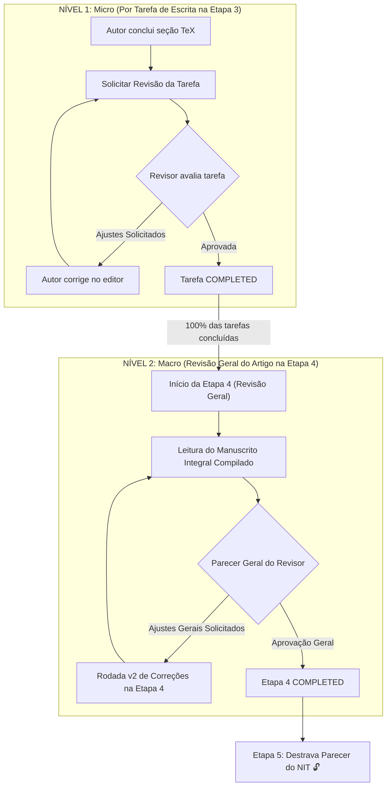

# ADR 008: Workflow Oficial em 6 Etapas Fixas, Modelo de Revisão em Dois Níveis e Versionamento Relacional Nativo

- **Status:** APROVADO
- **Data:** 25 de Outubro de 2026
- **Autor(es):** Equipe de Engenharia, Produto e Arquitetura SCIA
- **Domínio:** Governança Editorial Acadêmica, Workflow de Escrita e Revisão, Arquitetura de Permissões e Máquinas de Estado
- **Componentes Relacionados:** `frontend` (CodeMirror 6, Gantt, ReviewSidebar, DataGrid), `backend` (`project-stages`, `tasks`, `documents`, `projects`), `PostgreSQL` (`ProjectStage`, `Task`, `ReviewComment`)

---

## 1. Contexto & Motivação

No início do desenvolvimento da plataforma SCIA (`sci-latex-vscode`), os fluxos de escrita e revisão foram desenhados espelhando convenções tradicionais de engenharia de software (branches Git individuais por tarefa, Pull Requests, travas de merge via GitHub SDK Octokit e comandos `git status`).

Com a consolidação do editor web-nativo em **CodeMirror 6** colaborativo em tempo real via Transformação Operacional (OT) e persistência transacional em PostgreSQL (conforme estabelecido na [ADR 007](file:///home/gilson-russo/development/professional/sci-latex-vscode/docs/planning/adrs/adr-007-collaborative-editor-architecture-scaling.md)), esse acoplamento ao Git tornou-se um passivo técnico desnecessário:
1. **Fricção de Domínio Acadêmico:** Pesquisadores, orientadores e revisores científicos não operam sob a lógica de branches e merges; seu vocabulário nativo é composto por *seções*, *tarefas*, *apontamentos*, *rodadas de revisão* e *pareceres*.
2. **Inconsistência Estrutural de Etapas:** Permitir que etapas fossem criadas, deletadas ou reordenadas arbitrariamente via drag-and-drop gerava despadronização institucional, dificultava a consolidação de relatórios gerenciais e abria brechas na cadeia de dependência dos Gatekeepers institucionais.
3. **Ambiguidade na Persona do Revisor:** O revisor utiliza a mesma interface de acompanhamento do autor (Gantt e tabela de artigos), mas sua atuação no editor deve ser estritamente protegida contra edição acidental, garantindo ao mesmo tempo plena capacidade de anotação e emissão de pareceres.
4. **Falta de Padronização no Ciclo de "Bate e Volta":** A escrita científica exige ciclos contínuos de submissão, apontamento e correção entre alunos e orientadores. Sem uma máquina de estados explícita, não havia distinção entre o ajuste pontual de uma seção (nível micro) e a **Revisão Geral do Manuscrito** (nível macro antes do NIT).

---

## 2. Decisão Arquitetural Adotada

Fica aprovada a padronização do fluxo editorial do SCIA estruturada em **seis pilares normativos**:

```
┌─────────────────────────────────────────────────────────────────────────────────────────┐
│                           ARQUITETURA EDITORIAL SCIA (ADR 008)                          │
├────────────────────────────────┬───────────────────────────┬────────────────────────────┤
│ 1. Versionamento Nativo        │ 2. 6 Etapas Fixas         │ 3. Persona do Revisor      │
│ - Snapshots & deltas TeX       │ - Ordem 1 a 6 imutável    │ - Mesma tela do Autor      │
│ - Vocabulário 100% acadêmico   │ - Sem exclusão/reordenação│ - Filtros/badges contextuais│
│ - PostgreSQL ACID transacional │ - Remoção de @dnd-kit     │ - CodeMirror Read-Only     │
├────────────────────────────────┼───────────────────────────┼────────────────────────────┤
│ 4. Bate e Volta de Tarefa      │ 5. Revisão Geral (Etapa 4)│ 6. Governança Gatekeepers  │
│ - Nível micro na Etapa 3       │ - Nível macro consolidado │ - Etapa 5: Parecer NIT     │
│ - REVIEW_REQUESTED / IN_REVIEW │ - Rodadas sem reabrir E3  │ - Etapa 6: Submissão Alvo  │
│ - Apontamentos inline no TeX   │ - Métricas para a gerência│ - Travas sequenciais 🔒   │
└────────────────────────────────┴───────────────────────────┴────────────────────────────┘
```

---

### Pilar 1: Versionamento Relacional Nativo (Snapshots & Deltas no PostgreSQL)

1. **Eliminação do Acoplamento:** Todo o versionamento e histórico do manuscrito são gerenciados por operações colaborativas e snapshots centralizados no banco de dados (`ProjectFile`, `DocumentOperation` e `DocumentSnapshot`).
2. **Remoção de Remanescentes:** Ficam formalmente removidos e deprecados:
   - Rotas de verificação Git (`/projects/:id/git-status`).
   - Campos de repositório Git em entidades relacionais (`Project.gitRepoPath`).
   - Tags e referências a Pull Requests no Swagger/OpenAPI e no `AuditLog`.
3. **Vocabulário de Domínio:** A linguagem oficial da plataforma adota os conceitos de *Solicitação de Revisão de Tarefa*, *Apontamentos Inline*, *Rodadas de Ajustes* e *Conclusão de Tarefa*.

---

### Pilar 2: A Régua Institucional das 6 Etapas Fixas e Imutáveis

Todos os artigos científicos criados na plataforma são instanciados obrigatoriamente com **seis etapas fixas**, cuja ordem e existência são invioláveis:

```mermaid
graph LR
    E1["1. Planejamento<br/>e Pesquisa"] --> E2["2. Experimentos<br/>& Benchmarks"]
    E2 --> E3["3. Escrita do Artigo<br/>(Tarefas Paralelas)"]
    E3 --> E4["4. Revisão Técnica<br/>& Científica (Geral)"]
    E4 --> E5["5. Parecer do NIT<br/>(Gatekeeper 1)"]
    E5 --> E6["6. Submissão Final<br/>(Gatekeeper 2)"]

    style E1 fill:#e3f2fd,stroke:#1976d2,stroke-width:1.5px
    style E2 fill:#e3f2fd,stroke:#1976d2,stroke-width:1.5px
    style E3 fill:#e1f5fe,stroke:#0288d1,stroke-width:2px
    style E4 fill:#f3e5f5,stroke:#7b1fa2,stroke-width:2px
    style E5 fill:#fff3e0,stroke:#f57c00,stroke-width:2px
    style E6 fill:#e8f5e9,stroke:#388e3c,stroke-width:2px
```



1. **Definição das Etapas:**
   - **Etapa 1 — Planejamento e Pesquisa:** Levantamento bibliográfico, formulação de hipóteses e delimitação do problema.
   - **Etapa 2 — Desenvolvimento e Experimentos:** Execução metodológica, coleta de dados, benchmarks e geração de gráficos.
   - **Etapa 3 — Escrita do Artigo:** Redação paralela das seções TeX por tarefas distribuídas entre os coautores.
   - **Etapa 4 — Revisão Técnica e Científica (Nova):** Avaliação global do manuscrito compilado pelo Revisor Oficial antes da governança externa.
   - **Etapa 5 — Parecer do NIT (Gatekeeper 1):** Validação formal de propriedade intelectual, termos de cessão e patentes.
   - **Etapa 6 — Submissão Final ao Congresso (Gatekeeper 2):** Envio oficial do artigo compilado para a conferência alvo ou backup.
2. **Imutabilidade Estrutural:**
   - Nenhuma etapa pode ser excluída (`DELETE /stages/:id` bloqueado com `400 BAD_REQUEST`).
   - A ordem sequencial (1 a 6) não pode ser alterada.
   - O pacote `@dnd-kit` (`@dnd-kit/core`, `@dnd-kit/sortable`, `@dnd-kit/utilities`) é **desinstalado** do frontend. A tela de configurações do artigo passa a gerenciar unicamente as datas limites planejadas (`plannedCompletionDate`).

---

### Pilar 3: Arquitetura da Persona do Revisor

1. **Unificação de Telas:** O usuário com atribuição de Revisor navega pelas mesmas telas do Autor (`AuthorArticlesPage`, `ArticleDetailPage` e Gantt), eliminando sitemaps duplicados.
2. **Identificação e Filtros Contextuais:**
   - Na listagem de artigos, o usuário dispõe de um filtro segmentado: `[ Todos ]`, `[ Meus Artigos (Autor) ]` e `[ Sob Minha Revisão (Revisor) ]`.
   - Na tabela e no Gantt, artigos onde ele atua como Revisor exibem chips e badges roxos destacados (`Revisor Oficial`).
3. **Modo Read-Only no CodeMirror:**
   - Ao acessar o editor de um artigo em que foi designado como Revisor, o CodeMirror recebe dinamicamente a extensão de leitura:
     ```typescript
     EditorState.readOnly.of(true)
     ```
   - O revisor **não pode** alterar texto diretamente, prevenindo corrupção acidental do LaTeX.
   - O revisor **pode** selecionar qualquer trecho e acionar o `ReviewSidebar` para inserir comentários (`ReviewComment`), responder threads e marcar pendências como resolvidas.

---

### Pilar 4: O Modelo de Revisão em Dois Níveis

O ciclo de revisão opera em duas camadas desacopladas:



#### Nível 1: Bate e Volta Granular de Tarefas (Etapa 3)
- O enum `TaskStatus` passa a contemplar os estados de revisão:
  - `NOT_STARTED`: Tarefa criada e não iniciada.
  - `IN_PROGRESS`: Autor redigindo no editor.
  - `REVIEW_REQUESTED`: Autor finalizou e solicitou a revisão do orientador.
  - `IN_REVIEW`: Revisor inspecionando o trecho no editor.
  - `CHANGES_REQUESTED`: Revisor solicitou ajustes com comentários ancorados.
  - `COMPLETED`: Revisor aprovou a seção.
- Múltiplos autores solicitam revisões simultâneas de suas respectivas tarefas (ex: Introdução vs. Resultados) de forma paralela e independente.

---

### Pilar 5: Ciclo de Ajustes na Etapa 4 sem Reabertura da Etapa 3

Quando o Revisor identifica inconsistências macro na Etapa 4 (ex: limite de páginas estourado, incongruência entre resumo e conclusão, formatação de referências):

1. **A Etapa 3 Permanece `COMPLETED`:** O marco histórico de conclusão da escrita inicial não é desfeito nem retroagido.
2. **Rodadas Iterativas na Etapa 4:**
   - A Etapa 4 transiciona para `CHANGES_REQUESTED`.
   - Os autores recebem os apontamentos, realizam as adequações necessárias no editor e clicam em **`[ Reenviar para Revisão Geral ]`**.
   - Cada reenvio incrementa o contador de rodadas da Revisão Geral (`Rodada 1`, `Rodada 2`, etc.).
   - Os autores podem opcionalmente vincular tarefas de ajuste diretamente à Etapa 4 para distribuir o esforço entre a equipe.
3. **Preservação de Métricas:** A gerência mantém visibilidade precisa: sabe exatamente quanto tempo a equipe levou para escrever o rascunho (Etapa 3) e quantas rodadas/dias foram necessários para a lapidação final (Etapa 4).

---

### Pilar 6: Travas de Governança dos Gatekeepers

1. **Trava do NIT (Etapa 5):** Permanece em estado estrito **`🔒 LOCKED`** enquanto a Etapa 4 não atingir o status `COMPLETED`. É expressamente proibido abrir processo no NIT com parecer pendente do revisor.
2. **Trava de Submissão (Etapa 6):** Permanece em estado estrito **`🔒 LOCKED`** até a homologação da Etapa 5 com parecer favorável (`APPROVED_NIT`).

---

## 3. Consequências & Impactos

### Positivas
- **Simplificação do Frontend:** Remoção integral da dependência de arrastar-e-soltar (`@dnd-kit`), resultando em pacote menor, menor consumo de memória e código de modal limpo e determinístico.
- **Rastreabilidade Factual sem Git:** Fim dos conflitos de merge, travamento de branches e erros de sincronização remota.
- **Segurança de Conteúdo:** O revisor tem acesso imediato de leitura e anotação, sem risco de corromper o texto LaTeX em edição.
- **Indicadores Gerenciais Precisos:** Dashboards de coordenação e gerência ganham métricas reais de tempo de ciclo de revisão, taxas de retrabalho por equipe e antecipação de gargalos de submissão.

### Mitigações e Riscos Monitorados
- **Volume de Comentários:** Com múltiplos autores e revisores operando no mesmo artigo, o algoritmo de cascata anti-colisão do `ReviewSidebar` (CodeMirror 6) previne sobreposição visual de cards de comentários na tela.
- **Bloqueio de Prazos:** Caso um revisor demore para avaliar a Etapa 4, o sistema dispara alertas visuais de risco (`WARNING_SOON` / `OVERDUE`) para o Coordenador intervir preventivamente.
