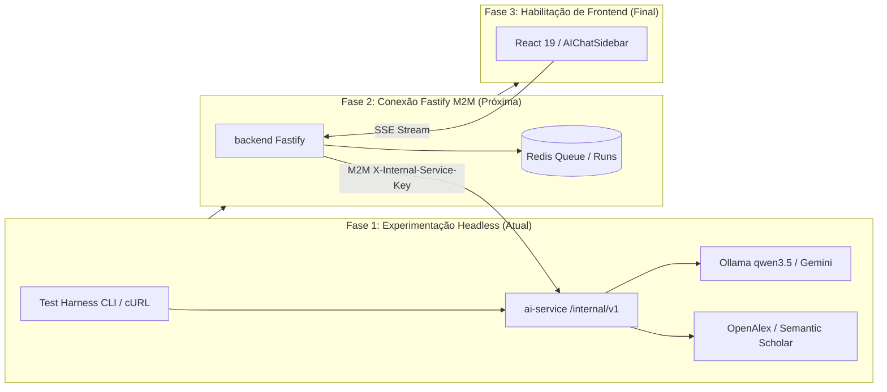

# ADR 009: Estratégia de Experimentação Headless, Validação de Contratos via API e Habilitação do Microserviço SciAI (`ai-service`)

- **Status:** EM DISCUSSÃO
- **Data:** 25 de Outubro de 2026
- **Autor(es):** Equipe de Engenharia, Inteligência Artificial e Arquitetura SCIA
- **Domínio:** Inteligência Artificial Científica, Orquestração Multi-Agente, Contratos M2M, Streaming SSE e Validação Headless
- **Componentes Relacionados:** `ai-service` (FastAPI / LangGraph / DeepAgents), `backend` (Fastify / TypeScript), `docs/planning/specs` (`sciai-contracts-spec.md`, `sciai-chat-copilot-spec.md`)

---

## 1. Contexto & Motivação

Com a importação do núcleo de inteligência artificial do projeto de referência para o microserviço desacoplado `ai-service`, foi estabelecido o motor científico baseado em **FastAPI**, **LangGraph** e **DeepAgents**, contendo subagentes especializados (`idea_refiner`, `search_specialist`, `curation` e `writer`) e ferramentas de busca acadêmica com fallback resiliente (**Semantic Scholar** e **OpenAlex**).

Conforme definido na [ADR 006](file:///home/gilson-russo/development/professional/sci-latex-vscode/docs/planning/adrs/adr-006-sciai-integration-architecture.md), a autoridade do negócio pertence exclusivamente ao backend **Fastify**, e o frontend React só deve ser acoplado quando os contratos e o comportamento dos agentes estiverem plenamente estabilizados.

Atualmente, surge a necessidade de **experimentar, estressar e calibrar as capacidades de IA exclusivamente via API**, sem nenhuma alteração na interface de usuário (frontend) neste momento. 

Durante o diagnóstico técnico do código importado no `ai-service`, foram identificados pontos que demandam alinhamento e decisões arquiteturais antes da integração plena:

1. **Ausência de Checkpointer Ativo no Endpoint de Chat:** O endpoint `/internal/v1/chat/stream` instancia o supervisor do LangGraph sem um checkpointer (`checkpointer=None`). Como o fluxo científico depende de pausas explícitas (*Human-in-the-Loop* via `interrupt`) para seleção de artigos e aprovação do cronograma, o LangGraph requer um mecanismo de persistência de estado (ao menos em memória para testes) atrelado ao `conversation_id` (`thread_id`), caso contrário a retomada via `/internal/v1/chat/resume` falha em tempo de execução.
2. **Divergência entre o Chat Interativo (SSE) e as Runs Assíncronas (M2M):** Os endpoints de `/runs` estão implementados como esqueletos (*stubs* retornando `202 PENDING`), enquanto o endpoint de `/chat/stream` já possui toda a lógica de streaming SSE conectada ao grafo. A experimentação imediata deve focar no canal interativo SSE.
3. **Módulo de Redação LaTeX Desconectado:** O componente `app/agents/writer.py` foi implementado como uma chain LangChain isolada, porém não foi exposto em nenhum endpoint HTTP, impedindo sua validação via API.
4. **Calibração de Modelos Locais vs. Nuvem:** O ambiente local conta com o **Ollama** ativo com modelos como `qwen3.5:4b` (dotado de suporte a *tools/function calling*), enquanto o padrão do código aponta para `llama3:8b`. É necessário formalizar a estratégia de configuração para permitir desenvolvimento local sem custos de token, com chaveamento para modelos em nuvem (Gemini 2.5 Flash / GPT-4o).

---

## 2. Decisão Arquitetural Adotada (Em Discussão)

Fica estruturada a estratégia de experimentação e habilitação do microserviço `ai-service` em **seis pilares fundamentais**:

```
┌────────────────────────────────────────────────────────────────────────────────────────┐
│               ESTRATÉGIA DE EXPERIMENTAÇÃO HEADLESS & VALIDAÇÃO SCIAI                  │
├───────────────────────────────┬───────────────────────────────┬────────────────────────┤
│ 1. Abordagem API-First        │ 2. Checkpointer Transiente    │ 3. Compatibilidade LLM │
│ - Validação 100% headless     │ - MemorySaver em testes       │ - Ollama local qwen3.5 │
│ - Zero impacto no frontend    │ - Preservação por thread_id   │ - Fallback para Gemini │
│ - CLI REPL e cURL scripts     │ - Suporte pleno a interrupt() │ - Suporte a tools      │
├───────────────────────────────┼───────────────────────────────┼────────────────────────┤
│ 4. Resiliência de Buscas      │ 5. Exposição do Writer LaTeX  │ 6. Roteiro Progressivo │
│ - Semantic Scholar + OpenAlex │ - Nova rota /writer/generate  │ - Fase 1: API pura     │
│ - Rate-limit backoff ativo    │ - Teste de diff TeX via JSON  │ - Fase 2: Fastify M2M  │
│ - Retorno estruturado JSON    │ - Validação de macros e bib   │ - Fase 3: UI Chat      │
└───────────────────────────────┴───────────────────────────────┴────────────────────────┘
```

---

### Pilar 1: Abordagem API-First e Harness de Teste Headless (Zero Frontend)

1. **Isolamento do Frontend:** Nenhuma linha de código ou componente de interface no diretório `frontend/` será alterada nesta etapa. O front-end existente permanece focado na edição colaborativa (ADR 007 e ADR 008).
2. **Harness de Teste em Linha de Comando (CLI REPL):**
   * Será disponibilizado um script de teste cliente em Python (`tests/harness/chat_cli_test.py`) consumindo `/internal/v1/chat/stream` via `httpx`.
   * O harness processa os eventos Server-Sent Events (SSE) em tempo real, renderizando no terminal os tokens dos agentes (`Guia de Exploração`, `Especialista de Busca`, `Gerente de Curadoria`).
   * Ao interceptar o evento `{"type": "interrupt"}`, o script suspende o stream, imprime a lista de opções para o operador no terminal, lê a decisão via `input()` e despacha a resposta para `/internal/v1/chat/resume`, simulando o comportamento exato que a interface futura terá.
3. **Coleção de Requisições Declarativas:**
   * Disponibilização de arquivo `.http` compatível com extensões de REST Client e coleções cURL reproduzíveis para inspeção direta de payloads.

---

### Pilar 2: Correção e Gestão de Checkpoint do LangGraph para Sessões Conversacionais

1. **Injeção de `MemorySaver` para Desenvolvimento e Testes:**
   * Para viabilizar a experimentação imediata das 4 fases do Onboarding sem exigir a criação das tabelas do Postgres checkpointer do LangGraph, a inicialização do supervisor em `app/api/v1/endpoints/chat.py` deve receber uma instância compartilhada de `MemorySaver`:
     ```python
     from langgraph.checkpoint.memory import MemorySaver
     
     # Checkpointer em memória para sessão de testes e isolamento por thread_id
     chat_checkpointer = MemorySaver()
     supervisor_graph = get_onboarding_supervisor(checkpointer=chat_checkpointer)
     ```
2. **Garantia do Human-in-the-Loop (HITL):**
   * Com o checkpointer ativo, as chamadas com `conversation_id` comum compartilham o mesmo grafo transacional. Quando o `search_specialist` chama `present_articles_to_user_for_selection`, o LangGraph persiste o estado e aguarda com segurança o `POST /chat/resume`.
3. **Evolução para Produção (ADR-006):**
   * O `MemorySaver` é restrito à fase de experimentação/testes de API. A transição para produção utilizará o checkpointer persistente em PostgreSQL (`PostgresSaver`) na infraestrutura K8s/Docker.

---

### Pilar 3: Seleção e Compatibilidade de Modelos LLM (Local vs. Nuvem)

1. **Uso Prioritário de Modelos Locais via Ollama:**
   * Para desenvolvimento local sem custos de API ou dependência de chaves externas, o microserviço deve ser configurado via `.env` apontando para o modelo local já disponível com capacidade de ferramentas (*tools*):
     ```ini
     OLLAMA_BASE_URL=http://localhost:11434
     OLLAMA_MODEL=qwen3.5:4b
     ```
2. **Requisito Obrigatório de Suporte a Tool Calling:**
   * Os subagentes operam com chamadas de ferramentas estruturadas (`execute_academic_search`, `present_articles_to_user_for_selection`, `create_project_and_roadmap`). Modelos locais incapazes de emitir tool calls em formato OpenAI-compatible não devem ser utilizados. O modelo `qwen3.5:4b` foi homologado com essa capacidade.
3. **Chaveamento para Modelos Cloud (Produção e Benchmarks):**
   * Caso configurada a variável `GEMINI_API_KEY` ou `OPENAI_API_KEY`, a fábrica `app/core/llm.py` assume automaticamente o modelo de nuvem correspondente (Gemini 2.5 Flash / GPT-4o), garantindo alta velocidade de geração e raciocínio acadêmico complexo.

---

### Pilar 4: Resiliência das Ferramentas de Busca Acadêmica

1. **Ordem de Precedência das Fontes:**
   * A ferramenta `execute_academic_search` executa primeiramente a busca no **Semantic Scholar (S2)** com semáforo de concorrência (`S2_SEMAPHORE = 2`) e backoff exponencial para lidar com limites de requisição da API pública (429).
   * Em caso de indisponibilidade, falha de rede ou esgotamento de retries no Semantic Scholar, o sistema chaveia automaticamente para o **OpenAlex**, processando o abstract em formato invertido (*inverted index*) e retornando metadados consolidados (título, autores, ano, venue, snippet, DOI, citações).
2. **Isolamento de Validação:**
   * Fica estabelecido um teste unitário/smoke script para testar as buscas científicas independentemente de inferência de LLM, assegurando que o canal externo de pesquisa acadêmica permaneça confiável.

---

### Pilar 5: Chat Lateral de Redação Consultiva (Zero Escrita Direta em Arquivos)

1. **Princípio Inviolável de Governança do Editor:**
   * O copiloto de escrita atua exclusivamente em **Chat Lateral (Sidebar Chat)**. A IA **nunca** injeta nem altera código LaTeX diretamente no arquivo do usuário de forma autônoma.
   * O copiloto atua de forma socrática e consultiva: responde dúvidas, explica escolhas de redação acadêmica, sugere comandos `\cite{}` com base nas referências do projeto e propõe blocos de código LaTeX com botões de cópia manual para o autor.
2. **Criação do Endpoint de Consultoria Lateral (`writer/assist`):**
   * A rota dedicada expõe a assistência de escrita:
     * **Rota:** `POST /internal/v1/writer/assist`
     * **Entrada:** `{ "section_name": "...", "document_snippet": "...", "user_prompt": "...", "conversation_id": "..." }`
     * **Resposta:** Objeto JSON contendo explicações metodológicas, sugestões em blocos LaTeX delimitados e referências recomendadas.
---

### Pilar 6: Matriz de Fases de Transição e Integração



---

## 3. Catálogo dos 4 Agentes de IA, Ferramentas (Tools) e Mapeamento nas 6 Etapas

Conforme estabelecido na [ADR 008](file:///home/gilson-russo/development/professional/sci-latex-vscode/docs/planning/adrs/adr-008-workflow-6-etapas-revisao-desacoplamento-git.md), o fluxo da plataforma SCIA possui **seis etapas fixas e imutáveis**.

> [!IMPORTANT]
> **Delimitação de Governança sobre a Etapa 5 (NIT):**
> A Etapa 5 (Gatekeeper 1 - Submissão Interna ao Núcleo de Inovação Tecnológica) é **100% administrativa e humana**. O sistema apenas disponibiliza um formulário de acompanhamento para registro de data de envio, número de protocolo e parecer institucional. **Nenhum agente de IA atua ou existirá na Etapa 5.**

```
┌────────────────────────────────────────────────────────────────────────────────────────┐
│               MAPA OFICIAL DE AGENTES E FERRAMENTAS NAS 6 ETAPAS                       │
├────────────────────┬─────────────────────────┬────────────────────────────────────────┤
│ Etapa do Workflow  │ Agente Responsável      │ Ferramentas / Tools Utilizadas         │
├────────────────────┼─────────────────────────┼────────────────────────────────────────┤
│ Onboarding / E1    │ supervisor_agent        │ Orquestrador principal dos subagentes  │
│ (Planejamento)     │ idea_refiner_subagent   │ Diálogo Socrático (sem tools externas) │
│                    │ search_specialist       │ execute_academic_search, interrupt     │
│                    │ curation_manager        │ calculate_timeline, create_scia_project│
├────────────────────┼─────────────────────────┼────────────────────────────────────────┤
│ E2 (Experimentos)  │ schedule_auditor        │ get_project_progress_metrics, drift    │
├────────────────────┼─────────────────────────┼────────────────────────────────────────┤
│ E3 (Escrita)       │ writing_copilot (Chat)  │ fetch_section_context, search_bibtex   │
│                    │ schedule_auditor        │ calculate_timeline_drift, rebalance    │
│                    │ review_briefing         │ diff_section, extract_focus, briefing  │
├────────────────────┼─────────────────────────┼────────────────────────────────────────┤
│ E4 (Revisão Geral) │ review_briefing (Macro) │ diff_full_manuscript, save_briefing    │
├────────────────────┼─────────────────────────┼────────────────────────────────────────┤
│ E5 (Gatekeeper NIT)│ 🔒 ZERO IA              │ Processo 100% Humano / Formulário NIT  │
├────────────────────┼─────────────────────────┼────────────────────────────────────────┤
│ E6 (Congresso Alvo)│ 🔒 Submissão Externa    │ Ação Final Humana do Autor             │
└────────────────────┴─────────────────────────┴────────────────────────────────────────┘
```

### 3.1. Agente 1: Onboarding & Criação do Artigo (`supervisor` / `curation_manager`)
* **Papel:** Conduz o autor desde a ideação embrionária até a criação do artigo no banco de dados.
* **Tools Obrigatórias:**
  1. `execute_academic_search(query: str, limit: int = 5, year_min?: int)`:
     - Executa busca unificada no Semantic Scholar com fallback automático para OpenAlex.
     - Retorna: `List[Article]` com título, autores, ano, venue, snippet, DOI e citações.
  2. `present_articles_to_user_for_selection(articles: List[Article])`:
     - Emite interrupção LangGraph (`interrupt`) para seleção humana no frontend/API.
     - Retorna: `selected_articles` confirmados pelo autor.
  3. `propose_article_structure_and_tasks(title, abstract, writing_tasks, conference_name, total_weeks)`:
     - Conhece a régua fixa das 6 etapas do SCIA (ADR 008) e calcula a distribuição proporcional de dias de cada uma.
     - Estrutura as tarefas de escrita (seções TeX) alocadas estritamente na **Etapa 3 (Escrita do Artigo)**.
     - Emite interrupção LangGraph (`interrupt`) com o payload consolidado (`approve_article_proposal`).
  4. `create_scia_project(...)` **(A Tool de Criação do Artigo):**
     - **Execução:** Ao receber a aprovação final do autor, despacha requisição M2M para o backend Fastify (`POST /internal/v1/projects`).
     - **Efeito no Sistema:** O Fastify persiste no PostgreSQL o `Project`, as 6 `ProjectStage`s imutáveis, as `Task`s da Etapa 3, vincula os artigos selecionados no `references.bib` e descompacta o template LaTeX do MinIO.
     - **Retorno da Tool:** `{ projectId: string, workspaceUrl: string, status: "CREATED" }`.

### 3.2. Agente 2: Auditor de Prazos e Cronograma (`schedule_auditor`)
* **Papel:** Monitorar preventivamente a velocidade de avanço das tarefas nas Etapas 2 e 3 em relação ao prazo final da Etapa 6 (Congresso Alvo).
* **Regra de Ouro:** Alerta e sugere, mas nunca altera datas no banco sem aprovação explícita.
* **Tools Obrigatórias:**
  1. `get_project_progress_metrics(projectId: str)`: Consulta status de tarefas concluídas, em andamento e em revisão.
  2. `calculate_timeline_drift(projectId: str, targetDeadline: str)`: Calcula índice de queima de tempo (*burn rate*) e diagnostica risco de estrangulamento da Etapa 4 (Revisão Geral).
  3. `propose_schedule_rebalance(projectId: str, tasksToAdjust: List[str])`: Simula nova distribuição proporcional de dias para seções pendentes.
  4. `apply_schedule_rebalance(projectId: str, approvedDates: List[TaskDate])`: Despacha mutação ao Fastify para atualizar as datas após confirmação do autor/coordenador.

### 3.3. Agente 3: Copiloto Consultivo de Escrita no Chat Lateral (`writing_copilot`)
* **Papel:** Parceiro de diálogo acadêmico e estilístico na lateral do editor CodeMirror durante a Etapa 3.
* **Regra de Ouro:** Não escreve no documento. Fornece blocos TeX com botão manual de copiar.
* **Tools Obrigatórias:**
  1. `fetch_section_context(taskId: str, projectId: str)`: Carrega o objetivo da tarefa, descrição e histórico de apontamentos da seção ativa.
  2. `search_project_bibtex(projectId: str, query: str)`: Realiza busca semântica dentro do arquivo `references.bib` do projeto para sugerir a chave correta `\cite{...}`.
  3. `search_new_citations_for_claim(claimTopic: str)`: Busca novos papers externos via OpenAlex/S2 para justificar afirmações que precisam de embasamento bibliográfico.
  4. `format_latex_table_or_equation(rawDescription: str, type: str)`: Converte descrições livres em código LaTeX padronizado (com legendas `\caption` e labels `\label`).

### 3.4. Agente 4: Gerador de Briefing de Revisão (`review_briefing`)
* **Papel:** Síntese executiva gerada quando o autor clica em "Solicitar Revisão" (fim de tarefa na Etapa 3 ou submissão do artigo na Etapa 4).
* **Tools Obrigatórias:**
  1. `diff_section_against_baseline(documentId: str, currentVersion: int)`: Extrai as alterações efetivas do texto desde o início da tarefa.
  2. `extract_review_focus_points(sectionContent: str, authorNotes: str)`: Identifica pontos sensíveis que exigem atenção prioritária do orientador/revisor.
  3. `save_review_briefing(taskId: str, briefingPayload: dict)`: Persiste o sumário no PostgreSQL via Fastify para ser renderizado no topo da `ReviewSidebar` do revisor.

---

## 4. Consequências e Trade-offs

### Aspectos Positivos
* **Velocidade de Feedback sem Acoplamento:** Permite avaliar prompts, alucinações, relevância das buscas acadêmicas e estabilidade das transições de agentes sem esperar o ciclo de desenvolvimento do frontend.
* **Segurança e Isolamento:** Evita retrabalho na interface do usuário caso as saídas estruturadas dos subagentes precisem de ajustes em seus contratos de JSON.
* **Economia Operacional:** Permite validar todo o pipeline localmente sem custos de tokens utilizando o Ollama.
* **Detecção Precoce de Bugs de Estado:** A validação do fluxo multi-turno com pausas e retomadas expõe falhas de checkpointing e memória antes do deploy em ambientes de staging.

### Aspectos Negativos & Mitigações
* **Estado Volátil em Memória no Modo Teste:** Com o uso inicial de `MemorySaver`, caso o servidor FastAPI reinicie, as conversas ativas no teste são perdidas.
  * *Mitigação:* Adequado e intencional para a fase de testes via API. A persistência durável via PostgresSaver será habilitada na Fase 2 com os containers do banco de dados já ativos.
* **Limitações de Contexto em Modelos Locais Pequenos:** Modelos como `qwen3.5:4b` possuem menor tolerância a prompts extremamente extensos do que modelos como Gemini 2.5 Flash ou Claude 3.5 Sonnet.
  * *Mitigação:* O arquivo `.env` permite alternar dinamicamente entre local e provedores em nuvem alterando uma única variável.

---

## 5. Contratos de API para Experimentação

### 5.1. Iniciar Diálogo de Onboarding (SSE)
- **Método:** `POST`
- **URL:** `http://localhost:8000/internal/v1/chat/stream`
- **Headers:** `Content-Type: application/json`
- **Body:**
```json
{
  "conversation_id": "session-test-01",
  "message": "Quero escrever um artigo sobre tolerância a falhas bizantinas em redes veiculares (VANETs)",
  "user_id": "usr-test-dev"
}
```
- **Formato dos Eventos SSE Emitidos:**
```
data: {"type": "token", "agent": "Guia de Exploração", "content": "Excelente tema! Você planeja focar na comunicação V2V (veículo a veículo) ou V2I (veículo a infraestrutura)?"}

data: {"type": "done"}
```

### 5.2. Retomar Grafo após Interrupção de Artigos (HITL)
- **Método:** `POST`
- **URL:** `http://localhost:8000/internal/v1/chat/resume`
- **Headers:** `Content-Type: application/json`
- **Body:**
```json
{
  "conversation_id": "session-test-01",
  "decision": {
    "selected_articles": [
      {
        "title": "Byzantine Fault Tolerant Consensus in VANETs",
        "doi": "https://doi.org/10.1109/TVT.2023.0001",
        "authors": ["Silva, J.", "Santos, A."],
        "year": 2024
      }
    ]
  }
}
```

### 5.3. Rascunho LaTeX Assistido (`writer`)
- **Método:** `POST`
- **URL:** `http://localhost:8000/internal/v1/writer/generate`
- **Headers:** `Content-Type: application/json`
- **Body:**
```json
{
  "document_content": "\\section{Introdução}\n\n% O autor deseja introduzir o conceito de VANETs.",
  "instruction": "Redija o parágrafo de introdução definindo redes VANETs e contextualizando o desafio de nós maliciosos."
}
```


### 5.4. Análise de Prazos e Cronograma (`schedule`)
- **Método:** `POST`
- **URL:** `http://localhost:8000/internal/v1/schedule/analyze`
- **Body:**
```json
{
  "project_id": "proj-test-01",
  "target_deadline": "2026-12-15",
  "tasks": [
    { "task_id": "t1", "title": "Metodologia", "status": "IN_PROGRESS", "due_date": "2026-11-05" },
    { "task_id": "t2", "title": "Experimentos", "status": "PENDING", "due_date": "2026-11-20" }
  ]
}
```

### 5.5. Briefing de Revisão (`reviews`)
- **Método:** `POST`
- **URL:** `http://localhost:8000/internal/v1/reviews/briefing`
- **Body:**
```json
{
  "task_id": "task-metodologia-01",
  "section_title": "Metodologia de Consenso Bizantino",
  "content": "\\section{Metodologia} ...",
  "author_notes": "Ajustei as equações do modelo de falhas e incluí a tabela de parâmetros."
}
```

### 5.6. Consultoria de Redação em Chat Lateral (`writer`)
- **Método:** `POST`
- **URL:** `http://localhost:8000/internal/v1/writer/assist`
- **Body:**
```json
{
  "section_name": "Metodologia",
  "document_snippet": "Utilizamos o algoritmo Paxos com três réplicas...",
  "user_prompt": "Como formalizar melhor a hipótese de falha na rede sem parecer informal?"
}
```
---

## 6. Critérios de Conclusão da Fase de Experimentação Headless

A fase de testes via API será considerada concluída com êxito quando:
1. Uma conversa completa passar pelas 4 etapas do Onboarding (Ideação $\rightarrow$ Busca $\rightarrow$ Seleção/Interrupção $\rightarrow$ Cronograma/Roadmap) com êxito e retenção de estado via `conversation_id`.
2. As buscas do `search_specialist` retornarem papers válidos através de Semantic Scholar e OpenAlex, emitindo o evento estruturado `articles_found`.
3. O endpoint de geração LaTeX responder com código `.tex` compilável pelo microserviço `compiler` da plataforma.
4. Os payloads dos eventos SSE estiverem validados e documentados para consumo direto pelo time de frontend quando a fase visual for iniciada.
