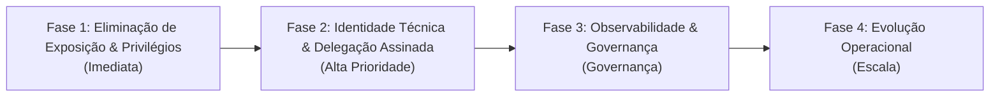

# ADR 012: Arquitetura de Identidade de Serviço (M2M), Autorização Granular por Escopos, Delegação Criptográfica e Prevenção a Prompt Injection

- **Status:** PROPOSTO (Em Discussão Avançada / Revisão Arquitetural Aprovada com Condições)
- **Data:** 09 de Novembro de 2026
- **Autor(es):** Equipe de Arquitetura, Engenharia e Segurança SCIA
- **Domínio:** Identidade M2M, Autorização por Escopos, Delegação Verificável (*On-Behalf-Of*), Prevenção a Prompt Injection, Auditoria Imutável e Observabilidade W3C
- **Componentes Relacionados:** 
  - `backend`: `src/middlewares/auth.middleware.ts`, `src/modules/ai/ai.routes.ts`, `src/config/env.ts`, `src/infra/minio.ts`
  - `ai-service`: `app/api/v1/endpoints/runs.py`, `app/agents/tools/platform_tools.py`, `app/core/config.py`
  - `compiler`: `src/server.ts`
  - `infra`: `docker-compose.yml`, `k8s/manifests/`

---

## ⚡ Guia Rápido & Resumo Executivo ("Elevator Pitch")

> [!TIP]
> **Consulte esta seção para uma resposta rápida ou para explicar a arquitetura a terceiros.**

### 1. O que estamos implementando (em poucas linhas):
1. **Blindar o Compilador TeX:** Fechar a porta pública (`4000`), exigir autenticação interna (M2M) e rodar a compilação em um **sandbox isolado** (usuário `nobody`, sem acesso à internet de saída, limites rígidos de CPU/RAM e cancelamento de toda a árvore de processos via `SIGKILL` em caso de timeout).
2. **Privatizar 100% do MinIO:** Eliminar qualquer política pública nos buckets. Navegador e compilador só acessam imagens e evidências através de **URLs pré-assinadas temporárias**, geradas com os endpoints corretos (público para o navegador do autor e interno para os pods).
3. **Controlar o Acesso da IA (SciAI):** Retirar o privilégio de `ADMIN` da IA. Ela passa a ter uma identidade técnica com escopos mínimos e só opera em um projeto através de um **Token de Delegação assinado** em nome do autor, sem permissão para executar ações institucionais ou irreversíveis sozinha (*Human-in-the-Loop*).
4. **Auditoria e Rastreabilidade:** Registrar eventos de forma imutável no banco (`REVOKE UPDATE, DELETE`) e propagar o identificador de rastreamento distribuído (*W3C Trace Context / traceparent*) em todas as chamadas.

### 2. Se alguém perguntar: *"Como funciona a comunicação entre os serviços do SCIA?"*
> *"Nossa arquitetura separa claramente o tráfego de usuários do tráfego interno de máquinas:*
> 
> * **Usuário ↔ Plataforma:** O frontend conecta no **Backend (Fastify)** via HTTP REST e Server-Sent Events (SSE) autenticado por JWT. Para edição colaborativa, usa **WebSockets diretos na memória RAM do Pod Dono** do documento (< 2ms de latência), coordenado via lease no Redis e persistido com integridade transacional ACID no PostgreSQL. Uploads pesados de arquivos vão direto do navegador para o **MinIO** via URLs pré-assinadas.
> * **Comunicação Interna (M2M):** Todos os serviços rodam em rede privada isolada. O Backend orquestra o **Compilador TeX** e o **SciAI** via chamadas autenticadas máquina-a-máquina.
> * **Princípio do Menor Privilégio:** Nenhum serviço interno tem privilégios de administrador por padrão. Quando a IA precisa consultar ou sugerir alterações em um artigo, ela atua estritamente através de um **token de delegação temporário emitido pelo Backend em nome daquele autor**, e o compilador opera como um **sandbox restrito**, sem acesso à internet externa.*"

---

## 1. Contexto & Diagnóstico Atual

Na arquitetura de microsserviços do SCIA, o **Backend Fastify** atua como autoridade transacional de negócio e o **SciAI Service** como orquestrador multi-agente para assistência científica.

### 1.1 O Mecanismo Anterior do MVP e Suas Falhas
Definido preliminarmente na ADR-006 como solução transitória:
1. O Backend envia `'X-Internal-Service-Key': env.INTERNAL_SERVICE_KEY` ao invocar endpoints do `ai-service`.
2. O `ai-service` devolve chamadas ao Backend via ferramentas (`platform_tools.py`) com esse mesmo cabeçalho.
3. No Backend ([`auth.middleware.ts`](file:///mnt/c0b6217c-c2f3-4c1f-8ba2-c8d177f718a9/development/professional/sci-latex-vscode/backend/src/middlewares/auth.middleware.ts#L21-L31)), a recepção da chave correta concedia:
   ```typescript
   request.user = {
     sub: 'internal-service',
     email: 'internal@scia.system',
     name: 'Internal SciAI Service',
     role: Role.ADMIN, // ⚠️ Super-privilégio administrativo total
   };
   ```

### 1.2 Por que isso é Inadmissível no SCIA?
* **Risco Crítico de Prompt Injection:** O `ai-service` interage com LLMs e consome textos externos não confiáveis (artigos do arXiv, buscas na web, entradas de autores). Se um agente for manipulado via injeção de prompt, ele não pode ter passe livre como `ADMIN` para alterar, ler ou destruir dados institucionais no PostgreSQL.
* **Poluição de Domínio:** Misturar identidades de máquina com papéis funcionais acadêmicos (`AUTHOR`, `ADVISOR`, `REVIEWER`, `ADMIN`) corrompe a governança.
* **Spoofing de Usuário:** Um cabeçalho em texto plano como `X-On-Behalf-Of: <userId>` não é confiável: um serviço comprometido poderia personificar qualquer pesquisador sem validação criptográfica.

---

## 2. Separação Estrita das Quatro Dimensões

O SCIA estabelece a distinção conceitual e técnica de quatro responsabilidades independentes:

```
┌────────────────────────────────────────────────────────────────────────────────────────┐
│                      AS QUATRO DIMENSÕES DE SEGURANÇA M2M NO SCIA                      │
├─────────────────────┬──────────────────────┬────────────────────┬──────────────────────┤
│ 1. Autenticação     │ 2. Autorização       │ 3. Delegação       │ 4. Auditoria         │
│ "Quem é você?"      │ "O que você pode     │ "Em nome de quem   │ "Qual ação foi       │
│ Identidade técnica  │ fazer na plataforma?"│ você está agindo?" │ executada, quando    │
│ da máquina emissora │ Escopos técnicos     │ Contexto delegado  │ e com qual desfecho?"│
│ (ex: service:sciai) │ granulares (scopes)  │ assinado (JWT)     │ Registro imutável    │
└─────────────────────┴──────────────────────┴────────────────────┴──────────────────────┘
```

---

## 3. Decisão Arquitetural Adotada

### 3.1. Modelo Tipado de Principal de Autenticação (`AuthenticatedPrincipal`)
O ecossistema adota formalmente o modelo de desacoplamento de entidades:

```typescript
export type PrincipalType = 'USER' | 'SERVICE';

export interface AuthenticatedPrincipal {
  type: PrincipalType;
  sub: string;            // ID do usuário ou ID do serviço ('service:sciai', 'service:compiler')
  scopes: string[];       // Permissões técnicas autorizadas (ex: ['templates:read', 'draft:read'])
  actor?: {
    userId: string;       // ID do pesquisador que iniciou o fluxo
    email: string;        // Email para auditoria
  };
  projectId?: string;     // ID do projeto com autorização contextual ativa
}
```

* **Usuário (`type: 'USER'`):** Sujeito a papéis de negócio (`Role`), controlados via RBAC convencional.
* **Serviço (`type: 'SERVICE'`):** Sujeito a escopos técnicos restritos (`scopes`), **nunca recebe `Role.ADMIN`** e deve apresentar delegação assinada para acessar recursos de usuários.

---

### 3.2. Contrato Completo do Token JWT de Delegação
Quando o Backend dispara um fluxo assíncrono no `ai-service` que precise interagir com os dados do autor:
1. O Backend gera um **Token de Delegação de Curta Duração (TTL: 5 a 15 minutos)** assinado assimetricamente (RS256 ou HMAC dedicado):
   ```json
   {
     "iss": "scia-backend",
     "sub": "service:sciai",
     "aud": "scia-backend",
     "actor": {
       "userId": "usr_9482_autor",
       "email": "pesquisador@instituicao.br"
     },
     "projectId": "proj_1029_artigo",
     "scopes": [
       "templates:read",
       "project:read_draft",
       "project:append_draft"
     ],
     "iat": 1731195600,
     "exp": 1731196500,
     "jti": "jwt_uuid_88329"
   }
   ```
2. O `ai-service` armazena esse token em seu estado de execução e o repassa nas chamadas de suas ferramentas de volta ao Backend:
   ```http
   Authorization: Bearer <delegation-token>
   ```
3. O Backend valida:
   * Assinatura, algoritmo permitido e expiração (`exp`).
   * Validação de `iss === 'scia-backend'` e `aud === 'scia-backend'`.
   * Se o `actor.userId` possui autorização ativa de coautoria/autoria no `projectId`.
   * Se a ferramenta solicitada está contida nos `scopes` concedidos.

---

### 3.3. Categorização de Ferramentas da IA & Human-in-the-Loop Mandatório
Para conter o raio de explosão de qualquer desvio de comportamento ou injeção de prompt:

| Categoria | Operações e Ferramentas | Política de Execução |
| :--- | :--- | :--- |
| **1. Consulta (Read-Only)** | `templates:read`, `search_arxiv`, busca bibliográfica | **Autônoma:** Permitida diretamente com base nos escopos do token. |
| **2. Rascunho (Idempotente)** | `project:read_draft`, `project:append_draft` | **Autônoma Controlada:** Permitida exclusivamente dentro do `projectId` autorizado pelo token. |
| **3. Irreversível / Institucional** | Submissão de artigo, exclusão de arquivos, avanço de Etapas com Gatekeeper (Etapa 5 NIT / Etapa 6 Congresso) | **PROIBIDA para IA Autônoma.** Requer confirmação humana explícita (*Human-in-the-Loop*) na interface do pesquisador. |

---

### 3.4. Segregação de Credenciais por Integração
Elimina-se a chave mestra global compartilhada (`INTERNAL_SERVICE_KEY`). Cada canal de integração possui sua própria identidade técnica e credenciais independentes:
* `backend -> compiler`: Credencial específica para o despachador de compilação.
* `backend -> sciai`: Credencial específica de orquestração de runs de IA.
* `sciai -> backend`: Token de delegação por requisição/job.

---

### 3.5. Auditoria Efetivamente Imutável
A rastreabilidade institucional dos eventos M2M é assegurada por mecanismos de banco de dados e permissões estritas:
1. **Estrutura do Evento:** Cada mutação gera um registro contendo:
   * `correlationId` (e W3C `traceparent`), `serviceId`, `actorUserId`, `projectId`, `operation`, `resourceType`, `resourceId`, `timestamp`, `result`.
2. **Imutabilidade SQL:** O usuário da aplicação no PostgreSQL não possui privilégio de exclusão ou alteração de registros de auditoria:
   ```sql
   REVOKE UPDATE, DELETE ON TABLE "AuditEvent" FROM "scia_app_user";
   GRANT INSERT, SELECT ON TABLE "AuditEvent" TO "scia_app_user";
   ```
   Isso garante que mesmo em caso de injeção de SQL na aplicação, o histórico institucional não possa ser adulterado.

---

### 3.6. Observabilidade Distribuída (W3C Trace Context)
Além do `X-Correlation-ID`, os microsserviços propagam o cabeçalho padrão do W3C:
```http
traceparent: 00-4bf92f3577b34da6a3ce929d0e0e4736-00f067aa0ba902b7-01
```
Permitindo rastrear visualmente a árvore de latências (SPA $\to$ Backend Fastify $\to$ SciAI $\to$ LLM/Ollama $\to$ MinIO) e diagnosticar timeouts com precisão.

---

## 4. Plano de Implementação em 4 Fases



### 🗓️ Fase 1: Eliminação de Exposição e Privilégios Excessivos
- [ ] Revogar atribuição automática de `Role.ADMIN` no [`auth.middleware.ts`](file:///mnt/c0b6217c-c2f3-4c1f-8ba2-c8d177f718a9/development/professional/sci-latex-vscode/backend/src/middlewares/auth.middleware.ts).
- [ ] Estabelecer whitelist estrita de rotas que aceitam chamadas de serviços de máquina.
- [ ] Sanitizar logs para nunca expor segredos ou tokens de autenticação.

### 🗓️ Fase 2: Identidade Técnica e Delegação Assinada
- [ ] Implementar a tipagem `AuthenticatedPrincipal` e middleware correspondente.
- [ ] Implementar emissor e validador de tokens JWT de delegação com escopos restritos.
- [ ] Atualizar `platform_tools.py` no `ai-service` para injetar o token de delegação nas requisições ao Backend.
- [ ] Implementar travas de segurança proibindo IA de executar mutações institucionais sem aprovação humana.

### 🗓️ Fase 3: Observabilidade e Governança
- [ ] Implementar tabela `AuditEvent` com restrições SQL `REVOKE UPDATE, DELETE`.
- [ ] Implementar propagação de W3C Trace Context (`traceparent`) e `X-Correlation-ID`.
- [ ] Configurar timeouts granulares por integração e circuit breaker para serviços de IA externos.

### 🗓️ Fase 4: Evolução Operacional
- [ ] Segregação de credenciais via Kubernetes Secrets independentes por pod.
- [ ] Políticas de rede `NetworkPolicy` isolando namespaces e portas M2M.
