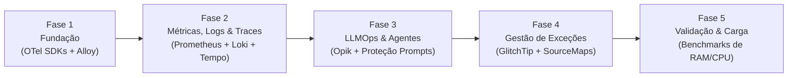

# ADR 013: Arquitetura de Observabilidade Open Source, Self-Hosted e Soberania Institucional (OpenTelemetry, Prometheus, Loki, Tempo, Opik e GlitchTip)

- **Status:** APROVADO (Revisão Técnica Incorporada — 10/11/2026)
- **Data Original:** 10 de Novembro de 2026
- **Data de Revisão:** 10 de Novembro de 2026
- **Autor(es):** Equipe de Arquitetura, Engenharia e Segurança SCIA
- **Revisão Técnica:** Análise de Confiabilidade & Arquitetura SRE/LLMOps
- **Domínio:** Observabilidade de Microsserviços, LLMOps de Agentes, Monitoramento de Sandbox TeX, Rastreamento Distribuído W3C e Gestão de Incidentes On-Premise
- **Componentes Relacionados:**
  - `frontend`: `@sentry/react` (sanitizado) conectando ao GlitchTip
  - `backend`: `fastify-metrics`, OpenTelemetry Node SDK, logs JSON via Pino, `@sentry/node`
  - `ai-service`: `prometheus-fastapi-instrumentator`, `opik` (OpikTracer com propagação de contexto W3C), `loguru`, OpenTelemetry Python SDK
  - `compiler`: Exporter de métricas de compilação, cgroups, propagação de trace em fila assíncrona
  - `infra`: Grafana Alloy, OpenTelemetry Collector, Prometheus, Loki, Tempo, Opik, GlitchTip, MinIO, PostgreSQL

---

## ⚡ Guia Rápido & Resumo Executivo ("Elevator Pitch" Revisado)

### 1. O que estamos decidindo e adotando:
1. **Infraestrutura de Observabilidade 100% Self-Hosted & Soberania Institucional:** Toda a pilha de coleta, armazenamento e visualização de telemetria roda exclusivamente na infraestrutura institucional on-premise. Elimina-se qualquer custo obrigatório recorrente de licenciamento ou SaaS de monitoramento.
2. **Separação entre Telemetria e Tráfego de Aplicação:** A garantia de soberania local aplica-se à **infraestrutura de observabilidade** (logs, traces, métricas e telemetrias ficam estritamente retidos localmente). O tráfego de aplicação com serviços externos de busca (arXiv, Semantic Scholar, OpenAlex) ou modelos comerciais (Gemini, GPT-4o) é governado separadamente pela política de segurança e classificação de dados do SCIA (ADR-012).
3. **Padrão Neutro de Coleta e Pipeline Unificado:** Instrumentação com **OpenTelemetry SDK** nos serviços, coleta de logs e métricas de nós via **Grafana Alloy** (substituindo o Promtail descontinuado), e processamento/roteamento via **OpenTelemetry Collector**.
4. **LLMOps com Opik & Correlação com Tracing Distribuído:** Adoção do **Opik (Apache 2.0)** on-premise para observabilidade semântica dos agentes LangGraph. O identificador W3C `traceparent` é explicitamente vinculado aos metadados do Opik, permitindo correlação bidirecional com o **Grafana Tempo**.
5. **Classificação e Proteção de Prompts:** Implementação de 3 níveis de registro no Opik (Operacional, Diagnóstico e Conteúdo), com mascaramento mandatório pré-envio para proteger manuscritos inéditos e segredos de pesquisa.
6. **Gestão Leve de Exceções com GlitchTip:** Substituição de soluções complexas pelo **GlitchTip (AGPLv3)**, com compatibilidade validada via matriz de testes para os SDKs essenciais do Sentry, com sanitização de PII e tokens no cliente.

---

## 1. Contexto & Diagnóstico

À medida que o SCIA consolida seu editor colaborativo em memória (ADR-007), suas 6 etapas institucionais (ADR-008) e seu motor multi-agente SciAI (ADR-006 / ADR-009), surgem três regimes de carga com comportamentos e modos de falha radicalmente distintos:

1. **Colaboração e Edição em Tempo Real:** Requisições contínuas, WebSockets concorrentes, leases em memória no Redis e checkpoints ACID no PostgreSQL. Exige rastreio de Event Loop lag, latência < 2ms e reconexões de rede.
2. **Motor de Inteligência Científica (LangGraph):** Execuções estocásticas assíncronas, grafos multi-agente, streaming de tokens SSE, interrupções humanas e dependência de APIs externas sujeitas a throttling severo (arXiv ToU 3s).
3. **Sandbox do Compilador LaTeX:** Jobs pesados de CPU/disco, concorrência delimitada, risco de loops infinitos em macros TeX e necessidade de isolamento rígido em cgroups sem rede.

---

## 2. Decisão Arquitetural: A Stack Open Source e Suas Responsabilidades

```
┌────────────────────────────────────────────────────────────────────────────────────────┐
│             MATRIZ DE FERRAMENTAS, LICENÇAS E RESPONSABILIDADES NO SCIA                │
├─────────────────────┬──────────────────────┬─────────────┬─────────────────────────────┤
│ Domínio             │ Ferramenta Eleita    │ Licença     │ Responsabilidade Específica │
├─────────────────────┼──────────────────────┼─────────────┼─────────────────────────────┤
│ Instrumentação Apps │ OpenTelemetry SDK    │ Apache 2.0  │ Spans e contexto W3C        │
│ Coleta no Host/K8s  │ Grafana Alloy        │ Apache 2.0  │ Logs, node & pod metrics    │
│ Pipeline Telemetria │ OTel Collector       │ Apache 2.0  │ Filtragem, enriquecimento   │
│ Métricas e Séries   │ Prometheus           │ Apache 2.0  │ TSDB métricas e alertas     │
│ Logs Estruturados   │ Grafana Loki         │ AGPLv3      │ Logs via Structured Metadata│
│ Tracing Distribuído │ Grafana Tempo        │ AGPLv3      │ Rastreamento entre serviços │
│ Visualização        │ Grafana OSS          │ AGPLv3      │ Painéis e correlação        │
│ LLMOps & Agentes    │ Opik (Comet)         │ Apache 2.0  │ Nós LangGraph, tokens, custo│
│ Rastreio de Bugs    │ GlitchTip            │ AGPLv3      │ Captura de exceções e crash │
└─────────────────────┴──────────────────────┴─────────────┴─────────────────────────────┘
```

> [!NOTE]
> **Sobre as Licenças AGPLv3 e Custos Operacionais:**
> A adoção de ferramentas sob licença AGPLv3 (Loki, Tempo, Grafana, GlitchTip) é segura no modelo on-premise do SCIA, pois os serviços são executados como componentes de infraestrutura sem modificação do seu código-fonte proprietário. "Custo Zero" refere-se estritamente à **isenção de faturas recorrentes de licenças de software e assinaturas SaaS**, permanecendo os custos reais de infraestrutura de hardware, energia, armazenamento e sustentação operacional da equipe.

---

## 3. Correções Técnicas e Definições Críticas

### 3.1 Soberania de Dados vs. Provedores Externos
A garantia de soberania local é delimitada à **infraestrutura de observabilidade**:
* Telemetria, métricas de hardware, logs internos, traces APM e dados capturados pelo Opik residem 100% em volumes e bancos on-premise.
* A comunicação com serviços acadêmicos externos (arXiv, S2, OpenAlex) transmite exclusivamente termos de busca bibliográfica.
* Chamadas para modelos de linguagem comerciais externos (Gemini, OpenAI) transmitem prompts e contexto de manuscritos para as APIs desses provedores sob suas respectivas políticas de privacidade. Quando for exigida confidencialidade absoluta institucional, o SCIA direciona a execução exclusivamente ao modelo local via **Ollama**.

### 3.2 Coleta Unificada: Grafana Alloy e OpenTelemetry Collector
Substitui-se a menção a ferramentas descontinuadas (como o Promtail, EOL em março de 2026):
* **Grafana Alloy:** Agente unificado para coleta de logs dos containers e métricas de infraestrutura (substitui Promtail e unifica pipelines).
* **OpenTelemetry Collector:** Atua como pipeline central de telemetria, recebendo spans OTLP (gRPC porta 4317 / HTTP porta 4318), executando amostragem (*tail-based sampling*), higienização de atributos sensíveis e encaminhamento para Prometheus e Tempo.

```
Aplicações SCIA (React, Fastify, FastAPI, Compiler)
       │
       ├─► [OTel SDKs] ─────────────► OTel Collector ──► Tempo (Traces)
       ├─► [/metrics Scraping] ────────────────────────► Prometheus (Métricas)
       ├─► [JSON Logs (stdout)] ────► Grafana Alloy ───► Loki (Logs com Structured Metadata)
       ├─► [OpikTracer (LangGraph)] ───────────────────► Opik (LLMOps)
       └─► [Sentry SDK (Higienizado)] ─────────────────► GlitchTip (Exceções)
```

### 3.3 Integração e Correlação entre Opik e OpenTelemetry (Tempo)
O Opik e o Grafana Tempo desempenham papéis complementares, não concorrentes:
* **Tempo:** Rastreamento distribuído entre serviços de borda (Frontend $\rightarrow$ Fastify $\rightarrow$ FastAPI $\rightarrow$ Compiler $\rightarrow$ PostgreSQL).
* **Opik:** Observabilidade semântica profunda da execução de IA (passos internos do LangGraph, parâmetros de temperatura, prompts do sistema, contagem de tokens e avaliações de qualidade).

#### Contrato de Correlação:
1. Ao receber uma requisição HTTP, o `FastAPI` extrai o cabeçalho W3C `traceparent` via middleware OTel, obtendo o `trace_id` distribuído.
2. O orquestrador injeta esse identificador nos metadados do `OpikTracer`:
   ```python
   metadata = {
       "trace_id": otel_trace_id,       # Vincula ao Tempo
       "conversation_id": conv_id,       # Vincula à sessão do usuário
       "article_id": article_id,         # Vincula ao projeto
       "project_stage": stage_number     # Etapa institucional (1 a 6)
   }
   ```
3. O Grafana é configurado com um link de dados (*Data Link*) no Tempo: clicar em um span do `ai-service` abre diretamente o trace correspondente na interface do Opik utilizando a URL parametrizada `http://opik:5174/traces?trace_id=${__trace.id}`.

### 3.4 Política de Proteção e Classificação de Prompts no Opik
Para impedir que o Opik se torne um repositório vulnerável de manuscritos confidenciais não publicados:

| Nível | Escopo dos Dados Registrados | Quando é Ativado? |
| :--- | :--- | :--- |
| **1. Operacional** | IDs de execução, tempo de resposta, nome do modelo, contagem de tokens, status HTTP e códigos de erro. Prompts e respostas são omitidos. | **Padrão em Produção** para todas as interações gerais. |
| **2. Diagnóstico** | Nível Operacional + Metadados de busca (consultas do arXiv, artigos recuperados, parâmetros de ferramentas). | Ativado para depuração de conectores de busca. |
| **3. Conteúdo Completo** | Prompts integrais, instruções de sistema e textos gerados em LaTeX. | **Restrito**, com mascaramento prévio de PII e retenção máxima de 7 dias, habilitado somente com consentimento institucional. |

### 3.5 Logs Estruturados no Loki com *Structured Metadata*
Para evitar a explosão de streams e degradação de desempenho no Loki, identificadores de alta cardinalidade **nunca serão usados como labels**:
* **Labels do Loki (Baixa Cardinalidade):** `service` (ex: `backend`), `environment` (ex: `production`), `level` (ex: `error`).
* **Structured Metadata (Alta Cardinalidade):** `trace_id`, `span_id`, `user_id`, `article_id`, `job_id`.
* **Conteúdo do Log (Mensagem):** Mensagens descritivas, payloads sanitizados e stack traces.

### 3.6 Observabilidade Especializada do Compilador LaTeX
O worker de compilação expõe métricas e telemetrias dedicadas:
* `compiler_jobs_total`: Total de compilações solicitadas.
* `compiler_jobs_active`: Compilações em execução concorrente.
* `compiler_job_duration_seconds`: Histograma de duração por motor (`pdflatex`, `xelatex`).
* `compiler_jobs_failed_total`: Falhas categorizadas (`syntax_error`, `package_missing`, `system_error`).
* `compiler_timeout_total`: Execuções encerradas forçadamente por estouro do teto de 30s (`SIGKILL`).
* `compiler_queue_size`: Tamanho da fila de espera de compilação.
* **Propagação de Trace em Filas:** Quando a compilação for assíncrona, o cabeçalho `traceparent` é injetado nos metadados do job na fila (Redis) e extraído pelo worker do compilador, mantendo o trace contínuo da requisição original.

### 3.7 Validação da Compatibilidade do GlitchTip
Reconhece-se que o GlitchTip é uma reimplementação compatível com o núcleo da API do Sentry, mas não possui paridade em 100% dos recursos:
* **Recursos Suportados e Homologados:** Captura de exceções React (`ErrorBoundary`), stack traces com Source Maps desminificados, exceções não tratadas no Fastify/FastAPI, tags de release e controle de ambientes.
* **Recursos Não Suportados / Omitidos:** Rastreamento avançado de sessões (*session tracking*) e profiling detalhado de runtime nativa do Sentry.
* **Sanitização Obrigatória no Cliente:** Configuração do hook `beforeSend` nos SDKs do cliente para expurgar tokens JWT, headers de autorização e dados pessoais sensíveis antes do envio ao GlitchTip.

### 3.8 Dimensionamento Baseado em Benchmark (Remoção da Premissa de < 3 GB)
A estimativa preliminar de consumo inferior a 3 GB de RAM total foi removida do documento. O Opik opera sobre backend Java/Python e ClickHouse analítico, e o Prometheus/Loki possuem consumo dependente do volume de dados em trânsito.
* Fica estabelecida a obrigatoriedade de **benchmarks de dimensionamento em 3 fases**:
  1. *Ambiente de Desenvolvimento:* Carga básica de testes unitários e de integração.
  2. *Ambiente de Staging/Homologação:* Testes de carga progressiva (50 a 200 usuários concorrentes simulados via k6).
  3. *Ambiente de Produção:* Dimensionamento com limites e reservas (*requests/limits*) validados no Kubernetes.

---

## 4. Governança, Retenção, Backup e Recuperação (DR)

```
┌────────────────────────────────────────────────────────────────────────────────────────┐
│               POLÍTICA DE RETENÇÃO E ARMAZENAMENTO POR COMPONENTE                      │
├────────────────────┬───────────┬──────────────────────┬────────────────────────────────┤
│ Componente         │ Retenção  │ Backend de Storage   │ Estratégia de Backup / DR      │
├────────────────────┼───────────┼──────────────────────┼────────────────────────────────┤
│ Prometheus         │ 15 dias   │ PVC Persistente SSD  │ Snapshots regulares + WAL      │
│ Grafana Loki       │ 14 dias   │ MinIO S3 (Chunks)    │ Replicação de bucket MinIO     │
│ Grafana Tempo      │ 7 dias    │ MinIO S3 (Traces)    │ Rotação natural (sem backup)   │
│ Opik (LLMOps)      │ 90 dias*  │ PostgreSQL + ClickH. │ Dump relacional + ClickHouse   │
│ GlitchTip          │ 30 dias   │ PostgreSQL           │ Dump diário pg_dump transac.   │
│ Grafana Dashboards │ Indefinido│ Git (Provisioning)   │ Infraestrutura como Código     │
└────────────────────┴───────────┴──────────────────────┴────────────────────────────────┘
```
*\*Para o Opik, métricas operacionais e custos são mantidos por 90 dias; prompts de nível de conteúdo são expurgados em até 7 dias.*

---

## 5. Estratégia de Alertas e Gestão de Incidentes

Alertas serão gerenciados via **Prometheus Alertmanager** e **Grafana Alerting**, focando nos sintomas que afetam os pesquisadores:

| Cenário de Falha | Condição do Alerta | Severidade | Ação Esperada |
| :--- | :--- | :--- | :--- |
| **Backend Fastify Indisponível** | Falha de healthcheck por > 1 min | 🚨 Crítico (P1) | Reinicialização automática do pod e alerta imediato |
| **Compiler Sobrecarregado** | Fila > 5 jobs por > 2 min | ⚠️ Aviso (P2) | Escalonamento horizontal (HPA) de workers TeX |
| **Timeouts Excessivos de TeX** | > 3 timeouts (30s) em 5 min | ⚠️ Alerta (P2) | Investigação de projeto travado ou macro maliciosa |
| **SciAI / Provedor Bloqueado** | arXiv ou LLM status 429 por > 2 min | ⚠️ Alerta (P2) | Verificação de throttle e acionamento de fallback |
| **Esgotamento do Pool Postgres** | Conexões ativas > 85% do pool | 🚨 Crítico (P1) | Investigação de queries lentas e transações presas |
| **MinIO Sem Espaço** | Espaço em disco livre < 15% | 🚨 Crítico (P1) | Expurgar compilações antigas e expandir PVC |

---

## 6. Roteiro de Implantação em 5 Fases



1. **Fase 1 — Fundação e Pipeline:** OpenTelemetry SDK no Fastify e FastAPI; padronização de logs JSON; deploy do Grafana Alloy e OTel Collector.
2. **Fase 2 — Observabilidade Operacional:** Prometheus para métricas; Loki com structured metadata; Tempo para tracing distribuído; dashboards e alertas no Grafana.
3. **Fase 3 — LLMOps de Agentes com Opik:** Deploy on-premise do Opik; instrumentação do LangGraph com correlação ao `trace_id` do Tempo; aplicação da política de mascaramento de prompts.
4. **Fase 4 — Gestão de Exceções com GlitchTip:** Deploy do GlitchTip; configuração dos SDKs React e Node com higienização de PII e suporte a releases.
5. **Fase 5 — Validação Operacional e Benchmarks:** Execução de testes de carga com k6; medição real de consumo de CPU, RAM e disco; homologação das rotinas de backup e restauração.
