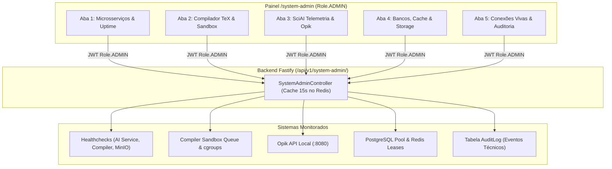

# ADR 014: Painel Administrativo Exclusivo para Monitoramento de Saúde da Aplicação e Métricas Operacionais

- **Status:** APROVADO
- **Data:** 10 de Novembro de 2026
- **Autor(es):** Equipe de Arquitetura, Engenharia e Segurança SCIA
- **Domínio:** Administração de Sistema, Saúde de Microsserviços, Controle de Sandbox TeX, Telemetria SciAI/LLMOps e Isolamento RBAC
- **Componentes Relacionados:**
  - `frontend`: `src/features/system-admin/`, `src/routes/index.tsx`, `src/layouts/RoleLayoutResolver.tsx`
  - `backend`: `src/modules/system-admin/`, `src/modules/system-admin/system-admin.routes.ts`, `src/middlewares/auth.middleware.ts`
  - `ai-service`: Exposição interna de métricas `/metrics` e agregação com Opik
  - `compiler`: Exposição de status da fila de workers e cgroups
  - `infra`: Redis, PostgreSQL, MinIO, Prometheus API

---

## ⚡ Guia Rápido & Resumo Executivo ("Elevator Pitch")

### 1. O que estamos decidindo e estabelecendo:
1. **Separação Rígida entre Domínio Acadêmico e Saúde Operacional:** Autores, Coordenadores e Gerentes (`Role.MANAGER`) operam artefatos acadêmicos (artigos, 6 etapas, revisões e congressos). O **Painel do Administrador (`Role.ADMIN`)** é estritamente técnico, focado no monitoramento e controle da **saúde, desempenho, capacidade e integridade dos serviços do SCIA**.
2. **Estrutura em 5 Abas Especializadas:**
   * **Aba 1 (Microsserviços & Uptime):** Matriz de conectividade dos 5 serviços, latência, RPS, erros 5xx e Event Loop Lag.
   * **Aba 2 (Compilador LaTeX & Sandbox):** Fila de jobs, tempos de compilação $p50$/$p95$, cancelamentos forçados por timeout (30s) e consumo de disco transitório.
   * **Aba 3 (SciAI Engine & LLMOps):** TTFT, conexões SSE ativas, conformidade com taxa do arXiv (janela 3s), nós do LangGraph e custos/tokens agregados do Opik.
   * **Aba 4 (Bancos, Cache & Storage):** Conexões do pool Prisma/PostgreSQL, leases de documentos no Redis (`editor:document:<docId>:owner`) e quotas do MinIO.
   * **Aba 5 (Conexões Vivas & Auditoria Técnica):** Conexões WebSocket ativas no editor colaborativo e logs de segurança/violação de autenticação M2M.
3. **Padrão Backend-For-Frontend (BFF Agregador Seguro):** O Frontend nunca acessa portas internas da infraestrutura (Prometheus `:9090`, Opik `:8080`, Redis `:6379`). O Backend Fastify agrega os dados via rotas autenticadas sob a permissão `Role.ADMIN`.

---

## 1. Contexto & Problema

O SCIA evoluiu para um ecossistema complexo com múltiplos microsserviços e workers concorrentes. 

No modelo anterior:
1. **Falta de Visibilidade para o Administrador:** O administrador da plataforma não tinha uma tela nativa no frontend para diagnosticar a saúde da aplicação em tempo real. A única alternativa era abrir múltiplos terminais ou acessar ferramentas de baixo nível (como a console do Docker ou banco).
2. **Risco de Poluição Conceitual:** Misturar indicadores de negócios (como metas de publicação ou contagem de artigos) com métricas de saturação de hardware, filas de compilação ou falhas de provedores de IA causa confusão funcional e quebra a separação de responsabilidades.
3. **Necessidade de Painel Centralizado sem Expor a Rede Interna:** Expor dashboards brutos de Prometheus ou Grafana em iframes no frontend acarreta brechas de segurança, quebra a identidade visual do Design System e exige autenticações duplicadas.

---

## 2. Decisão Arquitetural

Fica estabelecida a criação da área **`System Admin Health Dashboard`** (`/system-admin`) no Frontend do SCIA, sustentada por um módulo agregador seguro no Backend Fastify.

```
┌────────────────────────────────────────────────────────────────────────────────────────┐
│                        MATRIZ DE ISOLAMENTO DE PAPÉIS NO SCIA                          │
├─────────────────────┬──────────────────────┬───────────────────────────────────────────┤
│ Perfil (Role)       │ Área no Frontend     │ Escopo e Visibilidade                    │
├─────────────────────┼──────────────────────┼───────────────────────────────────────────┤
│ AUTHOR              │ /articles, /workspace│ Escrever manuscritos e executar tarefas   │
│ COORDINATOR         │ /coordinator         │ Orientar artigos e aprovar revisões       │
│ MANAGER             │ /manager             │ Governança acadêmica, metas do ciclo e NIT│
│ ADMIN (Sistema)     │ /system-admin        │ 100% Saúde Operacional, Serviços e Carga  │
└─────────────────────┴──────────────────────┴───────────────────────────────────────────┘
```

---

## 3. Arquitetura das 5 Abas Especializadas



### Aba 1: Saúde Geral dos Microsserviços
* Matriz de conectividade dos 5 serviços com semáforos visuais (`OPERATIONAL`, `DEGRADED`, `DOWN`).
* Latência de resposta ($p50$, $p95$, $p99$) do Fastify e do `ai-service`.
* Monitoramento de **Event Loop Lag** e consumo de Heap do Node.js.
* Taxa de requisições por segundo (RPS) e distribuição de status HTTP (2xx, 4xx, 5xx).

### Aba 2: Compilador LaTeX & Sandbox de Processos
* Estado da fila de compilações (workers ocupados vs ociosos).
* Histórico recente de tempo de compilação por motor (`pdflatex`, `xelatex`).
* Métricas de falha categorizadas:
  * Erros de sintaxe do usuário TeX.
  * Timeouts com cancelamento forçado (`SIGKILL` após 30s, conforme ADR-012).
* Volume de armazenamento transitório ocupado por arquivos `.aux`, `.log` e `.pdf`.

### Aba 3: SciAI Engine — Telemetria de LLMs e Conectores
* Conexões ativas no streaming SSE do chat copiloto (`/api/v1/chat/stream`).
* Métrica de TTFT (Time To First Token) médio.
* Monitoramento dos conectores científicos:
  * Cumprimento do semáforo unitário e throttle de 3s no **arXiv**.
  * Alertas de taxa de erro HTTP 429 de APIs externas (arXiv / S2 / OpenAlex).
* Dados consolidados do **Opik**:
  * Total de tokens consumidos no mês (Prompt vs Completion).
  * Custo financeiro estimado (USD) agrupado por provedor (Gemini Flash vs OpenAI vs Ollama local).

### Aba 4: Bancos, Cache e Armazenamento de Objetos
* **PostgreSQL:**
  * Conexões em uso no pool Prisma vs limite máximo (capacidade de pool).
  * Latência de roundtrip e detecção de queries em lock.
* **Redis:**
  * Uso de memória RAM alocada vs limite de eviction.
  * Quantidade de **Leases de Documentos ativas** (`editor:document:<docId>:owner`).
* **MinIO S3:**
  * Disponibilidade do bucket `collab-assets`.
  * Espaço total consumido e taxa de geração de URLs pré-assinadas.

### Aba 5: Conexões Vivas & Auditoria Técnica
* Monitoramento de salas colaborativas WebSocket ativas (`/ws/documents/:projectId`).
* Total de operações de Transformação Operacional (OT) processadas por segundo.
* Log de eventos de segurança técnica:
  * Tentativas de conexão com tokens inválidos ou expirados.
  * Falhas de autenticação M2M entre serviços internos.
  * Ações de cancelamento forçado de compilação ou desconexão de salas zumbis.

---

## 4. Segurança e Isolamento RBAC

1. **Guarda de Rotas no Frontend (`RoleLayoutResolver` e `ProtectedRoute`):**
   * A rota `/system-admin` exige estritamente `allowedRoles={[Role.ADMIN]}`.
   * Tentativas de acesso por usuários não-admin redirecionam imediatamente para `/` com aviso de acesso não autorizado.
2. **Guarda no Backend (`auth.middleware.ts`):**
   * O grupo de rotas `/api/v1/system-admin/*` valida a assinatura do JWT e rejeita qualquer requisição cujo `role !== Role.ADMIN` com código `403 Forbidden`.
3. **Proteção contra Sobrecarga (Cache no Redis):**
   * As agregações de métricas pesadas executadas pelo Fastify possuem cache temporário no Redis com TTL de **15 segundos**, evitando que consultas repetidas do painel sobrecarreguem o banco ou os serviços satélites.

---

## 5. Consequências da Decisão

### Positivas:
* **Controle Total pelo Administrador:** Visibilidade centralizada em interface nativa do sistema sem dependência de ferramentas externas no dia a dia.
* **Zero Contaminação de Domínio:** O gestor acadêmico continua com sua visão focada em metas e artigos, enquanto o administrador foca 100% na saúde da infraestrutura.
* **Segurança e Estilo Unificado:** Nenhuma porta de monitoramento (Prometheus, Opik, Redis) é aberta ao navegador. A tela utiliza 100% dos componentes e tema do SCIA Design System.

### Negativas / Mitigações:
* **Necessidade de Manter Endpoints de Agregação:** O Fastify precisa consultar os serviços satélites. Mitigado através de rotas de `/health` ultra-rápidas e cache de 15 segundos no Redis.

---

## 6. Próximos Passos
1. Criar a especificação técnica detalhada em `docs/planning/specs/system-admin-health-dashboard-spec.md`.
2. Implementar as rotas no backend: `src/modules/system-admin/`.
3. Implementar a página com abas no frontend: `src/features/system-admin/`.
