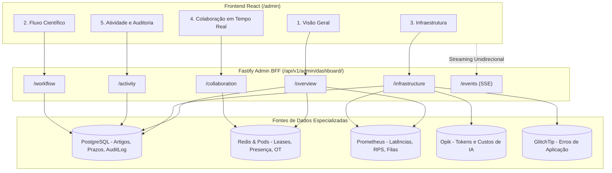

# ADR 014: SCIA Admin Center — Painel Administrativo de Observabilidade, Operação de Plataforma e Governança Científica

- **Status:** APROVADO
- **Data:** 12 de Novembro de 2026
- **Autor(es):** Equipe de Arquitetura, Engenharia e Segurança SCIA
- **Domínio:** Administração de Sistema, Inteligência Operacional, Saúde de Microsserviços, Monitoramento de Colaboração em Tempo Real e Auditoria
- **Componentes Relacionados:**
  - `frontend`: `src/features/admin/`, `src/routes/index.tsx`, `src/layouts/RoleLayoutResolver.tsx`
  - `backend`: `src/modules/admin/`, `src/modules/admin/admin.routes.ts`, `src/middlewares/auth.middleware.ts`
  - `ai-service`: Exposição interna de telemetria agregada com Opik
  - `compiler`: Exposição de status da fila e métricas de sandbox
  - `infra`: Redis (Leases e presença), PostgreSQL (Artigos, 6 etapas, AuditLog), Prometheus API, GlitchTip

---

## ⚡ Guia Rápido & Resumo Executivo ("Elevator Pitch")

### 1. O que estamos decidindo e estabelecendo:
1. **Criação do SCIA Admin Center no Frontend:** Implementação de um módulo nativo de administração e inteligência operacional no próprio frontend React do SCIA (`/admin`), exclusivo para usuários com perfil `Role.ADMIN`.
2. **Não Reproduzir o Grafana Dentro do SCIA:** O painel não visa duplicar gráficos brutos de infraestrutura. Em vez disso, é uma **Central de Inteligência Operacional** com linguagem de negócio e engenharia adaptada à plataforma, integrando saúde de serviços, fluxo editorial científico e estado da colaboração em tempo real.
3. **Estrutura em 5 Áreas Estratégicas:**
   * **1. Visão Geral:** Resumo executivo ao vivo (usuários ativos, sessões, artigos em andamento, WebSockets ativos, erros/hora e gráfico de atividade horária).
   * **2. Fluxo de Produção Científica:** Visão operacional dos artigos nas 6 etapas oficiais, gargalos institucionais, artigos atrasados e travas do NIT (Etapa 5) e Congresso (Etapa 6).
   * **3. Monitoramento da Infraestrutura:** Matriz de saúde dos serviços (Fastify, React, Postgres, Redis, Compiler, SciAI, K8s) com semáforos e links contextuais para o Grafana.
   * **4. Monitoramento da Colaboração em Tempo Real:** Distribuição de documentos por Pod dono, taxa de operações de Transformação Operacional (OT/s), latência de processamento em RAM, checkpoints pendentes e reconexões.
   * **5. Atividade e Auditoria:** Timeline ao vivo de eventos operacionais, editoriais e de segurança (`AuditLog`).
4. **BFF Seguro com REST + Server-Sent Events (SSE):** O frontend nunca acessa portas internas de telemetria (Prometheus, Opik, Redis). O Fastify agrega os dados via endpoints dedicados (`/api/v1/admin/dashboard/*`) e provê atualizações instantâneas via SSE (`/api/v1/admin/dashboard/events`).
5. **Dimensionamento do Compilador:** O escalonamento de workers TeX opera nesta fase com dimensionamento estático provisionado e monitoramento visual de fila. A adoção do KEDA fica formalmente postergada para uma fase futura, ativada apenas se o volume de concorrência em produção comprovar necessidade.

---

## 1. Contexto & Diagnóstico

A plataforma SCIA atingiu um nível de sofisticação onde coexistem:
1. **Regras Críticas de Negócio:** 6 etapas fixas imutáveis, controle de prazos de congressos, gatekeepers do NIT e colaboração editorial.
2. **Regimes Computacionais Concorrentes:** Centenas de deltas de digitação por segundo na memória RAM dos Pods (ADR-007), grafos de agentes com chamadas assíncronas a LLMs (ADR-006/009/013) e compilação de PDFs em workers isolados (ADR-012).

No modelo anterior, existia um vácuo operacional:
* Para saber a saúde técnica da máquina, o administrador precisava de ferramentas externas (Grafana, logs brutos).
* Para saber se havia artigos travados no NIT ou editores sobrecarregados, precisava rodar queries manuais no PostgreSQL.
* Faltava uma **interface unificada de controle** que permitisse ao administrador bater o olho e entender se a plataforma e a produção científica estão operando de forma saudável.

---

## 2. Decisão Arquitetural: O Módulo "SCIA Admin Center"

Fica aprovada a criação do módulo **SCIA Admin Center** (`/admin`), blindado por RBAC estrito (`Role.ADMIN`), estruturado em 5 áreas funcionais:

```
┌────────────────────────────────────────────────────────────────────────────────────────┐
│                                   SCIA ADMIN CENTER                                    │
├───────────────────┬───────────────────┬───────────────────┬───────────────────┬────────┤
│ [1. Visão Geral]  │ [2. Fluxo Cient.] │ [3. Infraestut.]  │ [4. Colaboração]  │ [5. Aud│
│ Saúde do sistema, │ Distribuição nas  │ Fastify, SciAI,   │ Pods donos, OT/s, │ Linha  │
│ usuários ativos,  │ 6 etapas, atrasos,│ Compiler, Bancos, │ latência em RAM,  │ do tem-│
│ WebSockets e erros│ NIT e submissões  │ Opik e links Graf.│ checkpoints pend. │ po vivo│
└───────────────────┴───────────────────┴───────────────────┴───────────────────┴────────┘
```

---

## 3. As 5 Áreas Estratégicas e Suas Fontes da Verdade



### Área 1: Visão Geral da Plataforma
* **Cards de Indicadores Instantâneos:**
  * Status geral da plataforma (🟢 *Operacional* / 🟡 *Degradado* / 🔴 *Instável*).
  * Usuários ativos no momento (contagem de sessões válidas).
  * Artigos em andamento (total de projetos ativos).
  * WebSockets ativos (conexões estabelecidas no `/ws/documents/:id`).
  * Erros na última hora (erros 5xx e exceções capturadas no GlitchTip).
* **Gráfico de Linha / Área:** Atividade da plataforma nas últimas 12 horas (RPS e operações de edição por hora).

### Área 2: Fluxo de Produção Científica
Visão analítica de negócio para identificar gargalos operacionais no fluxo acadêmico:
* **Funil de Distribuição nas 6 Etapas Canônicas:**
  * Etapa 1: Planejamento e Pesquisa
  * Etapa 2: Desenvolvimento e Experimentos
  * Etapa 3: Escrita do Manuscrito
  * Etapa 4: Revisão Técnica Preliminar
  * Etapa 5: Validação Institucional (NIT 🔒)
  * Etapa 6: Submissão ao Congresso Alvo 🔒
* **Indicadores de Alerta Institucional:**
  * Artigos com cronograma atrasado.
  * Artigos estagnados (sem alterações há mais de 15 dias na mesma etapa).
  * Processos do NIT aguardando parecer de patente/viabilidade.
  * Artigos na Etapa 6 próximos da data limite de submissão do Congresso Alvo vs. Backup.

### Área 3: Monitoramento da Infraestrutura
Painel executivo com semáforos dos componentes e links para o Grafana para diagnóstico aprofundado:

| Componente | Indicadores Apresentados no Admin Center | Ação ao Clicar |
| :--- | :--- | :--- |
| **Backend Fastify** | RPS, Latência $p95$, Taxa de erros 5xx, Event Loop Lag | Link para Dashboard Fastify no Grafana |
| **Frontend React** | Taxa de crash JS, Web Vitals, falhas de rede | Link para o GlitchTip |
| **PostgreSQL** | Conexões ativas vs pool, locks ativos, tempo de query | Link para Postgres Dashboard no Grafana |
| **Redis** | Uso de memória RAM, total de leases de documentos | Link para Redis Dashboard no Grafana |
| **WebSockets** | Conexões ativas, taxa de reconexão | Link para Métricas de Socket no Grafana |
| **Compilador LaTeX** | Fila de jobs, tempos de compilação, timeouts (30s) | Link para Métricas TeX no Grafana |
| **SciAI (LangGraph)** | TTFT, conexões SSE, status do arXiv, tokens e custos | Link para a UI do Opik (`:5174`) |
| **Kubernetes** | Pods em execução, restarts recentes (OOMKilled) | Link para Dashboard de Nodes no Grafana |

### Área 4: Monitoramento da Colaboração em Tempo Real
Supervisão do motor de edição colaborativa em memória (ADR-007 e ADR-007.1):
* Quantidade de artigos sendo editados simultaneamente.
* Total de pesquisadores conectados ao editor.
* Distribuição de salas por Pod dono (identifica se algum pod está concentrando documentos em excesso).
* Taxa de operações de Transformação Operacional (OT ops/s).
* Latência de processamento de operações na RAM do pod ($p95$).
* Quantidade de checkpoints atômicos pendentes de persistência no PostgreSQL.
* Taxa de reconexões WebSocket e eventuais falhas de lease no Redis.

### Área 5: Atividade e Auditoria Institucional
Linha do tempo ao vivo das ações relevantes ocorridas no sistema:
* Edições iniciadas e finalizadas em manuscritos.
* Conclusão de revisões e aprovações de tarefas.
* Mudanças de etapa (especialmente avanço para Etapa 5 NIT ou Etapa 6 Congresso).
* Ocorrências de timeout de compilação ou falhas de sistema.
* Eventos de segurança (tentativas de autenticação inválidas, violação de token M2M).

---

## 4. Arquitetura da API no Backend Fastify

Para garantir alta performance e isolamento de segurança:
1. **Nenhum Serviço Interno Exposto:** O navegador nunca se comunica diretamente com Prometheus (`9090`), Opik (`8081`) ou Redis (`6379`).
2. **Endpoints REST Agregadores:**
   * `GET /api/v1/admin/dashboard/overview`
   * `GET /api/v1/admin/dashboard/workflow`
   * `GET /api/v1/admin/dashboard/infrastructure`
   * `GET /api/v1/admin/dashboard/collaboration`
   * `GET /api/v1/admin/dashboard/activity`
3. **Streaming Unidirecional em Tempo Real via SSE:**
   * `GET /api/v1/admin/dashboard/events`
   * O Fastify publica eventos leves (usuário conectou, checkpoint salvo, erro registrado) via SSE. O frontend atualiza os contadores sem necessidade de polling agressivo.
4. **Cache em Memória / Redis:** As agregações do PostgreSQL e métricas de infraestrutura possuem cache temporário de 15 a 30 segundos, protegendo o banco contra sobrecarga.

---

## 5. Decisão sobre Escalonamento do Compilador (KEDA Postergado)

Fica estabelecido que:
* Os workers do compilador TeX operam com **dimensionamento estático provisionado** (pool dedicado com quotas estritas de CPU e memória em cgroups).
* A integração com **KEDA** (Kubernetes Event-driven Autoscaling) para escalonamento automático baseado na fila `compiler_queue_size` permanece formalizada e documentada como caminho técnico aprovado, mas **postergada para uma fase futura**, sendo ativada somente quando a volumetria de concorrência em produção comprovar saturação dos workers estáticos.

---

## 6. Consequências da Decisão

### Positivas:
* **Central de Controle Completa:** O administrador diagnostica saúde de servidores, gargalos de produção científica e problemas de colaboração em uma única interface.
* **UX Nativa:** A interface adota 100% dos componentes, paleta de cores e tipografia do SCIA Design System (React 19 + Material UI).
* **Segurança e Desacoplamento:** Todas as requisições passam pela camada de autorização do Fastify com validação de `Role.ADMIN`.

### Negativas / Mitigações:
* **Desenvolvimento Adicional de Telas:** Exige construir componentes de frontend dedicados. Mitigado pelo aproveitamento dos componentes existentes do Material UI e bibliotecas leves de gráficos (como Recharts).

---

## 7. Próximos Passos
1. Atualizar a especificação técnica em `docs/planning/specs/system-admin-health-dashboard-spec.md`.
2. Implementar os endpoints agregadores e rota SSE em `backend/src/modules/admin/`.
3. Desenvolver a página mestre e as 5 abas em `frontend/src/features/admin/`.
