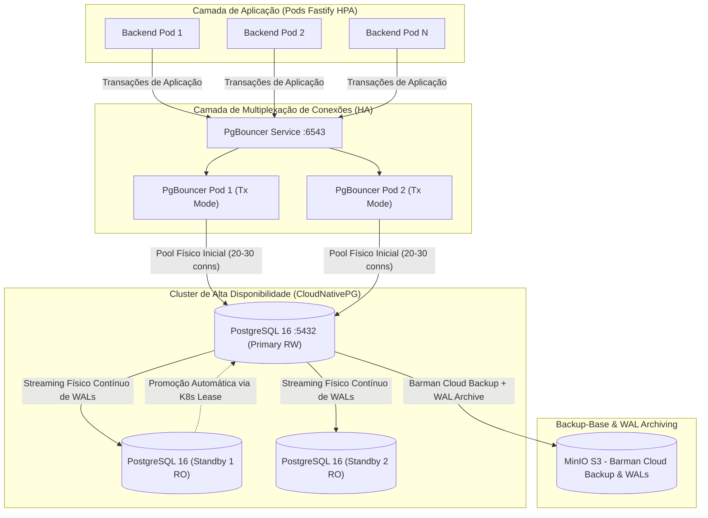

# ADR 015: Estratégia de Persistência Relacional, Alta Disponibilidade (CloudNativePG), Pooler de Conexões (PgBouncer) e Adiamento de Réplicas de Leitura no PostgreSQL 16

- **Status:** APROVADO / REVISÃO TÉCNICA RIGOROSA CONSOLIDADA
- **Data:** 10 de Novembro de 2026
- **Autor(es):** Equipe de Arquitetura, Engenharia de Dados e Infraestrutura SCIA
- **Domínio:** Persistência Relacional ACID, Alta Disponibilidade (HA), Gestão de Conexões (PgBouncer), Adiamento de Read Replicas, Fencing Monotônico, Recuperação do Editor e Disaster Recovery (RPO/RTO)
- **Componentes Relacionados:** 
  - `backend`: `src/db/prisma.ts`, `prisma/schema.prisma`, `src/modules/documents/documents.repository.ts`, `src/config/env.ts`
  - `docs`: [`DATABASE.md`](../../DATABASE.md), [`FAQ_BANCO_DE_DADOS_ESPECIALISTAS.md`](../../FAQ_BANCO_DE_DADOS_ESPECIALISTAS.md), [`ANALISE_ESCALABILIDADE_RECUPERACAO_POSTGRES.md`](../../ANALISE_ESCALABILIDADE_RECUPERACAO_POSTGRES.md)
  - `k8s`: `k8s/manifests/backend-cluster.yaml`, `k8s/manifests/secret.example.yaml`

---

## ⚡ Guia Rápido & Resumo Executivo ("Elevator Pitch")

> [!TIP]
> **Consulte esta seção para defesas técnicas em sabatinas com DBAs e especialistas em infraestrutura.**

### 1. Resumo da Decisão de Banco de Dados (em 4 pontos):
1. **Desacoplamento do Hot Path de Digitação e Resiliência em Duas Camadas:** O PostgreSQL **não sofre I/O a cada tecla digitada**. A edição colaborativa opera em memória RAM no Pod Dono via WebSockets (< 2ms) e a persistência é feita por **Debounce Híbrido** periódico (3s inativo / 15s contínuo / 50 ops). A proteção contra perda de operações em voo caso o Pod sofra crash reside no **buffer local do cliente CodeMirror (`pendingUpdates`)**, que reexecuta o rebase após a reconexão.
2. **Alta Disponibilidade em Produção com CloudNativePG:** Adoção oficial do operador **CloudNativePG** em topologia de **3 instâncias (1 Primário + 2 Standbys com replicação física de WALs)** e `podAntiAffinity` entre nós do cluster. A meta de RTO para failover automático local é de **10 a 15 segundos** (detecção + promoção + chaveamento de Service), sujeita a testes de caos/resiliência.
3. **Adiamento Deliberado do Uso de Réplicas para Distribuição de Leitura:** Não utilizamos réplicas de leitura no momento por ausência de necessidade comprovada de capacidade e para **evitar o risco de inconsistência de *Replication Lag / Read-Your-Writes*** (ex: usuário conclui tarefa e, ao recarregar a tela, consulta réplica defasada exibindo a tarefa como pendente). Gatilho de adoção futuro: **degradação mensurável composta** (latência P95 > 500ms, saturação de I/O, contenção de locks e relatórios do `pg_stat_statements`).
4. **Pooler de Conexões em Escala (PgBouncer em HA):** Para evitar o esgotamento de conexões (`max_connections`) quando o HPA escalar o backend Fastify para múltiplos pods, a arquitetura especifica o **PgBouncer com 2 réplicas na porta 6543** em modo *Transaction Pooling* (com capacidade inicial planejada de 20 a 30 conexões físicas reais no Postgres). Rotinas de migração de schema (`prisma migrate deploy`) utilizam obrigatoriamente a **porta direta 5432 (`DIRECT_URL`)**.

---

## 1. Contexto & Motivação

O **SCIA (Scientific Collaboration and Intelligent Assistance)** gerencia a escrita concorrente de artigos científicos de alta relevância acadêmica e institucional, dividindo seu modelo de persistência em dois domínios distintos:
1. **Governança Institucional e Integridade ACID:** Régua fixa de **6 Etapas**, Gatekeepers invioláveis (**Etapa 5 NIT 🔒** e **Etapa 6 Congresso Alvo 🔒**), matriz de tarefas e anotações inline de revisão. Essa camada exige **transações ACID atômicas, chaves estrangeiras com integridade relacional nativa e histórico de auditoria protegido**.
2. **Editor Científico Colaborativo:** Operações de edição, sincronização em tempo real de arquivos TeX (`main.tex`, `.bib`, seções modulares), versionamento contínuo e checkpoints periódicos.

### Por que PostgreSQL 16 e não MongoDB (Modelagem Histórica do Overleaf)?
O modelo do Overleaf/ShareLaTeX historicamente agrupava todo o projeto (dezenas de arquivos TeX, histórico e pastas) em um único documento BSON gigante de 20 a 50 MB, sofrendo com fragmentação severa de memória, contenção de escrita e ausência de integridade relacional.

No SCIA, estabelecemos:
* **Segregação Estrita de Binários:** PDFs compilados, imagens, gráficos e arquivos de evidências são armazenados exclusivamente em Object Storage S3 compatível (**MinIO**) via URLs pré-assinadas, mantendo o banco relacional enxuto.
* **Persistência Relacional Granular:** O projeto, suas tarefas e seus arquivos TeX (`ProjectFile`) são modelados em tabelas normalizadas, permitindo mutações atômicas de seções sem reescrever documentos inteiros de dezenas de megabytes.

---

## 2. Decisões Arquiteturais Adotadas



---

### 2.1. Desacoplamento do Hot Path de Digitação e Resiliência do Editor
* **Colaboração em Memória Quente:** A edição em tempo real opera na **memória RAM do Pod Dono** via WebSockets (Transformação Operacional `@codemirror/collab`) com latência P95 sub-milissegundo (< 2ms), eliminando I/O síncrono no banco por tecla digitada.
* **Persistência por Debounce Híbrido:** A gravação no PostgreSQL ocorre de forma assíncrona orientada por:
  1. *Inatividade:* 3 segundos após a última edição.
  2. *Teto contínuo:* a cada 15 segundos ininterruptos de digitação.
  3. *Volume:* a cada lote de 50 operações de deltas acumuladas.
* **Modelo Real de Persistência no Banco ([`documents.repository.ts`](file:///mnt/c0b6217c-c2f3-4c1f-8ba2-c8d177f718a9/development/professional/sci-latex-vscode/backend/src/modules/documents/documents.repository.ts)):**
  O checkpoint é persistido em uma única chamada `prisma.$transaction`, garantindo atomicidade entre:
  * Atualização da versão do projeto (`Project.currentVersion`).
  * Atualização do conteúdo do arquivo principal (`ProjectFile` onde `path = 'main.tex'`).
  * Atualização dos arquivos secundários alterados (`ProjectFile` para cada subseção/referência).
  * Criação do registro de histórico (`DocumentSnapshot`).
* **Delimitação de RPO e Recuperação Pós-Queda de Pod:**
  * **RPO do Banco de Dados:** Aplica-se exclusivamente às transações já comitadas.
  * **Operações em Voo (Janela de 3s/15s):** Se o processo do Pod Dono sofrer um *crash* antes do checkpoint, as operações na RAM daquele Pod são perdidas temporariamente.
  * **Mecanismo de Recuperação no Cliente:** O cliente CodeMirror Collab retém o buffer de deltas locais não confirmados (`pendingUpdates`). Ao reconectar ao novo Pod Dono eleito, o cliente executa `PULL_UPDATES` para alinhar com a versão do banco e realiza o **rebase e reenvio automático dos deltas pendentes**, restabelecendo a consistência sem intervenção manual do usuário.

---

### 2.2. Topologia de Alta Disponibilidade em Produção (CloudNativePG)
* **Operador Oficial Escolhido:** **CloudNativePG** (solução nativa de Kubernetes com gerenciamento de quorum, eleição de líderes e integração com Barman Cloud). A alternativa Patroni foi avaliada e descartada para evitar dependência externa de etcd dedicado fora do cluster K8s.
* **Topologia:** Cluster de **3 instâncias: 1 Primary (RW) + 2 Standbys (RO)** com replicação física de WALs.
* **Isolamento de Falha no Kubernetes:**
  * Configuração de `podAntiAffinity` com `topologyKey: kubernetes.io/hostname: requiredDuringSchedulingIgnoredDuringExecution`.
  * *Requisito Operacional:* O cluster Kubernetes de produção deve possuir no mínimo 3 nós operacionais elegíveis; caso contrário, réplicas secundárias permanecerão em estado `Pending`.
* **Meta de RTO no Failover Automático:**
  * A meta de engenharia é restabelecer a disponibilidade de escrita entre **10 a 15 segundos**.
  * Esse tempo abrange: *Detecção da indisponibilidade (health probes) $\to$ Promoção da réplica pelo CloudNativePG $\to$ Atualização do Service K8s $\to$ Reconexão do PgBouncer $\to$ Retentativa das transações pelo pool do Prisma*.
  * Essa meta deve ser **validada formalmente por testes de injeção de falhas (chaos testing)** antes da entrada em produção.

---

### 2.3. Adiamento do Uso de Réplicas para Distribuição de Leitura
* **Decisão:** Não utilizar réplicas dedicadas para balanceamento de carga de leitura no estágio atual do projeto.
* **Justificativas Técnicas:**
  1. **Ausência de Necessidade Comprovada de Capacidade:** O PostgreSQL 16 sobre hardware dedicado com índices B-Tree otimizados atende plenamente ao volume acadêmico projetado, sem saturação de recursos.
  2. **Complexidade e Risco de Inconsistência (*Replication Lag*):** A distribuição de leituras em réplicas assíncronas introduz o risco de quebra de *Read-Your-Writes* (ex: o pesquisador avança a etapa de um artigo e, ao recarregar o navegador, consulta uma réplica com milissegundos de atraso exibindo o estado anterior).
* **Diretriz para Futura Adoção:**
  * Réplicas de leitura não serão introduzidas por percepção empírica.
  * Adoção condicionada a uma **métrica de degradação composta**:
    * Latência de leitura P95 > 500 ms de forma sustentada;
    * Saturação contínua de I/O de armazenamento;
    * Fila de espera significativa no pool de conexões;
    * Relatório do `pg_stat_statements` comprovando que o gargalo decorre de consultas puramente analíticas (dashboards do gestor ou varreduras em lote do SciAI), as quais serão então segregadas para réplicas secundárias com isolamento de transação.

---

### 2.4. Gestão de Conexões em Escala Horizontal (PgBouncer em HA)
* **Problema:** Com o auto-scaling de pods do Backend Fastify via HPA, cada pod gerencia seu próprio pool de conexões clientes. Sem intermediação, rajadas de tráfego podem exaurir o parâmetro `max_connections` do PostgreSQL, degradando a memória por excesso de processos backend.
* **Decisão:** Inserção do **PgBouncer** em modo **Transaction Pooling**:
  * **Porta 6543 (PgBouncer - Transaction Pooling):** Roteia todo o tráfego transacional das instâncias Fastify. Centenas de conexões clientes da aplicação compartilham uma **capacidade física inicial planejada de 20 a 30 conexões reais no PostgreSQL**, ajustável sob testes de carga.
  * **Porta 5432 (PostgreSQL Direto):** Reservada para migrações de esquema (`npx prisma migrate deploy`), ferramentas de manutenção e monitoramento. **Nenhuma migração DDL pode trafegar pelo PgBouncer em Transaction Mode**.
  * **Alta Disponibilidade do PgBouncer:** Para eliminar o pooler como Ponto Único de Falha (SPOF), o PgBouncer será provisionado com **no mínimo 2 réplicas** sob um Service Kubernetes estável com probes de liveness/readiness.
  * **Compatibilidade Prisma 7:** Homologação do PgBouncer 1.21+ com `max_prepared_statements > 0` e configuração do driver `@prisma/adapter-pg`.

---

### 2.5. Protocolo Rigoroso de Fencing Monotônico (`ownerGeneration`)
* **Problema:** Um Pod que sofra desconexão transitória de rede pode se tornar "zumbi" e tentar persistir checkpoints defasados após outro Pod ter assumido a liderança do documento.
* **Protocolo de Validação no Banco de Dados:**
  * O recurso com propriedade exclusiva de edição é a entidade `Project` (que orquestra os `ProjectFile`).
  * A tabela `Project` mantém a coluna relacional `ownerGeneration Int @default(0)`.
  * **Protocolo Atômico de Checkpoint:** A gravação atômica só é aceita se a geração do pod persistente for exatamente a geração registrada e a versão for estritamente monotônica:
    ```sql
    UPDATE "Project" 
    SET "currentVersion" = :newVersion, 
        "ownerGeneration" = :myGen
    WHERE "id" = :id 
      AND "ownerGeneration" = :myGen 
      AND "currentVersion" = :expectedOldVersion;
    ```
  * No código atual ([`documents.repository.ts`](file:///mnt/c0b6217c-c2f3-4c1f-8ba2-c8d177f718a9/development/professional/sci-latex-vscode/backend/src/modules/documents/documents.repository.ts#L151-L168)), a transação aborta imediatamente com erro `[Fencing Token Conflict]` se a geração persistida no banco for superior à geração do processo (`currentProject.ownerGeneration > data.ownerGeneration`).
  * Um Pod destronado é impedido pelo próprio PostgreSQL de persistir qualquer modificação, protegendo a integridade contra *Split-Brain*.

---

### 2.6. Proteção do AuditLog e Estratégia Real de Disaster Recovery

#### A. Proteção do AuditLog
* A tabela `AuditLog` possui vínculo com usuários com `onDelete: SetNull`, preservando os metadados JSONB mesmo em caso de exclusão de usuários (conformidade com LGPD).
* No PostgreSQL de produção, aplica-se a **restrição de integridade para a role da aplicação**:
  ```sql
  REVOKE UPDATE, DELETE ON TABLE "AuditLog" FROM "scia_app_user";
  GRANT INSERT, SELECT ON TABLE "AuditLog" TO "scia_app_user";
  ```
  Isso garante que a aplicação não possua capacidade SQL de alterar ou excluir registros históricos, mesmo diante de falhas lógicas ou injeção de SQL.

#### B. Delimitação Clara de RPO e RTO (SLOs Reais)
Para evitar confusão entre disponibilidade local e recuperação de desastres catastróficos, estabelecemos:

| Cenário de Falha | Mecanismo de Recuperação | Meta de RPO | Meta de RTO |
| :--- | :--- | :--- | :--- |
| **Crash do Pod da Aplicação** | Buffer local do cliente CodeMirror (`pendingUpdates`) reenvia deltas pendentes | Janela de inatividade (3s / 15s) | Re-conexão do socket (~2 a 5s) |
| **Falha do Nó Primário do Postgres** | Promoção automática do Standby via CloudNativePG (streaming de WALs) | **< 1 segundo** (sob condições normais de rede) | **10 a 15 segundos** (SLO sujeito a testes) |
| **Corrupção de Dados / Desastre Total** | Barman Cloud (Backup-base diário no MinIO + arquivo de WALs contínuo) | Determinado pelo último WAL arquivado no storage | **Minutos a horas** (conforme volume e I/O de restauração PITR) |

---

## 3. Matriz Consolidada de Decisões Arquiteturais

| Dimensão | Opção Adotada no SCIA | Alternativas Avaliadas | Justificativa Técnica |
| :--- | :--- | :--- | :--- |
| **SGBD Primário** | **PostgreSQL 16 (ACID)** | MongoDB, DynamoDB | Integridade relacional nativa para as 6 etapas, tarefas com dependências e governança de Gatekeepers. |
| **Armazenamento de Binários** | **MinIO S3 (URLs Pré-assinadas)** | Armazenamento em BLOB no banco | Mantém o banco leve, backups ágeis e zero sobrecarga de RAM no backend. |
| **Operador de HA** | **CloudNativePG** | Patroni, Stolon | Solução nativa de Kubernetes, sem dependência externa de etcd fora do cluster e com integração Barman Cloud. |
| **Topologia de Banco** | **1 Primário + 2 Standbys** | Nó único / CockroachDB | Resiliência a falhas de hardware locais com custo operacional viável para ambiente on-premises. |
| **Distribuição de Leitura** | **Adiada (Nó Único para Leitura)** | Read Replicas ativas prematuramente | Evita inconsistências de *Replication Lag* (*Read-Your-Writes*). Gatilho condicionado a métricas compostas. |
| **Pooler de Conexões** | **PgBouncer (HA :6543 em Transaction Mode)** | Conexões diretas de cada Pod | Impede esgotamento de `max_connections` no Postgres quando o HPA escalar pods Fastify. |
| **Migrações de Esquema** | **Porta Direta 5432 (`DIRECT_URL`)** | Migrações através do PgBouncer | DDLs e transações com lock exclusivo do Prisma não são suportadas em Transaction Pooling. |
| **Proteção de Fencing** | **Validação Monotônica Atômica (`ownerGeneration`)** | Confiança em leases puras de rede | PostgreSQL atua como autoridade final, abortando transações de pods destronados. |

---

## 4. Testes de Homologação Mandatórios (Critérios de Aceite)

A implementação da arquitetura no ambiente Kubernetes só será homologada após a execução e aprovação dos seguintes testes:
1. **Teste de Carga e Concorrência:** Simulação de 100 autores concorrentes com medição de latência P95/P99, consumo de CPU, conexões físicas e volume de WAL gerado.
2. **Teste de Crash do Pod da Aplicação:** Interrupção abrupta do processo Node.js durante digitação ativa, comprovando que o cliente CodeMirror Collab reconecta e reexecuta o rebase dos deltas sem perda de texto.
3. **Teste de Split-Brain (Fencing):** Simulação de partição de rede no Pod Dono com tentativa de persistência com `ownerGeneration` antigo, comprovando que o PostgreSQL aborta a transação com erro `[Fencing Token Conflict]`.
4. **Teste de Failover do PostgreSQL:** Encerramento forçado do nó Primário do CloudNativePG, cronometrando a detecção, promoção do Standby, atualização de Services e restabelecimento das conexões do Fastify.
5. **Teste do PgBouncer com Prisma:** Validação de execução de transações interativas, prepared statements (`max_prepared_statements`) e confirmação de isolamento com a `DIRECT_URL` para `prisma migrate deploy`.
6. **Teste de PITR (Disaster Recovery):** Restauração pontual do banco a partir do backup-base e WALs arquivados no MinIO para um instante específico no passado, validando a integridade dos dados e o tempo real de recuperação.
