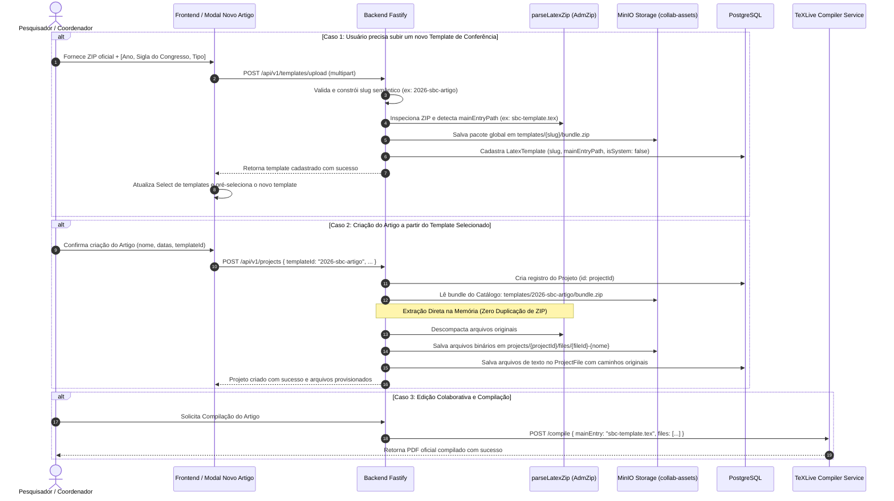

# ADR 017: Governança de Templates LaTeX de Conferências e Periódicos, Preservação de Integridade de Arquivos (.tex/.cls/.sty), Storage MinIO e Bootstrap Mínimo

- **Status:** APROVADO (Atualizado com Ciclo Completo de Catálogo Global & Cópia Autônoma do Artigo)
- **Data:** 14 de Novembro de 2026 (Revisado em 15 de Novembro de 2026)
- **Autor(es):** Equipe de Engenharia, Produto e Arquitetura SCIA
- **Domínio:** Governança Editorial LaTeX, Compilação TeXLive, Storage de Objetos (MinIO/S3), Integridade de Arquivos Acadêmicos, Bootstrap de Aplicação e UX de Criação de Projetos
- **Componentes Relacionados:** `backend` (`templates.service.ts`, `templates.controller.ts`, `projects.service.ts`, `documents.service.ts`, `latex-zip-parser.ts`, `minio.ts`), `compiler` (`src/server.ts`), `frontend` (`CreateProjectModal.tsx`, `templatesService.ts`), `prisma` (`seed.ts`, `schema.prisma`), `latex-templates/`

---

## 1. Contexto & Diagnóstico dos Problemas

O SCIA visa fornecer aos pesquisadores e laboratórios acadêmicos um ambiente de escrita colaborativa focado no rigor científico e na conformidade com chamadas de trabalhos de conferências e periódicos nacionais e internacionais (SBC, IEEE, ACM, Springer, Elsevier, etc.).

Durante a auditoria da esteira de templates e compilação, foram identificadas falhas conceituais e técnicas críticas:

1. **Templates Falsos / Mocks em Código (*Hardcoded Strings*):**
   - O arquivo `backend/src/modules/templates/templates.service.ts` continha uma constante `SYSTEM_TEMPLATES` com textos fictícios de `main.tex` e `references.bib` montados em memória via `AdmZip` e injetados compulsoriamente no MinIO e no banco de dados tanto no `seed` quanto a cada chamada de listagem (`listTemplates`).
   - Esses pacotes não continham as classes oficiais (`.cls`), estilos (`.sty`), tabelas de bibliografia (`.bst`) nem a estrutura real exigida pelas conferências, gerando falhas no TeXLive do compilador ou gerando documentos que não respeitam a diagramação editorial exigida.

2. **Renomeação Destrutiva Arbitrária para `main.tex`:**
   - Ao descompactar ou associar um template a um novo projeto de artigo, o backend forçava a renomeação do arquivo principal para `main.tex`, descartando o nome original fornecido pelo evento (ex: `bare_conf.tex` do IEEE, `sbc-template.tex` da SBC, `artigo.tex`).
   - Essa prática quebra macros LaTeX, diretivas `\input{}`, `\include{}`, scripts de compilação e dependências de bibliografia (`\bibliography{IEEEexample}`).

3. **Confusão Conceitual: "Template Custom de Usuário" vs. "Template Oficial de Evento":**
   - Usuários não sobem "templates pessoais descartáveis"; pesquisadores sobem **templates oficiais de conferências, congressos ou periódicos acadêmicos específicos**. Uma vez validado e enviado, o template deve ficar registrado institucionalmente e reutilizável por toda a organização.
   - O fluxo anterior gerava identificadores UUID aleatórios para uploads (`templates/{uuid}/bundle.zip`), poluindo a pasta `templates/` com pastas sem significado semântico.

4. **Duplicação de ZIPs vs. Extração Direta e Autônoma:**
   - Duplicar o pacote `.zip` completo para cada artigo criado (`projects/{projectId}/template.zip`) gera redundância massiva de storage (centenas de cópias idênticas do mesmo template) e operações de I/O desnecessárias.
   - O artigo é inerentemente autônomo e imutável porque **todos os seus arquivos** (`.tex`, `.cls`, `.sty`, figuras) são extraídos diretamente para o banco de dados (`ProjectFile`) e para a pasta de assets (`projects/{projectId}/files/`). O editor e o compilador utilizam exclusivamente esses arquivos extraídos, tornando o `.zip` redundante dentro do escopo do artigo.

5. **Inchaço de Repositório vs. Bootstrap Mínimo:**
   - O repositório Git não deve se tornar um repositório binário de dezenas de arquivos `.zip` pesados de conferências. Deve existir apenas uma semente mínima (*baseline seed*) no repositório para o primeiro deploy, deixando que o catálogo cresça organicamente através do envio colaborativo pelos próprios pesquisadores após a implantação da aplicação.

---

## 2. Decisões Arquiteturais Adotadas

```
┌──────────────────────────────────────────────────────────────────────────────────────────────────┐
│      GOVERNANÇA DE TEMPLATES LATEX: CATÁLOGO GLOBAL, EXTRAÇÃO DIRETA E INTEGRIDADE TOTAL         │
├──────────────────────────────┬─────────────────────────────┬─────────────────────────────────────┤
│ 1. Padrão Semântico de Slugs │ 2. Integridade Inegociável  │ 3. Catálogo Único vs. Extração      │
│ - [ANO]-[CONGRESSO]-[TIPO]   │ - Zero renomeação interna   │ - Upload enriquece Catálogo Global  │
│ - Regra dos hífens sem acento│ - Preserva bare_conf.tex    │ - Atualiza Select imediatamente     │
│ - Path MinIO e ID canônico   │ - Compilação com mainEntry  │ - Zero duplicação de ZIP no projeto │
└──────────────────────────────┴─────────────────────────────┴─────────────────────────────────────┘
```

### 2.1. Regra 1: Todo Template Subido Envia para o Catálogo Global
Não existe no domínio SCIA a entidade "template genérico ou descartável de usuário". Todo template representa o modelo formal exigido por uma entidade científica ou evento acadêmico.
- **Enriquecimento Coletivo:** Quando um pesquisador precisa de um template que ainda não existe no `Select` ao criar um artigo, ele realiza o upload do `.zip` oficial da conferência.
- Esse upload é persistido **diretamente no Catálogo Global** de templates (`templates/{slug}/bundle.zip` e tabela `LatexTemplate`), tornando-se imediatamente um patrimônio compartilhado de todo o laboratório/instituição.
- **Reatividade no Frontend:** Assim que o upload é concluído com sucesso:
  - O cache do TanStack Query (`useTemplateQueries`) é invalidado.
  - O novo template passa a figurar imediatamente no `Select` de templates da tela de criação de artigo.
  - O formulário pré-seleciona automaticamente o template recém-enviado para agilizar o fluxo do pesquisador.
- O template é classificado semântica e obrigatoriamente por:
  - **Ano do Evento / Versão:** ex: `2026`, `2027`.
  - **Conferência / Entidade:** ex: `IEEE`, `SBC`, `ACM`, `ANPAD`.
  - **Formato / Tipo de Artigo:** ex: `artigo` (completo), `resumo` (expandido), `transactions`, `periodico`.

### 2.2. Regra 2: Padrão Semântico de Nomenclatura (Regra dos Hífens e Normalização)
Para evitar que o compilador `pdflatex` no Linux e as rotas de URL do MinIO/S3 sofram com caracteres especiais, espaços ou acentos, e para impedir a proliferação de UUIDs opacos na pasta de templates, adota-se um padrão estrito de slug:

$$\mathbf{[ANO]-[CONGRESSO]-[FORMATO]}$$

- **Exemplos Canônicos:**
  - `2027-ieee-conference`
  - `2026-sbc-artigo`
  - `2026-acm-sigconf`
  - `2026-anpad-artigo`
  - `2026-erbase-resumo`
- **Validação de Slug:** `^[a-z0-9]+(-[a-z0-9]+)*$` (minúsculas, números e hífens).
- **Chave Padronizada no MinIO (`collab-assets`):**
  ```text
  templates/{templateSlug}/bundle.zip
  ```

### 2.3. Regra 3: Extração Direta e Autônoma dos Arquivos (Sem Duplicação de ZIP)
Ao confirmar a criação do artigo (`POST /api/v1/projects`):
1. O backend busca o pacote do template escolhido no Catálogo Global (`templates/{templateId}/bundle.zip`).
2. **Descompactação em Memória (`parseLatexZip`):**
   - O buffer do ZIP global é lido e descompactado sem salvar cópias adicionais do `.zip` na pasta do artigo.
   - Arquivos de texto e código TeX (`.tex`, `.cls`, `.sty`, `.bib`) são salvos na tabela `ProjectFile` do PostgreSQL, associados a `projectId`.
   - Arquivos binários (imagens `.png`, `.jpg`, logos, figuras) são persistidos no MinIO sob:
     ```text
     projects/{projectId}/files/{fileId}-{sanitizedFileName}
     ```
3. **Autonomia e Single Source of Truth:**
   - O Catálogo Global (`templates/{slug}/bundle.zip`) é a **Fonte Única da Verdade** para o arquivo comprimido original.
   - O artigo possui autonomia total e ciclo de vida independente através dos registros em `ProjectFile`. Mesmo que o template global seja desativado ou atualizado, os artigos existentes não são afetados.
   - Elimina-se completamente a redundância de `template.zip` na raiz do projeto, garantindo zero desperdício de storage e zero poluição visual no editor.

### 2.4. Regra 4: Integridade Absoluta dos Arquivos Internos (Zero Renomeação)
Fica **terminantemente proibido** renomear arquivos internos fornecidos no pacote `.zip` da conferência:
- Arquivos de classe (`.cls`), estilos (`.sty`), estilos de citação (`.bst`), bibliografias de exemplo (`.bib`), figuras e manuais em PDF permanecem com seus nomes e hierarquias de pastas exatas.
- **O arquivo `.tex` principal NUNCA deve ser forçado a se chamar `main.tex`:**
  - O utilitário `parseLatexZip` detecta o arquivo de entrada através da presença da macro `\documentclass` e heurísticas de prioridade, registrando o caminho relativo original (ex: `bare_conf.tex`, `sbc-template.tex` ou `IEEE-conference-template-062824.tex`) no atributo `mainEntryPath` da entidade `LatexTemplate`.
  - Ao criar um artigo a partir do template em `projects.service.ts`, o arquivo raiz é salvo na tabela `ProjectFile` com o seu **nome original**.
  - O serviço de compilação em `documents.service.ts` envia para o worker TeXLive o parâmetro dinâmico:
    ```json
    {
      "documentId": "proj-uuid",
      "mainEntry": "IEEE-conference-template-062824.tex",
      "files": [...]
    }
    ```
  - O microserviço `compiler` possui validação estrita *fail-fast*: se `mainEntry` não existir na lista de arquivos recebidos, interrompe com HTTP 400 imediato.

### 2.5. Regra 5: Repositório com Bootstrap Mínimo (*Baseline Seed*)
Para garantir que o repositório Git permaneça leve, rápido de clonar e não acumule dezenas de megabytes de zips binários:
- A pasta de baseline versionará **apenas o conjunto mínimo essencial de partida** (por exemplo, 1 ou 2 templates oficiais testados, como `2026-ieee-conference.zip`).
- **Ao implantar a aplicação (Deploy Inicial / CI-CD):**
  - O script de seed (`backend/prisma/seed.ts`) verifica a pasta de baseline.
  - Lê os zips baseline presentes na pasta.
  - Sobe o bundle completo e intacto para o MinIO (`templates/{slug}/bundle.zip`).
  - Registra na tabela `LatexTemplate` com `isSystem: true`.
- **Evolução Pós-Deploy:**
  - Quaisquer novos templates de conferências futuras são enviados pelos próprios pesquisadores através do fluxo web/API (`POST /templates/upload`), gerando o slug correspondente e persistindo de forma desacoplada no MinIO e PostgreSQL.

### 2.6. Regra 6: Expurgar Mocks Falsos do Código
- Eliminar o array fictício `SYSTEM_TEMPLATES` e as strings TeX hardcoded em `templates.service.ts`.
- Remover a execução repetitiva de `ensureSystemTemplates()` dentro dos métodos de listagem `listTemplates()` e `getTemplateById()` para eliminar concorrência desnecessária de I/O no MinIO em requisições de leitura.
- Limpar os templates legados fictícios (`tpl-system-ieeetran`, `tpl-system-sbc`, `tpl-system-acm`, `tpl-system-springer`) e objetos temporários gerados com UUIDs órfãos do storage.

---

## 3. Fluxo de Vida dos Templates e Artigos (Arquitetura)



---

## 4. Estrutura do Storage no MinIO (`collab-assets`)

A organização do bucket no MinIO fica rigorosamente estruturada em dois domínios claros:

```text
collab-assets/
├── templates/                                        <-- CATÁLOGO GLOBAL (Oficiais e Colaborativos)
│   ├── 2026-ieee-conference/
│   │   └── bundle.zip
│   ├── 2026-sbc-artigo/
│   │   └── bundle.zip
│   └── napopen-journal-article-template/
│       └── bundle.zip
│
└── projects/                                         <-- ESCOPO INDIVIDUAL DOS ARTIGOS CRIADOS
    └── {projectId}/
        ├── files/                                    <-- ASSETS BINÁRIOS (Imagens, logos, figuras)
        │   ├── {fileId}-fig1.png
        │   └── {fileId}-logo.png
        └── tasks/{taskId}/evidences/                 <-- EVIDÊNCIAS DE TAREFAS (Etapas 1 e 2)
            └── {evidenceId}-documento.pdf
```

---

## 5. Estrutura do Modelo de Dados (`schema.prisma`)

A entidade `LatexTemplate` reflete o slug canônico como identificador principal e registra o arquivo de entrada:

```prisma
model LatexTemplate {
  id               String    @id // Slug semântico: ex: "2026-sbc-artigo", "2027-ieee-conference"
  name             String    // Nome descritivo oficial: "SBC 2026 - Artigo Completo"
  description      String?   // Instruções ou orientações de submissão
  targetConference String?   // Sigla da entidade: "SBC", "IEEE", "ACM"
  storageKey       String    // MinIO: "templates/2026-sbc-artigo/bundle.zip"
  mainEntryPath    String    @default("main.tex") // Nome original: "sbc-template.tex", "bare_conf.tex"
  isSystem         Boolean   @default(false)      // True se fizer parte da semente oficial
  uploadedById     String?
  uploadedBy       User?     @relation("UserUploadedTemplates", fields: [uploadedById], references: [id], onDelete: SetNull)
  createdAt        DateTime  @default(now())
  updatedAt        DateTime  @updatedAt

  projects         Project[]

  @@index([uploadedById])
  @@index([isSystem])
}
```

---

## 6. Consequências & Benefícios

### Positivas:
1. **Catálogo Institucional Sempre Vivo:** Cada novo template de congresso enviado por um autor enriquece imediatamente o acervo de todos os pesquisadores da instituição.
2. **Zero Desperdício de Storage:** O `.zip` do template existe unicamente no catálogo global. Não são criadas cópias redundantes de ZIPs em cada artigo criado.
3. **Autonomia e Imutabilidade do Artigo:** Todos os arquivos de texto (`.tex`, `.cls`, `.sty`, etc.) e binários são provisionados de forma descompactada no `ProjectFile` e `files/`. Mesmo que o template global seja alterado ou excluído no futuro, o artigo continua 100% autônomo e funcional.
4. **Zero Poluição de UUIDs no MinIO:** A pasta `templates/` contém exclusivamente pastas com nomes semânticos auditáveis (`[ANO]-[CONGRESSO]-[TIPO]`).
5. **Zero Poluição Visual no Editor:** O editor de código e o compilador enxergam apenas os arquivos de trabalho reais cadastrados no banco; nenhum `.zip` ou pasta de arquivo compactado aparece na barra lateral.
6. **Fidelidade Editorial 100%:** O compilador TeXLive processa exatamente os arquivos originais (.cls/.sty/.bst) fornecidos pelas sociedades científicas, eliminando discrepâncias visuais e erros de fontes/margens.
7. **Zero Inchaço no Repositório:** Apenas 1 ou 2 templates essenciais residem no repositório Git para o deploy inicial; toda a expansão ocorre no MinIO e PostgreSQL.
8. **Desempenho Otimizado no Backend:** Fim da re-geração de zips fakes em memória durante rotas de listagem (`listTemplates`), poupando I/O no MinIO e ciclo de CPU do Node.js.

### Riscos Mitigados:
- **Poluição do Storage:** Slugs padronizados eliminam pastas com UUIDs randômicos órfãos no MinIO, e a ausência de ZIPs duplicados por artigo poupa megabytes de armazenamento.
- **Colisão de Nomes:** A extração do `mainEntryPath` original evita sobreposições acidentais de arquivos `main.tex`.
- **Falha de Compilação no Linux:** A higienização estrita de slugs sem espaços e sem acentos garante compatibilidade total com o executável `pdflatex` no contêiner Alpine/Debian.
