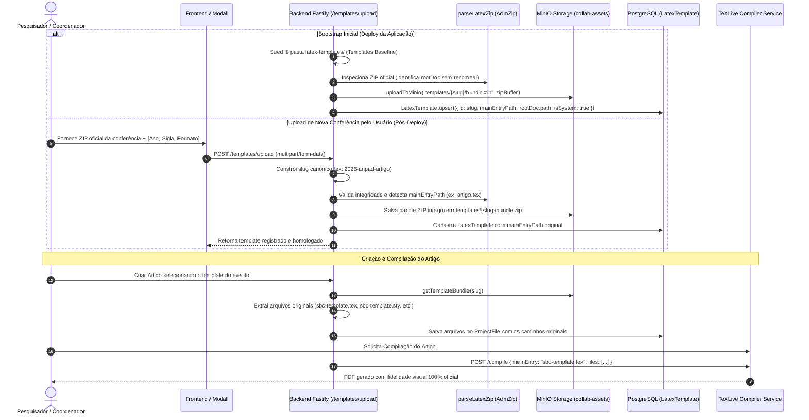

# ADR 017: Governança de Templates LaTeX de Conferências e Periódicos, Preservação de Integridade de Arquivos (.tex/.cls/.sty), Storage MinIO e Bootstrap Mínimo

- **Status:** APROVADO
- **Data:** 14 de Novembro de 2026
- **Autor(es):** Equipe de Engenharia, Produto e Arquitetura SCIA
- **Domínio:** Governança Editorial LaTeX, Compilação TeXLive, Storage de Objetos (MinIO/S3), Integridade de Arquivos Acadêmicos, Bootstrap de Aplicação e UX de Criação de Projetos
- **Componentes Relacionados:** `backend` (`templates.service.ts`, `templates.controller.ts`, `projects.service.ts`, `documents.service.ts`, `latex-zip-parser.ts`, `minio.ts`), `compiler` (`src/server.ts`), `frontend` (`CreateProjectModal.tsx`, `templatesService.ts`), `prisma` (`seed.ts`, `schema.prisma`), `latex-templates/`

---

## 1. Contexto & Diagnóstico dos Problemas

O SCIA visa fornecer aos pesquisadores e laboratórios acadêmicos um ambiente de escrita colaborativa focado no rigor científico e na conformidade com chamadas de trabalhos de conferências e periódicos nacionais e internacionais (SBC, IEEE, ACM, Springer, Elsevier, etc.).

Durante a auditoria da esteira de templates e compilação, foram identificadas falhas conceituais e técnicas críticas:

1. **Templates Falsos / Mocks em Código (*Hardcoded Strings*):**
   - O arquivo `backend/src/modules/templates/templates.service.ts` continha uma constante `SYSTEM_TEMPLATES` com textos fictícios de `main.tex` e `references.bib` montados em memória via `AdmZip` e injetados compulsoriamente no MinIO e no banco de dados tanto no `seed` quanto a cada chamada de listagem (`listTemplates`).
   - Esses pacotes não continham as classes oficiais (`.cls`), estilos (`.sty`), tabelas de bibliografia (`.bst`) nem a estrutura real exigida pelas conferências, gerando falhas no TeXLive do compilador ou gerando documentos que não respeitam a diagramação editorial exigida.

2. **Renomeação Destrutiva Arbitrária para `main.tex`:**
   - Ao descompactar ou associar um template a um novo projeto de artigo, o backend forçava a renomeação do arquivo principal para `main.tex`, descartando o nome original fornecido pelo evento (ex: `bare_conf.tex` do IEEE, `sbc-template.tex` da SBC, `artigo.tex`).
   - Essa prática quebra macros LaTeX, diretivas `\input{}`, `\include{}`, scripts de compilação e dependências de bibliografia (`\bibliography{IEEEexample}`).

3. **Confusão Conceitual: "Template Custom de Usuário" vs. "Template Oficial de Evento":**
   - Usuários não sobem "templates pessoais descartáveis"; pesquisadores sobem **templates oficiais de conferências, congressos ou periódicos acadêmicos específicos**. Uma vez validado e enviado, o template deve ficar registrado institucionalmente e reutilizável por toda a organização.

4. **Inchaço de Repositório vs. Bootstrap Mínimo:**
   - O repositório Git não deve se tornar um repositório binário de dezenas de arquivos `.zip` pesados de conferências. Deve existir apenas uma semente mínima (*baseline seed*) no repositório para o primeiro deploy, deixando que o catálogo cresça organicamente através do envio colaborativo pelos próprios pesquisadores após a implantação da aplicação.

---

## 2. Decisões Arquiteturais Adotadas

```
┌────────────────────────────────────────────────────────────────────────────────────────┐
   GOVERNANÇA DE TEMPLATES LATEX: BOOTSTRAP MÍNIMO, MINIO S3 E INTEGRIDADE DE ARQUIVOS    
├──────────────────────────────┬─────────────────────────────┬───────────────────────────┤
│ 1. Padrão Semântico de Slugs │ 2. Integridade Inegociável  │ 3. Bootstrap Mínimo (Seed)│
│ - [ANO]-[CONGRESSO]-[TIPO]   │ - Zero renomeação interna   │ - Apenas baseline no Git  │
│ - Regra dos hífens sem acento│ - Preserva bare_conf.tex    │ - Demais templates sobem  │
│ - Path MinIO e ID canônico   │ - Compilação com mainEntry  │   via upload de usuários  │
└──────────────────────────────┴─────────────────────────────┴───────────────────────────┘
```

### 2.1. Regra 1: Todo Template é Oficial de Conferência ou Periódico
Não existe no domínio SCIA a entidade "template genérico de usuário". Todo template representa o modelo formal exigido por uma entidade científica ou evento acadêmico.
- Todo upload feito por pesquisadores ou coordenadores passa a enriquecer o catálogo institucional de templates da organização.
- O template é classificado por:
  - **Ano do Evento / Versão:** ex: `2026`, `2027`.
  - **Conferência / Entidade:** ex: `IEEE`, `SBC`, `ACM`, `ANPAD`.
  - **Formato / Tipo de Artigo:** ex: `artigo` (completo), `resumo` (expandido), `transactions`, `periodico`.

### 2.2. Regra 2: Padrão Semântico de Nomenclatura (Regra dos Hífens e Normalização)
Para evitar que o compilador `pdflatex` no Linux e as rotas de URL do MinIO/S3 sofram com caracteres especiais, espaços ou acentos, adota-se um padrão estrito de slug:

$$\mathbf{[ANO]-[CONGRESSO]-[FORMATO]}$$

- **Exemplos Canônicos:**
  - `2027-ieee-conference`
  - `2026-sbc-artigo`
  - `2026-acm-sigconf`
  - `2026-anpad-artigo`
  - `2026-erbase-resumo`
- **Validação de Slug:** `^[a-z0-9]+(-[a-z0-9]+)*$` (minúsculas, números e hífens).
- **Chave Padronizada no MinIO (`collab-assets`):**
  ```text
  templates/{templateSlug}/bundle.zip
  ```

### 2.3. Regra 3: Integridade Absoluta dos Arquivos Internos (Zero Renomeação)
Fica **terminantemente proibido** renomear arquivos internos fornecidos no pacote `.zip` da conferência:
- Arquivos de classe (`.cls`), estilos (`.sty`), estilos de citação (`.bst`), bibliografias de exemplo (`.bib`), figuras e manuais em PDF permanecem com seus nomes e hierarquias de pastas exatas.
- **O arquivo `.tex` principal NUNCA deve ser forçado a se chamar `main.tex`:**
  - O utilitário `parseLatexZip` detecta o arquivo de entrada através da presença da macro `\documentclass` e heurísticas de prioridade, registrando o caminho relativo original (ex: `bare_conf.tex` ou `sbc-template.tex`) no atributo `mainEntryPath` da entidade `LatexTemplate`.
  - Ao criar um artigo a partir do template em `projects.service.ts`, o arquivo raiz é salvo na tabela `ProjectFile` com o seu **nome original**.
  - O serviço de compilação em `documents.service.ts` envia para o worker TeXLive o parâmetro dinâmico:
    ```json
    {
      "documentId": "proj-uuid",
      "mainEntry": "bare_conf.tex",
      "files": [...]
    }
    ```
  - O microserviço `compiler` já possui suporte nativo a `mainEntry` dinâmico e compila diretamente sobre o arquivo correto.

### 2.4. Regra 4: Repositório com Bootstrap Mínimo (*Baseline Seed*)
Para garantir que o repositório Git permaneça leve, rápido de clonar e não acumule dezenas de megabytes de zips binários:
- A pasta `latex-templates/` no repositório versionará **apenas o conjunto mínimo essencial de partida** (por exemplo, 1 template padrão completo como o `2026-sbc-artigo.zip` ou `2027-ieee-conference.zip`).
- **Ao implantar a aplicação (Deploy Inicial / CI-CD):**
  - O script de seed (`backend/prisma/seed.ts`) verifica a pasta `latex-templates/`.
  - Lê os zips baseline presentes na pasta.
  - Sobe o bundle completo e intacto para o MinIO (`templates/{slug}/bundle.zip`).
  - Registra na tabela `LatexTemplate` com `isSystem: true`.
- **Evolução Pós-Deploy:**
  - Quaisquer novos templates de conferências futuras são enviados pelos próprios pesquisadores através do fluxo web/API (`POST /templates/upload`), gerando o slug correspondente e persistindo de forma desacoplada no MinIO e PostgreSQL.

### 2.5. Regra 5: Expurgar Mocks Falsos do Código
- Eliminar o array fictício `SYSTEM_TEMPLATES` e as strings TeX hardcoded em `templates.service.ts`.
- Remover a execução repetitiva de `ensureSystemTemplates()` dentro dos métodos de listagem `listTemplates()` e `getTemplateById()` para eliminar concorrência desnecessária de I/O no MinIO em requisições de leitura.
- Limpar os templates legados fictícios (`tpl-system-ieeetran`, `tpl-system-sbc`, `tpl-system-acm`, `tpl-system-springer`) do banco e do storage.

---

## 3. Fluxo de Vida dos Templates (Arquitetura)



---

## 4. Estrutura do Modelo de Dados (`schema.prisma`)

A entidade `LatexTemplate` reflete o slug canônico como identificador principal e registra o arquivo de entrada:

```prisma
model LatexTemplate {
  id               String    @id // Slug semântico: ex: "2026-sbc-artigo", "2027-ieee-conference"
  name             String    // Nome descritivo oficial: "SBC 2026 - Artigo Completo"
  description      String?   // Instruções ou orientações de submissão
  targetConference String?   // Sigla da entidade: "SBC", "IEEE", "ACM"
  storageKey       String    // MinIO: "templates/2026-sbc-artigo/bundle.zip"
  mainEntryPath    String    @default("main.tex") // Nome original: "sbc-template.tex", "bare_conf.tex"
  isSystem         Boolean   @default(false)      // True se fizer parte da semente oficial
  uploadedById     String?
  uploadedBy       User?     @relation("UserUploadedTemplates", fields: [uploadedById], references: [id], onDelete: SetNull)
  createdAt        DateTime  @default(now())
  updatedAt        DateTime  @updatedAt

  projects         Project[]

  @@index([uploadedById])
  @@index([isSystem])
}
```

---

## 5. Consequências & Benefícios

### Positivas:
1. **Fidelidade Editorial 100%:** O compilador TeXLive processa exatamente os arquivos originais (.cls/.sty/.bst) fornecidos pelas sociedades científicas, eliminando discrepâncias visuais e erros de fontes/margens.
2. **Zero Inchaço no Repositório:** Apenas 1 ou 2 templates essenciais residem na pasta `latex-templates/` para garantia de funcionamento no primeiro deploy; toda a expansão ocorre no MinIO e PostgreSQL.
3. **Imutabilidade e Rastreabilidade:** O padrão `[ANO]-[CONGRESSO]-[FORMATO]` elimina nomes ambíguos ou caminhos quebrados por caracteres especiais e espaços.
4. **Desempenho Otimizado no Backend:** Fim da re-geração de zips fakes em memória durante rotas de listagem (`listTemplates`), poupando I/O no MinIO e ciclo de CPU do Node.js.

### Riscos Mitigados:
- **Colisão de Nomes:** A extração do `mainEntryPath` original evita sobreposições acidentais de arquivos `main.tex`.
- **Falha de Compilação no Linux:** A higienização estrita de slugs sem espaços e sem acentos garante compatibilidade total com o executável `pdflatex` no contêiner Alpine/Debian.
