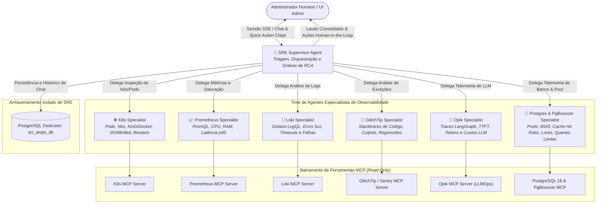

# ADR 018: AIOps Copilot no SCIA Admin Center — Diagnóstico Autônomo de Causa-Raiz com Model Context Protocol (MCP), Agentes Especialistas e Governança Human-in-the-Loop

- **Status:** APROVADO (Consolidado e Alinhado às ADR-012, ADR-013, ADR-014, ADR-015 e Decisões de Produção)
- **Data:** 15 de Novembro de 2026
- **Autor(es):** Equipe de Arquitetura, Engenharia, SRE e Segurança SCIA
- **Domínio:** AIOps, Inteligência Operacional, Diagnóstico de Causa-Raiz (RCA), Model Context Protocol (MCP), Governança de Infraestrutura, Arquitetura Multi-Agente Hierárquica e Isolamento de Domínios
- **Componentes Relacionados:**
  - `frontend`: `src/features/admin/components/AIOpsChatDrawer.tsx`, `src/features/admin/hooks/useAIOps.ts`, `src/features/admin/`
  - `backend`: `src/modules/admin/aiops/`, `src/modules/admin/aiops/aiops.routes.ts`, `src/modules/admin/aiops/aiops.service.ts`, `src/infra/mcp/`
  - `ai-service`: `app/agents/aiops/`, `app/agents/aiops/sre_supervisor.py`, `app/agents/aiops/specialists/`, `app/agents/aiops/tools/`, `app/agents/aiops/skills/`
  - `infra`: Servidores MCP (K8s MCP, Prometheus MCP, Loki MCP, GlitchTip MCP, Opik MCP, Postgres/PgBouncer MCP), Banco Dedicado `sci_aiops_db`, PgBouncer (`:6543`), Kubernetes RBAC, OpenTelemetry Collector, PostgreSQL 16

---

## ⚡ Guia Rápido & Resumo Executivo ("Elevator Pitch")

> [!TIP]
> **Consulte esta seção para entender a motivação, o funcionamento e as fronteiras do AIOps Copilot no SCIA.**

### 1. O que estamos decidindo e adotando:
1. **Evolução de Gráficos Passivos para Diagnóstico Ativo:** O [SCIA Admin Center (ADR-014)](file:///mnt/c0b6217c-c2f3-4c1f-8ba2-c8d177f718a9/development/professional/sci-latex-vscode/docs/planning/adrs/adr-014-painel-admin-saude-e-metricas-aplicacao.md) deixa de ser exclusivamente um painel visual de semáforos e gráficos para incorporar um **Agente Copilot de AIOps**. Em vez de forçar o operador a correlacionar mentalmente logs no Loki, métricas no Prometheus e pods no Kubernetes, o agente atua ativamente, correlacionando eventos e gerando laudos estruturados de **Causa-Raiz (Root Cause Analysis - RCA)**.
2. **Separação Estrita de Domínios (SCIA Acadêmico vs. SCIA AIOps):**
   - O domínio de AIOps é **100% isolado** do domínio científico (Belisa, orientadores, artigos, templates e etapas). Não há compartilhamento de estado, prompts nem permissões.
   - Acesso estrito por RBAC: apenas administradores com `Role.ADMIN` podem interagir com os agentes e APIs de AIOps.
3. **Topologia Hierárquica de Agentes Especialistas (Fim do Regex):**
   - Proibição de regras frágeis de regex para detecção de intenção.
   - Adoção do padrão **SRE Supervisor Agent** que orquestra **6 Agentes Especialistas de Ferramentas** via Tool Calling / Function Calling nativo:
     - ☸️ **K8s & Container Specialist:** Pods, Nós, KinD/Docker, OOMKilled (ExitCode 137), Restarts, Rollouts.
     - 📜 **Loki Logs Specialist:** Sintaxe LogQL, erros 5xx, timeouts, correlação temporal de mensagens.
     - 📈 **Prometheus Specialist:** PromQL, consumo de CPU, saturação de RAM, taxas de erro 5xx e latências p95/p99.
     - 🐛 **GlitchTip Specialist:** Exceções de aplicação, stacktraces com arquivos/linhas culpadas (*culprit*), contagem de recorrências.
     - 🧠 **Opik LLMOps Specialist:** Spans de grafos LangGraph, Time to First Token (TTFT), contagem e custos de tokens.
     - 🐘 **PostgreSQL 16 & PgBouncer Specialist:** Métricas de conexões ativas/idle, cache hit ratio (>99%), queries lentas (>2s), locks e status do PgBouncer (:6543) em Transaction Pooling mode ([ADR-015](file:///mnt/c0b6217c-c2f3-4c1f-8ba2-c8d177f718a9/development/professional/sci-latex-vscode/docs/planning/adrs/adr-015-postgresql-scalability-ha-pgbouncer-and-read-replicas.md)).
4. **Skills de Runtime Autocontidas no Microsserviço:**
   - As diretrizes operacionais de SRE residem no próprio código do microsserviço (`ai-service/app/agents/aiops/skills/`), garantindo que em produção (Docker/K8s) os agentes tenham acesso autônomo aos playbooks (`kubernetes-operations`, `postgresql-operations`, `opik-diagnose`) sem depender de pastas de desenvolvimento local (`.agents/`).
5. **UX Guiada no Frontend com Quick Action Chips e Cards de Ferramentas:**
   - Abertura com menu operacional guiado exibindo botões de ação rápida de 1 clique, com digitação de zero latência (`ChatInputBar` memoizado) e botão de "Nova Conversa".
6. **Histórico Conversacional Persistente e Memória Contextual:**
   - Disponibilização de endpoint `GET /api/v1/admin/aiops/chat/messages` para recuperação completa de diálogos.
   - Injeção de janela de turnos anteriores no prompt do agente para suportar perguntas de acompanhamento (*follow-up questions*).
7. **Isolamento de Banco de Dados (`sci_aiops_db`):**
   - Segregação de banco de dados para evitar contaminação do banco core da aplicação (`sci_latex_db`). Pools de conexões isolados, política própria de TTL/retenção (60 dias) e *blast radius* zero.
8. **Governança Estrita M2M via JWT Criptográfico e Human-in-the-Loop ([ADR-012](file:///mnt/c0b6217c-c2f3-4c1f-8ba2-c8d177f718a9/development/professional/sci-latex-vscode/docs/planning/adrs/adr-012-m2m-security-evolution.md)):** 
   - Autenticação máquina-a-máquina com tokens JWT assinados criptograficamente (`type: 'SERVICE'`, `sub: 'service:aiops'`, `scopes: ['aiops:chat', 'observability:read']`, `actor: { userId, email }`), com **permissões 100% de leitura** (`Read-Only`).
   - A IA **NUNCA executa ações remediadoras de forma autônoma**. Ela emite Propostas de Ação parametrizadas de uma allowlist. A execução física é assinada pelo administrador humano com trilha auditável imutável (`AiopsActionAuditLedger`).

---

## 1. Contexto & Diagnóstico dos Problemas

Com a consolidação da [ADR-013 (Observabilidade On-Premise)](file:///mnt/c0b6217c-c2f3-4c1f-8ba2-c8d177f718a9/development/professional/sci-latex-vscode/docs/planning/adrs/adr-013-observabilidade-on-premise-licenca-zero.md) e da [ADR-014 (SCIA Admin Center)](file:///mnt/c0b6217c-c2f3-4c1f-8ba2-c8d177f718a9/development/professional/sci-latex-vscode/docs/planning/adrs/adr-014-painel-admin-saude-e-metricas-aplicacao.md), a plataforma SCIA passou a contar com telemetria unificada (Prometheus, Loki, Tempo, GlitchTip e Opik) e um painel central de indicadores.

No entanto, a operação diária revelou três desafios críticos de confiabilidade:

1. **Sobrecarga Cognitiva e Fadiga de Alertas (Alert Fatigue):**
   - Diante de uma instabilidade (ex: degradação do compilador TeX ou atraso nas requisições do LangGraph), o administrador precisa abrir 3 ou 4 painéis distintos: checar restarts de pods via `kubectl`, olhar picos de CPU no Prometheus, buscar stacktraces no Loki e inspecionar exceções no GlitchTip.
   - Esse processo consome minutos preciosos de MTTR (Mean Time to Resolution) e depende de conhecimento especializado e sênior em infraestrutura.

2. **Dificuldade em Isolar a Causa-Raiz (Infra vs. App):**
   - É comum que sintomas de infraestrutura sejam na verdade provocados por falhas de código (ex: um vazamento de conexões no backend Fastify que esgota o pool do PostgreSQL e derruba a liveness probe do Pod).
   - O oposto também ocorre: nós do Kubernetes sob `MemoryPressure` ou com CNI saturada matando pods saudáveis da aplicação com código correto.
   - Faltava um mecanismo automatizado capaz de cruzar logs e eventos de nós para emitir um laudo objetivo.

3. **Inexistência de Interface Conversacional Segura com Ferramentas:**
   - O administrador não tinha como interagir com o sistema perguntando: *"Por que o pod do ai-service reiniciou às 14:10?"* ou *"Identifique se o erro no compilador foi por loop infinito de macro TeX ou falta de memória no nó"*.
   - A conexão de modelos de linguagem diretamente a comandos de shell (`kubectl`, `bash`) apresentava risco intolerável de segurança e violação da [ADR-012](file:///mnt/c0b6217c-c2f3-4c1f-8ba2-c8d177f718a9/development/professional/sci-latex-vscode/docs/planning/adrs/adr-012-m2m-security-evolution.md).

---

## 2. Decisão Arquitetural: O Ecossistema AIOps Copilot

```
┌──────────────────────────────────────────────────────────────────────────────────────────────────┐
│             ARQUITETURA AIOPS COPILOT: MCP GATEWAY, DIAGNÓSTICO E GOVERNANÇA                     │
├──────────────────────────────┬─────────────────────────────┬─────────────────────────────────────┤
│ 1. Model Context Protocol    │ 2. Triagem e Correlação     │ 3. Human-in-the-Loop Mandatório     │
│ - Servidores MCP Read-Only   │ - Input de logs (ERR/WARN)  │ - A IA sugere ações parametrizadas  │
│ - K8s, Prometheus, Loki, Sentry - Matriz Infra vs. App     │ - Admin aprova com Token Pessoal    │
│ - Zero shell arbitrário      │ - Laudo de RCA padronizado  │ - Trilha imutável em AuditLog       │
└──────────────────────────────┴─────────────────────────────┴─────────────────────────────────────┘
```

### 2.1. Topologia Hierárquica de Agentes Especialistas de AIOps

A operação do AIOps Copilot adota o padrão **Hierarchical Multi-Agent System (SRE Supervisor + 6 Especialistas de Ferramentas)**. Fica terminantemente vetado o uso de parsers baseados em Expressões Regulares (Regex) para detecção de intenções, transferindo o roteamento e a execução para **Tool Calling / Function Calling nativo** suportado por LLMs:



#### Papéis dos Agentes do Domínio SRE:
1. **SRE Supervisor Agent:**
   - Realiza o acolhimento técnico, apresenta as capacidades do time e guia o operador (evitando telas cegas).
   - Coordena diagnósticos cross-telemetria para emissão de laudos de Causa-Raiz (RCA).
   - Injeta a janela de histórico conversacional recente para suportar diálogos contínuos com perguntas de acompanhamento (*follow-up*).
2. **K8s & Container Specialist:** Domina o ciclo de vida de contêineres e orquestração. Identifica se o ambiente roda em Docker Compose ou Kubernetes/KinD, analisa contadores de restarts, probes e eventos de `OOMKilled` (ExitCode 137).
3. **Loki Logs Specialist:** Executa consultas refinadas em LogQL com agregação por serviço e nível (`ERROR`, `FATAL`), correlacionando os logs no intervalo temporal da anomalia.
4. **Prometheus Specialist:** Executa métricas em PromQL instantâneas e vetoriais, diagnosticando saturação de recursos, consumo de CPU e RAM.
5. **GlitchTip Specialist:** Analisa stacktraces, culpados (*culprits*) e frequência de erros em nível de código (TypeScript/Python).
6. **Opik LLMOps Specialist:** Monitora a latência de streaming, custos de tokens e nós de grafos LangGraph no `ai-service`.
7. **PostgreSQL & PgBouncer Specialist:** Monitora conexões ativas/ociosas, contenção de locks concorrentes (`pg_locks`), queries em execução lenta (> 2s), transações em `idle in transaction`, Cache Hit Ratio (`> 99%`) e filas de espera no pooler PgBouncer (`cl_waiting > 0` na porta 6543) conforme a [ADR-015](file:///mnt/c0b6217c-c2f3-4c1f-8ba2-c8d177f718a9/development/professional/sci-latex-vscode/docs/planning/adrs/adr-015-postgresql-scalability-ha-pgbouncer-and-read-replicas.md).

---

## 3. Arquitetura de Ferramentas: Servidores MCP Oficiais vs. Tools Nativas de Inspeção

Para garantir rigor técnico e evitar confusão conceitual, a arquitetura distingue claramente duas camadas de ferramentas:

1. **Servidores MCP Oficiais (Model Context Protocol):** Processos que implementam formalmente a especificação MCP da Anthropic (JSON-RPC sobre SSE ou stdio), com handshake dinâmico de schemas, recursos e autenticação padronizada. No SCIA, operamos com:
   - **Opik MCP Server:** Servidor oficial Comet ML para LLMOps e grafos LangGraph (`/api/v1/mcp`).
   - **GlitchTip Native MCP Server:** Servidor oficial embutido no GlitchTip 6.1+ (`apps.mcp`) ativado via `GLITCHTIP_ENABLE_MCP=True` na porta `:8005/mcp` com transporte SSE e autenticação Bearer/OAuth.
2. **Tools Nativas de Inspeção (Python `@tool` via REST API / SDK / DB):** Ferramentas tipadas implementadas diretamente no microsserviço `ai-service` que se comunicam via HTTP REST assíncrono ou drivers nativos (PostgreSQL via `asyncpg`/`psql`, Prometheus via HTTP REST, K8s via SDK/CLI, Loki via LogQL). São extremamente rápidas, têm latência sub-milissegundo e dispensam a sobrecarga de gerenciar contêineres ou processos intermediários adicionais.

### 3.1. Detalhamento dos Conectores e Servidores

1. **Kubernetes & Containers (Tools Nativas):**
   - **Escopo RBAC:** ServiceAccount dedicado com permissões estritas de `["get", "list", "watch"]` em pods, nodes, events, namespaces e configmaps. Proibição absoluta de verbos mutantes (`create`, `update`, `delete`, `patch`).
   - **Ferramentas Expostas:**
     - `k8s_inspect_environment()`: Retorna o inventário de pods, restarts, `lastState.terminated.exitCode`, nós K8s ou contêineres Docker Compose ativos.
     - `k8s_get_node_status(node_name)`: Avalia condições de nós (`Ready`, `MemoryPressure`, `DiskPressure`, `PIDPressure`).

2. **Prometheus Tools & Rota de Evolução MCP (`prometheus-mcp`):**
   - **Abordagem Ativa (Chamadas HTTP REST Diretas via Tools):**
     Nesta fase, para manter a arquitetura extremamente enxuta, sem provisionar contêineres adicionais ou processos Go no cluster, as ferramentas do Prometheus são implementadas através de chamadas assíncronas diretas à API REST nativa do Prometheus (`http://scia_prometheus:9090/api/v1/`), encapsuladas como Tools tipadas (`@tool`) no microsserviço `ai-service`:
     - `promql_instant_query(query)`: Avaliação pontual de vetores e métricas (ex: saturação de pool de banco, uso de RAM em cgroups, RPS).
     - `promql_range_query(query, minutes_ago, step_seconds)`: Análise de tendência de séries temporais com cálculo automático de mínimo, máximo, atual e contagem de amostras em janelas recentes.
     - `promql_list_targets()`: Inspeciona a saúde de raspagem (scraping health) de todos os jobs (`scia-backend`, `scia-ai-service`, `scia-compiler`, `otel-collector`), identificando alvos `UP` vs `DOWN`.
     - `promql_get_active_alerts()`: Coleta regras de alerta ativas ou disparadas (`firing` / `pending`).
     - `promql_cluster_health()`: Panorama sintético de disponibilidade baseado na métrica global `up`.
   - **Possibilidade de Adoção do Servidor Oficial MCP ([`prometheus/prometheus-mcp`](https://github.com/prometheus/prometheus-mcp)):**
     O projeto oficial da CNCF mantém o servidor MCP dedicado em Go (`quay.io/prometheus/prometheus-mcp` ou `docker.io/prom/prometheus-mcp`). Caso a evolução da plataforma demande federação padronizada via MCP JSON-RPC com IDEs externas (Claude Desktop, Cursor) ou múltiplos agentes heterogêneos, o contêiner oficial do `prometheus-mcp` poderá ser adicionado ao `docker-compose.yml` e K8s operando com `--transport sse` na porta 8080 apontando para o Prometheus (`http://scia_prometheus:9090`), sem ruptura no fluxo operacional dos agentes.

3. **Loki Tools (LogQL Nativo):**
   - **Ferramentas Expostas:**
     - `loki_query_logs(query, limit, level, start_time)`: Busca filtrada por rótulos estruturados (`app`, `namespace`, `level="ERROR"`).

4. **GlitchTip Native MCP Server (`glitchtip-mcp` — porta :8005/mcp):**
   - **Protocolo & Endpoint:** Servidor MCP oficial embutido nativamente no GlitchTip 6.1+ (`apps.mcp`), ativado via variável `GLITCHTIP_ENABLE_MCP: "True"` no container `scia_glitchtip`.
   - **Transporte & Autenticação:** HTTP Server-Sent Events (SSE) no endpoint `http://localhost:8005/mcp` protegido por Bearer Token de API ou fluxo OAuth 2.0 (RFC 6749 / RFC 7591).
   - **Ferramentas Nativas Expostas pelo GlitchTip MCP:**
     - `list_organizations()`: Lista organizações do tenant.
     - `list_projects()`: Lista projetos monitorados.
     - `list_issues(query="is:unresolved")`: Rastreia exceções ativas e culpados de código.
     - `get_issue(issue_id)`: Recupera detalhes da issue e metadados de ocorrência.
     - `get_latest_event(issue_id)`: Extrai a stacktrace e culprit mais recente.
     - `get_event(event_id)`: Análise forense detalhada do evento de erro.

5. **Opik MCP Server (`opik-mcp` — Comet ML):**
   - **Papel:** Observabilidade profunda de agentes de IA, grafos LangGraph e LLMOps (previsto na ADR-013).
   - **Ferramentas Expostas:**
     - `opik_list_entities(entity_type, project_name, since)`: Consulta traces, spans, projetos e diagnósticos via Servidor MCP oficial.
     - `opik_read_entity(entity_type, id)`: Lê detalhes completos de spans, inputs, prompts e custos de tokens.
     - `opik_read_skill(skill_name)`: Carrega as diretrizes operacionais de skills oficiais (`opik-diagnose`, `opik-explain`).

6. **PostgreSQL 16 & PgBouncer Tools (`postgres-tools` — ADR-015):**
   - **Papel:** Monitoramento profundo do motor relacional PostgreSQL 16 e da camada de multiplexação de conexões PgBouncer (porta 6543) via chamadas nativas `asyncpg` e `psql`.
   - **Ferramentas Expostas:**
     - `postgres_inspect_health()`: Coleta o número de conexões ativas/ociosas/em transação, o Cache Hit Ratio em tempo real (`> 99%`) e o tamanho das bases de dados (`sci_latex_db` e `sci_aiops_db`).
     - `postgres_check_slow_queries_and_locks()`: Detecta queries em execução há mais de 2 segundos, transações presas em `idle in transaction` (> 10s) e contenção de locks (`pg_locks`).
     - `pgbouncer_inspect_pools()`: Inspeciona o console administrativo do PgBouncer (:6543) via `SHOW POOLS;`, verificando se há conexões de clientes em fila (`cl_waiting > 0`) por exaustão de pool.
     - `pgbouncer_inspect_pools()`: Inspeciona o console administrativo do PgBouncer (:6543) via `SHOW POOLS;`, verificando se há conexões de clientes em fila (`cl_waiting > 0`) por exaustão de pool.

### 3.2. Arquitetura de Skills: Dev-Time vs. Run-Time (Autocontenção em Produção)

Para evitar que o `ai-service` falhe em produção por tentar acessar pastas externas que não existem no container Docker:

1. **Dev-Time Skills (IDE / Desenvolvedor):**
   - Residem na raiz do monorepo em `.agents/skills/` (ex: `library-skills`, `scientific-article-analysis`, `code-review`).
   - Utilizadas exclusivamente pelas IAs de assistência de código (Antigravity, Cursor, Claude Code) durante o desenvolvimento local. Não entram na imagem de produção.
2. **Run-Time Skills (Container da Aplicação em Produção):**
   - Residem obrigatoriamente dentro do pacote do microsserviço: `ai-service/app/agents/aiops/skills/`.
   - **Arquitetura Modular em Camadas (Prevenção de *Prompt Bloat*):**
     Para evitar sobrecarga de contexto na LLM, as skills de SRE não utilizam um único arquivo monolítico. Em vez disso, adotam a estrutura padrão enterprise de Agent Skills:
     - `SKILL.md`: Roteador principal, missão, limites inegociáveis de segurança (Read-Only/HITL) e sumário executivo com SLA tables.
     - `diagnostics/`: Playbooks especializados por sintomas focados (ex: `crashloopbackoff.md`, `oomkilled.md`, `connection-exhaustion.md`, `lock-contention.md`, `slow-queries.md`, `replication-lag.md`, `storage-and-wal-pressure.md`, `autovacuum-health.md`, `backup-failure.md`).
     - `knowledge/` / `references/`: Fundamentos técnicos profundos (ciclos de vida K8s, QoS, probes, networking, baseline do PostgreSQL 16, transaction pooling no PgBouncer, MVCC, segurança e redaction).
     - `workflows/`: Procedimentos padronizados de investigação de pods/nós/banco, correlação cruzada com Prometheus/Loki e montagem de pacotes de evidência para RCA.
     - `sql/`: Modelos de consultas de leitura revisadas por DBA com `statement_timeout` e redação de parâmetros sensíveis.
     - `schemas/`: Contrato lógico de saída estruturada em JSON (`specialist-output.schema.json`).
   - **Carregador com Lazy Loading por Tópico ([`loader.py`](file:///mnt/c0b6217c-c2f3-4c1f-8ba2-c8d177f718a9/development/professional/sci-latex-vscode/ai-service/app/agents/aiops/skills/loader.py)):**
     - O utilitário `load_aiops_skill(skill_name, topic=None)` e a ferramenta de agente `read_operational_skill(skill_name, topic=None)` operam com cache em memória (`@lru_cache`).
     - Se `topic` for omitido, lê o `SKILL.md` principal.
     - Se `topic` for especificado (ex: `diagnostics/oomkilled.md` ou `references/connections-and-pgbouncer.md`), carrega pontualmente apenas o arquivo demandado, viabilizando diagnósticos cirúrgicos com mínimo consumo de tokens.
   - **Skills Ativas Empacotadas:**
     - `kubernetes-operations/`: 19 arquivos modulares para diagnóstico de contêineres, pods, nós, KinD e fallback Docker Compose.
     - `postgresql-operations/`: 25 arquivos modulares para diagnóstico do PostgreSQL 16, CloudNativePG e PgBouncer (:6543) conforme a ADR-015.
     - `opik-diagnose/`: Procedimentos de triagem de latência, grafos LangGraph e custos de LLMOps.

---

## 4. Política de Ingestão e Filtro de Logs

Para evitar explosão de custos de processamento e limites de contexto de LLM:

```
┌────────────────────────────────────────────────────────────────────────────────────────┐
│                   POLÍTICA DE ROTEAMENTO DE TELEMETRIA PARA O AIOPS                    │
├──────────────┬───────────────────┬─────────────────────────────────────────────────────┤
│ Nível do Log │ Política de Armaz.│ Papel no Fluxo do AIOps                             │
├──────────────┼───────────────────┼─────────────────────────────────────────────────────┤
│ DEBUG        │ Amostrado (10%)   │ Retido localmente por 48h. Consultado apenas sob    │
│              │ TTL de 2 dias     │ demanda do agente durante investigação profunda.    │
├──────────────┼───────────────────┼─────────────────────────────────────────────────────┤
│ INFO         │ 100% no Loki      │ Base para auditoria e tráfego. O agente consulta    │
│              │ TTL de 30 dias    │ apenas contadores agregados de requisições.         │
├──────────────┼───────────────────┼─────────────────────────────────────────────────────┤
│ WARNING      │ 100% no Loki      │ Monitorado em janelas de tendência. Se a taxa de    │
│              │ TTL de 30 dias    │ WARN subir > 20% em 5 min, gera alerta preventivo.  │
├──────────────┼───────────────────┼─────────────────────────────────────────────────────┤
│ ERROR /      │ 100% no Loki      │ GATILHO IMEDIATO: Despacha evento para a fila       │
│ FATAL        │ + GlitchTip       │ de triagem do AIOps com stacktrace e metadados.     │
└──────────────┴───────────────────┴─────────────────────────────────────────────────────┘
```

---

## 5. Matriz de Classificação de Causa-Raiz (RCA)

O agente deve aplicar uma árvore de decisão determinística para categorizar a falha:

```mermaid
flowchart TD
    Trigger[Alerta Recebido ou Chamada do Admin] --> K8sCheck[Consulta K8s MCP & Métricas]
    
    K8sCheck --> CondInfra{Evidências de Infraestrutura?<br>• ExitCode == 137 (OOMKilled)?<br>• Node com Memory/DiskPressure?<br>• Falha em CoreDNS / CNI Network?<br>• Desalocação por Preemption / Eviction?}
    
    CondInfra -- SIM --> CheckLeak{O consumo de memória cresceu linearmente?<br>• Memory leak no código?<br>• Ou cluster subdimensionado?}
    CheckLeak -- "Crescimento contínuo no código" --> HybridResult[Classificação: FALHA MISTA<br>Causa: Vazamento de memória na aplicação gerando OOM na infraestrutura]
    CheckLeak -- "Spike súbito / ResourceLimit baixo" --> InfraResult[Classificação: FALHA DE INFRAESTRUTURA<br>Causa: Limite de cgroup insuficiente ou nó saturado]

    CondInfra -- NÃO --> AppCheck{Evidências de Aplicação?<br>• Stacktrace 500 no GlitchTip/Loki?<br>• Connection pool exhausted?<br>• Timeout em serviço externo (arXiv/Redis)?<br>• Erro de sintaxe de LaTeX / Macro loop?}
    
    AppCheck -- SIM --> AppResult[Classificação: FALHA DE APLICAÇÃO<br>Causa: Exceção de código ou esgotamento de recurso lógico]
    AppCheck -- NÃO --> UnresolvedResult[Classificação: INCONCLUSIVA / INVESTIGAÇÃO ADICIONAL NECESSÁRIA]
```

### 5.1. Estrutura Canônica do Laudo de RCA

O agente responde e persiste o laudo técnico sempre obedecendo ao schema:
1. **Identificador e Metadados:** ID do incidente, severidade, ambiente, namespace e serviço.
2. **Veredito Categórico:** `[INFRAESTRUTURA]`, `[APLICAÇÃO]` ou `[MISTA]`.
3. **Resumo Executivo (2 parágrafos):** O que houve e qual o impacto real aos pesquisadores.
4. **Linha do Tempo dos Fatos (Timeline):** Momentos canônicos de início, propagação e impacto.
5. **Evidências Coletadas:** Dados factuais extraídos via MCP (sem alucinações).
6. **Recomendação de Remediação:**
   - *Ação Imediata (Mitigação):* Workaround emergencial.
   - *Ação Preventiva Definitiva:* Correção permanente no código ou IaC.

---

## 6. Segurança, Identidade M2M Criptográfica e Governança ([ADR-012](file:///mnt/c0b6217c-c2f3-4c1f-8ba2-c8d177f718a9/development/professional/sci-latex-vscode/docs/planning/adrs/adr-012-m2m-security-evolution.md))

Para garantir total conformidade com a política de menor privilégio e segurança de serviço:

1. **Separação de Identidade M2M e Eliminação de Chaves Estáticas:**
   - O Agente de AIOps opera como entidade técnica: `type: 'SERVICE'`, `sub: 'service:aiops'`.
   - **Ele nunca recebe `Role.ADMIN`**.
   - Seus escopos são estritamente de leitura de telemetria: `['aiops:chat', 'observability:read']`.
   - A comunicação Fastify -> `ai-service` é autenticada através do cabeçalho `Authorization: Bearer <m2m_jwt>`, validado criptograficamente com `JWT_SECRET` (`HS256`) via middleware `verify_m2m_token` (`app/core/m2m_auth.py`). Tentativas sem token ou com assinatura inválida retornam `HTTP 401 Unauthorized`.

2. **Delegação Criptográfica (*On-Behalf-Of*):**
   - Ao interagir com o Admin Center, o backend Fastify emite um token de delegação assinado (TTL de 15 minutos) vinculando a identidade do administrador humano logado:
     ```json
     {
       "type": "SERVICE",
       "sub": "service:aiops",
       "scopes": ["aiops:chat", "observability:read"],
       "actor": {
         "userId": "usr_admin_01",
         "email": "sre@instituicao.br"
       },
       "exp": 1794783000
     }
     ```

3. **Human-in-the-Loop Mandatório para Ações de Remediação:**
   - O agente **NUNCA executa comandos mutantes diretamente no Kubernetes ou na infraestrutura**.
   - Quando uma remediação for identificada, o agente emite uma **Ação Parametrizada de uma Allowlist**:
     ```json
     {
       "action_id": "act_8829_restart",
       "action_type": "K8S_DEPLOYMENT_RESTART",
       "parameters": {
         "namespace": "production",
         "deployment": "compiler-worker"
       },
       "risk_level": "LOW",
       "requires_human_approval": true
     }
     ```
   - O frontend renderiza um card de ação com o botão `[Aprovar e Executar]`.
   - Ao clicar, o frontend envia a aprovação ao **Execution Gateway** com o token do administrador logado.
   - O comando é executado no K8s via **User Impersonation** (`--as=sre@instituicao.br`), garantindo que o Kubernetes registre exatamente qual humano aprovou a ação.

4. **Trilha de Auditoria Imutável (`AuditLog`):**
   - Toda proposta da IA, confirmação humana, parâmetros executados e saídas de comando são gravados na tabela de auditoria com restrição no banco de dados contra `UPDATE` e `DELETE`.

---

## 7. Modelagem de Dados, Isolamento de Banco (`sci_aiops_db`) e Histórico Conversacional

Para garantir total conformidade com os princípios de produção, segurança e resiliência:

### 7.1. Isolamento Físico de Banco de Dados (`sci_aiops_db`)
O subsistema AIOps opera em um banco de dados dedicado (**`sci_aiops_db`**), separado da base de negócios acadêmica (**`sci_latex_db`**):
1. **Blast Radius Zero:** Picos de tráfego, tempestades de alertas ou consultas analíticas pesadas no AIOps jamais competem por pool de conexões ou CPU com pesquisadores editando artigos.
2. **Políticas de Retenção e TTL Segregadas:** Enquanto os artigos científicos são mantidos perpetuamente, os dados de AIOps possuem expiração configurada para **60 dias** (com expurgo automático via job cron ou particionamento).
3. **Backups Independentes:** Backups rápidos do banco acadêmico sem contaminação por megabytes de telemetria e laudos de RCA.

```sql
-- Executado no banco dedicado: sci_aiops_db
CREATE EXTENSION IF NOT EXISTS vector;

-- 1. Incidentes Registrados pelo Coletor de Telemetria
CREATE TABLE aiops_incidents (
    id UUID PRIMARY KEY DEFAULT gen_random_uuid(),
    service_name VARCHAR(100) NOT NULL,
    namespace VARCHAR(100) NOT NULL,
    severity VARCHAR(20) NOT NULL, -- CRITICAL, HIGH, MEDIUM, LOW
    status VARCHAR(30) DEFAULT 'OPEN', -- OPEN, INVESTIGATING, MITIGATED, RESOLVED
    trigger_source VARCHAR(50) NOT NULL, -- 'LOKI_ERROR', 'PROMETHEUS_ALERT', 'ADMIN_MANUAL'
    trigger_message TEXT NOT NULL,
    trace_id VARCHAR(64), -- W3C Trace ID para correlação no Tempo
    detected_at TIMESTAMPTZ DEFAULT NOW(),
    resolved_at TIMESTAMPTZ
);

-- 2. Laudos de Causa-Raiz (RCA) Emitidos pelo Agente
CREATE TABLE aiops_rca_reports (
    id UUID PRIMARY KEY DEFAULT gen_random_uuid(),
    incident_id UUID REFERENCES aiops_incidents(id) ON DELETE CASCADE,
    classification VARCHAR(30) NOT NULL, -- 'INFRASTRUCTURE', 'APPLICATION', 'HYBRID'
    root_cause_summary TEXT NOT NULL,
    full_markdown_report TEXT NOT NULL,
    evidence_payload JSONB NOT NULL,
    suggested_actions JSONB NOT NULL,
    embedding vector(1536), -- Vetor para similaridade semântica em incidentes futuros
    created_at TIMESTAMPTZ DEFAULT NOW()
);

-- 3. Mensagens do Chat Interativo entre Admin e Agente (Histórico Persistente)
CREATE TABLE aiops_chat_messages (
    id UUID PRIMARY KEY DEFAULT gen_random_uuid(),
    incident_id UUID REFERENCES aiops_incidents(id) ON DELETE SET NULL,
    user_id VARCHAR(100) NOT NULL, -- ID do Admin
    role VARCHAR(20) NOT NULL, -- 'user', 'assistant', 'system'
    content TEXT NOT NULL,
    tool_calls JSONB, -- Registro das chamadas MCP executadas
    created_at TIMESTAMPTZ DEFAULT NOW()
);

-- 4. Trilha Imutável de Auditoria de Ações Executadas
CREATE TABLE aiops_action_audit_ledger (
    id UUID PRIMARY KEY DEFAULT gen_random_uuid(),
    incident_id UUID REFERENCES aiops_incidents(id),
    executed_by_user_id VARCHAR(100) NOT NULL,
    executed_by_email VARCHAR(255) NOT NULL,
    user_ip_address INET NOT NULL,
    action_type VARCHAR(100) NOT NULL,
    target_resource VARCHAR(255) NOT NULL,
    payload_parameters JSONB NOT NULL,
    ai_rationale TEXT NOT NULL,
    execution_status VARCHAR(30) NOT NULL, -- 'SUCCESS', 'FAILED', 'REJECTED'
    k8s_response_code INT,
    output_details TEXT,
    executed_at TIMESTAMPTZ DEFAULT NOW()
);

-- Índices de consulta, auditoria e similaridade
CREATE INDEX idx_aiops_incidents_status ON aiops_incidents(status);
CREATE INDEX idx_aiops_chat_incident_created ON aiops_chat_messages(incident_id, created_at ASC);
CREATE INDEX idx_aiops_audit_user_executed ON aiops_action_audit_ledger(executed_by_user_id, executed_at DESC);
CREATE INDEX idx_aiops_rca_embedding ON aiops_rca_reports USING ivfflat (embedding vector_cosine_ops) WITH (lists = 100);
```

### 7.2. Contrato da API de Histórico Conversacional e Memória
1. **Endpoint `GET /api/v1/admin/aiops/chat/messages`:**
   - **Query Parameters:**
     - `incidentId` (UUID opcional): Recupera o histórico do incidente específico ou da sessão geral do cluster.
     - `limit` (int, default 50, máx 100): Tamanho da janela de mensagens.
   - **Retorno:** Array ordenado cronologicamente (`createdAt ASC`) contendo `id`, `role`, `content`, `toolCalls` e `createdAt`.
2. **Injeção de Memória Conversacional no Agente:**
   - Ao processar uma nova mensagem no `POST /api/v1/admin/aiops/chat`, o serviço recupera os últimos $N$ turnos de diálogo do banco e injeta como contexto histórico no Supervisor, habilitando perguntas contextuais contínuas.

---

## 8. Integração com o SCIA Admin Center ([ADR-014](file:///mnt/c0b6217c-c2f3-4c1f-8ba2-c8d177f718a9/development/professional/sci-latex-vscode/docs/planning/adrs/adr-014-painel-admin-saude-e-metricas-aplicacao.md))

No frontend React (`/admin`):

1. **AIOps Drawer Lateral Global:**
   - Disponível em todas as telas do Admin Center através do atalho ou botão no cabeçalho.
   - Permite interação fluida em linguagem natural com streaming de tokens via Server-Sent Events (SSE).
2. **Botões Contextuais na Área 3 (Monitoramento da Infraestrutura):**
   - Ao lado de cada componente com semáforo amarelo (🟡) ou vermelho (🔴), exibe-se a ação rápida `[🤖 Investigar com AIOps]`.
   - O clique abre o drawer já pré-alimentado com o contexto do pod, do serviço e da janela temporal afetada.
3. **Card de Aprovação com Diff / Preview:**
   - Se o agente sugerir uma ação (ex: ajuste de réplicas ou reinício de pod), o card apresenta os comandos exatos de pré-visualização e o nível de risco antes de liberar o botão de clique.

---

## 9. Consequências & Trade-offs

### Consequências Positivas:
- **Redução Drástica do MTTR:** Diagnósticos de minutos/horas passam a ser consolidados em menos de 30 segundos.
- **Democratização da Operação:** Administradores sem profundidade extrema em comandos de Kubernetes conseguem operar a plataforma com segurança.
- **Zero Risco de Comandos Destrutivos por Alucinação:** A arquitetura desacopla a IA da execução física; o agente só sugere ações de uma lista fechada, com confirmação obrigatória do administrador.
- **Conformidade Total com Padrões Aprovados:** A solução respeita a soberania on-premise da ADR-013, o modelo de segurança da ADR-012 e a interface da ADR-014.

### Trade-offs & Mitigações:
- **Consumo Adicional de Tokens de LLM:** A execução de múltiplos passos de ReAct com MCP consome tokens. *Mitigação:* As ferramentas MCP retornam dados recortados e estruturados (ex: `tail_lines=50`, sumários JSON), evitando despejo de logs brutos no prompt.
- **Manutenção de Servidores MCP:** Necessidade de gerenciar pods de servidores MCP. *Mitigação:* Os servidores MCP são containers leves e stateless que rodam em namespace dedicado com probes de saúde padrão.

---

## 10. Referências & Documentos Relacionados
- [ADR-012: Arquitetura de Identidade de Serviço (M2M) e Delegação Criptográfica](file:///mnt/c0b6217c-c2f3-4c1f-8ba2-c8d177f718a9/development/professional/sci-latex-vscode/docs/planning/adrs/adr-012-m2m-security-evolution.md)
- [ADR-013: Arquitetura de Observabilidade Open Source e Soberania Institucional](file:///mnt/c0b6217c-c2f3-4c1f-8ba2-c8d177f718a9/development/professional/sci-latex-vscode/docs/planning/adrs/adr-013-observabilidade-on-premise-licenca-zero.md)
- [ADR-014: SCIA Admin Center — Painel Administrativo de Observabilidade](file:///mnt/c0b6217c-c2f3-4c1f-8ba2-c8d177f718a9/development/professional/sci-latex-vscode/docs/planning/adrs/adr-014-painel-admin-saude-e-metricas-aplicacao.md)
- [ADR-015: Estratégia de Persistência Relacional, CloudNativePG, PgBouncer e Réplicas no PostgreSQL 16](file:///mnt/c0b6217c-c2f3-4c1f-8ba2-c8d177f718a9/development/professional/sci-latex-vscode/docs/planning/adrs/adr-015-postgresql-scalability-ha-pgbouncer-and-read-replicas.md)
- [Especificação de Observabilidade SCIA](file:///mnt/c0b6217c-c2f3-4c1f-8ba2-c8d177f718a9/development/professional/sci-latex-vscode/docs/planning/specs/observability-spec.md)
- [Model Context Protocol (MCP) Specification (Anthropic)](https://modelcontextprotocol.io)
