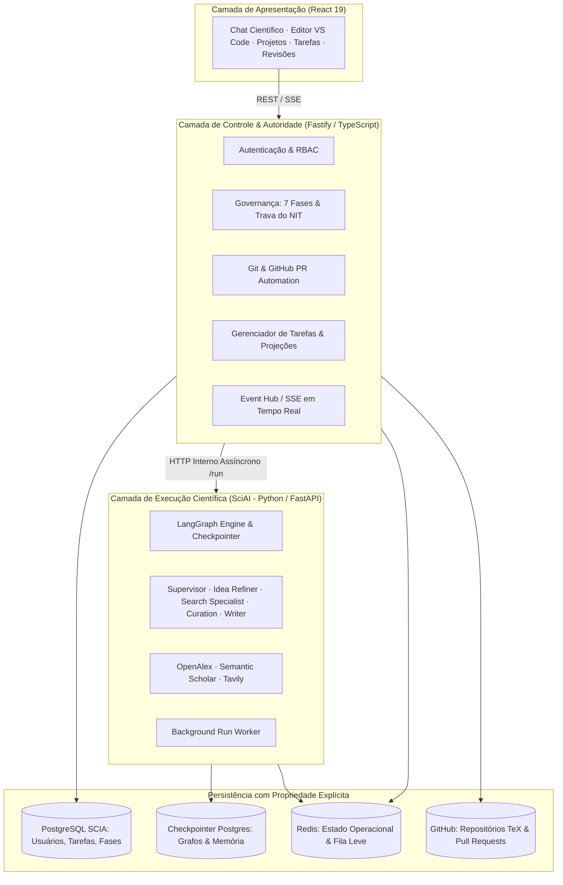
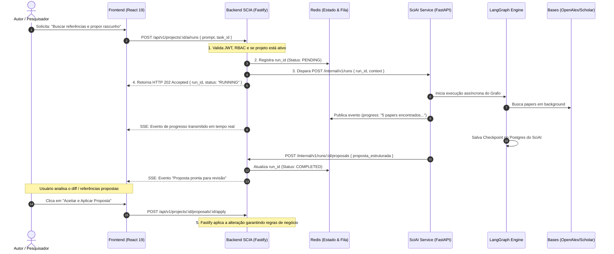

# 📊 Análise Comparativa de Arquitetura e Funcionalidades
## `sci-project` (SciAgent OS) vs `sci-latex-vscode` (SCIA Platform)

> **Data:** Outubro de 2026  
> **Objetivo:** Mapear a arquitetura, funcionalidades, pontos fortes, gargalos técnicos e oportunidades de sinergia entre o projeto legado/pesquisa `sci-project` e a plataforma atual `sci-latex-vscode`.

---

## 1. 📌 Resumo Executivo

O ecossistema foi desenvolvido em dois projetos complementares com focos e maturidades distintas:

1. **`sci-latex-vscode` (SCIA — Projeto Atual):**
   * **Posicionamento:** Plataforma corporativa de **Engenharia de Software, Governança e Infraestrutura**.
   * **Destaques:** Editor VS Code nativo (`code-server`) em pods on-demand no **Kubernetes (KinD)**, repositórios privados provisionados no **GitHub** via Service Account, workflow formal em **7 fases acadêmicas com Gatekeeper do NIT**, revisão de Pull Requests linha a linha e painéis de governança para 4 personas (Autor, Revisor, Coordenador e Gerente).
2. **`sci-project` (SciAgent OS — Projeto Analisado):**
   * **Posicionamento:** Prova de conceito e motor de **Inteligência Artificial Multi-Agente & RAG Científico**.
   * **Destaques:** Grafo de agentes cíclicos em **LangGraph** (Supervisor, Refinador de Ideias, Especialista de Busca, Curador e Escritor), integração direta com APIs de artigos científicos (**OpenAlex**, **Semantic Scholar**, **Scholarly**, **Tavily**) e fluxo de entrevista interativa de onboarding guiada por LLM.

```
┌────────────────────────────────────────────────────────────────────────────────────────┐
│                                   VISÃO ESTRATÉGICA                                    │
├──────────────────────────────────────────┬─────────────────────────────────────────────┤
│      sci-latex-vscode (SCIA)             │           sci-project (SciAgent OS)         │
│  "O Corpo e o Ambiente de Trabalho"      │               "O Cérebro de IA"             │
│  - Kubernetes KinD + Pods On-Demand      │  - LangGraph Multi-Agent Orchestration      │
│  - VS Code Nativo (TeX Workshop)         │  - Ferramentas de Busca (OpenAlex/Scholar)  │
│  - Fastify + Prisma + PostgreSQL + Redis │  - Entrevista de Onboarding com IA          │
│  - Git & GitHub Service Account + PRs    │  - Ideação, Curadoria e Rascunhos           │
│  - Governança NIT & 7 Fases Acadêmicas   │  - Editor Leve CodeMirror 6 + Yjs           │
└──────────────────────────────────────────┴─────────────────────────────────────────────┘
```

---

## 2. ⚖️ Tabela Comparativa de Alto Nível

| Dimensão | `sci-latex-vscode` (Nosso Projeto Atual) | `sci-project` (Projeto Analisado) |
| :--- | :--- | :--- |
| **Arquitetura Backend** | Node.js (v20+), **Fastify**, TypeScript, **Prisma ORM**, PostgreSQL, Redis | Python (3.12+), **FastAPI**, **SQLModel**, Alembic, PostgreSQL / SQLite |
| **Motor de IA** | *Especificado no PRD/Roteiro*, mas sem implementação no monorepo | **LangGraph**, LangChain, DeepAgents, Ollama, Langfuse, Tavily |
| **Ambiente de Edição** | **VS Code real (`code-server`)** embutido via `<iframe>` com proxy autenticado | Editor customizado no navegador: **CodeMirror 6** com **Yjs / y-websocket** |
| **Infraestrutura / Runtime** | **Kubernetes (KinD)** com *Warm Pool* de Pods pré-aquecidos e PVCs dedicados | Containers **Docker pontuais** executados via subprocessos para compilar TeX |
| **Controle de Versão** | **Git / GitHub nativo**: repositório privado, branches por task e Pull Requests | Persistência do texto via **CRDT (Yjs)** e dumps no banco de dados relacional |
| **Governança & Regras** | **Rígida**: 7 fases, Trava do NIT, Períodos Acadêmicos, Metas e Cotas por Time | **Básica**: Projetos, membros e tarefas com status simples de workflow |
| **Frontend UI** | React 19, Material UI 9, TanStack Query 5, Redux Toolkit, DnD Kit, Framer Motion | React 19, Material UI 7, TanStack Query, Zustand + Redux, Recharts, Lucide |

---

## 3. 🏗️ Comparativo Detalhado de Arquitetura

### 3.1 Backend & Persistência

#### `sci-latex-vscode`
* **Padrão:** Modular (`src/modules/*`), com separação entre Rotas (Zod Type-Provider), Casos de Uso/Serviços e Repositórios Prisma.
* **Segurança & Sessão:** JWT OWASP com cookies httpOnly, RBAC granular para 5 papéis (`AUTHOR`, `REVIEWER`, `COORDINATOR`, `MANAGER`, `ADMIN`), e proxy reverso Fastify (`@fastify/http-proxy`) autenticado para o `code-server`.
* **Projeções de Performance:** Projeções locais no Postgres sincronizadas via eventos e webhooks do GitHub, minimizando chamadas externas.
* **Tempo Real:** Server-Sent Events (SSE) para atualização em tempo real de dashboards e status das tarefas sem recarregar a tela.

#### `sci-project`
* **Padrão:** Iniciou com uma tentativa de DDD (*Domain-Driven Design*) que gerou alta sobrecarga de arquivos e conversões (Entity ➡️ DTO ➡️ UseCase ➡️ Repository ➡️ SQLModel). O projeto possui um documento interno propondo migração para o padrão *Service-Model-API* padrão do FastAPI.
* **Persistência de IA:** Utiliza `langgraph-checkpoint-postgres` para persistir o histórico de execução de grafos de agentes de forma transacional.
* **Colaboração:** Implementa salas de colaboração com `ypy-websocket` e `y-py` (`YRoom`), mantendo o estado compartilhado na memória do servidor e descarregando periodicamente no banco.

---

### 3.2 Frontend & Experiência de Edição

#### `sci-latex-vscode`
* Não tenta reinventar a roda do editor: utiliza o ecossistema completo do **VS Code**, trazendo extensão **LaTeX Workshop**, IntelliSense, atalhos universais, visualizador de PDF SyncTeX integrado e suporte a múltiplos arquivos de projeto.
* O frontend foca na gestão holística:
  * Visão hierárquica e Gráficos de Gantt compartilhados.
  * Painel de revisão lado a lado do diff LaTeX das tarefas em Pull Request.
  * Acompanhamento de metas de submissão e prazos de congressos alvos e congressos backups.

#### `sci-project`
* Construiu uma interface split-screen no React utilizando `react-resizable-panels`:
  * **Painel Esquerdo:** CodeMirror 6 customizado com extensões para sintaxe LaTeX/Markdown e sincronização Yjs.
  * **Painel Direito:** Visualizador de PDF renderizado a partir das compilações disparadas pelo backend.
  * **Painel de Onboarding:** Interface de chat interativo com streaming token-a-token das mensagens geradas pelo LangGraph.

---

## 4. 🧩 Comparativo de Funcionalidades

### 4.1 O que o `sci-project` tem implementado (e o `sci-latex-vscode` não tem):

1. **Pipeline Multi-Agente Autônomo com LangGraph:**
   * **Supervisor Agent (`supervisor.py`):** Orquestra o ciclo de vida da pesquisa e delega tarefas aos sub-agentes.
   * **Idea Refiner Agent (`idea_refiner.py`):** Ajuda o autor a delimitar hipóteses, questões de pesquisa e estrutura de tópicos.
   * **Search Specialist Agent (`search_specialist.py`):** Elabora queries e recupera literatura científica relevante.
   * **Curation Agent (`curation.py`):** Filtra artigos pelo fator de impacto, relevância e consistência metodológica.
   * **Writer Agent (`writer.py`):** Gera rascunhos acadêmicos formais estruturados a partir das referências selecionadas.
2. **Integração com Fontes Científicas Reais:**
   * Ferramentas prontas para **OpenAlex** e **Semantic Scholar**, permitindo buscar resumos, autores, citações e DOIs de papers reais.
3. **Fluxo de Onboarding Guiado por IA:**
   * Chat interativo que conduz uma entrevista socrática para transformar uma ideia inicial em um sumário com tarefas preliminares.

### 4.2 O que o `sci-latex-vscode` tem implementado (e o `sci-project` não tem):

1. **Ambiente Real de Desenvolvimento (VS Code em Pods KinD):**
   * Sem limitações de editores simplificados de navegador; ambiente completo com suporte a compiladores TeX Live modernos.
2. **Esteira de Governança Institucional (7 Fases):**
   * Trava formal do **NIT (Núcleo de Inovação Tecnológica)**: impede que qualquer artigo avance para submissão sem auditoria de propriedade intelectual.
3. **Controle de Versão Enterprise via GitHub:**
   * Provisionamento real de repositórios privados na organização do GitHub via conta de serviço (sem exigir chaves SSH dos alunos).
   * Branches automatizadas por tarefa (`task/SLV-X-...`) com auto-commits no salvamento.
4. **Revisão por Pull Requests e Apontamentos:**
   * Painel de code review acadêmico com diff side-by-side de TeX/PDF e comentários linha a linha.
5. **Módulos Gerenciais por Período Acadêmico:**
   * Visão estratégica para Gestores e Coordenadores com cotas de submissão por time (`TeamAcademicGoal`), gráficos de Gantt e detecção de atrasos.

---

## 5. 🔍 Diagnóstico Técnico e Lições Aprendidas do `sci-project`

Os documentos de auditoria do próprio `sci-project` (`analise_completa.md` e `analise_complexidade_backend.md`) apontam problemas que devem ser evitados caso seus módulos venham a ser reaproveitados:

1. **Compilação Bloqueante no Event Loop (Gargalo Fatal):**
   * O `compiler.py` executava `subprocess.run()` síncrono. Como o FastAPI roda em single-thread no Event Loop, compilações de 2 a 10 segundos paralisavam o servidor para todos os outros usuários.
   * *Correção necessária:* Uso de `asyncio.create_subprocess_exec` ou delegação para workers assíncronos (Celery/Temporal).
2. **Vazamento de Memória nos WebSockets (`YRoom`):**
   * As salas de sincronização criadas no `collaboration.py` nunca eram descartadas da memória RAM, acumulando estado indefinidamente.
3. **WebSockets Abertos sem Autenticação:**
   * O endpoint `/ws/{project_id}` não realizava validação de JWT nem verificava se o usuário pertencia ao projeto.
4. **Reconfiguração Repetitiva de Conexões e Clientes:**
   * O checkpointer do LangGraph executava comandos DDL (`await saver.setup()`) a cada mensagem, e as ferramentas de busca recriavam instâncias de `httpx.AsyncClient` sem reaproveitar o pool de conexões TCP.

---

## 6. 💡 Estratégias de Integração: Microserviço Independente vs. Camada Interna

O PRD do nosso `sci-latex-vscode` ([docs/planning/PRD.md](file:///home/gilson-russo/development/professional/sci-latex-vscode/docs/planning/PRD.md) e [docs/planning/ROTEIRO_ARQUITETURA_SCIA.md](file:///home/gilson-russo/development/professional/sci-latex-vscode/docs/planning/ROTEIRO_ARQUITETURA_SCIA.md)) já previa a **Assistência de Inteligência Artificial Integrada (Scientific AI)**.

A integração entre os dois ecossistemas não deve ser encarada meramente como uma disputa de linguagens (*Python vs. TypeScript*). O desafio central é **como a inteligência artificial vai se acoplar à plataforma SCIA sem comprometer a colaboração em tempo real, a governança acadêmica das 7 fases, o ambiente de edição e os fluxos de Git**.

---

### 6.1. Decisão Executiva: Microserviço Independente (Python + FastAPI) para o Motor de IA

Para a primeira versão integrada (MVP), adota-se a **Opção A: Microserviço Independente SciAI (Python / FastAPI)**.



#### Fundamentos da Decisão:
1. **Preservação de Investimento:** O `sci-project` já possui os grafos cíclicos de LangGraph e ferramentas de busca científica funcionando. Portar tudo para TypeScript antes de validar o produto aumentaria o tempo de entrega e exigiria revalidar comportamentos já estáveis.
2. **Desmistificação da "Linguagem Única":** Homogeneidade de código (100% TypeScript) não garante, por si só, uma arquitetura melhor. Um serviço Python desacoplado com contratos de API rígidos é muito mais seguro e manutenível do que introduzir tarefas de IA de longa duração no mesmo processo do Fastify.
3. **Isolamento de Carga e Falhas:** Se uma consulta ao OpenAlex sofrer timeout ou uma inferência de LLM falhar, a API principal do SCIA, o proxy reverso do VS Code e os webhooks do GitHub continuam 100% operacionais.

---

### 6.2. Princípio Fundamental: Propriedade Lógica Estrita de Dados (Data Ownership)

Compartilhar diretamente as mesmas tabelas de banco entre o Prisma e o ORM do Python seria um **anti-pattern crítico de acoplamento**. A divisão lógica de responsabilidades é estrita:

| Componente | Propriedade Exclusiva dos Dados | O que NÃO pode fazer |
| :--- | :--- | :--- |
| **Fastify / Prisma** | Usuários, sessões, permissões (RBAC), projetos, tarefas, etapas, aprovações de Gatekeepers (NIT) e metadados de revisão. | Não persiste estados intermediários internos dos nós do LangGraph. |
| **SciAI / LangGraph** | Histórico de execução de grafos, checkpoints transacionais, interrupções human-in-the-loop e cache de papers pesquisados. | **Nunca escreve diretamente** nas tabelas de projetos, tarefas ou aprovações do SCIA. |
| **Git / GitHub** | *Single source of truth* dos arquivos TeX, histórico de commits, branches por tarefa e Pull Requests. | Não armazena estado de execução volátil de agentes. |

> [!IMPORTANT]
> O serviço de IA pode consultar informações da plataforma via API interna, recebendo apenas o contexto mínimo necessário para a operação. A infraestrutura do PostgreSQL pode até ser compartilhada no início, mas os schemas/tabelas pertencem estritamente a cada serviço.

---

### 6.3. Execução Assíncrona e Gestão de Operações Longas (`run_id`)

Operações de pesquisa científica e escrita por IA podem levar de 30 a 90 segundos. Tratar isso como uma requisição HTTP síncrona aberta causaria timeouts em proxies, desconexões e perda de trabalho.

A arquitetura adota um **ciclo de vida desacoplado**:



#### Distinção Crítica de Estados:
* **Checkpoint do LangGraph:** Persistência do estado interno do grafo de nós (permite retomar fluxos interrompidos ou human-in-the-loop).
* **Estado Operacional da Execução:** Informa à plataforma o status da solicitação (`pending`, `running`, `completed`, `failed`, `cancelled`).

---

### 6.4. O Princípio de Propostas Estruturadas (A IA não comanda a governança)

A inteligência artificial **recomenda e produz propostas**, mas **não executa mutações de governança diretamente**:
* A IA **não** transita tarefas para "Feito", **não** aprova Gatekeepers do NIT e **não** realiza merge no GitHub.
* A saída da IA é sempre uma **Proposta Estruturada** (JSON tipado com: resumo, papers recomendados, diff de código LaTeX sugerido).
* A execução real da ação exige autorização explícita do usuário e passa pelas validações do backend Fastify.

---

### 6.5. Matriz Decisória Corrigida de Trade-Offs

| Fator de Avaliação | Opção A: Microserviço SciAI (Python / FastAPI) *(Opção Escolhida)* | Opção B: Camada Interna (TypeScript / LangGraph.js) |
| :--- | :--- | :--- |
| **Tempo até o Primeiro Valor (Time-to-Value)** | 🟢 **Imediato:** Reaproveita 100% dos agentes e ferramentas existentes do `sci-project`. | 🔴 **Lento:** Exigiria reescrever grafos, prompts e ferramentas em TypeScript. |
| **Integridade de Dados & Baixo Acoplamento** | 🟢 **Alta:** Propriedade lógica de dados estrita. A IA não acessa nem polui tabelas de negócio. | 🔴 **Risco de Acoplamento:** Tendência a misturar persistência de agentes com o schema Prisma. |
| **Isolamento de Falhas (Blast Radius)** | 🟢 **Excelente:** Quedas ou lentidão no serviço de IA não afetam o editor VS Code nem a API SCIA. | 🟡 **Médio:** Exige segregação cuidadosa de workers para não degradar o event loop do Fastify. |
| **Maturidade de Ferramentas de Pesquisa** | 🟢 **Excelente:** Bibliotecas como `scholarly`, `tavily` e conectores acadêmicos nativos em Python. | 🟡 **Média:** Vários conectores precisariam ser desenvolvidos manualmente via HTTP em Node.js. |
| **Complexidade Operacional de Deploy** | 🟡 **Controlada:** Dois containers no Kubernetes (KinD) comunicando via rede interna. | 🟢 **Baixa:** Uma única imagem Docker de backend. |

---

### 6.6. Diretrizes do que NÃO Fazer no MVP (Anti-Overengineering)

Para evitar complexidade prematura na fase inicial de integração:
1. ❌ **Não reescrever agentes em TypeScript** antes de comprovar o valor de negócio com usuários reais.
2. ❌ **Não criar múltiplos microsserviços por agente** (o SciAI é um único serviço contendo o supervisor e seus sub-agentes).
3. ❌ **Não introduzir orquestradores pesados (Temporal, Celery)**: uma fila leve em Redis com workers assíncronos FastAPI é suficiente para o volume do MVP.
4. ❌ **Não misturar checkpoints do LangGraph com histórico Git**: o Git versiona o documento científico; o LangGraph versiona a memória do agente.


