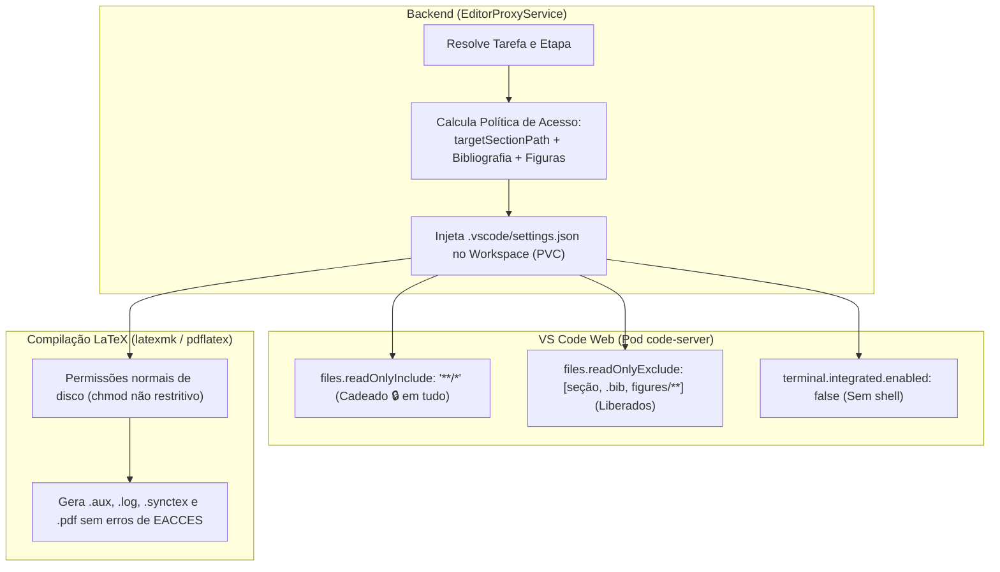

# Especificação e Diretriz Arquitetural: Restrição de Edição por Etapa no VS Code (`sci-latex-vscode`)

**Data:** 12 de Outubro de 2026  
**Status:** Em Discussão / Proposta Aprovada em Arquitetura  
**Contexto:** Governança de Escrita Científica, Isolamento de Arquivos no Code-Server e Ciclo de Vida Pod/PVC/Git  

---

## 1. Contexto e Motivação

Na plataforma **SCI-LaTeX**, múltiplos autores colaboram na escrita de um artigo científico divididos por tarefas e etapas modulares. Para evitar conflitos de edição e alterações acidentais em capítulos de outros autores ou na estrutura mestra (`main.tex`), discutiu-se como **travar o editor do VS Code (code-server) para que o autor consiga alterar apenas o arquivo referente à sua etapa ativa**.

---

## 2. Premissas Fundamentais do Ciclo de Vida e Git (Modelo Mental Real)

A restrição visual no VS Code **NÃO** deve interferir no ciclo de vida da infraestrutura, no Git ou nas regras de negócio da aplicação:

1. **A Tarefa é a Unidade de Trabalho do Autor:**
   - O autor assina a tarefa e entra no workspace.
   - O sistema provisiona um **PVC** e um **Pod** Kubernetes no namespace do projeto.
   - Uma tarefa é uma tarefa Git comum: o autor pode commitar, compilar e fazer **merge direto na branch da etapa (`feature/etapa-*`)** quando julgar concluída.
   - **Não há revisão de pares no nível da tarefa**. A conclusão da tarefa é determinada pelo próprio ato de merge na feature.

2. **A Feature/Etapa é a Unidade de Governança Acadêmica:**
   - A branch da etapa (`feature/etapa-*`) consolida o trabalho de todas as tarefas daquela etapa.
   - **Apenas as branches de feature passam por revisão formal** (revisão por pares ou parecer do revisor/NIT).

3. **Ciclo de Vida de Recursos K8s (Pod vs. PVC):**

| Evento | Pod K8s | PVC K8s | Git / Estado |
| :--- | :--- | :--- | :--- |
| **Autor no Workspace** | Ativo | Persiste | Trabalho ativo no disco montado |
| **Inatividade / Desconexão (3 min)** | Morre (economiza recursos) | **Persiste** | Dados mantidos intactos no volume |
| **Autor desassina a tarefa** | Finalizado | **Removido** | Commit & push automático salvam rascunho na branch remota |
| **Outro autor assume tarefa desassinada** | Novo Pod criado | **Novo PVC criado** | Repositório clona a branch remota existente com o histórico salvo |
| **Merge da tarefa na feature** | Finalizado | **Removido** | Branch integrada na feature e PVC descartado |

---

## 3. A Trava no VS Code: Abordagem Híbrida Aprovada

A trava opera exclusivamente na camada de configuração do VS Code injetada no workspace do container (`.vscode/settings.json`), sem afetar ferramentas do sistema operacional.



### 3.1 Nível da Restrição (Editor vs. Sistema Operacional)
- **Apenas no Editor (VS Code):** Não utilizamos comandos restritivos de disco (`chmod 444`) no workspace do autor (diferente do workspace do revisor, que é 100% read-only).
- **Justificativa:** O compilador LaTeX (`latexmk` / `pdflatex`) roda em background dentro do Pod e precisa de permissão de escrita para gerar e sobrescrever arquivos auxiliares (`.aux`, `.log`, `.synctex.gz`, `.pdf`).
- **Segurança Prática:** O terminal integrado do autor já é desativado por padrão (`"terminal.integrated.enabled": false`), eliminando o risco de edições via linha de comando no container.

### 3.2 Arquivos Autorizados (Política do Backend)
O autor recebe permissão de edição estrita para:
1. **O arquivo da seção da etapa:** (ex: `sections/02-methodology.tex`).
2. **Referências Bibliográficas:** `references.bib` (essencial para inclusão de citações `\cite{...}`).
3. **Imagens e Gráficos:** `figures/**` ou `img/**` (para adicionar figuras e ilustrações citadas na seção).

Todos os demais arquivos (incluindo `main.tex` e as seções de outros autores) permanecem com cadeado 🔒 e aviso nativo de somente-leitura (*"Cannot edit in read-only editor"*).

---

## 4. Visão de Futuro: Templates Dinâmicos, MinIO e Eliminação do Hardcode

### 4.1 A Limitação Atual (Paliativa)
Atualmente, as etapas (`DEFAULT_STAGES`) e os arquivos de seções (`ensureTeXTemplateFiles` gerando `01-introduction.tex`, `02-methodology.tex`, etc. e copiando `IEEEtran.cls`) estão codificados diretamente no código TypeScript do backend.

### 4.2 Arquitetura com Object Storage (MinIO / S3)
No modelo definitivo do produto:
1. **Catálogo & Upload de Templates:** O usuário poderá selecionar um modelo acadêmico (IEEE, ACM, Springer, SBC, Elsevier) ou fazer upload de um `.zip` com o template oficial da conferência.
2. **Armazenamento no MinIO:** O pacote `.zip` será persistido em um bucket S3/MinIO como um `TemplateBundle`.
3. **Geração Dinâmica de Etapas a partir do Template:**
   - O backend inspeciona o arquivo `main.tex` e o diretório de seções do template.
   - Cria as `ProjectStages` no banco de dados correspondendo às seções reais encontradas no template (ex: `sec-intro.tex`, `sec-experiments.tex`, `capitulo1.tex`).

### 4.3 Como isso Resolve a Identificação do Arquivo?
Em vez de depender de heurísticas frágeis (como adivinhar o arquivo pelo título da tarefa via regex), o modelo de dados passa a carregar o mapeamento explícito:

* **No Modelo `ProjectStage`:**
  - Atributo: `targetSectionPath: String?` (ex: `"sections/02-methodology.tex"` ou `"sec-methods.tex"`).
* **No Modelo `Task`:**
  - Herda por padrão o `targetSectionPath` da sua etapa ou define um `targetFile` específico caso seja uma sub-tarefa pontual.

---

## 5. Exemplo de Injeção no `.vscode/settings.json`

Quando o autor ingressa no workspace de uma tarefa de metodologia:

```json
{
  "files.autoSave": "afterDelay",
  "files.autoSaveDelay": 1000,

  "files.readOnlyInclude": {
    "**/*": true
  },
  "files.readOnlyExclude": {
    "sections/02-methodology.tex": true,
    "references.bib": true,
    "figures/**": true
  },

  "terminal.integrated.enabled": false,

  "workbench.colorCustomizations": {
    "statusBar.background": "#0F4C81",
    "statusBar.foreground": "#FFFFFF"
  }
}
```

---

## 6. Próximos Passos de Implementação

1. **Schema Prisma:** Avaliar a inclusão do campo `targetSectionPath` em `ProjectStage` e `targetFile` em `Task`.
2. **Backend (`EditorProxyService`):**
   - Atualizar `ensureWorkspaceSettings(targetDir, mode, options)` para aceitar a lista calculada de arquivos permitidos.
   - Injetar o bloco `files.readOnlyInclude` e `files.readOnlyExclude` no `.vscode/settings.json` do container.
3. **Roadmap de Templates:**
   - Planejar o módulo de upload/catálogo de templates com armazenamento no MinIO.
   - Desenvolver o parser de templates TeX para automação na criação de etapas.
