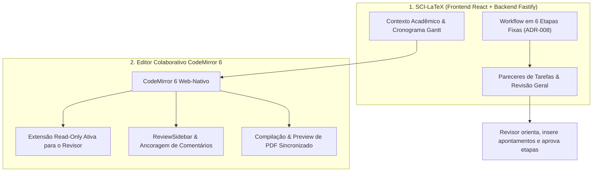
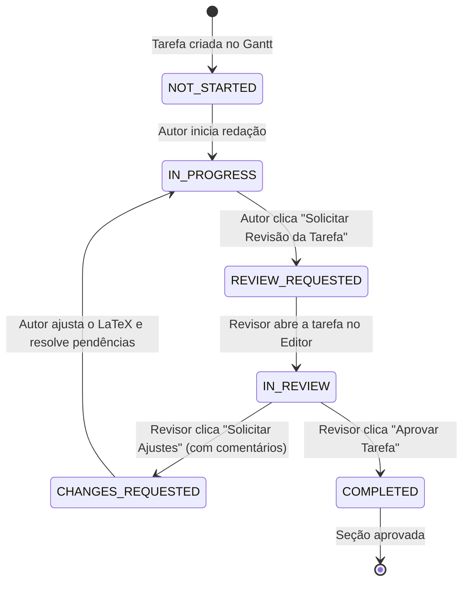

# Especificação Arquitetural e de Produto: Visão e Persona do Revisor (`sci-latex-vscode`)

**Data da Última Atualização:** 25 de Outubro de 2026  
**Status:** Diretriz Arquitetural Aprovada (Alinhada à ADR-007 e ADR-008)  
**Projeto:** Plataforma Web de Escrita Científica Self-Hosted (`sci-latex-vscode`)  
**Tecnologias Centrais:** CodeMirror 6, `@codemirror/collab`, React 19, Fastify, PostgreSQL (Prisma)

---

## 1. Decisão Fundamental de Produto & Modelo Mental

> [!IMPORTANT]
> **Modelo Mental Acadêmico:**  
> O revisor atua sobre o **Artigo Científico** com foco em seções, tarefas acadêmicas e apontamentos de qualidade.  
> Ele atua como **Orientador** ou **Revisor Técnico Oficial** designado para o projeto acadêmico. A sua tela de acompanhamento é **a mesma tela do Autor** (`AuthorArticlesPage`, `ArticleDetailPage` e Gantt), diferenciada por contexto de atuação, indicadores visuais e travas de proteção de conteúdo no editor.



---

## 2. A Experiência do Revisor nas Telas da Aplicação

### 2.1 Na Listagem de Artigos (`AuthorArticlesPage`)
O revisor não possui um sitemap apartado; ele visualiza todos os artigos em que participa através de um **filtro segmentado unificado**:

```
[ Todos (8) ]   [ Meus Artigos / Autor (5) ]   [ Sob Minha Revisão (3)  • 1 pendente ]
```

- **Badges de Papel:**
  - `Autor / Coautor` (azul): Artigos onde o usuário escreve e gerencia tarefas.
  - `Revisor Oficial` (roxo/magenta): Artigos onde o usuário foi designado como o Revisor Técnico do projeto.
- **Ação Direta de Revisão:** Quando um artigo possuir tarefas em `REVIEW_REQUESTED` ou estiver na Etapa 4 (Revisão Geral), o botão de ação destaca: `[ 🔍 Revisar Pendências ]`.

### 2.2 Na Visão Gantt do Artigo (`ArticleDetailPage`)
- **Banner Contextual:** O topo da página sinaliza o papel ativo:
  > *Visualizando como **Revisor Oficial** deste artigo científico.*
- **Destaque de Tarefas:** Tarefas submetidas para avaliação pelos coautores ganham indicação visual imediata (`● Aguardando Revisão`).
- **Ações Rápidas:** O drawer da tarefa disponibiliza os atalhos:
  - *"Abrir no Editor (Modo Leitura)"*
  - *"Visualizar Histórico de Apontamentos"*
  - *"Emitir Parecer (Aprovar / Solicitar Ajustes)"*

---

## 3. Comportamento no Editor CodeMirror 6 (`isReadOnly`)

Quando o Revisor abre o editor de um artigo onde atua como Revisor, a plataforma garante a integridade do texto sem bloquear a colaboração textual:

1. **Injeção da Extensão Read-Only:**
   ```typescript
   // editorCompartments.ts
   import { EditorState } from '@codemirror/state';
   
   // Se o usuário logado for o Revisor do projeto:
   EditorState.readOnly.of(true)
   ```
   - O cursor de digitação é desativado para o revisor.
   - Tentativas de digitação ou deleção de caracteres são interceptadas e impedidas pelo CodeMirror.
   - A barra superior exibe o chip: `🔒 Modo de Revisão (Somente Leitura)`.

2. **Permissão Total para Comentários Ancorados (`ReviewSidebar`):**
   - O revisor pode selecionar qualquer palavra, linha ou parágrafo no editor.
   - Ao soltar a seleção, a popover de anotação oferece: **"Comentar trecho selecionado"**.
   - O comentário (`ReviewComment`) é ancorado aos offsets de caractere (`from`, `to`) e ajustado dinamicamente via `changes.mapPos()`.
   - No `ReviewSidebar`, o revisor pode responder a mensagens dos autores, marcar dúvidas como esclarecidas e reabrir pendências.

3. **Compilação e PDF Sincronizado:**
   - O painel lateral direito exibe o PDF compilado atualizado sob demanda (`PdfPreview.tsx`), permitindo ao orientador conferir se tabelas, equações e diagramas estão compilando perfeitamente no padrão acadêmico.

---

## 4. O Modelo de Revisão em Dois Níveis: "Bate e Volta"

Conforme normatizado na **ADR-008**, o processo de revisão é estritamente separado em dois níveis:

### 4.1 Nível 1: Bate e Volta de Tarefa (Etapa 3 — Escrita do Artigo)
Cada autor escreve suas seções simultaneamente em tarefas separadas (ex.: Introdução, Metodologia, Experimentos).



1. **Envio pelo Autor:** O autor clica em **"Solicitar Revisão"** na tarefa e pode opcionalmente resumir suas entregas. A tarefa assume o status `REVIEW_REQUESTED`.
2. **Avaliação pelo Revisor:** O revisor analisa o trecho TeX em modo leitura e insere comentários no texto.
3. **Decisão do Revisor:**
   - 🟠 **"Solicitar Ajustes":** A tarefa transiciona para `CHANGES_REQUESTED`. O autor é notificado, realiza as correções no editor, marca os comentários como resolvidos e clica em **"Reenviar para Revisão"** (incrementando o contador de rodadas da tarefa).
   - 🟢 **"Aprovar Tarefa":** A tarefa transiciona para `COMPLETED`.

---

### 4.2 Nível 2: Revisão Geral do Artigo (Etapa 4 — Revisão Técnica e Científica)

A Etapa 4 é o marco institucional consolidado antes da liberação para os Gatekeepers (NIT e Conferência).

1. **Critério de Início:** A Etapa 4 só é liberada quando **100% das tarefas da Etapa 3 estiverem no status `COMPLETED`**.
2. **Escopo da Avaliação:** Leitura do manuscrito compilado integral (limite de páginas da conferência, consistência entre resumo, resultados e conclusões, integridade das referências `.bib`).
3. **Mecanismo de Ajustes Gerais (Sem Reabertura da Etapa 3):**
   - Caso haja inconformidades macro, o Revisor clica em **`[ Solicitar Ajustes Gerais ]`**.
   - A **Etapa 3 permanece intacta como `COMPLETED`**, preservando o histórico da entrega inicial.
   - A **Etapa 4 assume o status `CHANGES_REQUESTED`** (Rodada 1).
   - Os autores recebem os apontamentos, ajustam o LaTeX, resolvem os itens no painel e clicam em **`[ Reenviar para Revisão Geral ]`** (iniciando a Rodada 2).
   - Ao aprovar o manuscrito consolidado, o Revisor clica em **`[ Aprovar Revisão Geral ]`**, transicionando a Etapa 4 para `COMPLETED`.

---

## 5. Governança e Métricas Executivas

A atuação do Revisor alimenta diretamente a tomada de decisão da Coordenação e Gerência:

| Métrica no Dashboard | Origem no Domínio | Utilidade para a Gestão |
| :--- | :--- | :--- |
| **Tempo de Ciclo de Revisão** | Intervalo entre `REVIEW_REQUESTED` e a emissão do parecer. | Identifica orientadores sobrecarregados antes do vencimento de prazos. |
| **Taxa de Retrabalho (Rodadas)** | Quantidade de ciclos `CHANGES_REQUESTED` nas tarefas e na Etapa 4. | Mensura o nível de maturidade da escrita de cada equipe de pesquisa. |
| **Fila de Revisão Geral** | Artigos ativos na Etapa 4. | Previsibilidade imediata da demanda que chegará ao NIT no próximo ciclo. |
| **Alertas de Risco Preventivos** | Comparação entre tempo decorrido na Etapa 4 e a data do congresso. | Aciona o Coordenador para reatribuir co-orientações antes da perda do prazo da conferência. |

---

## 6. Conclusão

Esta especificação consolida a persona do Revisor como um colaborador ativo e protegido, integrado à mesma experiência fluida dos autores, com segurança garantida pelo CodeMirror 6 Read-Only e governança estrita pelas 6 etapas fixas e pelos dois níveis de revisão da plataforma SCIA.
