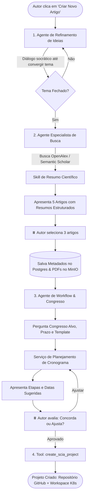

# 📐 Especificação Técnica: Chat Copilot & Onboarding Multi-Agente (SciAI)

> **Documento de Referência:** [`ADR-006: Modelo de Integração SciAI`](file:///home/gilson-russo/development/professional/sci-latex-vscode/docs/planning/adrs/adr-006-sciai-integration-architecture.md) | [`sciai-contracts-spec.md`](file:///home/gilson-russo/development/professional/sci-latex-vscode/docs/planning/specs/sciai-contracts-spec.md)  
> **Status:** ESPECIFICAÇÃO DE PRODUTO & ARQUITETURA  
> **Data:** Outubro de 2026  
> **Escopo:** Módulo de Criação de Projetos via Chat, Hub Conversacional Polimórfico e Integração de Armazenamento (PostgreSQL + MinIO)

---

## 1. 🎯 Visão do Produto & Arquitetura do Chat

O chat integrado à plataforma **SCIA** não é um mero chatbot isolado de perguntas e respostas. Ele é um **Hub Conversacional Polimórfico** que atua em dois grandes papéis:

1. **Assistente Guiado de Criação de Artigos (Onboarding "Zero to Hero"):**  
   Conduz o autor por um funil de decisões (ideação ➡️ busca e resumo de artigos ➡️ seleção de referências ➡️ escolha de conferência/template ➡️ cronograma preliminar de etapas) até acionar a ferramenta determinística de criação do projeto no SCIA.
2. **Copilot Científico e Gestor Onipresente (Transversal na Plataforma):**  
   Acessível em múltiplas telas da aplicação por diferentes personas para:
   * **Autor:** Discutir ideias do dia a dia, revisar experimentos, auditar citações, refinar seções e solicitar revisão integral do manuscrito.
   * **Coordenador & Gerente:** Analisar o andamento das etapas paralelas, diagnosticar riscos preditivos de atraso em relação à data limite do congresso e identificar gargalos da equipe.

```
┌────────────────────────────────────────────────────────────────────────────────────────┐
│                          CHAT COPILOT POLIMÓRFICO (SCIA)                               │
├──────────────────────────────────────────┬─────────────────────────────────────────────┤
│         1. MODO ONBOARDING               │             2. MODO WORKSPACE / COPILOT     │
│  - Refinamento de Tema (Idea Refiner)    │  - Discussão de Experimentos & Metodologia  │
│  - Busca & Resumo de Papers (Scholar)    │  - Revisão de Etapa de Escrita (Section PR) │
│  - Seleção & Armazenamento (PDF/MinIO)   │  - Revisão Global de Artigo (Fact-Checking) │
│  - Workflow & Template de Congresso      │  - Análise Preditiva de Prazos (Coordenação)│
│  - Tool de Criação do Projeto no SCIA    │  - Geração de Propostas Estruturadas (Diff) │
└──────────────────────────────────────────┴─────────────────────────────────────────────┘
```

---

## 2. 🔄 O Fluxo de Criação de Artigo (Onboarding Guiado)

O fluxo de criação opera como um **Grafo de Estados Cíclico no LangGraph**, com pontos de interrupção explícita (*Human-in-the-Loop* via `interrupt`) onde a IA aguarda a decisão do usuário:



### 2.1. Detalhamento dos Estágios do Grafo:

#### Estágio 1: Refinamento da Ideia (`idea_refiner_agent`)
* O autor fornece uma descrição livre (ex: *"Quero estudar consenso bizantino em redes móveis"*).
* O agente atua como orientador: questiona premissas, delimita o escopo, identifica o problema de pesquisa e propõe títulos provisórios.
* **Saída Estruturada:** `research_topic`, `problem_statement`, `keywords`.

#### Estágio 2: Busca Bibliográfica e Skill de Resumo (`search_specialist_agent`)
* Com base nas keywords, o agente consulta APIs acadêmicas (**OpenAlex** e **Semantic Scholar**).
* Executa a **Skill de Resumo:** processa o abstract e gera um card sintético:
  * *Objetivo principal*
  * *Metodologia utilizada*
  * *Resultados e relevância para o tema do autor*
* Apresenta 5 opções estruturadas na interface.
* **Interrupção:** O autor marca as caixas de seleção (ex: escolhe 3 artigos).
* **Armazenamento:**
  * Metadados (DOI, autores, ano, BibTeX) são gravados no **PostgreSQL**.
  * Se o PDF de acesso aberto (*Open Access*) estiver disponível, o arquivo é baixado e enviado para o **MinIO** (`buckets/papers/{doi}.pdf`).

#### Estágio 3: Planejamento do Workflow e Template (`workflow_planner_agent`)
* O agente pergunta ao autor:
  1. *Qual é a conferência alvo?* (Ex: SBSEG, SBRC, IEEE S&P).
  2. *Qual a data limite (deadline) de submissão?*
  3. *Qual o template LaTeX desejado?* (O autor pode escolher templates pré-cadastrados no MinIO, como SBC, IEEE, ACM, ou subir um `.zip`).
* **Cálculo de Datas:** O agente utiliza um serviço determinístico que aplica heurísticas proporcionais a partir da data de submissão (ex: 40% do tempo para escrita de metodologia, 30% para experimentos, 20% para revisão interna e 10% para o Gatekeeper do NIT).
* **Interrupção:** O cronograma de etapas preliminares (`ProjectStage`) é exibido com datas estimadas para o autor aprovar ou recalibrar.

#### Estágio 4: Criação do Projeto via Tool (`create_scia_project_tool`)
* Quando o autor clica em **"Confirmar e Criar Projeto"**, o agente invoca a tool interna.
* A tool despacha uma chamada autenticada ao backend Fastify do SCIA, que:
  1. Cria o registro `Project` e suas `ProjectStage`s no PostgreSQL.
  2. Provisiona o repositório privado no GitHub via Conta de Serviço institucional.
  3. Descompacta o template LaTeX (`.cls`, `.tex`, `references.bib`) selecionado no MinIO dentro do repositório.
  4. Insere as 3 referências escolhidas no arquivo `references.bib`.
  5. Retorna a URL do novo workspace para o frontend redirecionar o autor diretamente para o editor VS Code.

---

## 3. 🗄️ Estratégia Híbrida de Armazenamento: PostgreSQL vs. MinIO

Não se deve sobrecarregar o banco relacional com arquivos binários, nem utilizar o storage de objetos para dados que exigem integridade relacional:

| Categoria de Informação | Onde Armazenar | Estrutura / Localização | Justificativa |
| :--- | :--- | :--- | :--- |
| **Sessão do Chat & Histórico** | **PostgreSQL (SCIA)** | Tabela `ai_conversations` e `ai_messages` | Permite que o autor saia da tela e retome o chat de onde parou. |
| **Metadados dos Artigos** | **PostgreSQL (SCIA)** | Tabela `project_references` (DOI, título, autores, BibTeX) | Consultas rápidas, busca por palavras-chave e geração de índices. |
| **PDFs dos Artigos** | **MinIO (S3 API)** | `s3://scia-storage/projects/:id/papers/:doi.pdf` | PDFs pesados não inflam o banco de dados; acessados via URL pré-assinada. |
| **Templates LaTeX de Congressos** | **MinIO (S3 API)** | `s3://scia-storage/templates/:templateId/bundle.zip` | Pacotes contendo `.cls`, `.sty`, `.bst`, imagens de logo e esqueleto TeX. |
| **Metadados de Templates** | **PostgreSQL (SCIA)** | Tabela `templates` (nome, congresso, versão, arquivo zip) | Listagem rápida em dropdowns na UI. |
| **Cronograma de Etapas** | **PostgreSQL (SCIA)** | Tabela `project_stages` e `tasks` | Integridade referencial com os prazos de submissão do SCIA. |
| **Checkpoints do LangGraph** | **PostgreSQL (SciAI)** | Checkpointer Postgres do LangGraph (`checkpoints`) | Estado interno de memória dos grafos para pausas e retomadas. |

---

## 4. 🌐 O Chat Transversal: Matriz de Contextos e Personas

O mesmo componente de chat no frontend React é instanciado em diferentes áreas da aplicação, variando o **Envelope de Contexto**:

```typescript
type ChatContextPayload = {
  conversationId: string;
  projectId?: string;
  taskId?: string;
  contextType: 
    | "NEW_PROJECT_ONBOARDING"   // Criação do Artigo
    | "SECTION_WRITING_ASSIST"   // Ajuda de escrita em seção aberta no editor
    | "EXPERIMENT_REVIEW"        // Análise de dados/metodologia
    | "ARTICLE_FULL_REVIEW"      // Fact-checking e revisão geral antes do NIT
    | "COORDINATOR_RISK_AUDIT";  // Painel de Coordenação: análise de prazos
  userRole: "AUTHOR" | "REVIEWER" | "COORDINATOR" | "MANAGER";
  selectedSnippet?: string;     // Trecho de código TeX selecionado no editor
};
```

### 4.1. Modos de Operação do Chat:

```
┌────────────────────────────────────────────────────────────────────────────────────────┐
│                               MODOS DO CHAT COPILOT                                    │
├─────────────────────┬──────────────────┬───────────────────────────────────────────────┤
│ Modo                │ Persona Ativa    │ Comportamento da IA                           │
├─────────────────────┼──────────────────┼───────────────────────────────────────────────┤
│ **Onboarding**      │ Autor            │ Conduz ideação, busca de papers e criação.    │
│ **Escrita/Seção**   │ Autor            │ Sugere parágrafos acadêmicos e citações BibTeX│
│ **Experimento**     │ Autor            │ Revisa lógica estatística e formatação tabelas│
│ **Revisão Completa**│ Autor / Revisor  │ Avalia aderência às normas e referências reais│
│ **Auditoria Riscos**│ Coordenador/Gest.│ Analisa datas de etapas vs. deadline congresso│
└─────────────────────┴──────────────────┴───────────────────────────────────────────────┘
```

---

## 5. ⚖️ Governança de Prazos e Cronogramas: IA vs. Autores

Fica estabelecida uma regra rígida de separação de autoridade:
1. **Papel da IA:** Durante o onboarding, o agente **sugere e inicializa** as etapas e datas preliminares com base no congresso e no template escolhido.
2. **Papel dos Autores:** Uma vez criado o projeto, **a IA não altera datas de etapas automaticamente**. A autoridade para ajustar prazos, estender tarefas ou trocar datas cabe exclusivamente aos **Autores e Coordenadores** através do painel de governança e cronograma nativo da plataforma SCIA.
3. **Papel Consultivo Posterior:** Caso o autor pergunte no chat *"Como reorganizar minhas datas porque atrasei os testes?"*, o agente pode sugerir um novo cronograma, mas a aplicação prática da alteração exige confirmação manual do autor na tela de configurações.

---

## 6. 🚀 Comunicação em Tempo Real: Streaming sem Dependência de Fila

Para a experiência fluida do chat conversacional:
* As interações de chat utilizam **HTTP Streaming (SSE / Server-Sent Events)** direto entre Frontend ➡️ Fastify ➡️ SciAI (FastAPI).
* **Zero Overhead de Mensageria:** Não é necessário enfileirar cada mensagem em RabbitMQ ou Kafka; o streaming responde token-a-token com latência mínima.
* **Pausas com Estado:** Quando o grafo precisa de uma decisão do autor (selecionar 3 artigos ou aprovar datas), o LangGraph salva o checkpoint no banco e encerra o stream. Ao receber a resposta do usuário, o Fastify retoma o grafo chamando o endpoint de resume com o `thread_id`/`checkpoint_id`.
