# 📐 Especificação Técnica: Contratos de Integração SciAI (APIs, Eventos & Schemas)

> **Documento de Referência:** [`ADR-006: Modelo de Integração SciAI`](file:///home/gilson-russo/development/professional/sci-latex-vscode/docs/planning/adrs/adr-006-sciai-integration-architecture.md)  
> **Status:** APROVADO / ESPECIFICAÇÃO DE IMPLEMENTAÇÃO (v2.0 Consolidada)  
> **Data:** Outubro de 2026  
> **Componentes:** `backend` (Fastify / TypeScript), `SciAI` (FastAPI / LangGraph / Python), `frontend` (React 19 / SSE)

---

## 1. 📋 Visão Geral e Princípios Fundamentais

Esta especificação define os contratos formais de comunicação entre a autoridade da plataforma (**Fastify**) e o motor de pesquisa acadêmica (**SciAI**), estabelecendo:
1. **Máquina de estados determinística** com retorno inicial estrito em `PENDING`.
2. **Persistência durável no PostgreSQL do SCIA** aliada a transporte de mensagens no Redis.
3. **Ciclo completo de APIs internas M2M** (disparo, interrupção/retomada, cancelamento e callbacks).
4. **Proteção de concorrência com o documento ativo** via `baseVersion` (versão canônica OT) e `baseFileHash` (SHA-256 do arquivo TeX).
5. **Protocolo SSE com envelope estruturado** e recuperação pós-reconexão (`Last-Event-ID` e consulta REST).

---

## 2. 🔄 Máquina de Estados Operacional da Execução (`RunState`)

```mermaid
stateDiagram-v2
    [*] --> PENDING: Fastify cria execução durável no Postgres e enfileira
    PENDING --> RUNNING: Worker SciAI consome mensagem e inicia grafo
    RUNNING --> WAITING: Interrupção LangGraph (Human-in-the-Loop)
    WAITING --> RUNNING: Autor submete resposta /resume via Fastify
    RUNNING --> COMPLETED: Grafo finalizado; proposta entregue via /complete
    RUNNING --> FAILED: Erro irrecuperável ou timeout de worker
    RUNNING --> CANCELLED: Autor aborta operação em andamento
    PENDING --> CANCELLED: Autor cancela antes do início do worker
    COMPLETED --> [*]
    FAILED --> [*]
    CANCELLED --> [*]
```



### 2.1. Tabela de Transições e Momentos

| Momento do Fluxo | Estado Operacional | Ação do Sistema |
| :--- | :--- | :--- |
| **1. Fastify recebe e valida a requisição** | `PENDING` | Persiste registro em `ai_runs` no PostgreSQL e publica job no Redis. Retorna `HTTP 202 { status: "PENDING" }`. |
| **2. SciAI Worker retira da fila** | `RUNNING` | Worker confirma ACK, atualiza estado e inicia os nós do LangGraph. |
| **3. LangGraph atinge nó de intervenção humana** | `WAITING` | Grafo pausa (checkpoint gravado); Fastify despacha evento `ai:run_interrupted`. |
| **4. Autor submete resposta no frontend** | `RUNNING` | Fastify despacha `POST /resume` ao SciAI; grafo continua a execução. |
| **5. SciAI conclui processamento** | `COMPLETED` | SciAI entrega proposta via `POST /complete`; Fastify persiste `ai_proposals`. |
| **6. Erro de execução ou timeout** | `FAILED` | SciAI despacha `POST /fail` com código de erro e flag de retry. |
| **7. Usuário aborta a operação** | `CANCELLED` | Fastify despacha `POST /cancel` e interrompe o worker. |

---

## 3. 💾 Persistência Durável vs. Transporte Operacional

Para evitar que execuções desapareçam caso um container reinicie ou o Redis sofra instabilidade:

```
┌──────────────────────────────────────────────┐     ┌──────────────────────────────────────────────┐
│       POSTGRESQL SCIA (Prisma / Durável)      │     │         REDIS (Transporte & Pub/Sub)         │
├──────────────────────────────────────────────┤     ├──────────────────────────────────────────────┤
│ - ai_runs: estado durável, idempotency_key,  │     │ - scia:queue:runs (Fila durável de jobs)     │
│   projeto, autor, timestamps e erros.        │     │ - scia:channel:events (Pub/Sub SSE)          │
│ - ai_proposals: minutas, diffs, citações.    │     │ - scia:runs:{id}:active (Lock temporário)    │
└──────────────────────────────────────────────┘     └──────────────────────────────────────────────┘
```

### 3.1. Esquema Relacional no PostgreSQL do SCIA (Prisma)

```prisma
enum AiRunStatus {
  PENDING
  RUNNING
  WAITING
  COMPLETED
  FAILED
  CANCELLED
}

enum AiProposalReviewStatus {
  PENDING_REVIEW
  ACCEPTED
  REJECTED
  EXPIRED
}

enum AiProposalApplyStatus {
  NOT_APPLIED
  APPLYING
  APPLIED
  CONFLICT
  APPLY_FAILED
}

model AiRun {
  id             String       @id @default(uuid())
  projectId      String
  taskId         String?
  userId         String
  operation      String
  status         AiRunStatus  @default(PENDING)
  idempotencyKey String       @unique
  promptInput    Json
  failureReason  String?
  errorCode      String?
  createdAt      DateTime     @default(now())
  updatedAt      DateTime     @updatedAt
  startedAt      DateTime?
  finishedAt     DateTime?

  proposal       AiProposal?

  @@index([projectId, status])
}

model AiProposal {
  id           String                 @id @default(uuid())
  runId        String                 @unique
  run          AiRun                  @relation(fields: [runId], references: [id])
  projectId    String
  taskId       String?
  reviewStatus AiProposalReviewStatus @default(PENDING_REVIEW)
  applyStatus  AiProposalApplyStatus  @default(NOT_APPLIED)
  summary      String
  references   Json
  changes      Json
  createdAt    DateTime               @default(now())
  updatedAt    DateTime               @updatedAt

  @@index([projectId, reviewStatus])
}
```

### 3.2. Mecanismo de Recuperação de Falhas
* **Varredura de Órfãos (Sweeper Worker):** A cada 60 segundos, o Fastify busca execuções `PENDING` sem início há mais de 2 minutos e as reenfileira.
* **Detecção de Dead Runs:** Execuções em `RUNNING` sem batimento de progresso há mais de 5 minutos são marcadas como `FAILED` com `errorCode: "WORKER_TIMEOUT"`.

---

## 4. 🌐 Contratos de API REST

### 4.1. Endpoints Públicos (Frontend ➡️ Fastify)

| Método | Endpoint | Descrição |
| :--- | :--- | :--- |
| `POST` | `/api/v1/projects/:id/ai/runs` | Cria uma nova execução de IA (exige `Idempotency-Key` no header). |
| `GET`  | `/api/v1/projects/:id/ai/runs/:runId` | Consulta o estado atual da execução (usado após reconexão SSE). |
| `POST` | `/api/v1/projects/:id/ai/runs/:runId/resume` | Submete a resposta do usuário quando o estado for `WAITING`. |
| `POST` | `/api/v1/projects/:id/ai/runs/:runId/cancel` | Solicita cancelamento voluntário da execução. |
| `POST` | `/api/v1/projects/:id/ai/proposals/:id/apply` | Autoriza a aplicação atômica da proposta no workspace. |

---

### 4.2. Endpoints Internos Machine-to-Machine (Fastify ↔ SciAI)

Autenticação obrigatória em todas as requisições M2M:
```http
X-Internal-Service-Key: <TOKEN_COMPARTILHADO_K8S>
X-Correlation-Id: <UUID_DO_REQUEST>
Content-Type: application/json
```

#### A. Iniciar Execução: `POST /internal/v1/runs` (Fastify ➡️ SciAI)
* **Payload:**
```json
{
  "runId": "c8a4f9e2-3b21-4f1a-b6d2-9c1e4f8a7e3d",
  "projectId": "a1b2c3d4-e5f6-7890-abcd-ef1234567890",
  "taskId": "f1e2d3c4-b5a6-0987-fedc-ba9876543210",
  "operation": "RESEARCH_AND_DRAFT",
  "input": {
    "topic": "Sincronização de relógios em sistemas distribuídos Tolerantes a Falhas Bizantinas",
    "sectionPath": "sections/02-related-work.tex",
    "baseVersion": 42,
    "baseFileHash": "e3b0c44298fc1c149afbf4c8996fb92427ae41e4649b934ca495991b7852b855",
    "existingTextSnippet": "\\section{Trabalhos Relacionados}\nNesta seção abordamos...",
    "maxReferences": 5
  }
}
```
* **Resposta (`HTTP 202 Accepted`):**
```json
{
  "runId": "c8a4f9e2-3b21-4f1a-b6d2-9c1e4f8a7e3d",
  "status": "PENDING",
  "estimatedDurationSeconds": 45
}
```

#### B. Retomar Grafo Interrompido: `POST /internal/v1/runs/{runId}/resume` (Fastify ➡️ SciAI)
* **Payload:**
```json
{
  "runId": "c8a4f9e2-3b21-4f1a-b6d2-9c1e4f8a7e3d",
  "interruptionId": "interrupt-node-methodology-choice",
  "humanResponse": {
    "selectedApproach": "BFT-SMaRt",
    "additionalNotes": "Focar em replicação de máquina de estados"
  }
}
```
* **Resposta:** `HTTP 200 OK { "runId": "...", "status": "RUNNING" }`

#### C. Cancelar Execução: `POST /internal/v1/runs/{runId}/cancel` (Fastify ➡️ SciAI)
* **Payload:** `{ "reason": "USER_ABORTED" }`
* **Resposta:** `HTTP 200 OK { "runId": "...", "status": "CANCELLED" }`

#### D. Callback Único de Conclusão: `POST /internal/v1/runs/{runId}/complete` (SciAI ➡️ Fastify)
* **Payload:**
```json
{
  "runId": "c8a4f9e2-3b21-4f1a-b6d2-9c1e4f8a7e3d",
  "proposal": {
    "summary": "Foram localizados 4 artigos relevantes no OpenAlex e gerada a minuta comparativa.",
    "references": [
      {
        "title": "Practical Byzantine Fault Tolerance",
        "authors": ["Castro, M.", "Liskov, B."],
        "year": 1999,
        "doi": "10.1145/319151.319167",
        "bibtexKey": "castro1999practical",
        "bibtexSnippet": "@inproceedings{castro1999practical, title={Practical Byzantine Fault Tolerance}, author={Castro, Miguel and Liskov, Barbara}, booktitle={OSDI}, year={1999}}"
      }
    ],
    "changes": [
      {
        "path": "sections/02-related-work.tex",
        "baseVersion": 42,
        "baseFileHash": "e3b0c44298fc1c149afbf4c8996fb92427ae41e4649b934ca495991b7852b855",
        "diff": "--- a/sections/02-related-work.tex\n+++ b/sections/02-related-work.tex\n@@ -1,3 +1,8 @@\n \\section{Trabalhos Relacionados}\n-Nesta seção abordamos...\n+O protocolo PBFT introduzido por \\cite{castro1999practical} estabeleceu as bases..."
      }
    ]
  }
}
```
* **Resposta:** `HTTP 200 OK { "proposalId": "...", "saved": true }`

#### E. Callback de Falha: `POST /internal/v1/runs/{runId}/fail` (SciAI ➡️ Fastify)
* **Payload:**
```json
{
  "runId": "c8a4f9e2-3b21-4f1a-b6d2-9c1e4f8a7e3d",
  "errorCode": "ACADEMIC_API_TIMEOUT",
  "message": "A API OpenAlex não respondeu dentro do limite de 30 segundos.",
  "recoverable": true
}
```

---

## 5. 🛡️ Proteção do Workspace contra Concorrência e Sobrescrita Cega
### 5.1. O Risco de Concorrência com Digitação Ativa
Caso um autor continue digitando no CodeMirror enquanto a IA estiver pesquisando, as alterações locais do autor poderiam ser sobrescritas pela proposta da IA se não houvesse dupla checagem de versão canônica e integridade de conteúdo.

### 5.2. Algoritmo de Validação Pré-Aplicação (Atômico)

```typescript
import crypto from "crypto";
import { documentsService } from "../documents/documents.service";

export async function applyProposalAtomically(
  projectId: string,
  proposal: AiProposal
): Promise<void> {
  const currentDocVersion = await documentsService.getCurrentVersion(projectId);

  // 1. Fase de Validação e Detecção de Conflitos (Staging Check)
  for (const change of proposal.changes) {
    // A. Verificação de Versão Base Canônica
    if (change.baseVersion !== currentDocVersion) {
      throw new VersionConflictError(
        `O documento avançou (versão canônica alterada). Versão base esperada: ${change.baseVersion}, atual: ${currentDocVersion}`
      );
    }

    // B. Verificação de Conteúdo Atual (Hash Check)
    const currentContent = await documentsService.getFileContent(projectId, change.path);
    const currentHash = crypto.createHash("sha256").update(currentContent).digest("hex");

    if (currentHash !== change.baseFileHash) {
      throw new VersionConflictError(
        `O arquivo ${change.path} possui edições concorrentes no editor. O hash atual difere da versão base usada pela IA.`
      );
    }
  }

  // 2. Aplicação Atômica via Operação Colaborativa (OT)
  await documentsService.applyAiProposalUpdates(projectId, proposal);
}
```

---

## 6. 📡 Protocolo SSE Resiliente à Reconexão

### 6.1. Envelope Estruturado

Todas as mensagens SSE enviadas no canal `/api/v1/projects/:id/events` seguem o envelope unificado:

```http
id: evt-550e8400-e29b-41d4-a716-446655440000
event: message
data: {"eventId":"evt-550e8400-e29b-41d4-a716-446655440000","runId":"c8a4f9e2-3b21-4f1a-b6d2-9c1e4f8a7e3d","projectId":"a1b2c3d4-e5f6-7890-abcd-ef1234567890","occurredAt":"2026-10-12T00:05:00.000Z","type":"ai:run_progress","payload":{"step":"SEARCHING","message":"Buscando artigos no Semantic Scholar..."}}
```

### 6.2. Tipos de Eventos
* `ai:run_started`: Início confirmado pelo worker (`status: RUNNING`).
* `ai:run_progress`: Mensagem de progresso em tempo real da barra de status.
* `ai:run_interrupted`: Grafo pausado em `WAITING`; envia perguntas/opções para o usuário.
* `ai:run_completed`: Proposta persistida e pronta para revisão.
* `ai:run_failed`: Notificação de falha com possibilidade de retry.
* `ai:run_cancelled`: Confirmação do encerramento voluntário.

### 6.3. Reconexão do Cliente (Browser)
Se a conexão SSE cair:
1. O navegador reconecta enviando `Last-Event-ID`.
2. O frontend chama `GET /api/v1/projects/:id/ai/runs/:runId` para hidratar o estado atualizado a partir do PostgreSQL durável.

---

## 7. 📦 Schemas Zod Validados

```typescript
import { z } from "zod";

// Schema de Início de Execução
export const CreateAiRunInputSchema = z.object({
  topic: z.string().min(5).max(1000),
  sectionPath: z.string().regex(/^[a-zA-Z0-9_\-\.\/]+\.tex$/, "Caminho TeX inválido").refine(
    (p) => !p.includes("..") && !path.isAbsolute(p),
    "Path Traversal não permitido"
  ),
  baseVersion: z.number().int().min(0, "Versão base canônica inválida"),
  baseFileHash: z.string().regex(/^[a-f0-9]{64}$/, "SHA-256 de arquivo inválido"),
  existingTextSnippet: z.string().max(20000).optional(),
  maxReferences: z.number().int().min(1).max(20).default(5),
});

// Schema da Proposta da IA
export const AiProposalSchema = z.object({
  id: z.string().uuid().optional(), // Gerado no Fastify na persistência
  runId: z.string().uuid(),
  summary: z.string().min(10),
  references: z.array(
    z.object({
      title: z.string(),
      authors: z.array(z.string()).default([]),
      year: z.number().int().optional(),
      doi: z.string().optional(),
      url: z.string().url().optional(),
      bibtexKey: z.string(),
      bibtexSnippet: z.string().optional(),
    })
  ),
  changes: z.array(
    z.object({
      path: z.string(),
      baseVersion: z.number().int().min(0),
      baseFileHash: z.string(),
      diff: z.string(),
    })
  ),
});

export type CreateAiRunInput = z.infer<typeof CreateAiRunInputSchema>;
export type AiProposal = z.infer<typeof AiProposalSchema>;
```
