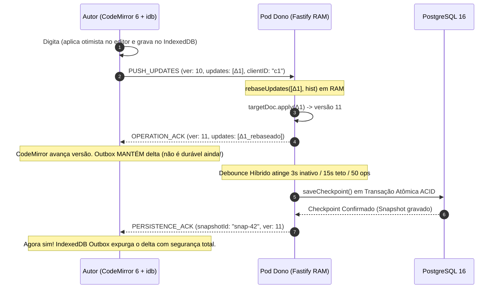

# 📝 Especificação Técnica: Editor Colaborativo LaTeX & Persistência em Tempo Real

- **Documento:** `collaborative-editor-spec.md`
- **Referência Arquitetural:** [ADR-007: Arquitetura Unificada do Editor Colaborativo](../../architecture/adrs/adr-007-collaborative-editor-architecture-scaling.md)
- **Status Geral:** APROVADO / ESPECIFICAÇÃO DE ENGENHARIA DE PADRÃO INDUSTRIAL
- **Público-Alvo:** Engenheiros Backend, Frontend, Arquitetos de Software e Agentes Autônomos de Implementação
- **Stack Tecnológica:**
  - Frontend: React 19 + TypeScript Estrito + CodeMirror 6 (`@codemirror/collab`) + `idb` (IndexedDB Wrapper)
  - Backend: Node.js 22 LTS + Fastify + `@fastify/websocket` + `@codemirror/state` (Headless Engine)
  - Coordenação: Redis 7 (Leases de Dono com TTL e Presença)
  - Banco de Dados: PostgreSQL 16 Alpine via Prisma ORM v7 com `@prisma/adapter-pg`
  - Armazenamento de Objetos: MinIO S3 (Assets imutáveis e PDFs compilados)
  - Compilador: Microserviço TeX Live Worker isolado

---

## 📑 Sumário

1. [Princípios Arquiteturais & Taxonomia de Governança](#1-princípios-arquiteturais--taxonomia-de-governança)
2. [Modelo de Dados Relacional (`schema.prisma`)](#2-modelo-de-dados-relacional-schemaprisma)
3. [Protocolo WebSocket & Contratos de Comunicação](#3-protocolo-websocket--contratos-de-comunicação)
4. [Coordenação Distribuída & Ciclo Completo de Fencing Token](#4-coordenação-distribuída--ciclo-completo-de-fencing-token)
5. [Contratos de Implementação Backend (`documents.repository.ts`)](#5-contratos-de-implementação-backend-documentsrepositoryts)
6. [Resiliência Frontend: Local Outbox, Web Locks & Circuit Breaker](#6-resiliência-frontend-local-outbox-web-locks--circuit-breaker)
7. [Snapshot Multi-Arquivo: Estrutura, Manifesto e Restauração](#7-snapshot-multi-arquivo-estrutura-manifesto-e-restauração)
8. [Compilation Manifest Hash: Cache Determinístico de Compilação](#8-compilation-manifest-hash-cache-determinístico-de-compilação)
9. [Snapshot Pruning: Política de Retenção e Auditoria](#9-snapshot-pruning-política-de-retenção-e-auditoria)
10. [Matriz de Testes de Falhas Reais & Critérios de Aceitação](#10-matriz-de-testes-de-falhas-reais--critérios-de-aceitação)

---

## 1. Princípios Arquiteturais & Taxonomia de Governança

A plataforma opera sob um modelo híbrido: **sincronização colaborativa em tempo real com Transformação Operacional (OT) em memória RAM e persistência transacional periódica desacoplada no PostgreSQL 16**.

$$\text{A digitação não depende do PostgreSQL para acontecer, mas a confirmação de durabilidade depende estritamente dele.}$$

### Taxonomia de Status das Entregas

* **`APROVADO`**: Decisão canônica aprovada e base estrutural em operação.
* **`CORREÇÃO CRÍTICA (P0)`**: Ajuste de segurança ou consistência com implementação prioritária e mandatória.
* **`PROPOSTO (P1-P3)`**: Especificação técnica refinada e aprovada para execução nas sprints seguintes.
* **`VALIDADO`**: Funcionalidade com cobertura total comprovada pela matriz de testes de falha real.

```
┌────────────────────────────────────────────────────────────────────────┐
│                        ARQUITETURA CANÔNICA DO EDITOR                  │
├────────────────────┬────────────────────┬──────────────┬───────────────┤
│ Frontend           │ Backend Fastify    │ Redis 7      │ PostgreSQL 16 │
├────────────────────┼────────────────────┼──────────────┼───────────────┤
│ - CodeMirror 6     │ - Document Owner   │ - Ownership  │ - Fonte da    │
│ - Zero Latência    │   (Single Writer)  │   Lease TTL  │   Verdade     │
│ - Local Outbox idb │ - @cm/collab em RAM│ - Presença   │ - Snapshots   │
│ - Duplo ACK        │ - Rebase Server    │ - Eventos de │ - ProjectFile │
│ - Web Locks Co-op  │ - Flush Híbrido    │   Negócio    │ - Versão ACID │
└────────────────────┴────────────────────┴──────────────┴───────────────┘
```

---

## 2. Modelo de Dados Relacional (`schema.prisma`)

```prisma
// Entidade principal do Artigo / Projeto
model Project {
  id               String            @id @default(uuid())
  name             String
  currentVersion   Int               @default(1)
  ownerGeneration  Int               @default(0) // Token Monotônico de Fencing
  templateId       String?
  template         LatexTemplate?    @relation(fields: [templateId], references: [id], onDelete: SetNull)
  files            ProjectFile[]
  snapshots        DocumentSnapshot[]
  operations       DocumentOperation[]
  comments         ReviewComment[]
  createdAt        DateTime          @default(now())
  updatedAt        DateTime          @updatedAt
  deletedAt        DateTime?
}

// Arquivos que compõem o artigo (árvore virtual)
model ProjectFile {
  id         String   @id @default(uuid())
  projectId  String
  path       String   // ex: "main.tex", "sections/01_intro.tex", "references.bib"
  fileType   String   // "text" | "binary" | "image" | "bib" | "style" | "tex"
  mimeType   String   // "text/x-tex", "text/plain", "image/png"
  sizeBytes  BigInt   // Tamanho exato em bytes
  content    String?  @db.Text // Texto puro para .tex/.bib. Null para binários
  storageKey String?  // Chave MinIO S3 para binários. Null para textos
  createdAt  DateTime @default(now())
  updatedAt  DateTime @updatedAt
  project    Project  @relation(fields: [projectId], references: [id], onDelete: Cascade)

  @@unique([projectId, path])
  @@index([projectId])
}

// Snapshots históricos consolidados com suporte a Multi-Arquivo
model DocumentSnapshot {
  id         String   @id @default(uuid())
  projectId  String
  version    Int      // Versão sequencial consolidada
  content    String   @db.Text // Texto consolidado do arquivo raiz (retrocompatibilidade)
  manifest   Json?    // Manifesto JSONB completo da árvore de arquivos naquela versão
  savedBy    String   // Nome do último autor ou 'Sistema'
  reason     String   // 'checkpoint_50_operacoes', 'versao_inicial', 'release_candidate'
  createdAt  DateTime @default(now())
  project    Project  @relation(fields: [projectId], references: [id], onDelete: Cascade)

  @@index([projectId])
  @@index([createdAt])
}
```

---

## 3. Protocolo WebSocket & Contratos de Comunicação

A comunicação cliente-servidor opera sobre `/ws/documents/:projectId` com protocolo determinístico tipado em TypeScript:

### 3.1 Definição de Tipos dos Payloads

```typescript
// Envelope base das mensagens WebSocket
export type CollabClientMessage =
  | { type: 'SYNC_INIT' }
  | { type: 'PULL_UPDATES'; file: string; sinceVersion: number }
  | { type: 'PUSH_UPDATES'; file: string; clientVersion: number; clientID: string; updates: SerializedChangeSet[] }
  | { type: 'AWARENESS_CURSOR'; file: string; from: number; to: number };

export type CollabServerMessage =
  | { 
      type: 'SYNC_RESPONSE'; 
      version: number; 
      ownerGeneration: number; 
      files: Array<{ path: string; version: number }>; 
      members: Array<{ userId: string; userName: string; color: string }> 
    }
  | { 
      type: 'OPERATION_ACK'; 
      file: string; 
      newVersion: number; 
      rebasedUpdates: SerializedChangeSet[] 
    }
  | { 
      type: 'PERSISTENCE_ACK'; 
      snapshotId: string; 
      version: number; 
      timestamp: string 
    }
  | { 
      type: 'VERSION_MISMATCH'; 
      file: string; 
      serverVersion: number; 
      reason: string 
    };

export interface SerializedChangeSet {
  clientID: string;
  changes: unknown; // Representação serializada de ChangeSet.toJSON()
}
```

### 3.2 Diagrama Sequencial de Duplo ACK



---

## 4. Coordenação Distribuída & Ciclo Completo de Fencing Token

### 4.1 Posse Única no Redis (Document Ownership)
Quando o primeiro usuário conecta a um artigo, o Pod tenta adquirir o lease distribuído:
```bash
SET editor:document:<projectId>:owner "<podId>" NX EX 15
```
* **Heartbeat:** Enquanto houver clientes na sala, um timer a cada 2 segundos renova a chave (`EX 15`).
* **Expiração Limpa:** Se o Pod morrer, a chave expira em 15 segundos, permitindo que outro Pod assuma a liderança.

### 4.2 O Ciclo Atômico no PostgreSQL (`CORREÇÃO CRÍTICA - P0`)
A autoridade da geração reside estritamente no PostgreSQL para eliminar vulnerabilidades de TOCTOU e dependência de durabilidade do Redis:

#### Passo 1: Aquisição Atômica da Geração (No Boot da Sala)
```sql
UPDATE "Project"
SET "ownerGeneration" = "ownerGeneration" + 1,
    "updatedAt" = NOW()
WHERE "id" = :projectId
RETURNING "ownerGeneration";
```
* O valor retornado é o `podGeneration` exclusivo daquele Pod para aquela sessão.

#### Passo 2: Persistência do Checkpoint com Igualdade Estrita
Toda gravação de checkpoint exige que a geração do processo seja exatamente igual à geração ativa no banco:
```sql
UPDATE "Project"
SET "currentVersion" = :newVersion,
    "updatedAt" = NOW()
WHERE "id" = :projectId
  AND "ownerGeneration" = :myGeneration
  AND "currentVersion" = :expectedOldVersion;
```
* **Comportamento sob Falha:** Se `affectedRows === 0`:
  1. Aborta a transação do PostgreSQL imediatamente via `ROLLBACK`.
  2. Lança exceção `[Fencing Token Conflict]`.
  3. O Pod rejeitado descarrega o documento da sua memória RAM ativa (`activeDocs.delete(projectId)`).

---

## 5. Contratos de Implementação Backend (`documents.repository.ts`)

Abaixo está a implementação de referência padrão industrial para a gravação de checkpoints com Fencing Token e manifesto multi-arquivo:

```typescript
export interface CheckpointPayload {
  projectId: string;
  version: number;
  expectedOldVersion: number;
  ownerGeneration: number;
  mainEntryPath: string;
  files: Array<{
    path: string;
    fileType: string;
    mimeType: string;
    content?: string;
    storageKey?: string;
    sha256: string;
  }>;
  savedBy: string;
  reason: string;
}

export class PrismaDocumentsRepository {
  async saveCheckpointAtomic(data: CheckpointPayload): Promise<string> {
    return prisma.$transaction(async (tx) => {
      // 1. Validação Atômica de Fencing Token e Versão Esperada no SQL
      const updateResult = await tx.$executeRaw`
        UPDATE "Project"
        SET "currentVersion" = ${data.version},
            "updatedAt" = NOW()
        WHERE "id" = ${data.projectId}
          AND "ownerGeneration" = ${data.ownerGeneration}
          AND "currentVersion" = ${data.expectedOldVersion};
      `;

      if (updateResult === 0) {
        throw new Error(
          `[Fencing Token Conflict] Pod destronado ou versão divergente. projectId=${data.projectId}, gen=${data.ownerGeneration}, expectedVer=${data.expectedOldVersion}`
        );
      }

      // 2. Upsert Atômico de todos os arquivos textuais alterados
      for (const file of data.files) {
        if (file.content !== undefined) {
          const sizeBytes = BigInt(Buffer.byteLength(file.content, 'utf-8'));
          await tx.projectFile.upsert({
            where: { projectId_path: { projectId: data.projectId, path: file.path } },
            create: {
              projectId: data.projectId,
              path: file.path,
              fileType: file.fileType,
              mimeType: file.mimeType,
              sizeBytes,
              content: file.content,
              storageKey: null,
            },
            update: {
              content: file.content,
              sizeBytes,
            },
          });
        }
      }

      // 3. Montagem do Manifesto Canônico do Snapshot Multi-Arquivo
      const snapshotId = crypto.randomUUID();
      const mainFile = data.files.find((f) => f.path === data.mainEntryPath);

      const manifestPayload = {
        schemaVersion: 1,
        projectId: data.projectId,
        projectVersion: data.version,
        mainEntryPath: data.mainEntryPath,
        files: data.files.map((f) => ({
          path: f.path,
          type: f.fileType,
          sha256: f.sha256,
          storageKey: f.storageKey || null,
          content: f.content !== undefined ? f.content : null,
        })),
      };

      // 4. Inserção do Snapshot Consolidado
      await tx.documentSnapshot.create({
        data: {
          id: snapshotId,
          projectId: data.projectId,
          version: data.version,
          content: mainFile?.content || '',
          manifest: manifestPayload,
          savedBy: data.savedBy,
          reason: data.reason,
        },
      });

      return snapshotId;
    });
  }
}
```

---

## 6. Resiliência Frontend: Local Outbox, Web Locks & Circuit Breaker

### 6.1 Schema do IndexedDB (`idb`)

O cliente utiliza uma base isolada `cm6-collab-db`:

```typescript
import { openDB, DBSchema } from 'idb';

export interface CollabDBSchema extends DBSchema {
  documents: {
    key: string; // projectId
    value: {
      projectId: string;
      clientID: string;
      baseText: string;
      baseVersion: number;
      pendingUpdates: Array<{
        clientID: string;
        changes: unknown; // ChangeSet serializado
        localTimestamp: number;
      }>;
      offlineSince: number | null;
      lastSyncedAt: number;
    };
  };
}

export const getCollabDB = () =>
  openDB<CollabDBSchema>('cm6-collab-db', 1, {
    upgrade(db) {
      if (!db.objectStoreNames.contains('documents')) {
        db.createObjectStore('documents', { keyPath: 'projectId' });
      }
    },
  });
```

### 6.2 Coordenação de Múltiplas Abas com Web Locks Cooperativos

```typescript
export function useDocumentTabLock(projectId: string) {
  const [isLeader, setIsLeader] = useState(false);
  const releaseLockRef = useRef<(() => void) | null>(null);

  useEffect(() => {
    let unmounted = false;
    const lockName = `lock:project:${projectId}`;
    const channel = new BroadcastChannel(`channel:project:${projectId}`);

    const acquireLock = () => {
      if (unmounted) return;
      navigator.locks.request(lockName, { ifAvailable: true }, (lock) => {
        if (!lock) {
          setIsLeader(false);
          return;
        }
        setIsLeader(true);
        return new Promise<void>((resolve) => {
          releaseLockRef.current = () => {
            resolve();
            channel.postMessage({ type: 'LOCK_RELEASED' });
          };
        });
      });
    };

    acquireLock();

    channel.onmessage = (e) => {
      if (e.data?.type === 'LOCK_RELEASED') {
        acquireLock();
      } else if (e.data?.type === 'TAKEOVER_REQUEST') {
        // Aba líder cede graciosamente a liderança após flush
        if (releaseLockRef.current) {
          releaseLockRef.current();
          releaseLockRef.current = null;
          setIsLeader(false);
        }
      }
    };

    return () => {
      unmounted = true;
      if (releaseLockRef.current) releaseLockRef.current();
      channel.close();
    };
  }, [projectId]);

  const requestTakeover = () => {
    const channel = new BroadcastChannel(`channel:project:${projectId}`);
    channel.postMessage({ type: 'TAKEOVER_REQUEST' });
    channel.close();
  };

  return { isLeader, requestTakeover };
}
```

---

## 7. Snapshot Multi-Arquivo: Estrutura, Manifesto e Restauração

### 7.1 Schema JSONB do Manifesto (`schemaVersion: 1`)

```json
{
  "$schema": "http://json-schema.org/draft-07/schema#",
  "title": "DocumentSnapshotManifest",
  "type": "object",
  "properties": {
    "schemaVersion": { "type": "integer", "const": 1 },
    "projectId": { "type": "string", "format": "uuid" },
    "projectVersion": { "type": "integer" },
    "mainEntryPath": { "type": "string" },
    "files": {
      "type": "array",
      "items": {
        "type": "object",
        "properties": {
          "path": { "type": "string" },
          "type": { "type": "string", "enum": ["text", "binary", "image", "bib", "style", "tex"] },
          "sha256": { "type": "string" },
          "storageKey": { "type": ["string", "null"] },
          "content": { "type": ["string", "null"] }
        },
        "required": ["path", "type", "sha256"]
      }
    }
  },
  "required": ["schemaVersion", "projectId", "projectVersion", "mainEntryPath", "files"]
}
```

### 7.2 Imutabilidade de Binários no MinIO
Arquivos enviados para o MinIO utilizam particionamento estrito baseado no hash SHA-256 do conteúdo:
```
projects/{projectId}/assets/{sha256}-{sanitizedFilename}
```
* **Garantia:** Como a chave é baseada no hash, uma figura substituída no artigo gera uma nova chave. Os snapshots antigos continuam apontando eternamente para o binário exato daquela versão histórica.

### 7.3 Restauração por Substituição Integral (Rollback Fiel)
Ao restaurar uma versão histórica:
1. A transação lê o `manifest` do `DocumentSnapshot`.
2. Remove da tabela `ProjectFile` qualquer arquivo que não conste no manifesto da versão restaurada (eliminando arquivos criados posteriormente).
3. Atualiza o conteúdo dos arquivos existentes e recria arquivos que haviam sido deletados.
4. Incrementa o `currentVersion` do projeto no PostgreSQL e emite evento de recarga para a sala WebSocket.

---

## 8. Compilation Manifest Hash: Cache Determinístico de Compilação

Para impedir re-compilações desnecessárias que consomem CPU e memória dos workers TeX Live, o backend calcula o **Compilation Manifest Hash**:

$$H = \text{SHA256}(\text{CanonicalCompilationManifest})$$

### Estrutura Canônica Serializada

```json
{
  "mainEntryPath": "main.tex",
  "templateId": "ieee-artigo",
  "compiler": {
    "imageDigest": "sha256:d84f8...",
    "engine": "pdflatex",
    "bibliographyTool": "bibtex"
  },
  "files": [
    { "path": "main.tex", "sha256": "4b227..." },
    { "path": "references.bib", "sha256": "8f31a..." }
  ],
  "assets": [
    { "path": "figures/arch.png", "sha256": "e3b0c..." }
  ]
}
```

* **Comportamento de Execução:**
  1. Se existir um PDF no MinIO com a chave `compilations/cache/{projectId}/{hash}.pdf`, o backend retorna a URL pré-assinada imediatamente com status `HTTP 200 (Cache Hit)`.
  2. Caso contrário, despacha o job para o `compiler`, grava o PDF no MinIO e atualiza o hash de compilação.

---

## 9. Snapshot Pruning: Política de Retenção e Auditoria

Para evitar crescimento desenfreado da tabela `DocumentSnapshot`, a rotina opera sob regras estritas de governança:

### 9.1 Matriz de Retenção

| Idade do Snapshot | Regra de Retenção |
| :--- | :--- |
| **0 a 48 horas** | Retenção de 100% dos checkpoints automáticos. |
| **3 a 30 dias** | Compactação: retém 1 checkpoint representativo por dia (o último gravado no dia). |
| **Mais de 30 dias** | Expurgado, **exceto** se atender à regra de imunidade. |
| **Regra de Imunidade** | **Nunca expurgar** se referenciado por `Release`, `ReleaseCandidate`, marco NIT ou se possuir tag manual do autor. |

### 9.2 Execução Segura em Lotes
A rotina roda como um cron job noturno executando exclusões em lotes pequenos (`LIMIT 100`) com pausas de 500ms para não gerar contenção de locks na tabela:
```sql
DELETE FROM "DocumentSnapshot"
WHERE "id" IN (
  SELECT "id" FROM "DocumentSnapshot"
  WHERE "createdAt" < NOW() - INTERVAL '30 days'
    AND "reason" LIKE 'checkpoint_%'
    AND "id" NOT IN (SELECT "snapshotId" FROM "ReleaseCandidate" WHERE "snapshotId" IS NOT NULL)
  LIMIT 100
);
```

---

## 10. Matriz de Testes de Falhas Reais & Critérios de Aceitação

A promoção do código para o status `VALIDADO` exige aprovação nos seguintes testes automatizados de integração e estresse:

| ID | Cenário de Teste de Caos | Ação de Simulação | Resultado Esperado Obrigatório |
| :---: | :--- | :--- | :--- |
| **T01** | Queda do Pod Dono | `kill -9` no processo Node.js durante digitação contínua. | Novo Pod assume via Redis; clientes reconectam, fazem PULL e reenviam deltas sem perda de texto. |
| **T02** | Pod Zumbi retorna de GC | Pausa de thread de 16s no Pod A; Pod B assume com geração $G+1$; Pod A tenta flush. | PostgreSQL rejeita gravação do Pod A com `[Fencing Token Conflict]`. |
| **T03** | Concorrência de Posse | Dois Pods disparam boot simultâneo para a mesma sala. | Apenas um executa `UPDATE ownerGeneration < :newGen`; o segundo recebe 0 linhas e aborta. |
| **T04** | Queda de Aba / F5 Offline | Cliente edita offline, fecha a aba bruscamente e reabre. | `restoreEditorState` recupera o texto e os deltas do IndexedDB antes de abrir a rede. |
| **T05** | Múltiplas Abas Locais | Usuário abre o mesmo artigo na Aba A e Aba B do Chrome. | Aba A obtém o Web Lock; Aba B bloqueia com botão "Editar nesta aba" e transfere cooperativamente. |
| **T06** | Rollback Multi-Arquivo | Restauração de snapshot v10 onde um arquivo `sec2.tex` foi excluído na v15. | O rollback recria `sec2.tex` e devolve todos os arquivos ao estado exato da v10. |
| **T07** | Substituição de Imagem | Usuário faz upload de nova versão de `logo.png`. | Nova chave MinIO gerada; snapshot anterior continua exibindo a imagem antiga. |
| **T08** | Cache de Compilação | Usuário clica em compilar duas vezes sem alterar o texto. | Segunda requisição retorna em $< 50$ms com PDF servido diretamente do cache MinIO. |
| **T09** | Imunidade no Pruning | Execução de rotina de limpeza sobre projeto antigo com Release formal. | Snapshots de Release e RC permanecem 100% intactos no PostgreSQL. |
| **T10** | ACK Perdido na Reconexão | Cliente envia delta; servidor aceita; rede cai antes do ACK; cliente reconecta. | Protocolo PULL-First detecta o próprio `clientID`, avança a versão e não duplica caracteres. |
