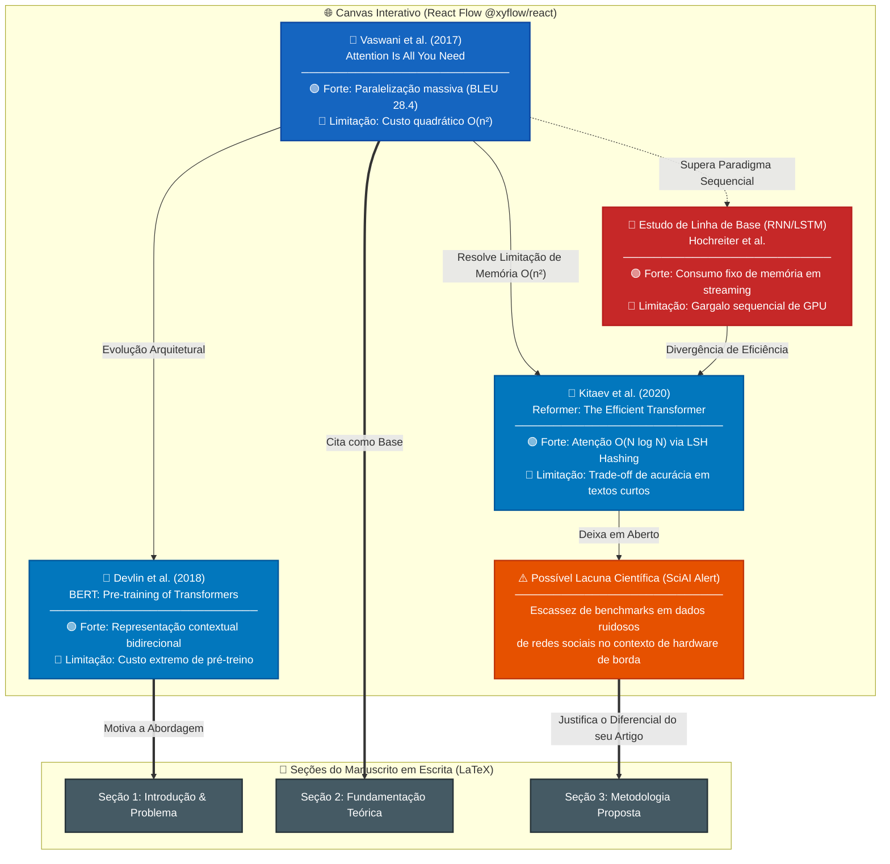

# 📐 Especificação Técnica: SCIA Literature Intelligence (`literature-intelligence-spec.md`)

> **Documento de Referência:** [`ADR-016: Arquitetura de Literature Intelligence e React Flow`](../architecture/adrs/adr-016-scia-literature-intelligence-paper-analysis-and-react-flow.md)  
> **Status:** APROVADO / EM IMPLEMENTAÇÃO  
> **Data:** Novembro de 2026  
> **Componentes:** `ai-service` (FastAPI / LangGraph / DeepAgents), `backend` (Fastify / TypeScript), `frontend` (React 19 / Vite / `@xyflow/react`)

---

## 1. 📋 Visão Geral

O módulo **Literature Intelligence** transforma a pesquisa científica no SCIA em conhecimento acionável para o autor. A funcionalidade é composta por três capacidades principais:
1. **Scientific Paper Intelligence:** Compreensão individual estruturada de cada publicação com extração de metadados, problema, metodologia, evidências empíricas, **pontos fortes** e **limitações (declaradas e ameaças à validade)**.
2. **Research Relationship Intelligence:** Comparação de múltiplos artigos e visualização do mapa mental interativo com `@xyflow/react`.
3. **Research Alignment:** Diagnóstico de aderência e cobertura das seções do manuscrito LaTeX em desenvolvimento pelo autor.

---

## 2. 🔌 Contratos de API (FastAPI `ai-service`)

### 2.1. Análise Individual de Artigo (`POST /internal/v1/papers/analyze`)

- **Headers:** `Content-Type: application/json`
- **Request Body (`PaperAnalysisRequest`):**
```json
{
  "title": "Attention Is All You Need",
  "abstract": "The dominant sequence transduction models are based on complex recurrent or convolutional neural networks...",
  "authors": ["Ashish Vaswani", "Noam Shazeer"],
  "year": 2017,
  "venue": "NeurIPS 2017",
  "doi": "10.48550/arXiv.1706.03762",
  "arxiv_url": "https://arxiv.org/abs/1706.03762",
  "pdf_url": "https://arxiv.org/pdf/1706.03762",
  "author_topic": "Modelos Fundacionais e Transformers em Processamento de Linguagem Natural"
}
```

- **Response Body (`ScientificPaperAnalysis`):**
```json
{
  "metadata": {
    "title": "Attention Is All You Need",
    "authors": ["Ashish Vaswani", "Noam Shazeer"],
    "year": 2017,
    "venue": "NeurIPS 2017",
    "doi": "10.48550/arXiv.1706.03762",
    "arxiv_url": "https://arxiv.org/abs/1706.03762",
    "pdf_url": "https://arxiv.org/pdf/1706.03762"
  },
  "executive_summary": "Propõe a arquitetura Transformer baseada unicamente em auto-atenção...",
  "problem_and_objectives": {
    "research_question": "É possível realizar transdução de sequências com alta eficiência sem recorrência?",
    "theoretical_gap": "Gargalo sequencial das RNNs que inviabiliza paralelização massiva.",
    "objectives": [
      "Eliminar convoluções e recorrência da arquitetura",
      "Reduzir drasticamente o tempo computacional de treino"
    ]
  },
  "methodology": {
    "study_type": "Pesquisa Experimental Quantitativa",
    "dataset_sample": "WMT 2014 English-German e WMT 2014 English-French",
    "instruments_methods": "Mecanismo Multi-Head Attention com codificação posicional",
    "analysis_techniques": "Avaliação BLEU e cálculo de FLOPS"
  },
  "findings": {
    "main_results": [
      "Superou modelos baseados em LSTM em qualidade de tradução",
      "Treinamento completado em 3.5 dias em 8 GPUs"
    ],
    "empirical_metrics": "28.4 BLEU (En-De) e 41.8 BLEU (En-Fr)",
    "hypotheses_corroborated": true
  },
  "critique": {
    "strengths": [
      "Inovação conceitual radical ao estabelecer novo paradigma de atenção",
      "Paralelização massiva do processo de treino",
      "Reprodutibilidade empírica validada em benchmarks oficiais"
    ],
    "declared_limitations": [
      "Complexidade de memória quadrática O(n^2) com sequências longas"
    ],
    "internal_validity_threats": [
      "Sensibilidade a hiperparâmetros de aquecimento e taxas de aprendizado"
    ],
    "external_validity_threats": [
      "Validação restrita inicialmente a tradução automática textual"
    ]
  },
  "contributions": {
    "theoretical_advance": "Prova de que a atenção é suficiente para modelagem de sequências",
    "practical_implications": "Base fundacional de todos os LLMs modernos",
    "future_work": [
      "Aplicação a domínios multimodais (visão, áudio e vídeo)",
      "Mecanismos de atenção local para sequências ultra-longas"
    ]
  },
  "alignment": {
    "relation_type": "theoretical_foundation",
    "suggested_sections": [
      "Introdução",
      "Fundamentação Teórica",
      "Trabalhos Relacionados"
    ],
    "synthesis_note": "Leitura obrigatória para fundamentar a escolha de mecanismos de atenção."
  }
}
```

### 2.2. Análise em Lote (`POST /internal/v1/papers/analyze-batch`)
- Recebe uma lista de `PaperAnalysisRequest` e retorna `List[ScientificPaperAnalysis]`.

---

## 3. 🌐 Visualização do Mapa Mental com React Flow (`@xyflow/react`)

### 3.1. Diagrama Conceitual do Canvas
Abaixo está a representação de como o grafo interativo renderiza os artigos analisados pela IA, destacando **pontos fortes**, **limitações**, **arestas semânticas** e o **vínculo com o manuscrito em escrita do autor**:



### 3.2. Tipos de Nós Customizados (`NodeTypes`)
* `paperNode` (`PaperNode.tsx`): Card de artigo com título, autores, ano, chips bicolores (🟢 Pontos Fortes e 🔴 Limitações) e botão para abrir a Ficha Científica.
* `themeNode` (`ThemeNode.tsx`): Agrupamento temático ou tópico guarda-chuva de artigos correlatos.
* `gapNode` (`GapNode.tsx`): Alerta visual destacado em laranja com possíveis lacunas detectadas pela IA na literatura.
* `sectionTarget` (`SectionAnchorNode.tsx`): Representa as seções do arquivo `.tex` do autor com status de cobertura bibliográfica.

### 3.3. Tipos de Conexões Semânticas (`EdgeTypes`)
* `convergent`: Linha contínua azul com label "Convergência".
* `divergent`: Linha tracejada âmbar com label "Divergência".
* `complementary`: Linha pontilhada verde com label "Complementar".
* `baseline`: Linha sólida com seta indicando extensão metodológica.

### 3.4. Algoritmo de Auto-Layout e Controles
* O grafo utiliza layout hierárquico via biblioteca `dagre` para organizar os artigos cronológica e metodologicamente sem sobreposição de arestas.
* Controles nativos via `<MiniMap />` e `<Controls />` para zoom e pan fluidos.

---

## 4. 🚀 Ponto de Entrada: Modelo Híbrido Progressivo

Para garantir fluidez no uso sem impor sobrecarga cognitiva ou lentidão inicial, adota-se um **Modelo Híbrido em Duas Fases**:

```
┌────────────────────────────────────────────────────────────────────────┐
│                        FLUXO EM DUAS FASES                             │
├───────────────────────────────────┬────────────────────────────────────┤
│ 1. Na Criação (Onboarding Leve)   │ 2. No Workspace (Mapa Completo)    │
│ - Busca de papers pelo agente     │ - Aba dedicada "Literature Intel"  │
│ - Botão opcional: [Ver Mapa]      │ - Canvas full-screen (zoom e pan)  │
│ - Preview rápido de convergências │ - Conexão drag-and-drop com seções │
│ - O autor pode pular e criar logo │ - Citação 1-clique no LaTeX (.bib) │
└───────────────────────────────────┴────────────────────────────────────┘
```

1. **Fase 1: No Onboarding de Criação (Sneak Peek Opcional)**:
   - Quando o `search_specialist_agent` apresenta os artigos selecionados, a UI exibe o botão opcional: **"Visualizar Relações da Literatura"**.
   - O autor pode abrir um preview leve do grafo conceitual preliminar para validar se a literatura atende à sua ideia, ou simplesmente avançar direto para a criação do projeto.

2. **Fase 2: No Workspace (Centro de Inteligência Permanente)**:
   - Disponível a qualquer momento como uma aba ou ferramenta visual nativa do projeto (`Literature Intelligence`).
   - O mapa torna-se um artefato vivo: conforme novos PDFs e referências BibTeX são adicionados ao longo das semanas de pesquisa, o autor pode regenerar o grafo, inspecionar novas lacunas sugeridas pela IA e arrastar conexões visuais diretamente para as seções correspondentes do editor LaTeX.
